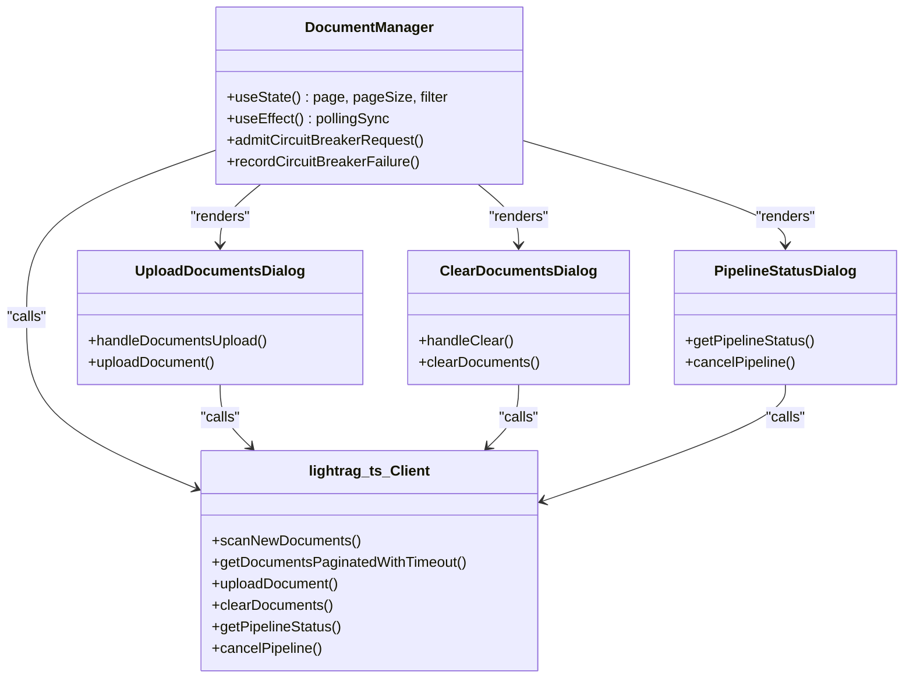

<!-- source: DeepWiki mcp.deepwiki.com · repo HKUDS/LightRAG · page 7.1 Document Manager UI · fetched 2026-11-09 -->

# Document Manager UI

<details>
<summary>Relevant source files</summary>

The following files were used as context for generating this wiki page:

- [lightrag_webui/src/App.tsx](lightrag_webui/src/App.tsx)
- [lightrag_webui/src/AppRouter.tsx](lightrag_webui/src/AppRouter.tsx)
- [lightrag_webui/src/WorkspaceAppRouter.tsx](lightrag_webui/src/WorkspaceAppRouter.tsx)
- [lightrag_webui/src/api/lightrag.test.ts](lightrag_webui/src/api/lightrag.test.ts)
- [lightrag_webui/src/api/lightrag.ts](lightrag_webui/src/api/lightrag.ts)
- [lightrag_webui/src/components/documents/ClearDocumentsDialog.tsx](lightrag_webui/src/components/documents/ClearDocumentsDialog.tsx)
- [lightrag_webui/src/components/documents/PipelineStatusDialog.tsx](lightrag_webui/src/components/documents/PipelineStatusDialog.tsx)
- [lightrag_webui/src/components/documents/UploadDocumentsDialog.tsx](lightrag_webui/src/components/documents/UploadDocumentsDialog.tsx)
- [lightrag_webui/src/components/ui/Dialog.tsx](lightrag_webui/src/components/ui/Dialog.tsx)
- [lightrag_webui/src/components/ui/FileUploader.tsx](lightrag_webui/src/components/ui/FileUploader.tsx)
- [lightrag_webui/src/features/DocumentManager.tsx](lightrag_webui/src/features/DocumentManager.tsx)
- [lightrag_webui/src/features/LoginPage.tsx](lightrag_webui/src/features/LoginPage.tsx)
- [lightrag_webui/src/features/SiteHeader.tsx](lightrag_webui/src/features/SiteHeader.tsx)
- [lightrag_webui/src/features/documentRefreshCircuitBreaker.test.ts](lightrag_webui/src/features/documentRefreshCircuitBreaker.test.ts)
- [lightrag_webui/src/features/documentRefreshCircuitBreaker.ts](lightrag_webui/src/features/documentRefreshCircuitBreaker.ts)
- [lightrag_webui/src/features/documentRefreshErrors.test.ts](lightrag_webui/src/features/documentRefreshErrors.test.ts)
- [lightrag_webui/src/features/documentRefreshErrors.ts](lightrag_webui/src/features/documentRefreshErrors.ts)
- [lightrag_webui/src/features/documentRefreshQueue.test.ts](lightrag_webui/src/features/documentRefreshQueue.test.ts)
- [lightrag_webui/src/features/documentRefreshQueue.ts](lightrag_webui/src/features/documentRefreshQueue.ts)
- [lightrag_webui/src/services/navigation.ts](lightrag_webui/src/services/navigation.ts)
- [lightrag_webui/src/stores/state.ts](lightrag_webui/src/stores/state.ts)
- [tests/test_aclear_cache_contract.py](tests/test_aclear_cache_contract.py)

</details>


The Document Manager UI is a foundational feature of the LightRAG Web UI (`lightrag_webui`). It provides a comprehensive interface for managing document intake, lifecycle, and metadata inspection within the LightRAG system. This UI supports essential operations such as uploading new documents, scanning for new or retriable documents on the backend, displaying document statuses with paginated views, and managing document deletions or cache clears.

This page covers the technical implementation details of the `DocumentManager` React component, the underlying `lightrag.ts` API client interaction, throttled sync/update polling, circuit breaker logic to handle unstable requests, and key dialogs (`UploadDocumentsDialog`, `ClearDocumentsDialog`, and `PipelineStatusDialog`) that enable user control over document ingestion and pipeline monitoring.

---

## 1. DocumentManager Component Architecture

The main UI entry point is the `DocumentManager` React component located at `lightrag_webui/src/features/DocumentManager.tsx` [1-182](). This component encapsulates state management for pagination, status filtering, sorting, and row selection, while integrating directly with backend state via `useBackendState` [42-42]().

### Key Responsibilities

- **Document List Management:** Renders paginated document lists using `Table` components from `lightrag_webui/src/components/ui/Table.tsx` [7-13](), supporting sort columns and status badges.
- **Polling & Activity Sync:** Tracks pipeline busy flags from `useBackendState` and triggers periodic document list updates.
- **Circuit Breaker Integration:** Implements error classification and circuit breaker states (`admitCircuitBreakerRequest`, `recordCircuitBreakerFailure`) to safeguard against backend timeouts [54-61]().

Sources: [lightrag_webui/src/features/DocumentManager.tsx:1-182](), [lightrag_webui/src/stores/state.ts:1-156]()

---

## 2. API Client Integration (`lightrag.ts`)

The Document Manager relies heavily on the centralized API client defined in `lightrag_webui/src/api/lightrag.ts` [1-212](). This module wraps Axios calls and provides strong TypeScript types for backend status, queues, and responses.

### Principal API Functions

- `scanNewDocuments()`: Triggers backend discovery of unindexed files in the input directory [lightrag_webui/src/api/lightrag.ts:32-33]().
- `getDocumentsPaginatedWithTimeout()`: Fetches document status pages with built-in timeout handling [lightrag_webui/src/api/lightrag.ts:33-34]().
- `uploadDocument()`: Handles multipart file uploads with progress reporting callbacks [lightrag_webui/src/components/documents/UploadDocumentsDialog.tsx:139-145]().
- `clearDocuments()`: Executes storage-clearing operations (`clearCacheOption`) under destructive server reservation locks [lightrag_webui/src/components/documents/ClearDocumentsDialog.tsx:96-96]().
- `getPipelineStatus()` and `cancelPipeline()`: Monitor and abort active pipeline jobs [lightrag_webui/src/components/documents/PipelineStatusDialog.tsx:14-14]().

Sources: [lightrag_webui/src/api/lightrag.ts:1-212](), [lightrag_webui/src/components/documents/UploadDocumentsDialog.tsx:1-175]()

---

## 3. Polling, Throttle Sync, and Circuit Breaker Logic

To prevent browser lockups and server flooding during heavy ingestion jobs, the Document Manager UI coordinates polling with a circuit breaker module (`lightrag_webui/src/features/documentRefreshCircuitBreaker.ts`).

### Polling Cadence and Queue Management

- Document list refreshes adapt to backend activity states exposed by `useBackendState` [lightrag_webui/src/stores/state.ts:24-25]().
- Pipeline status dialogs poll the `/status/pipeline` endpoint on a fixed 2-second interval guarded by an `inFlight` check to prevent request stacking [lightrag_webui/src/components/documents/PipelineStatusDialog.tsx:73-102]().

### Circuit Breaker States

- `admitCircuitBreakerRequest()` evaluates whether a refresh attempt is permitted based on recent failure history [lightrag_webui/src/features/DocumentManager.tsx:54-56]().
- `recordCircuitBreakerFailure()` transitions the breaker to a cooldown state upon classification via `classifyDocumentRefreshError()` [lightrag_webui/src/features/DocumentManager.tsx:57-62]().

Sources: [lightrag_webui/src/features/DocumentManager.tsx:54-62](), [lightrag_webui/src/components/documents/PipelineStatusDialog.tsx:73-102]()

---

## 4. Dialog Components

### 4.1 UploadDocumentsDialog (`UploadDocumentsDialog.tsx`)

- Located at `lightrag_webui/src/components/documents/UploadDocumentsDialog.tsx` [1-175]().
- Fetches backend parser capabilities and allowlists via `getSupportedFileTypes()` [lightrag_webui/src/components/documents/UploadDocumentsDialog.tsx:55-56]().
- Sorts selected files using locale-aware comparison (`Intl.Collator`) before sequential upload execution [lightrag_webui/src/components/documents/UploadDocumentsDialog.tsx:122-131]().

### 4.2 ClearDocumentsDialog (`ClearDocumentsDialog.tsx`)

- Located at `lightrag_webui/src/components/documents/ClearDocumentsDialog.tsx` [1-190]().
- Requires explicit user confirmation matching `"yes"` to enable the destruction action [lightrag_webui/src/components/documents/ClearDocumentsDialog.tsx:48-48]().
- Implements a 30-second watchdog timer (`CLEAR_TIMEOUT`) to catch hanging server clear requests [lightrag_webui/src/components/documents/ClearDocumentsDialog.tsx:50-51]().

### 4.3 PipelineStatusDialog (`PipelineStatusDialog.tsx`)

- Located at `lightrag_webui/src/components/documents/PipelineStatusDialog.tsx` [1-190]().
- Displays batch processing metrics, job names, and streaming history messages.
- Provides user-triggered cancellation via `cancelPipeline()` [lightrag_webui/src/components/documents/PipelineStatusDialog.tsx:105-117]().

Sources: [lightrag_webui/src/components/documents/UploadDocumentsDialog.tsx:1-175](), [lightrag_webui/src/components/documents/ClearDocumentsDialog.tsx:1-190](), [lightrag_webui/src/components/documents/PipelineStatusDialog.tsx:1-190]()

---

## 5. Document Lifecycle and Status Management

The UI translates backend `DocStatus` enums into logical frontend buckets via helper functions:

| Frontend Bucket | Backend Document Statuses Mapped |
|-----------------|---------------------------------|
| `completed`     | `COMPLETED`                     |
| `parse`         | `PARSING`                       |
| `analyze`       | `ANALYZING`                     |
| `process`       | `PROCESSING`                    |
| `failed`        | `FAILED`                       |

Metadata timestamps (e.g., `parse_start_time`, `analyzing_end_time`) are parsed from Unix epoch numbers into localized date strings [lightrag_webui/src/features/DocumentManager.tsx:115-144]().

Sources: [lightrag_webui/src/features/DocumentManager.tsx:34-39](), [lightrag_webui/src/features/DocumentManager.tsx:115-144]()

---

## 6. System Architecture Diagrams

### Diagram 1: Natural Language Space to Code Entity Space (Document Operations)

```mermaid
graph TD
  UserUpload[""User Upload Action""] --> UploadComp[""lightrag_webui/src/components/documents/UploadDocumentsDialog.tsx""]
  UploadComp --> UploadApi[""uploadDocument() in lightrag_webui/src/api/lightrag.ts""]
  UploadApi --> FastAPIUpload[""POST /documents/upload route in document_routes.py""]

  UserScan[""User Scan Action""] --> DocMgr[""lightrag_webui/src/features/DocumentManager.tsx""]
  DocMgr --> ScanApi[""scanNewDocuments() in lightrag_webui/src/api/lightrag.ts""]
  ScanApi --> FastAPIScan[""POST /documents/scan route in document_rules.py""]

  UserClear[""User Clear Action""] --> ClearComp[""lightrag_webui/src/components/documents/ClearDocumentsDialog.tsx""]
  ClearComp --> ClearApi[""clearDocuments() in lightrag_webui/src/api/lightrag.ts""]
  ClearApi --> FastAPIClear[""POST /documents/clear route in document_routes.py""]
```
Sources: [lightrag_webui/src/features/DocumentManager.tsx:32-33](), [lightrag_webui/src/api/lightrag.ts:1-212](), [lightrag_webui/src/components/documents/UploadDocumentsDialog.tsx:23-23](), [lightrag_webui/src/components/documents/ClearDocumentsDialog.tsx:16-16]()

### Diagram 2: Frontend Component State and Circuit Breaker Class Mapping


Sources: [lightrag_webui/src/features/DocumentManager.tsx:1-182](), [lightrag_webui/src/api/lightrag.ts:1-212](), [lightrag_webui/src/components/documents/UploadDocumentsDialog.tsx:1-175](), [lightrag_webui/src/components/documents/ClearDocumentsDialog.tsx:1-190](), [lightrag_webui/src/components/documents/PipelineStatusDialog.tsx:1-190]()

---

