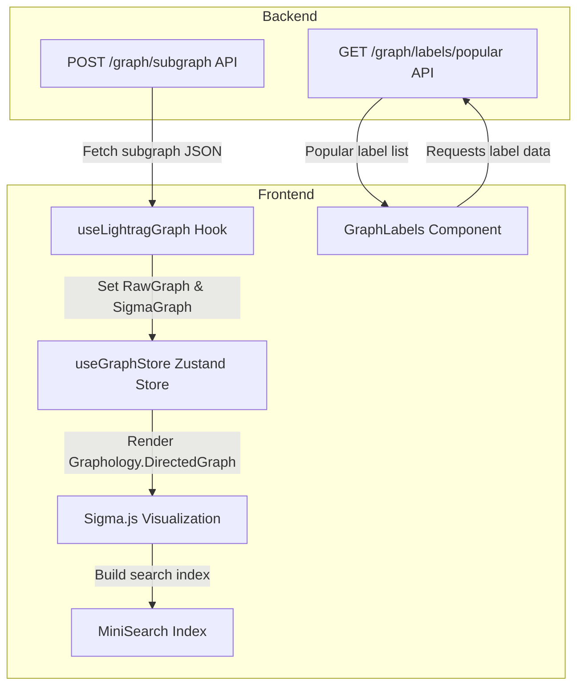
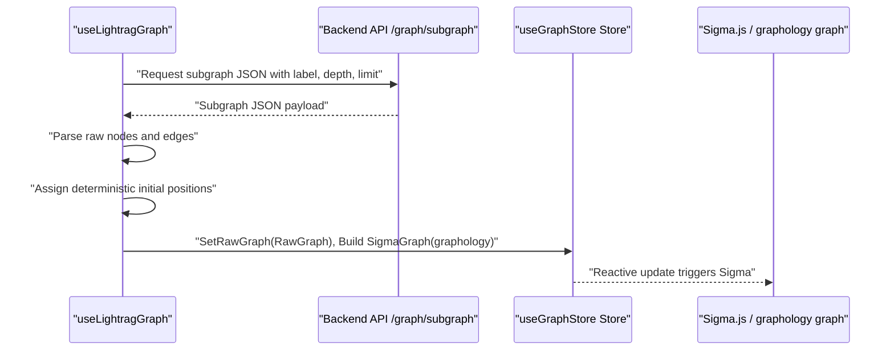
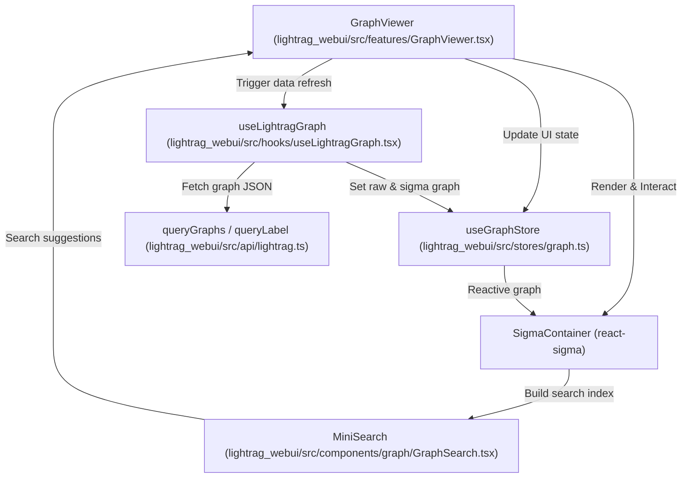
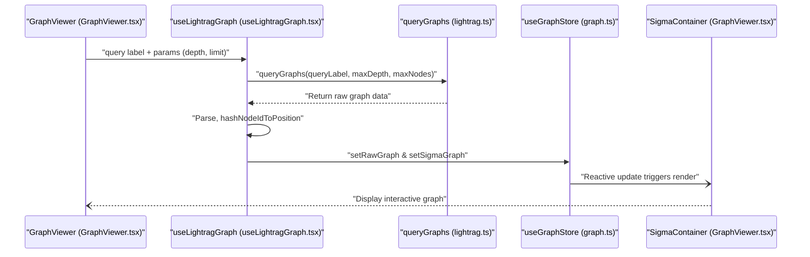

<!-- source: DeepWiki mcp.deepwiki.com · repo HKUDS/LightRAG · page 7.2 Knowledge Graph Viewer · fetched 2026-11-09 -->

# Knowledge Graph Viewer

<details>
<summary>Relevant source files</summary>

The following files were used as context for generating this wiki page:

- [lightrag_webui/src/components/ApiKeyAlert.tsx](lightrag_webui/src/components/ApiKeyAlert.tsx)
- [lightrag_webui/src/components/graph/EditablePropertyRow.tsx](lightrag_webui/src/components/graph/EditablePropertyRow.tsx)
- [lightrag_webui/src/components/graph/FocusOnNode.tsx](lightrag_webui/src/components/graph/FocusOnNode.tsx)
- [lightrag_webui/src/components/graph/GraphControl.tsx](lightrag_webui/src/components/graph/GraphControl.tsx)
- [lightrag_webui/src/components/graph/GraphLabels.tsx](lightrag_webui/src/components/graph/GraphLabels.tsx)
- [lightrag_webui/src/components/graph/GraphSearch.tsx](lightrag_webui/src/components/graph/GraphSearch.tsx)
- [lightrag_webui/src/components/graph/LayoutsControl.tsx](lightrag_webui/src/components/graph/LayoutsControl.tsx)
- [lightrag_webui/src/components/graph/PropertiesView.tsx](lightrag_webui/src/components/graph/PropertiesView.tsx)
- [lightrag_webui/src/components/graph/PropertyEditDialog.tsx](lightrag_webui/src/components/graph/PropertyEditDialog.tsx)
- [lightrag_webui/src/components/graph/PropertyRowComponents.tsx](lightrag_webui/src/components/graph/PropertyRowComponents.tsx)
- [lightrag_webui/src/components/graph/ZoomControl.tsx](lightrag_webui/src/components/graph/ZoomControl.tsx)
- [lightrag_webui/src/components/status/StatusCard.tsx](lightrag_webui/src/components/status/StatusCard.tsx)
- [lightrag_webui/src/components/status/StatusDialog.tsx](lightrag_webui/src/components/status/StatusDialog.tsx)
- [lightrag_webui/src/components/status/StatusIndicator.tsx](lightrag_webui/src/components/status/StatusIndicator.tsx)
- [lightrag_webui/src/components/ui/AlertDialog.tsx](lightrag_webui/src/components/ui/AlertDialog.tsx)
- [lightrag_webui/src/components/ui/AsyncSearch.tsx](lightrag_webui/src/components/ui/AsyncSearch.tsx)
- [lightrag_webui/src/components/ui/AsyncSelect.tsx](lightrag_webui/src/components/ui/AsyncSelect.tsx)
- [lightrag_webui/src/components/ui/NumberInput.tsx](lightrag_webui/src/components/ui/NumberInput.tsx)
- [lightrag_webui/src/features/GraphViewer.tsx](lightrag_webui/src/features/GraphViewer.tsx)
- [lightrag_webui/src/hooks/useLightragGraph.tsx](lightrag_webui/src/hooks/useLightragGraph.tsx)
- [lightrag_webui/src/hooks/useRandomGraph.tsx](lightrag_webui/src/hooks/useRandomGraph.tsx)
- [lightrag_webui/src/lib/constants.ts](lightrag_webui/src/lib/constants.ts)
- [lightrag_webui/src/stores/graph.ts](lightrag_webui/src/stores/graph.ts)

</details>


The **Knowledge Graph Viewer** is a core React-based component in the LightRAG WebUI designed to provide interactive exploration, visualization, search, and inline editing of the knowledge graph data. It integrates tightly with the LightRAG backend for data fetching while managing local state and rendering fully in the browser using GPU-accelerated WebGL and advanced graph data structures.

At its heart, the Knowledge Graph Viewer combines several subsystems:
- A **Zustand**-based global state store for graph data and UI state (`useGraphStore`) [lightrag_webui/src/stores/graph.ts:93-187]().
- The `useLightragGraph` hook managing fetching, transformation, and application of graph data [lightrag_webui/src/hooks/useLightragGraph.tsx:2-118]().
- Rendering through **Sigma.js** and **Graphology** for graph manipulations, using custom node and edge programs [lightrag_webui/src/features/GraphViewer.tsx:3-97]().
- A **MiniSearch** full-text index for efficient node search [lightrag_webui/src/components/graph/GraphSearch.tsx:94-116]().
- Interactive UI controls for graph layout, zoom, search, and node/edge property editing [lightrag_webui/src/features/GraphViewer.tsx:16-29]().
- Status cards presenting backend and model configuration statuses [lightrag_webui/src/components/status/StatusCard.tsx:148-182]().

This page details the internal architecture, data flow, components, state management, rendering strategies, and user interactions that form the Knowledge Graph Viewer.

---

## 7.2.1 System Architecture and Data Flow

The Knowledge Graph Viewer adopts an architecture where the backend serves raw graph data based on user queries (subgraph streaming by label and depth). This data is fetched and incrementally parsed inside the `useLightragGraph` hook [lightrag_webui/src/hooks/useLightragGraph.tsx:150-165](). It is transformed into a `RawGraph` plain structure for property access and also converted into a `graphology.DirectedGraph` for Sigma.js rendering [lightrag_webui/src/stores/graph.ts:55-101](). 

State is centralized in the `useGraphStore` Zustand store, which retains both raw and rendering graphs, selected/focused elements, search index, layout supervisors, and UI flags [lightrag_webui/src/stores/graph.ts:93-187]().

Search is powered by a local `MiniSearch` instance built from graph node labels on load or graph change [lightrag_webui/src/components/graph/GraphSearch.tsx:80-120]().

Sigma.js consumes the `graphology` graph to display an interactive canvas with performant rendering programs and manages camera controls such as zoom and rotation [lightrag_webui/src/features/GraphViewer.tsx:3-97]().

Several components cooperate in this system:



This flow depicts that the frontend only requests the subgraph JSON data from the backend for the current label/depth, then builds and updates its internal graph state accordingly.

Sources:  
[lightrag_webui/src/hooks/useLightragGraph.tsx:150-165]()  
[lightrag_webui/src/stores/graph.ts:55-91]()  
[lightrag_webui/src/components/graph/GraphLabels.tsx:18-173]()  
[lightrag_webui/src/components/graph/GraphSearch.tsx:87-120]()

---

## 7.2.2 Core Components

### 7.2.2.1 GraphViewer Component

The `GraphViewer` React component initializes and orchestrates the Sigma.js graph visualization and UI panels [lightrag_webui/src/features/GraphViewer.tsx:145-162](). Key features include:

- Instantiates `SigmaContainer` with graph rendering settings, tailored for dark/light theme colors and enabling/disabling edge picking events based on performance constraints [lightrag_webui/src/features/GraphViewer.tsx:38-97]().
- Uses customized WebGL render programs such as `NodeBorderProgram` (for node borders) and `EdgeCurvedArrowProgram` (for curved edges with arrows) [lightrag_webui/src/features/GraphViewer.tsx:10-14]().
- Manages interactive graph events: node dragging, mouse down/up for dragging state, and suppressing camera control during drag [lightrag_webui/src/features/GraphViewer.tsx:100-140]().
- Includes controls for layout selection, zoom, full screen toggle, legend display, and a property panel [lightrag_webui/src/features/GraphViewer.tsx:16-29]().
- Dynamically toggles rendering options such as label display and edge events based on graph size thresholds (e.g., disables edge events above 5000 edges to preserve performance) [lightrag_webui/src/features/GraphViewer.tsx:60-84]().

The component listens to graph store state changes (`selectedNode`, `focusedNode`, etc.) and passes settings from `useSettingsStore` [lightrag_webui/src/features/GraphViewer.tsx:145-160](). It also coordinates the initial layout run using ForceAtlas2 running in a web worker for responsiveness [lightrag_webui/src/components/graph/GraphControl.tsx:103-114]().

**Snippet excerpt:**

```tsx
const GraphViewer = () => {
  const sigmaRef = useRef<any>(null)
  const selectedNode = useGraphStore.use.selectedNode()
  const isFetching = useGraphStore.use.isFetching()
  const theme = useSettingsStore.use.theme()
  const enableEdgeEvents = useSettingsStore.use.enableEdgeEvents()
  const graphEdgeCount = useGraphStore.use.graphEdgeCount()

  const sigmaSettings = createSigmaSettings(
    theme === 'dark',
    enableEdgeEvents && graphEdgeCount <= Constants.EDGE_PERF_LIMIT
  )

  // Render SigmaContainer and UI controls (LayoutsControl, ZoomControl, PropertiesView, etc.)
}
```

Sources:  
[lightrag_webui/src/features/GraphViewer.tsx:38-97]()  
[lightrag_webui/src/features/GraphViewer.tsx:145-162]()

### 7.2.2.2 useLightragGraph Hook

The `useLightragGraph` is a critical hook that:

- Accepts graph query parameters, triggers backend calls to fetch subgraph JSON data [lightrag_webui/src/hooks/useLightragGraph.tsx:150-165]().
- Parses raw nodes and edges, applying defensive measures (e.g. safe label construction) [lightrag_webui/src/hooks/useLightragGraph.tsx:128-132]().
- Uses a deterministic positioning function (`hashNodeIdToPosition`) for consistent node coordinate assignment, avoiding randomness [lightrag_webui/src/hooks/useLightragGraph.tsx:46-57]().
- Performs cooperative fiber-style yielding (`yieldToBrowser()`) during intensive graph build loops to keep the UI responsive [lightrag_webui/src/hooks/useLightragGraph.tsx:65-76]().
- Creates a `RawGraph` instance to maintain raw node/edge data with indexing, alongside a `graphology.DirectedGraph` for Sigma [lightrag_webui/src/stores/graph.ts:55-101]().
- Updates the Zustand store graph state and triggers reactive UI updates [lightrag_webui/src/stores/graph.ts:137-142]().
- Manages retries for backend fetches with exponential backoff for transient errors [lightrag_webui/src/hooks/useLightragGraph.tsx:18-24]().

**Illustration of fetch and build flow:**



Sources:  
[lightrag_webui/src/hooks/useLightragGraph.tsx:45-133]()  
[lightrag_webui/src/hooks/useLightragGraph.tsx:150-165]()  
[lightrag_webui/src/stores/graph.ts:55-91]()

### 7.2.2.3 Graph Zustand Store (`useGraphStore`)

This Zustand store manages the global graph state, including:

- Raw graph (`RawGraph`), Sigma.js graph (`graphology.DirectedGraph`), and instance [lightrag_webui/src/stores/graph.ts:99-101]().
- Selection and focus of nodes and edges [lightrag_webui/src/stores/graph.ts:94-97]().
- Search engine instance (MiniSearch) rebuilt when graph changes [lightrag_webui/src/stores/graph.ts:112]().
- Layout state: tracking active layout supervisors to ensure a single mutator for node positions [lightrag_webui/src/stores/graph.ts:156-162]().
- UI flags: fetching loading state, graph emptiness, selected node movement flags [lightrag_webui/src/stores/graph.ts:114-116]().
- Color mappings from entity type to RGBA hex color strings (`typeColorMap`) [lightrag_webui/src/stores/graph.ts:119]().
- Incremental versioning on data changes to trigger re-renders [lightrag_webui/src/stores/graph.ts:184-185]().

The store exposes getters/setters for all these properties and convenience functions like resetting the graph or updating nodes [lightrag_webui/src/stores/graph.ts:125-187]().

**Key store state excerpt:**

```ts
interface GraphState {
  selectedNode: string | null;
  focusedNode: string | null;
  rawGraph: RawGraph | null;
  sigmaGraph: DirectedGraph | null;
  isFetching: boolean;
  graphNodeCount: number;
  graphEdgeCount: number;
  typeColorMap: Map<string, string>;
  searchEngine: MiniSearch | null;
  incrementGraphDataVersion: () => void;
  // ... more ...
}
```

Sources:  
[lightrag_webui/src/stores/graph.ts:19-187]()

---

## 7.2.3 Interactive Features

### 7.2.3.1 Graph Search (MiniSearch Index)

The viewer enables fast approximate full-text search on graph nodes:

- Constructs a `MiniSearch` instance configured to index node labels with prefix and fuzzy matching [lightrag_webui/src/components/graph/GraphSearch.tsx:94-104]().
- Builds the index on graph load or change [lightrag_webui/src/components/graph/GraphSearch.tsx:80-120]().
- The `GraphSearch` component triggers the index search on user input, providing relevant node suggestions [lightrag_webui/src/components/graph/GraphSearch.tsx:125-156]().
- Augments results with "middle-content" matching (substring search inside labels) if initial prefix-fuzzy search gives few results [lightrag_webui/src/components/graph/GraphSearch.tsx:160-188]().
- Displays a custom UI result list with color-coded nodes [lightrag_webui/src/components/graph/GraphSearch.tsx:37-50]().

Sources:  
[lightrag_webui/src/components/graph/GraphSearch.tsx:87-120]()

### 7.2.3.2 PropertiesView with Inline Editing

The `PropertiesView` panel displays properties of the currently selected or focused node/edge [lightrag_webui/src/components/graph/PropertiesView.tsx:14-64]().

- Uses `refineNodeProperties` and `refineEdgeProperties` to augment basic data with neighbor relationship summaries and connectivity details extracted from the Sigma graph [lightrag_webui/src/components/graph/PropertiesView.tsx:79-158]().
- Renders properties in rows, turning key fields like `entity_id`, `description`, and `keywords` editable inline via the `EditablePropertyRow` component [lightrag_webui/src/components/graph/PropertiesView.tsx:217-222]().
- Inline edits validate uniqueness (for `entity_id`) and can trigger server-side updates [lightrag_webui/src/components/graph/EditablePropertyRow.tsx:140-152]().
- Supports merging entities via the `updateEntity` API when renaming collisions occur, prompting a `MergeDialog` [lightrag_webui/src/components/graph/EditablePropertyRow.tsx:152-166]().
- The UI locks editing while backend pipeline updates are in-progress [lightrag_webui/src/components/graph/EditablePropertyRow.tsx:82]().

Sources:  
[lightrag_webui/src/components/graph/PropertiesView.tsx:14-64]()  
[lightrag_webui/src/components/graph/EditablePropertyRow.tsx:43-184]()

### 7.2.3.3 Graph Controls & Layouts

Various controls enhance user interaction:

- **GraphControl** component binds the Sigma.js graph instance, allows toggling rendering options (labels, edge events) [lightrag_webui/src/components/graph/GraphControl.tsx:23-57]().
- Performs initial layout using ForceAtlas2 (FA2) running in a web worker for scalability to large graphs [lightrag_webui/src/components/graph/GraphControl.tsx:103-110]().
- Filters edge rendering and edge events based on edge count threshold (`EDGE_PERF_LIMIT = 5000`) [lightrag_webui/src/components/graph/GraphControl.tsx:47]() [lightrag_webui/src/lib/constants.ts:127]().
- **LayoutsControl** component allows users to choose from multiple layout algorithms including Circular, Circlepack, Random, Noverlaps, Force Directed, and Force Atlas [lightrag_webui/src/components/graph/LayoutsControl.tsx:22-36]().
- Worker-based layouts run asynchronously with a timed budget scaled by graph size [lightrag_webui/src/components/graph/LayoutsControl.tsx:98-112]().
- **ZoomControl** supports camera zoom, rotation in fixed increments (PI/8), and centering on nodes or graph bounds.

Sources:  
[lightrag_webui/src/components/graph/GraphControl.tsx:23-143]()  
[lightrag_webui/src/components/graph/LayoutsControl.tsx:22-163]()  
[lightrag_webui/src/lib/constants.ts:113-131]()  
[lightrag_webui/src/features/GraphViewer.tsx:145-162]()

### 7.2.3.4 Status Cards

The viewer includes status cards displaying backend and model configuration/status info [lightrag_webui/src/components/status/StatusCard.tsx:148-182]().

- Shows LLM roles configuration and queue statuses [lightrag_webui/src/components/status/StatusCard.tsx:90-143]().
- Displays storage backend classes and workspaces [lightrag_webui/src/components/status/StatusCard.tsx:155-182]().
- Formats MinerU and Docling pipeline settings [lightrag_webui/src/components/status/StatusCard.tsx:59-87]().
- Provides compact UI rows and handles missing information gracefully [lightrag_webui/src/components/status/StatusCard.tsx:24-39]().

Sources:  
[lightrag_webui/src/components/status/StatusCard.tsx:10-195]()

---

## 7.2.4 Visual Styling and Theming

### Colors and Legend

- Colors per entity type are resolved by `createTypeColorResolver`, which caches mappings and updates the store atomically to keep the UI legend synchronized [lightrag_webui/src/hooks/useLightragGraph.tsx:89-118]().
- Uses utility functions to assign default colors if no specific color is found [lightrag_webui/src/hooks/useLightragGraph.tsx:106]().
- Supports dark/light themes by switching colors from constants such as `labelColorDarkTheme` and `edgeColorDarkTheme` [lightrag_webui/src/features/GraphViewer.tsx:86-94]().

### Performance Thresholds

| Feature                | Threshold     | Effect                                                               |
|------------------------|---------------|----------------------------------------------------------------------|
| Label Rendering        | 2000 nodes    | Labels are forcibly hidden above this to prevent large graph lag     |
| Edge Rendering Curves  | 5000 edges    | Curved edges disable and switch to straight edges for performance   |
| Edge Events Activation | 5000 edges    | Edge hover/click events disable above this, reducing GPU overhead   |

These thresholds balance performance and aesthetics on large graphs.

Sources:  
[lightrag_webui/src/hooks/useLightragGraph.tsx:89-115]()  
[lightrag_webui/src/features/GraphViewer.tsx:86-97]()  
[lightrag_webui/src/lib/constants.ts:112-131]()

---

# Summary

The **Knowledge Graph Viewer** in LightRAG WebUI tightly integrates backend data querying with advanced frontend graph rendering and state management. It leverages:

- `useLightragGraph` for data fetching and progressive graph build with cooperative yielding [lightrag_webui/src/hooks/useLightragGraph.tsx:2-118]()
- `useGraphStore` Zustand store for consistent and reactive state [lightrag_webui/src/stores/graph.ts:93-187]()
- Sigma.js and Graphology for GPU-accelerated, scalable graph visualization [lightrag_webui/src/features/GraphViewer.tsx:3-97]()
- MiniSearch for fast full-text graph node search [lightrag_webui/src/components/graph/GraphSearch.tsx:94-116]()
- Rich UI controls for graph exploration, layouts, zoom, and inline editing of knowledge graph properties [lightrag_webui/src/features/GraphViewer.tsx:16-29]()

These components together enable a fluid and responsive experience for exploring complex knowledge graphs, editing metadata inline, and performing targeted queries and analyses.

---

# Diagrams

### Mapping System Concepts to Code Entities



### Data Flow From Label Query to Graph Rendering



Sources:  
[lightrag_webui/src/features/GraphViewer.tsx]()  
[lightrag_webui/src/hooks/useLightragGraph.tsx]()  
[lightrag_webui/src/stores/graph.ts]()  
[lightrag_webui/src/components/graph/GraphSearch.tsx]()

---

