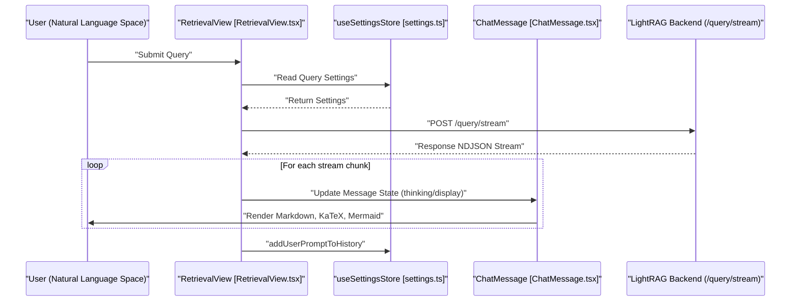
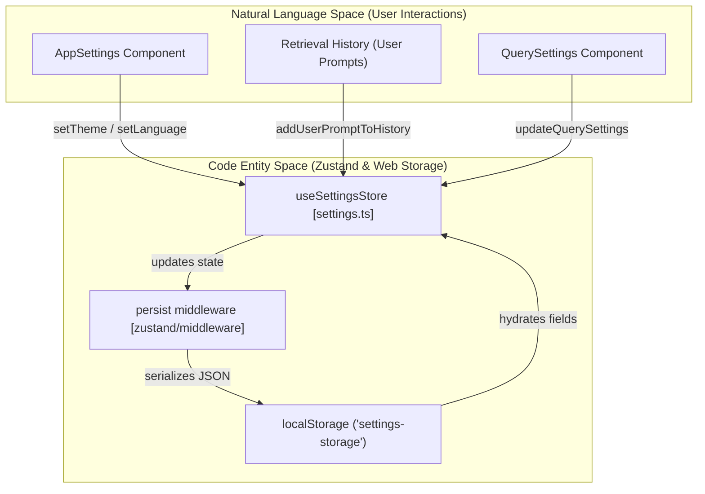
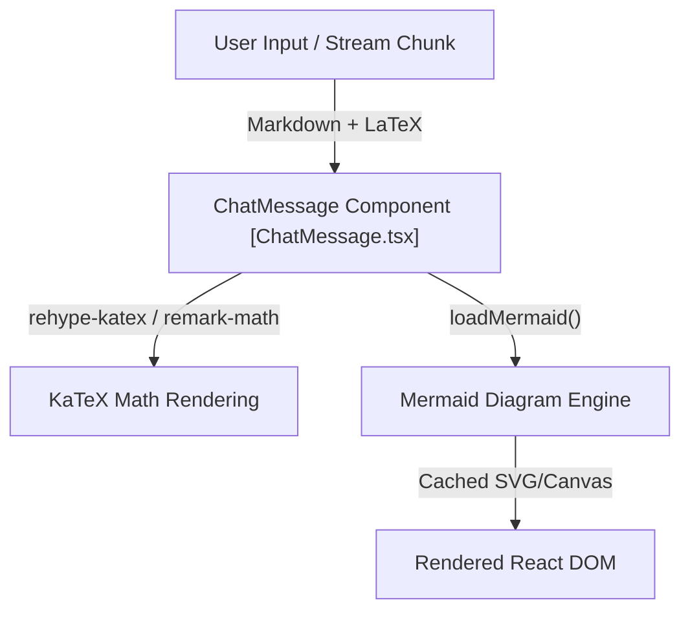

<!-- source: DeepWiki mcp.deepwiki.com · repo HKUDS/LightRAG · page 7.3 Retrieval Testing and Settings UI · fetched 2026-11-09 -->

# Retrieval Testing and Settings UI

Relevant source files

The following files were used as context for generating this wiki page:

- [.github/workflows/webui-tests.yml](.github/workflows/webui-tests.yml)
- [lightrag_webui/.env.development](lightrag_webui/.env.development)
- [lightrag_webui/bun.lock](lightrag_webui/bun.lock)
- [lightrag_webui/bunfig.toml](lightrag_webui/bunfig.toml)
- [lightrag_webui/env.development.smaple](lightrag_webui/env.development.smaple)
- [lightrag_webui/env.local.sample](lightrag_webui/env.local.sample)
- [lightrag_webui/eslint.config.js](lightrag_webui/eslint.config.js)
- [lightrag_webui/package.json](lightrag_webui/package.json)
- [lightrag_webui/src/api/lightrag-stream.test.ts](lightrag_webui/src/api/lightrag-stream.test.ts)
- [lightrag_webui/src/bootstrap/workspaceEntry.test.ts](lightrag_webui/src/bootstrap/workspaceEntry.test.ts)
- [lightrag_webui/src/components/AppSettings.tsx](lightrag_webui/src/components/AppSettings.tsx)
- [lightrag_webui/src/components/customization/brandTitle.test.ts](lightrag_webui/src/components/customization/brandTitle.test.ts)
- [lightrag_webui/src/components/customization/useCustomizedContent.ts](lightrag_webui/src/components/customization/useCustomizedContent.ts)
- [lightrag_webui/src/components/graph/Settings.tsx](lightrag_webui/src/components/graph/Settings.tsx)
- [lightrag_webui/src/components/retrieval/ChatMessage.tsx](lightrag_webui/src/components/retrieval/ChatMessage.tsx)
- [lightrag_webui/src/components/retrieval/QuerySettings.tsx](lightrag_webui/src/components/retrieval/QuerySettings.tsx)
- [lightrag_webui/src/components/ui/Table.tsx](lightrag_webui/src/components/ui/Table.tsx)
- [lightrag_webui/src/features/RetrievalView.tsx](lightrag_webui/src/features/RetrievalView.tsx)
- [lightrag_webui/src/features/retrieval/QueryComposer.tsx](lightrag_webui/src/features/retrieval/QueryComposer.tsx)
- [lightrag_webui/src/features/retrieval/serializeQueryRequest.ts](lightrag_webui/src/features/retrieval/serializeQueryRequest.ts)
- [lightrag_webui/src/features/retrieval/useQuerySession.ts](lightrag_webui/src/features/retrieval/useQuerySession.ts)
- [lightrag_webui/src/features/workspace/WorkspaceQueryView.tsx](lightrag_webui/src/features/workspace/WorkspaceQueryView.tsx)
- [lightrag_webui/src/features/workspace/querySettingsSnapshot.test.ts](lightrag_webui/src/features/workspace/querySettingsSnapshot.test.ts)
- [lightrag_webui/src/features/workspace/querySettingsSnapshot.ts](lightrag_webui/src/features/workspace/querySettingsSnapshot.ts)
- [lightrag_webui/src/i18n.ts](lightrag_webui/src/i18n.ts)
- [lightrag_webui/src/index.css](lightrag_webui/src/index.css)
- [lightrag_webui/src/lib/aiContentNotice.test.ts](lightrag_webui/src/lib/aiContentNotice.test.ts)
- [lightrag_webui/src/lib/aiContentNotice.ts](lightrag_webui/src/lib/aiContentNotice.ts)
- [lightrag_webui/src/lib/browserLanguage.test.ts](lightrag_webui/src/lib/browserLanguage.test.ts)
- [lightrag_webui/src/lib/browserLanguage.ts](lightrag_webui/src/lib/browserLanguage.ts)
- [lightrag_webui/src/lib/initialLanguage.test.ts](lightrag_webui/src/lib/initialLanguage.test.ts)
- [lightrag_webui/src/locales/ar.json](lightrag_webui/src/locales/ar.json)
- [lightrag_webui/src/locales/de.json](lightrag_webui/src/locales/de.json)
- [lightrag_webui/src/locales/en.json](lightrag_webui/src/locales/en.json)
- [lightrag_webui/src/locales/fr.json](lightrag_webui/src/locales/fr.json)
- [lightrag_webui/src/locales/ja.json](lightrag_webui/src/locales/ja.json)
- [lightrag_webui/src/locales/ko.json](lightrag_webui/src/locales/ko.json)
- [lightrag_webui/src/locales/ru.json](lightrag_webui/src/locales/ru.json)
- [lightrag_webui/src/locales/uk.json](lightrag_webui/src/locales/uk.json)
- [lightrag_webui/src/locales/vi.json](lightrag_webui/src/locales/vi.json)
- [lightrag_webui/src/locales/zh.json](lightrag_webui/src/locales/zh.json)
- [lightrag_webui/src/locales/zh_TW.json](lightrag_webui/src/locales/zh_TW.json)
- [lightrag_webui/src/main.tsx](lightrag_webui/src/main.tsx)
- [lightrag_webui/src/services/navigation.test.ts](lightrag_webui/src/services/navigation.test.ts)
- [lightrag_webui/src/stores/customization.test.ts](lightrag_webui/src/stores/customization.test.ts)
- [lightrag_webui/src/stores/customization.ts](lightrag_webui/src/stores/customization.ts)
- [lightrag_webui/src/stores/settings.ts](lightrag_webui/src/stores/settings.ts)
- [lightrag_webui/src/stores/storageSplit.test.ts](lightrag_webui/src/stores/storageSplit.test.ts)
- [lightrag_webui/src/stores/tokenValidation.test.ts](lightrag_webui/src/stores/tokenValidation.test.ts)
- [lightrag_webui/src/vite-env.d.ts](lightrag_webui/src/vite-env.d.ts)
- [lightrag_webui/tailwind.config.js](lightrag_webui/tailwind.config.js)
- [lightrag_webui/vite.config.ts](lightrag_webui/vite.config.ts)
- [tests/api/routes/test_query_stream_routes.py](tests/api/routes/test_query_stream_routes.py)

The **Retrieval Testing and Settings UI** constitutes a pivotal interface for interacting with the LightRAG core knowledge retrieval and generation (RAG) engine. It offers users facilities for performing retrieval queries with streaming responses, visualizing chat-like conversations rendered with markdown plus advanced math and diagram support, robust query and application settings management, and localization via i18n.

This interface is built with React + TypeScript using Zustand for state management with persistence, providing a responsive and customizable experience that integrates tightly with the backend and the core engine.

---

## 7.3.1 RetrievalView and Query Session Streaming

The central UI feature for retrieval testing is implemented by the `RetrievalView` component. It acts as a chat-style interface where the user can enter queries and see streamed responses from the LightRAG backend.

### Query Session and Streaming

- Query sessions maintain a message history of user queries and model responses [lightrag_webui/src/components/retrieval/ChatMessage.tsx:57-70]().
- Queries are sent to the backend's `/query/stream` endpoint using the client streaming utilities [lightrag_webui/src/components/retrieval/ChatMessage.tsx:57-70]().
- Responses are streamed back as NDJSON chunks for incremental message updates.
- The UI parses these chunks to update the "thinking" (streaming) and "display" states of messages dynamically [lightrag_webui/src/components/retrieval/ChatMessage.tsx:80-97]().
- This streaming approach enables low-latency feedback and progressive disclosure of answers.

### ChatMessage Rendering

To display the chat entries, the UI uses the `ChatMessage` component which applies rich rendering:

- **Markdown Rendering**: Markdown is parsed and rendered using `react-markdown` with extensions like `remark-gfm` for GitHub Flavored Markdown [lightrag_webui/src/components/retrieval/ChatMessage.tsx:6-12]().
- **KaTeX Math Support**: Support for LaTeX math is dynamically imported (`rehype-katex` plugin) and used in rendering both inline and display math expressions [lightrag_webui/src/components/retrieval/ChatMessage.tsx:107-121]().
- **Mermaid Diagrams**: Mermaid support allows rendering diagrams directly from Mermaid markdown blocks, dynamically loading the Mermaid library and memoizing rendered diagrams to avoid flickering during streaming updates [lightrag_webui/src/components/retrieval/ChatMessage.tsx:40-43]().
- **Scrollable Tables**: Markdown tables are rendered inside horizontally scrollable containers (`ScrollableTable`) to handle overflow on narrow screens [lightrag_webui/src/components/retrieval/ChatMessage.tsx:50-54]().
- **Chain-of-Thought Support**: Special reasoning blocks (`thinkingContent`) are detected and rendered with distinct styles to visualize chain-of-thought steps [lightrag_webui/src/components/retrieval/ChatMessage.tsx:80-100]().

---

**Query Execution and Rendering Flow**

Sources:  
[lightrag_webui/src/components/retrieval/ChatMessage.tsx:1-168](),  
[lightrag_webui/src/stores/settings.ts:187-207]()

---

## 7.3.2 QuerySettings Component

The `QuerySettings` component provides a sidebar panel enabling users to control the retrieval query parameters precisely. It is mapped closely to the backend `QueryRequest` model, allowing tuning of retrieval modes, token limits, reranking, and user prompt customization [lightrag_webui/src/components/retrieval/QuerySettings.tsx:43-80]().

### Supported Parameters and Controls

| Parameter           | Type / Control                  | Description                                                                                     |
|---------------------|--------------------------------|-------------------------------------------------------------------------------------------------|
| `mode`              | Select dropdown                | Query retrieval mode: `'mix'` (default), `'hybrid'`, `'naive'`, `'local'`, `'global'`, `'bypass'` [lightrag_webui/src/components/retrieval/QuerySettings.tsx:70]() |
| `top_k`             | Numeric input                 | Number of top-ranked entities/relations to retrieve (default 40) [lightrag_webui/src/components/retrieval/QuerySettings.tsx:71]() |
| `chunk_top_k`       | Numeric input                 | Number of top ranked text chunks to retrieve (default 20) [lightrag_webui/src/components/retrieval/QuerySettings.tsx:72]() |
| `max_entity_tokens` | Numeric input                 | Token budget for entities (default 6000) [lightrag_webui/src/components/retrieval/QuerySettings.tsx:73]() |
| `max_relation_tokens` | Numeric input               | Token budget for relations (default 8000) [lightrag_webui/src/components/retrieval/QuerySettings.tsx:74]() |
| `max_total_tokens`  | Numeric input                 | Total token budget for all context (default 30,000) [lightrag_webui/src/components/retrieval/QuerySettings.tsx:75]() |
| `user_prompt`       | Text input with history       | Custom system prompt override with selection and deletion from prompt history [lightrag_webui/src/components/retrieval/QuerySettings.tsx:145-151]() |

### Additional Features

- Tooltips and help icons provide guidance on each setting [lightrag_webui/src/components/retrieval/QuerySettings.tsx:24-41]().
- Reset buttons revert parameters to default values [lightrag_webui/src/components/retrieval/QuerySettings.tsx:23-41]().
- Query mode selection warns users if modes with limited retrieval coverage are selected [lightrag_webui/src/components/retrieval/QuerySettings.tsx:84-85]().
- User prompt input has a dropdown backed by the stored prompt history, allowing quick reuse [lightrag_webui/src/components/retrieval/QuerySettings.tsx:145-151]().

Sources:  
[lightrag_webui/src/components/retrieval/QuerySettings.tsx:43-151]()

---

## 7.3.3 Persistent Settings Store (`useSettingsStore`)

State management is powered by `useSettingsStore`, implemented with **Zustand** and its `persist` middleware to enable persistence across browser reloads using `localStorage` [lightrag_webui/src/stores/settings.ts:1-102]().

### Responsibilities

- Maintains global application settings such as theme, language, and current UI tab [lightrag_webui/src/stores/settings.ts:23-98]().
- Tracks user prompt history with de-duplication and limits history size to 12 entries [lightrag_webui/src/stores/settings.ts:187-207]().
- Stores query label and API keys [lightrag_webui/src/stores/settings.ts:65-70]().
- Manages graph viewer preferences such as max nodes rendered, label visibility, and edge size ranges [lightrag_webui/src/stores/settings.ts:37-62]().

### Store Structure Overview

Sources:  
[lightrag_webui/src/stores/settings.ts:1-207]()

---

## 7.3.4 Application Settings (`AppSettings` Component)

The `AppSettings` component allows users to manage global UI configurations, notably:

- **Theme selection**: Light, Dark, or System default, persisted via `useSettingsStore` [lightrag_webui/src/stores/settings.ts:13-74]().
- **Language selection**: Changes the application's i18n language code, causing components to re-render with localized strings [lightrag_webui/src/stores/settings.ts:14-87]().
- These preferences are globally stored and read on app load to customize the UX.

Sources:  
[lightrag_webui/src/stores/settings.ts:13-98]()

---

## 7.3.5 Localization and i18n

LightRAG WebUI supports internationalization (i18n) via the `i18next` framework with `react-i18next` [lightrag_webui/package.json:53-62]().

### Supported Languages

- English (`en`) [lightrag_webui/src/locales/en.json:1-10]()
- Simplified Chinese (`zh`) [lightrag_webui/src/locales/zh.json:1-10]()
- Traditional Chinese (`zh_TW`) [lightrag_webui/src/locales/zh_TW.json:1-10]()
- French (`fr`) [lightrag_webui/src/locales/fr.json:1-10]()
- Arabic (`ar`) [lightrag_webui/src/locales/ar.json:1-10]()
- Korean (`ko`) [lightrag_webui/src/locales/ko.json:1-10]()
- Other bundled locales (ru, ja, de, uk, vi, id) [lightrag_webui/src/stores/settings.ts:14-15]()

### Implementation Details

- The `useTranslation()` hook from `react-i18next` provides a `t()` function used throughout UI components for dynamic string selection.
- Language changes trigger updates in `useSettingsStore` via the `setLanguage` action [lightrag_webui/src/stores/settings.ts:86-141]().
- On initialization, automatic detection of user locale or stored preference determines the active language.
- Key UI strings like headers, button labels, tooltips, and error messages are localized leveraging JSON namespaces such as `"settings"`, `"header"`, `"common"` [lightrag_webui/src/locales/en.json:1-49]().

Sources:  
[lightrag_webui/src/locales/en.json:1-49](),  
[lightrag_webui/src/stores/settings.ts:13-141]()

---

## 7.3.6 Rendering Chat Messages with Markdown, KaTeX, and Mermaid

The rendering of conversational messages that include rich content is handled by the `ChatMessage` component [lightrag_webui/src/components/retrieval/ChatMessage.tsx:57-70]().

### Markdown and Syntax Highlighting

- Utilizes `react-markdown` for markdown to React element conversion [lightrag_webui/src/components/retrieval/ChatMessage.tsx:6]()
- Supports GitHub Flavored Markdown via `remark-gfm` [lightrag_webui/src/components/retrieval/ChatMessage.tsx:7]()
- Code blocks are syntax-highlighted using `react-syntax-highlighter` Prism themes adapted for light/dark mode [lightrag_webui/src/components/retrieval/ChatMessage.tsx:16-18]()

### KaTeX Integration

- Dynamically imports `rehype-katex` to render LaTeX math blocks and inline math expressions [lightrag_webui/src/components/retrieval/ChatMessage.tsx:109-121]()
- Supports `remark-math` parsing for `$...$` and `$$...$$` delimiters [lightrag_webui/src/components/retrieval/ChatMessage.tsx:11]()

### Mermaid Diagram Support

- Dynamically loads Mermaid for rendering diagrams specified in markdown code blocks [lightrag_webui/src/components/retrieval/ChatMessage.tsx:40-43]()
- Mermaid output is cached per message to avoid flickering on streaming updates.

### Scrollable Tables

- Markdown tables render inside a horizontally scrollable container (`ScrollableTable`) to handle overflows in narrow UI layouts [lightrag_webui/src/components/retrieval/ChatMessage.tsx:50-54]()

---

**Rich ChatMessage Render Flow**

Sources:  
[lightrag_webui/src/components/retrieval/ChatMessage.tsx:1-168]()

---

# Summary

The **Retrieval Testing and Settings UI** in LightRAG WebUI delivers a robust environment for performing and visualizing complex query sessions with streaming response rendering. Its comprehensive settings panels give advanced control over retrieval parameters and global UI preferences. Persistent state management with Zustand ensures continuity between sessions, while extensive internationalization provides a seamless multilingual experience.

Sources:  
- [lightrag_webui/src/components/retrieval/ChatMessage.tsx:1-168]()  
- [lightrag_webui/src/components/retrieval/QuerySettings.tsx:43-151]()  
- [lightrag_webui/src/stores/settings.ts:1-207]()  
- [lightrag_webui/src/locales/en.json:1-49]()

---

