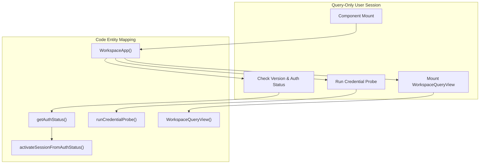
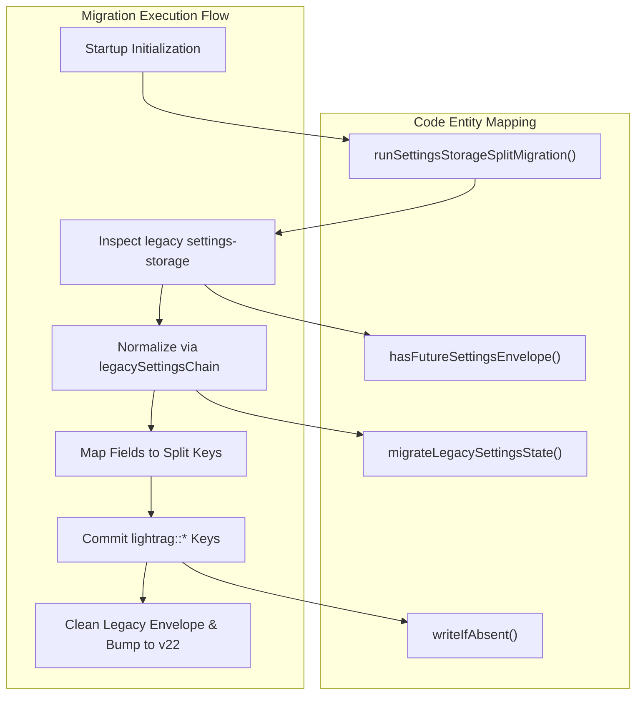

<!-- source: DeepWiki mcp.deepwiki.com · repo HKUDS/LightRAG · page 7.4 Workspace Entry, Login, and Storage Migrations · fetched 2026-11-09 -->

# Workspace Entry, Login, and Storage Migrations

<details>
<summary>Relevant source files</summary>

The following files were used as context for generating this wiki page:

- [docs/MultiSiteDeployment.md](docs/MultiSiteDeployment.md)
- [lightrag_webui/index.html](lightrag_webui/index.html)
- [lightrag_webui/src/components/retrieval/mermaidLoadFailure.test.tsx](lightrag_webui/src/components/retrieval/mermaidLoadFailure.test.tsx)
- [lightrag_webui/src/components/retrieval/mermaidLoader.ts](lightrag_webui/src/components/retrieval/mermaidLoader.ts)
- [lightrag_webui/src/components/ui/TooltipWidth.test.tsx](lightrag_webui/src/components/ui/TooltipWidth.test.tsx)
- [lightrag_webui/src/features/RetrievalView.test.tsx](lightrag_webui/src/features/RetrievalView.test.tsx)
- [lightrag_webui/src/features/retrieval/queryEntryAlignment.test.tsx](lightrag_webui/src/features/retrieval/queryEntryAlignment.test.tsx)
- [lightrag_webui/src/features/retrieval/streamedContentKey.ts](lightrag_webui/src/features/retrieval/streamedContentKey.ts)
- [lightrag_webui/src/features/workspace/WorkspaceApp.test.tsx](lightrag_webui/src/features/workspace/WorkspaceApp.test.tsx)
- [lightrag_webui/src/features/workspace/WorkspaceApp.tsx](lightrag_webui/src/features/workspace/WorkspaceApp.tsx)
- [lightrag_webui/src/features/workspace/WorkspaceEmptyState.tsx](lightrag_webui/src/features/workspace/WorkspaceEmptyState.tsx)
- [lightrag_webui/src/features/workspace/WorkspaceWelcome.tsx](lightrag_webui/src/features/workspace/WorkspaceWelcome.tsx)
- [lightrag_webui/src/features/workspace/credentialProbe.test.ts](lightrag_webui/src/features/workspace/credentialProbe.test.ts)
- [lightrag_webui/src/features/workspace/credentialProbe.ts](lightrag_webui/src/features/workspace/credentialProbe.ts)
- [lightrag_webui/src/lib/base64url.test.ts](lightrag_webui/src/lib/base64url.test.ts)
- [lightrag_webui/src/lib/base64url.ts](lightrag_webui/src/lib/base64url.ts)
- [lightrag_webui/src/lib/documentTitle.test.ts](lightrag_webui/src/lib/documentTitle.test.ts)
- [lightrag_webui/src/lib/documentTitle.ts](lightrag_webui/src/lib/documentTitle.ts)
- [lightrag_webui/src/lib/loginIdentity.test.ts](lightrag_webui/src/lib/loginIdentity.test.ts)
- [lightrag_webui/src/lib/loginIdentity.ts](lightrag_webui/src/lib/loginIdentity.ts)
- [lightrag_webui/src/lib/runtimeConfig.ts](lightrag_webui/src/lib/runtimeConfig.ts)
- [lightrag_webui/src/migrations/splitSettingsStorage.test.ts](lightrag_webui/src/migrations/splitSettingsStorage.test.ts)
- [lightrag_webui/src/migrations/splitSettingsStorage.ts](lightrag_webui/src/migrations/splitSettingsStorage.ts)
- [lightrag_webui/src/stores/documentTitleSync.test.ts](lightrag_webui/src/stores/documentTitleSync.test.ts)
- [lightrag_webui/src/test/processState.ts](lightrag_webui/src/test/processState.ts)
- [lightrag_webui/src/test/sourceScan.test.ts](lightrag_webui/src/test/sourceScan.test.ts)
- [lightrag_webui/src/test/sourceScan.ts](lightrag_webui/src/test/sourceScan.ts)
- [lightrag_webui/workspace.html](lightrag_webui/workspace.html)
- [tests/api/test_webui_title_injection.py](tests/api/test_webui_title_injection.py)
- [tests/api/test_workspace_entry_mount.py](tests/api/test_workspace_entry_mount.py)

</details>


## 7.4.1 Purpose and Scope

The workspace entry provides a minimalistic, query-focused application shell (`WorkspaceApp`) separate from the main administrative UI (`RetrievalView` in `/webui`). It is engineered for authenticated or guest users to access knowledge retrieval capabilities without exposure to document management, graph viewers, or administrative controls.

Key technical domains covered:
- Application shell initialization and asynchronous auth reconciliation (`WorkspaceApp.tsx`) [lightrag_webui/src/features/workspace/WorkspaceApp.tsx:37-90]().
- Identity lifecycle management, JWT parsing, and session history isolation (`loginIdentity.ts`) [lightrag_webui/src/lib/loginIdentity.ts:1-149]().
- Credential probing for API-key enforced deployments (`credentialProbe.ts`) [lightrag_webui/src/features/workspace/credentialProbe.ts]().
- Multi-site runtime configuration injection (`MultiSiteDeployment.md`) [docs/MultiSiteDeployment.md:35-70]().
- Document title synchronization via runtime config structures [lightrag_webui/src/features/workspace/WorkspaceApp.tsx:136-138]().
- Monolithic-to-split `localStorage` settings migration (`splitSettingsStorage.ts`) [lightrag_webui/src/migrations/splitSettingsStorage.ts:1-62]().
- Unauthenticated welcome landing and guest activation flow (`WorkspaceWelcome.tsx`) [lightrag_webui/src/features/workspace/WorkspaceWelcome.tsx:28-95]().
- Automated test suites verifying UI stability, migration convergence, and session alignment [lightrag_webui/src/features/workspace/WorkspaceApp.test.tsx](), [lightrag_webui/src/migrations/splitSettingsStorage.test.ts]().

Sources: `lightrag_webui/src/features/workspace/WorkspaceApp.tsx:37-90`, `lightrag_webui/src/lib/loginIdentity.ts:1-149`, `docs/MultiSiteDeployment.md:35-70`, `lightrag_webui/src/migrations/splitSettingsStorage.ts:1-62`, `lightrag_webui/src/features/workspace/WorkspaceWelcome.tsx:28-95`

---

## 7.4.2 Workspace Query-Only Application Shell

The workspace entry point is encapsulated in `WorkspaceApp` (`lightrag_webui/src/features/workspace/WorkspaceApp.tsx`), responsible for mounting the query view while omitting management sidebars.

### Implementation Details
- **Lifecycle & Reconciliation**: On mount, an `useEffect` hook queries `getAuthStatus()` to reconcile token state and server configuration through `activateSessionFromAuthStatus()` [lightrag_webui/src/features/workspace/WorkspaceApp.tsx:61-89]().
- **Credential Probing**: After initialization, `runCredentialProbe()` verifies API key requirements. If credentials fail or are absent, `ApiKeyAlert` modal visibility is toggled via monotonically increasing dialog requests (`useCredentialProbeStore`) [lightrag_webui/src/features/workspace/WorkspaceApp.tsx:93-112]().
- **Header Structure**: Renders a deployment brand anchor (`entryHomeHref`), deployment description tooltips, guest mode badges (`isGuestMode`), and a logout trigger pointing to unauthenticated navigation routes [lightrag_webui/src/features/workspace/WorkspaceApp.tsx:119-154]().

### Diagram: Workspace Shell Lifecycle & Code Entities


Sources: `lightrag_webui/src/features/workspace/WorkspaceApp.tsx:37-154`

---

## 7.4.3 Login Identity and Credential Probe

To maintain session integrity and isolate conversation logs, `lightrag_webui/src/lib/loginIdentity.ts` governs user transitions and history persistence.

### Identity Lifecycle Management
- **Token Decoding**: `loginIdentityFromToken(token: string)` extracts the `sub` claim from JWT payloads using `decodeBase64Url`, falling back to `"guest"` on parsing failures [lightrag_webui/src/lib/loginIdentity.ts:45-57]().
- **Identity Transition Check**: `isIdentityChange(previous, identity)` compares stored identifiers with incoming ones, recognizing legacy mojibake representations of non-ASCII usernames to prevent false-positive session wipes [lightrag_webui/src/lib/loginIdentity.ts:88-92]().
- **History Clearance**: When an identity change is detected, `applyLoginIdentity(identity)` purges persistent retrieval history keys (`WEBUI_RETRIEVAL_HISTORY_KEY` and `WORKSPACE_RETRIEVAL_HISTORY_KEY`) to prevent cross-user data leakage [lightrag_webui/src/lib/loginIdentity.ts:99-136]().

| Storage Key Constant | Target Store | Purpose |
|----------------------|--------------|---------|
| `WEBUI_RETRIEVAL_HISTORY_KEY` | Admin UI History | Stores debugging prompts for administrative users |
| `WORKSPACE_RETRIEVAL_HISTORY_KEY` | Workspace History | Stores isolated user-facing conversation threads |

Sources: `lightrag_webui/src/lib/loginIdentity.ts:1-149`, `lightrag_webui/src/lib/storageKeys.ts`

---

## 7.4.4 Navigation and Runtime Configuration

Multi-instance and reverse-proxy deployments rely on dynamic config injection rather than static build-time arguments.

### Runtime Prefix Injection
- The FastAPI server injects configuration parameters into `index.html` via `SmartStaticFiles` middleware (`lightrag/api/lightrag_server.py`), replacing the `<!-- __LIGHTRAG_RUNTIME_CONFIG__ -->` placeholder [docs/MultiSiteDeployment.md:35-44]().
- The injected payload conforms to `window.__LIGHTRAG_CONFIG__`:
  ```typescript
  {
    apiPrefix: string;
    webuiPrefix: string;
    webuiTitle: string;
  }
  ```
- **Forwarding Agnosticism**: Both strip and verbatim proxy forwarding modes are supported by an ASGI middleware layer that prepends `root_path` to request scopes where necessary [docs/MultiSiteDeployment.md:85-92]().

Sources: `docs/MultiSiteDeployment.md:10-100`

---

## 7.4.5 Document Title Synchronization

The frontend synchronizes browser tab titles and brand headers using deployment metadata received during auth initialization.
- `WorkspaceApp` extracts `webuiTitle` and `webuiDescription` from `useAuthStore` [lightrag_webui/src/features/workspace/WorkspaceApp.tsx:39]() and applies them directly to the brand anchor element and tooltip description popovers [lightrag_webui/src/features/workspace/WorkspaceApp.tsx:136-148]().

Sources: `lightrag_webui/src/features/workspace/WorkspaceApp.tsx:37-154`

---

## 7.4.6 LocalStorage Split Settings Migration

Legacy versions of the WebUI stored query settings and retrieval transcripts in a single monolithic `settings-storage` localStorage key. `lightrag_webui/src/migrations/splitSettingsStorage.ts` implements a deterministic, one-time migration splitting this envelope [lightrag_webui/src/migrations/splitSettingsStorage.ts:1-62].

### Migration Rules and Execution
1. **Version Normalization**: Envelopes $\le$ v21 are normalized through `legacySettingsChain.ts` prior to splitting [lightrag_webui/src/migrations/splitSettingsStorage.ts:18-19]().
2. **Exhaustive Field Mapping**:
   - `querySettings` $\rightarrow$ `lightrag::query-settings-storage` [lightrag_webui/src/migrations/splitSettingsStorage.ts:7]()
   - `retrievalHistory` $\rightarrow$ `lightrag::webui-retrieval-history` [lightrag_webui/src/migrations/splitSettingsStorage.ts:8]()
   - Unspecified $\rightarrow$ `lightrag::workspace-retrieval-history = []` (isolating workspace history from admin debug logs) [lightrag_webui/src/migrations/splitSettingsStorage.ts:9-15]().
3. **Safety Guarantees**: Migration values are written only to target keys that do not already exist (`writeIfAbsent`), preventing data clobbering [lightrag_webui/src/migrations/splitSettingsStorage.ts:30-31](). Legacy cleanup occurs exclusively after all target keys have been committed [lightrag_webui/src/migrations/splitSettingsStorage.ts:32-34]().

### Diagram: Split Settings Migration Pipeline


Sources: `lightrag_webui/src/migrations/splitSettingsStorage.ts:1-120`

---

## 7.4.7 Workspace Welcome Page and Guest Activation

For unauthenticated sessions, `WorkspaceWelcome` (`lightrag_webui/src/features/workspace/WorkspaceWelcome.tsx`) provides a landing view.

### Key Implementation Flow
- **Auth Probing**: Fires a lightweight `/auth-status` probe in parallel with branding configuration fetches on component mount [lightrag_webui/src/features/workspace/WorkspaceWelcome.tsx:40-52]().
- **Guest Activation**: When authentication is disabled server-side (`auth_configured === false`), clicking "Enter Workspace" fetches an access token, registers the identity via `activateLoginIdentityFromToken()`, updates `useAuthStore`, and redirects to `/` [lightrag_webui/src/features/workspace/WorkspaceWelcome.tsx:59-84]().

Sources: `lightrag_webui/src/features/workspace/WorkspaceWelcome.tsx:28-95`

---

## 7.4.8 WebUI Test Coverage for Workspace Entry

Automated tests validate workspace behaviors, identity transitions, and storage migrations:
- `WorkspaceApp.test.tsx`: Validates version reconciliation, credential alert dialog triggers, and title rendering [lightrag_webui/src/features/workspace/WorkspaceApp.test.tsx]().
- `loginIdentity.test.ts`: Asserts the identity change contract, guest vs. named user history clearing logic, and mojibake correction [lightrag_webui/src/lib/loginIdentity.test.ts:1-167]().
- `splitSettingsStorage.test.ts`: Simulates `Storage` double instances to test quota exhaustion recovery, version caps, and new-key preservation rules [lightrag_webui/src/migrations/splitSettingsStorage.test.ts:1-182]().
- `queryEntryAlignment.test.tsx`: Asserts request payload parity between admin retrieval views and workspace query composers [lightrag_webui/src/features/retrieval/queryEntryAlignment.test.tsx]().

Sources: `lightrag_webui/src/features/workspace/WorkspaceApp.test.tsx`, `lightrag_webui/src/lib/loginIdentity.test.ts:1-167`, `lightrag_webui/src/migrations/splitSettingsStorage.test.ts:1-182`, `lightrag_webui/src/features/retrieval/queryEntryAlignment.test.tsx`

---

### Sources
- `lightrag_webui/src/features/workspace/WorkspaceApp.tsx:37-154`
- `lightrag_webui/src/lib/loginIdentity.ts:1-149`
- `lightrag_webui/src/migrations/splitSettingsStorage.ts:1-120`
- `lightrag_webui/src/features/workspace/WorkspaceWelcome.tsx:28-95`
- `docs/MultiSiteDeployment.md:10-100`
- `lightrag_webui/src/features/workspace/WorkspaceApp.test.tsx`
- `lightrag_webui/src/lib/loginIdentity.test.ts:1-167`
- `lightrag_webui/src/migrations/splitSettingsStorage.test.ts:1-182`
- `lightrag_webui/src/features/retrieval/queryEntryAlignment.test.tsx`

---

