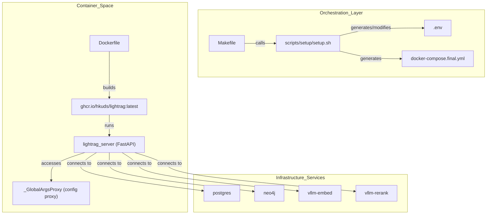
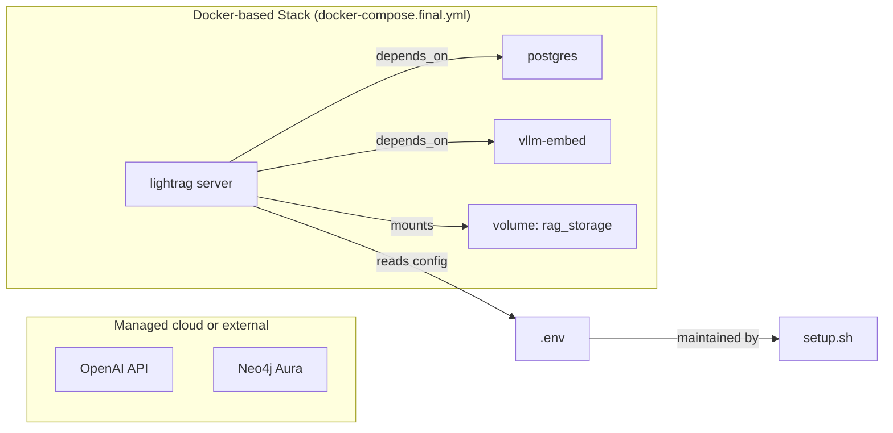

<!-- source: DeepWiki mcp.deepwiki.com · repo HKUDS/LightRAG · page 8 Deployment and Infrastructure · fetched 2026-11-09 -->

# Deployment and Infrastructure

Relevant source files

The following files were used as context for generating this wiki page:

- [Dockerfile](Dockerfile)
- [Dockerfile.lite](Dockerfile.lite)
- [Makefile](Makefile)
- [docker-compose-full.yml](docker-compose-full.yml)
- [docker-compose.yml](docker-compose.yml)
- [docker-entrypoint.sh](docker-entrypoint.sh)
- [docs/DockerDeployment.md](docs/DockerDeployment.md)
- [docs/InteractiveSetup.md](docs/InteractiveSetup.md)
- [docs/UserDefinedUI-zh.md](docs/UserDefinedUI-zh.md)
- [docs/UserDefinedUI.md](docs/UserDefinedUI.md)
- [scripts/setup/lib/file_ops.sh](scripts/setup/lib/file_ops.sh)
- [scripts/setup/lib/presets.sh](scripts/setup/lib/presets.sh)
- [scripts/setup/lib/prompts.sh](scripts/setup/lib/prompts.sh)
- [scripts/setup/lib/validation.sh](scripts/setup/lib/validation.sh)
- [scripts/setup/setup.sh](scripts/setup/setup.sh)
- [tests/api/config/test_whitelist_exposes_api_routes.py](tests/api/config/test_whitelist_exposes_api_routes.py)
- [tests/setup/test_generate.py](tests/setup/test_generate.py)
- [tests/setup/test_misc.py](tests/setup/test_misc.py)

This section provides a high-level overview of the deployment options available for LightRAG. The system is designed to be flexible, supporting everything from local development on a host machine to large-scale production clusters using Kubernetes.

## Deployment Overview

LightRAG supports multiple deployment modes tailored to different infrastructure needs:

1. **Host-based Deployment**: Run the `lightrag-server` directly on a physical or virtual machine using Python environments managed by tools like `uv` or `pip`.
2. **Containerized Deployment (Docker Compose)**: Utilize containerization with the provided `Dockerfile` and `docker-compose.yml` to orchestrate the API server alongside storage backends such as PostgreSQL, Neo4j, Milvus, etc.
3. **Cloud-Native Deployment (Kubernetes/Helm)**: Employ Helm charts and Kubernetes manifests to deploy and manage LightRAG at scale with automated infrastructure provisioning and orchestration.

### System Architecture Mapping

The diagram below connects the logical deployment services to the concrete code artifacts and configurations within the codebase, illustrating how orchestration, containerization, and infrastructure services relate.

**Sources:**  
[scripts/setup/setup.sh:1-30](), [Makefile:1-100](), [docker-compose.yml:1-28](), [Dockerfile:1-146]()

---

## Interactive Setup Wizard

LightRAG includes an **Interactive Setup Wizard** to simplify configuring environment variables, storage backends, and deployment artifacts.

- **Access**: Through `make` targets such as `make env-base`, `make env-storage`, and `make env-server` which invoke the main `scripts/setup/setup.sh` script [Makefile:20-100]() [scripts/setup/setup.sh:1-150]().
- **Features**:
  - **Environment Normalization**: Converts host-based URLs (e.g., `localhost`) to Docker-compatible ones (e.g., `host.docker.internal`) for container runtimes.
  - **Validation**: Includes URI format checks for supported storage backends like PostgreSQL, Neo4j, MongoDB, Redis, Milvus, Qdrant, and Memgraph using helper functions [scripts/setup/lib/validation.sh:3-134]().
  - **Preservation of Custom Values**: User-added environment variables are preserved in `.env` during regeneration, keeping customization safe [scripts/setup/lib/file_ops.sh:155-212]().
  - **SSL Staging**: Automatically stages and manages SSL certificate/key files for Docker use [scripts/setup/lib/file_ops.sh:85-107]().
  - **Security Audits**: `make env-security-check` identifies weak secrets and insecure settings prior to exposing the server publicly [docs/InteractiveSetup.md:160-200]().

The wizard drives the generation of `.env` and customized `docker-compose.final.yml` files for container orchestration.

For details, see [Docker Compose Deployment](#8.1).

---

## Deployment Options

### Docker Compose

Docker Compose deployment is the primary containerized mode, offering:

- A **multi-stage `Dockerfile`** to optimize build times and image size, compiling frontend assets with Bun and backend Python dependencies with UV [Dockerfile:1-146]().
- The included `docker-compose.yml` sets up the LightRAG service with required volume mounts for data persistence and configuration [docker-compose.yml:1-44]().
- The interactive wizard generates `docker-compose.final.yml` reflecting your service selections including optional local embedding (`vllm-embed`) and rerank (`vllm-rerank`) services [docs/DockerDeployment.md:5-135]().
- Containers run as non-root users (`lightrag` UID 1000), adopting file ownership seamlessly for bind mounts and volumes, improving security [Dockerfile:117-135]().
- SSL/TLS certificates can be staged into container mounts for HTTPS termination by the server [scripts/setup/lib/file_ops.sh:85-107]().

Local inference services for embedding and reranking can be run as additional containers managed via Docker Compose for offline or isolated environments.

For details, see [Docker Compose Deployment](#8.1).

### Kubernetes / Helm

LightRAG supports Kubernetes deployments using Helm charts located in `k8s-deploy/lightrag`:

- The Helm chart supports deployment in **lightweight/dev mode**, using local JSON and NetworkX storages for ease of testing.
- For production, it leverages **KubeBlocks operators** to deploy managed stateful databases like PostgreSQL with `pgvector` and Neo4j.
- Helm templates enable declarative management of `Deployment` and `StatefulSet` resources for the API server and backend databases with scaling policies.
- Scripts for database operator lifecycle management (install/uninstall) are provided.

For details, see [Kubernetes / Helm Deployment](#8.2).

### Multi-Site and Offline Deployment

LightRAG accommodates complex deployment scenarios with features such as:

- **Path Prefixes and Reverse Proxying**: Configuration injection to support multi-site hosting behind reverse proxies.
- **Offline Air-Gapped Installations**: Pre-download Python wheel packages (`uv sync --extra offline`) and tokenizers to avoid external downloads.
- **Local vLLM services**: Embeddings and reranking run locally without cloud LLM dependencies.
- **Web UI for air-gapped environments**: Frontend build optimized for isolated networks.

These configurations support enterprise and restricted-network use cases.

For details, see [Multi-Site and Offline Deployment](#8.3).

---

## Infrastructure Configuration Mapping

The table below connects key infrastructure requirements to code variables and files managing them:

| Requirement                 | Code Variable / Entity            | Relevant File & Lines                         |
|----------------------------|---------------------------------|----------------------------------------------|
| Runtime Target              | `LIGHTRAG_RUNTIME_TARGET`        | [scripts/setup/setup.sh:119-143]()           |
| Server API Port             | `PORT` (default 9621)            | [docker-compose.yml:10]()                      |
| Data Persistence Directory  | `WORKING_DIR`, `INPUT_DIR`, etc.| [Dockerfile:106-116](), [docker-compose.yml:11-18]() |
| SSL Certificate and Key     | `SSL_CERTFILE`, `SSL_KEYFILE`   | [scripts/setup/lib/file_ops.sh:85-107]()      |
| Storage Backend Services    | `STORAGE_SERVICES` array         | [scripts/setup/setup.sh:56-65]()               |
| Local Embedding Services    | `VLLM_SERVICES` array            | [scripts/setup/setup.sh:51-54]()               |

### Infrastructure Dependency Flow

**Sources:**  
[scripts/setup/setup.sh:50-65](), [scripts/setup/lib/file_ops.sh:155-197](), [docs/InteractiveSetup.md:20-196]()

---

For detailed step-by-step deployment instructions, environment variable configurations, Docker manifests, Kubernetes Helm deployments, and offline deployment considerations, consult the corresponding child pages:

- **[Docker Compose Deployment](#8.1)**
- **[Kubernetes / Helm Deployment](#8.2)**
- **[Multi-Site and Offline Deployment](#8.3)**

---

**Sources:**  
- [scripts/setup/setup.sh:1-150]()  
- [scripts/setup/lib/file_ops.sh:1-212]()  
- [scripts/setup/lib/validation.sh:1-134]()  
- [Makefile:1-100]()  
- [Dockerfile:1-146]()  
- [docker-compose.yml:1-44]()  
- [docs/InteractiveSetup.md:1-196]()  
- [docs/DockerDeployment.md:1-135]()

---

