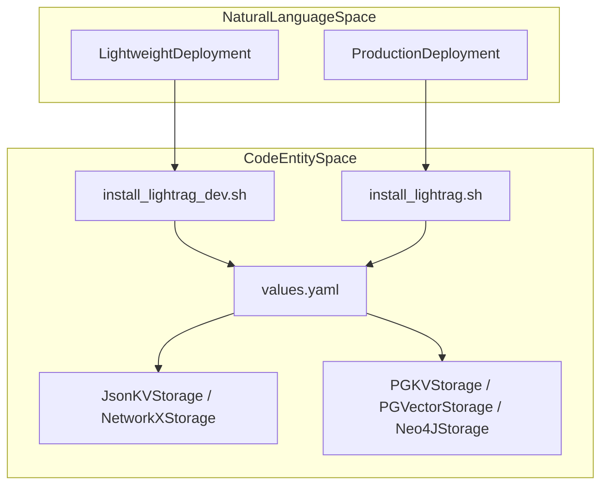
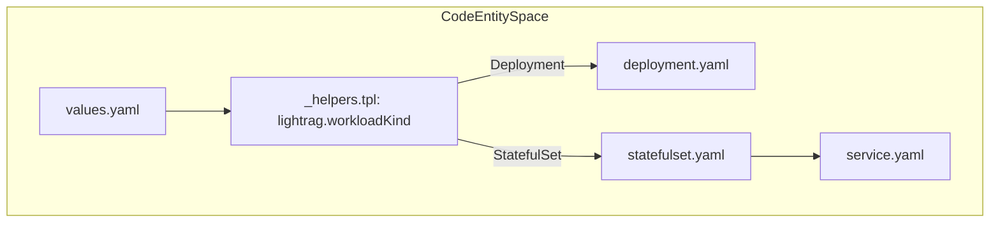

<!-- source: DeepWiki mcp.deepwiki.com · repo HKUDS/LightRAG · page 8.2 Kubernetes / Helm Deployment · fetched 2026-11-09 -->

# Kubernetes / Helm Deployment

Relevant source files

The following files were used as context for generating this wiki page:

- [k8s-deploy/K8S-README-zh.md](k8s-deploy/K8S-README-zh.md)
- [k8s-deploy/K8S-README.md](k8s-deploy/K8S-README.md)
- [k8s-deploy/databases/00-config.sh](k8s-deploy/databases/00-config.sh)
- [k8s-deploy/databases/01-prepare.sh](k8s-deploy/databases/01-prepare.sh)
- [k8s-deploy/databases/02-install-database.sh](k8s-deploy/databases/02-install-database.sh)
- [k8s-deploy/databases/03-uninstall-database.sh](k8s-deploy/databases/03-uninstall-database.sh)
- [k8s-deploy/databases/04-cleanup.sh](k8s-deploy/databases/04-cleanup.sh)
- [k8s-deploy/databases/install-kubeblocks.sh](k8s-deploy/databases/install-kubeblocks.sh)
- [k8s-deploy/databases/scripts/common.sh](k8s-deploy/databases/scripts/common.sh)
- [k8s-deploy/databases/uninstall-kubeblocks.sh](k8s-deploy/databases/uninstall-kubeblocks.sh)
- [k8s-deploy/install_lightrag.sh](k8s-deploy/install_lightrag.sh)
- [k8s-deploy/install_lightrag_dev.sh](k8s-deploy/install_lightrag_dev.sh)
- [k8s-deploy/lightrag/Chart.yaml](k8s-deploy/lightrag/Chart.yaml)
- [k8s-deploy/lightrag/templates/NOTES.txt](k8s-deploy/lightrag/templates/NOTES.txt)
- [k8s-deploy/lightrag/templates/_helpers.tpl](k8s-deploy/lightrag/templates/_helpers.tpl)
- [k8s-deploy/lightrag/templates/deployment.yaml](k8s-deploy/lightrag/templates/deployment.yaml)
- [k8s-deploy/lightrag/templates/pvc.yaml](k8s-deploy/lightrag/templates/pvc.yaml)
- [k8s-deploy/lightrag/templates/service.yaml](k8s-deploy/lightrag/templates/service.yaml)
- [k8s-deploy/lightrag/templates/statefulset.yaml](k8s-deploy/lightrag/templates/statefulset.yaml)
- [k8s-deploy/lightrag/values.yaml](k8s-deploy/lightrag/values.yaml)
- [tests/workspace/README_WORKSPACE_ISOLATION_TESTS.md](tests/workspace/README_WORKSPACE_ISOLATION_TESTS.md)

LightRAG provides a comprehensive Kubernetes deployment suite under `k8s-deploy/` designed to scale from local development environments to production-grade clusters [k8s-deploy/K8S-README.md:1-8](). Deployment is orchestrated via a Helm chart (`k8s-deploy/lightrag/`) and automated shell scripts that integrate with the **KubeBlocks** database operator for high-availability storage backends [k8s-deploy/K8S-README.md:72-87]().

---

## 1. Deployment Modes: Lightweight vs Production

LightRAG supports two primary deployment strategies in Kubernetes:

- **Lightweight Deployment**: Uses built-in lightweight storage components (`JsonKVStorage`, `NanoVectorDBStorage`, `NetworkXStorage`, `JsonDocStatusStorage`) configured via environment variables [k8s-deploy/K8S-README.md:28-32](), [k8s-deploy/install_lightrag_dev.sh:54-60](). Ideal for testing, demos, and small-scale usage without external database dependencies [k8s-deploy/K8S-README.md:28-30]().
- **Production Deployment**: Uses external managed database clusters (PostgreSQL for KV/vector/doc-status storage, Neo4j for graph storage) deployed via KubeBlocks [k8s-deploy/K8S-README.md:72-87](), [k8s-deploy/lightrag/values.yaml:102-107]().

Sources: [k8s-deploy/K8S-README.md:28-87](), [k8s-deploy/install_lightrag_dev.sh:54-60](), [k8s-deploy/install_lightrag.sh:69-80](), [k8s-deploy/lightrag/values.yaml:102-107]()

---

## 2. Helm Chart Configuration and Workload Templates

The Helm chart defined in `k8s-deploy/lightrag/` parametrizes container execution, resource requests, environment variables, and persistence [k8s-deploy/lightrag/values.yaml:1-121]().

### Workload Kinds: Deployment vs. StatefulSet

- **`Deployment`**: The default workload kind (`workload.kind: Deployment`) [k8s-deploy/lightrag/values.yaml:41-42]() uses shared PersistentVolumeClaims defined in `k8s-deploy/lightrag/templates/pvc.yaml` [k8s-deploy/lightrag/templates/pvc.yaml:1-47](). Update strategy defaults to `Recreate` to prevent concurrent container writes during upgrades [k8s-deploy/lightrag/values.yaml:60-61]().
- **`StatefulSet`**: Used when ordered startup is required for advanced multi-instance query-only replicas (`workload.kind: StatefulSet`, `podManagementPolicy: OrderedReady`) [k8s-deploy/lightrag/values.yaml:41-48](), [k8s-deploy/lightrag/templates/statefulset.yaml:1-70](). It provisions per-pod `volumeClaimTemplates` with `ReadWriteOnce` access to eliminate file corruption risks [k8s-deploy/lightrag/templates/statefulset.yaml:41-69]().

Sources: [k8s-deploy/lightrag/values.yaml:41-61](), [k8s-deploy/lightrag/templates/_helpers.tpl:80-95](), [k8s-deploy/lightrag/templates/deployment.yaml:1-17](), [k8s-deploy/lightrag/templates/statefulset.yaml:1-70](), [k8s-deploy/lightrag/templates/service.yaml:1-59]()

---

## 3. Storage Backend Mapping and Database Integration

Production deployments bind LightRAG storage classes to database endpoints via environment variables configured in `k8s-deploy/lightrag/values.yaml` [k8s-deploy/lightrag/values.yaml:102-121]() and populated by `k8s-deploy/install_lightrag.sh` [k8s-deploy/install_lightrag.sh:39-60]().

- **PostgreSQL Cluster**: Mapped to `pg-cluster-postgresql-postgresql:5432` providing `PGKVStorage`, `PGVectorStorage`, and `PGDocStatusStorage` [k8s-deploy/lightrag/values.yaml:102-114](). Requires the `vector` extension, created via `CREATE EXTENSION vector;` on the primary pod [k8s-deploy/install_lightrag.sh:30-37]().
- **Neo4j Cluster**: Mapped to `neo4j-cluster-neo4j:7687` providing `Neo4JStorage` [k8s-deploy/lightrag/values.yaml:106(),116-118]().

Sources: [k8s-deploy/lightrag/values.yaml:102-121](), [k8s-deploy/install_lightrag.sh:30-60]()

---

## 4. Installation, Upgrade, and Uninstallation Scripts

Deployment automation is provided by shell scripts in `k8s-deploy/`:

- **Lightweight Installation**: `install_lightrag_dev.sh` validates environment variables (`OPENAI_API_KEY`, `OPENAI_API_BASE`), creates the `rag` namespace, and executes `helm upgrade --install` with lightweight storage drivers [k8s-deploy/install_lightrag_dev.sh:1-68]().
- **Production Installation**: `install_lightrag.sh` invokes KubeBlocks preparation scripts, installs database operators and clusters, enables vector extensions, extracts credentials from Kubernetes Secrets, and deploys the Helm chart [k8s-deploy/install_lightrag.sh:1-81](), [k8s-deploy/databases/install-kubeblocks.sh:12-43]().
- **Cleanup and Uninstallation**: `uninstall-kubeblocks.sh` removes the KubeBlocks Helm charts, controllers, CRDs, and the `kb-system` namespace [k8s-deploy/databases/uninstall-kubeblocks.sh:26-48]().

Sources: [k8s-deploy/install_lightrag_dev.sh:1-68](), [k8s-deploy/install_lightrag.sh:1-81](), [k8s-deploy/databases/install-kubeblocks.sh:12-43](), [k8s-deploy/databases/uninstall-kubeblocks.sh:26-48]()

---

## 5. Operational Constraints and Replica Management

- **Single Writer Constraint (`replicaCount: 1`)**: A workspace supports exactly one ingesting LightRAG instance [k8s-deploy/lightrag/values.yaml:1-12](). Storage initialization, schema migration, and pipeline coordination occur via per-host shared memory (`lightrag/kg/shared_storage.py`) which does not cross pods [k8s-deploy/lightrag/values.yaml:1-6](). Running multiple concurrent writers results in race conditions, corrupted state, and duplicated document processing [k8s-deploy/lightrag/values.yaml:4-7]().
- **Advanced Query-Only Replicas**: Extra query-only instances require external database backends, `StatefulSet` with `podManagementPolicy: OrderedReady`, health check gating (`/health`), and strict ingress routing to direct write traffic exclusively to pod 0 (`<release>-writer` service) [k8s-deploy/K8S-README.md:128-156](), [k8s-deploy/lightrag/templates/service.yaml:38-59]().

Sources: [k8s-deploy/lightrag/values.yaml:1-12](), [k8s-deploy/lightrag/templates/service.yaml:38-59](), [k8s-deploy/K8S-README.md:128-156]()

---

