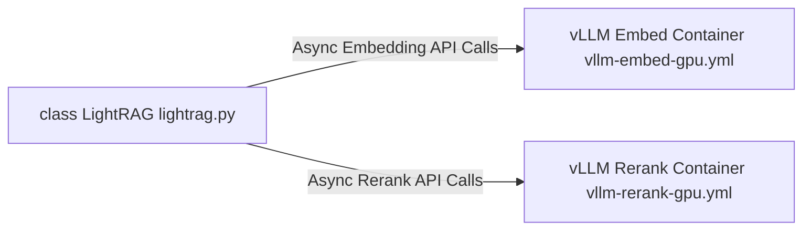

<!-- source: DeepWiki mcp.deepwiki.com · repo HKUDS/LightRAG · page 8.3 Multi-Site and Offline Deployment · fetched 2026-11-09 -->

# Multi-Site and Offline Deployment

<details>
<summary>Relevant source files</summary>

The following files were used as context for generating this wiki page:

- [docs/MultiSiteDeployment.md](docs/MultiSiteDeployment.md)
- [lightrag/llm/binding_options.py](lightrag/llm/binding_options.py)
- [lightrag_webui/index.html](lightrag_webui/index.html)
- [lightrag_webui/src/lib/documentTitle.test.ts](lightrag_webui/src/lib/documentTitle.test.ts)
- [lightrag_webui/src/lib/documentTitle.ts](lightrag_webui/src/lib/documentTitle.ts)
- [lightrag_webui/src/lib/runtimeConfig.ts](lightrag_webui/src/lib/runtimeConfig.ts)
- [lightrag_webui/src/stores/documentTitleSync.test.ts](lightrag_webui/src/stores/documentTitleSync.test.ts)
- [lightrag_webui/workspace.html](lightrag_webui/workspace.html)
- [pyproject.toml](pyproject.toml)
- [requirements-offline-llm.txt](requirements-offline-llm.txt)
- [requirements-offline-storage.txt](requirements-offline-storage.txt)
- [requirements-offline.txt](requirements-offline.txt)
- [scripts/setup/templates/vllm-embed-gpu.yml](scripts/setup/templates/vllm-embed-gpu.yml)
- [scripts/setup/templates/vllm-embed.yml](scripts/setup/templates/vllm-embed.yml)
- [scripts/setup/templates/vllm-rerank-gpu.yml](scripts/setup/templates/vllm-rerank-gpu.yml)
- [scripts/setup/templates/vllm-rerank.yml](scripts/setup/templates/vllm-rerank.yml)
- [tests/api/test_webui_title_injection.py](tests/api/test_webui_title_injection.py)
- [tests/api/test_workspace_entry_mount.py](tests/api/test_workspace_entry_mount.py)
- [uv.lock](uv.lock)

</details>


This section covers advanced deployment configurations for LightRAG focused on multi-site hosting behind reverse proxies, offline dependency packaging, runtime model caches, local inference services via vLLM, and building the WebUI for air-gapped environments.

---

## Multi-Site Deployment

Multiple isolated LightRAG instances can be hosted on a single server behind a reverse proxy (e.g., Nginx, Traefik, Kubernetes Ingress) using a **"build once, deploy many"** architecture. Sites differ only by their runtime-configured URL path prefixes, eliminating per-site frontend builds [docs/MultiSiteDeployment.md:1-32]().

### Runtime Prefix Injection and Reverse Proxy Setup

The backend accepts a path prefix via `LIGHTRAG_API_PREFIX`, which is passed to FastAPI as `root_path` [docs/MultiSiteDeployment.md:72-76](). The backend injects a runtime configuration block into `index.html` via `SmartStaticFiles` (defined in `lightrag/api/lightrag_server.py`) [docs/MultiSiteDeployment.md:35-44](). 

The injected snippet defines:
```js
window.__LIGHTRAG_CONFIG__ = {
  apiPrefix: "<prefix>",
  webuiPrefix: "<prefix>/webui/",
  webuiTitle: "<optional title>"
};
```
[docs/MultiSiteDeployment.md:35-44]()

### Key Configuration Variables

| Variable | Default | Description |
| --- | --- | --- |
| `LIGHTRAG_API_PREFIX` | `""` | Reverse-proxy mount prefix. Passed to FastAPI as `root_path` [docs/MultiSiteDeployment.md:72-76](). |
| `LIGHTRAG_DEFAULT_UI` | `"webui"` | Frontend UI entry point for root path `/` (`webui` or `workspace`) [docs/MultiSiteDeployment.md:72-78](). |

Sources: [docs/MultiSiteDeployment.md:1-100]()

### Diagram: Multi-Site Reverse Proxy Flow (Code-Entity Mapped)

```mermaid
graph TD
  Browser["Browser Client"]
  Proxy["Nginx Reverse Proxy"]
  ServerA["FastAPIApp lightrag_server.py<br/>LIGHTRAG_API_PREFIX=/site01"]
  ServerB["FastAPIApp lightrag_server.py<br/>LIGHTRAG_API_PREFIX=/site02"]
  StaticFiles["SmartStaticFiles light_server.py"]

  Browser -->|GET /site01/webui/index.html| Proxy
  Browser -->|GET /site02/webui/index.html| Proxy
  Proxy -->|proxy_pass (strip /site01)| ServerA
  Proxy -->|proxy_pass (strip /site02)| ServerB
  ServerA -->|Invokes| StaticFiles
  ServerB -->|Invokes| StaticFiles
  StaticFiles -->|Injects window.__LIGHTRAG_CONFIG__ | Browser
```
Sources: [docs/MultiSiteDeployment.md:35-64]()

### Forwarding Modes and Whitelist Paths

- **Strip mode**: The proxy removes the prefix before forwarding (client `/site01/webui/` maps to backend `/webui/`) [docs/MultiSiteDeployment.md:85-92]().
- **Verbatim mode**: The proxy forwards the full prefixed path (client `/site01/webui/` maps to backend `/site01/webui/`) [docs/MultiSiteDeployment.md:85-92]().
- **`WHITELIST_PATHS`**: Evaluated *after* the mount prefix is stripped, matching internal route declarations precisely (e.g., `WHITELIST_PATHS=/health,/api/*`) [docs/MultiSiteDeployment.md:94-100]().

Sources: [docs/MultiSiteDeployment.md:72-100]()

---

## Offline Deployment and Dependency Layers

LightRAG supports fully air-gapped environments through modular extras defined in `pyproject.toml` and requirement files [pyproject.toml:143-174](), [requirements-offline.txt:1-32]().

### Modular Offline Extras

| Extra | Contents / Purpose | Source Reference |
| --- | --- | --- |
| `offline-storage` | Drivers for Redis, Neo4j, Milvus, Mongo, FAISS, OpenSearch, PostgreSQL AGE/pgvector | [pyproject.toml:144-155]() |
| `offline-llm` | Bindings for OpenAI, Anthropic, Ollama, ZhipuAI, AWS Bedrock (aioboto3), VoyageAI, LlamaIndex | [pyproject.toml:157-170]() |
| `offline` | Combines `api`, `offline-storage`, and `offline-llm` | [pyproject.toml:171-174]() |

To install offline using pre-downloaded wheels:
```bash
pip install --no-index --find-links=./packages -r requirements-offline.txt
```
[requirements-offline.txt:3-5]()

Sources: [pyproject.toml:143-174](), [requirements-offline.txt:1-32](), [requirements-offline-storage.txt:1-19](), [requirements-offline-llm.txt:1-20]()

---

## Local Inference Services: vLLM Embedding and Reranking

For air-gapped deployments requiring local neural network inference, LightRAG integrates with containerized vLLM endpoints [scripts/setup/templates/vllm-embed-gpu.yml:1-33](), [scripts/setup/templates/vllm-rerank-gpu.yml:1-33]().

Templates available in `scripts/setup/templates/`:
- `vllm-embed-gpu.yml`: GPU-accelerated embedding service (default port `8001`) [scripts/setup/templates/vllm-embed-gpu.yml:1-15]().
- `vllm-rerank-gpu.yml`: GPU-accelerated reranking service (default port `8000`) [scripts/setup/templates/vllm-rerank-gpu.yml:1-15]().
- `vllm-rerank.yml`: CPU fallback runtime for reranking [scripts/setup/templates/vllm-rerank.yml:1-12]().

### Diagram: Local Inference Data Flow


Sources: [scripts/setup/templates/vllm-embed-gpu.yml:1-33](), [scripts/setup/templates/vllm-rerank-gpu.yml:1-33](), [scripts/setup/templates/vllm-rerank.yml:1-21]()

---

## WebUI Build and Air-Gapped Configuration

The frontend (`lightrag_webui`) embeds runtime configuration markers into `index.html` to support dynamic multi-site resolution [lightrag_webui/index.html:1-17]().

### Document Title Resolution and Testing

Browser tab titles are governed by `WEBUI_TITLE` and resolved dynamically via `resolveInitialDocumentTitle` and tested thoroughly in `lightrag_webui/src/lib/documentTitle.test.ts` [lightrag_webui/src/lib/documentTitle.test.ts:1-36](). The logic checks `window.__LIGHTRAG_CONFIG__.webuiTitle` injected during server responses [lightrag_webui/index.html:11]().

Sources: [lightrag_webui/index.html:1-17](), [lightrag_webui/src/lib/documentTitle.test.ts:1-165]()

---

