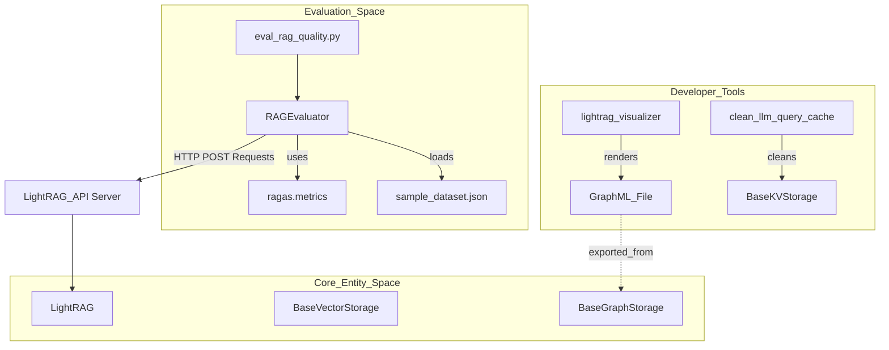
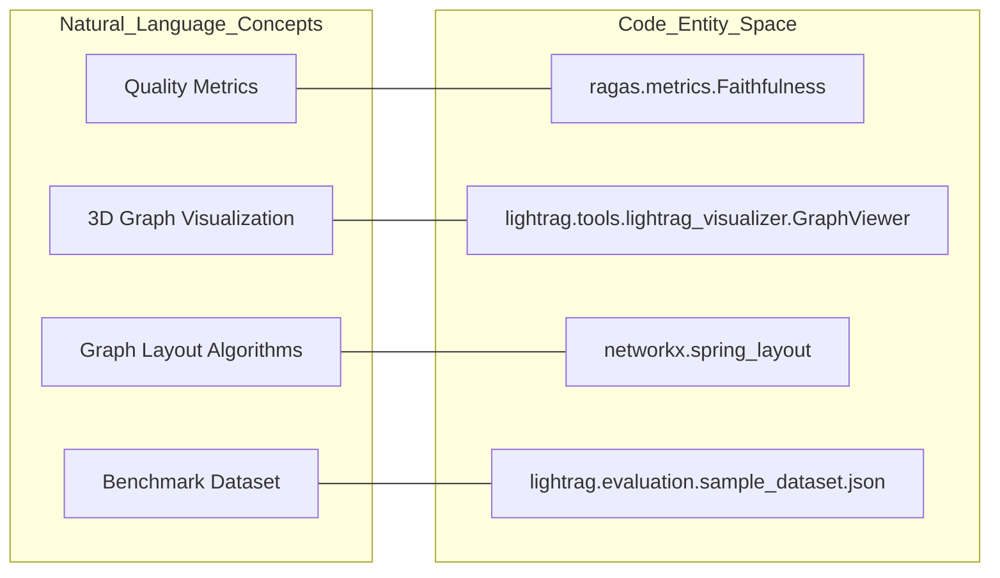

<!-- source: DeepWiki mcp.deepwiki.com · repo HKUDS/LightRAG · page 9 Evaluation, Tools, and Examples · fetched 2026-11-09 -->

# Evaluation, Tools, and Examples

Relevant source files

The following files were used as context for generating this wiki page:

- [lightrag/evaluation/__init__.py](lightrag/evaluation/__init__.py)
- [lightrag/evaluation/eval_rag_quality.py](lightrag/evaluation/eval_rag_quality.py)
- [lightrag/evaluation/sample_dataset.json](lightrag/evaluation/sample_dataset.json)
- [lightrag/evaluation/sample_documents/01_lightrag_overview.md](lightrag/evaluation/sample_documents/01_lightrag_overview.md)
- [lightrag/evaluation/sample_documents/02_rag_architecture.md](lightrag/evaluation/sample_documents/02_rag_architecture.md)
- [lightrag/evaluation/sample_documents/03_lightrag_improvements.md](lightrag/evaluation/sample_documents/03_lightrag_improvements.md)
- [lightrag/evaluation/sample_documents/04_supported_databases.md](lightrag/evaluation/sample_documents/04_supported_databases.md)
- [lightrag/evaluation/sample_documents/05_evaluation_and_deployment.md](lightrag/evaluation/sample_documents/05_evaluation_and_deployment.md)
- [lightrag/evaluation/sample_documents/README.md](lightrag/evaluation/sample_documents/README.md)
- [tests/evaluation/test_eval_rag_quality.py](tests/evaluation/test_eval_rag_quality.py)

This section outlines LightRAG's capabilities for quality evaluation, maintenance and developer utilities, and usage demonstrations. It provides a high-level view of how to verify system quality, maintain LightRAG instances, and leverage example scripts across different LLM and storage backends. This bridges core LightRAG functionality with practical deployment and development workflows.

---

## RAG Quality Evaluation

LightRAG provides a dedicated evaluation module built around the **RAGAS** (Retrieval Augmented Generation Assessment) metrics aimed at measuring retrieval-augmented generation performance with quantifiable quality scores [lightrag/evaluation/eval_rag_quality.py:3-9](). The evaluation focuses on correctness, relevance, and retrieval quality of RAG-generated answers relative to ground truth.

### Key Metrics Measured:
- **Faithfulness**: Verifies that the generated answer is factually grounded in the retrieved context and ensures hallucinations are minimized [lightrag/evaluation/eval_rag_quality.py:6-6]().  
- **Answer Relevance**: Measures whether the answer appropriately addresses the posed question [lightrag/evaluation/eval_rag_quality.py:7-7]().  
- **Context Recall**: Checks completeness of the retrieved evidence for answering the query [lightrag/evaluation/eval_rag_quality.py:8-8]().  
- **Context Precision**: Assesses retrieved context quality, ensuring it excludes irrelevant or noisy information [lightrag/evaluation/eval_rag_quality.py:9-9]().

These metrics are calculated for each test case and aggregated to provide an overall RAGAS score summarizing system quality [lightrag/evaluation/eval_rag_quality.py:5-9]().

### Evaluation Workflow

- The evaluation uses a curated **sample dataset** [lightrag/evaluation/sample_dataset.json:1-34]() containing questions paired with ground truth answers and aligned project metadata.
- The central orchestrator is the `RAGEvaluator` class, which loads test cases, submits queries to a local or specified LightRAG API endpoint, and computes RAGAS scores by invoking OpenAI-compatible models [lightrag/evaluation/eval_rag_quality.py:126-186]().
- Configuration for evaluation models and endpoints is controlled via environment variables such as `EVAL_LLM_BINDING_HOST` and related API keys, enabling flexible LLM backend testing [lightrag/evaluation/eval_rag_quality.py:138-144]().
- Results are output in both CSV and JSON formats under `lightrag/evaluation/results/` for detailed analysis [lightrag/evaluation/eval_rag_quality.py:29-31]().

For details, see [RAG Quality Evaluation](#9.1).

Sources:
- [lightrag/evaluation/eval_rag_quality.py:3-186]()
- [lightrag/evaluation/sample_dataset.json:1-34]()

---

## Maintenance and Developer Tools

To support ongoing maintenance, debugging, and system integrity, LightRAG includes a collection of developer utilities and repair tools accessible under `lightrag/tools/`.

### Core Tooling Highlights:

- **Storage and Cache Management**:
  - Tools like `migrate_llm_cache` and `migrate_graph_storage` help migrate stored data across backend versions or types.
  - Repair scripts such as `kg_integrity_repair`, `chunk_tracking_repair`, and `source_conflict_repair` assist in maintaining KG and chunk consistency.
  - Password hashing utilities and clean-up tools for LLM and query caches aid in safe and efficient maintenance.

For details, see [Maintenance and Developer Tools](#9.2).

Sources:
- [lightrag/evaluation/eval_rag_quality.py:1-186]()

---

## Usage Examples and Benchmarks

LightRAG's codebase features multiple curated example scripts demonstrating real-world usage patterns integrating various LLM providers and storage backends. This is aimed at helping developers quickly bootstrap their own RAG systems or reproduce benchmarks.

### Integration Demonstrations:

- **OpenAI**: Example demonstrating OpenAI models and embedding usage, including insertion and queries with multiple query modes.  
- **Ollama**: Demo using Ollama LLM backend with custom embedding function and streaming query responses.  
- **Azure OpenAI**: Integration snippet for Azure's OpenAI services with deployment-specific configuration.  
- **MongoDB Knowledge Graph**: Sample showcasing use of MongoDB as graph storage backend with embeddings and queries driven by OpenAI LLM.

### Benchmarking and Reproducibility

- Example scripts under `examples/` support query performance benchmarking and quality evaluation reproduction.
- Scripts also cover reranking workflows, multi-provider experimentation, and graph visualization capabilities.

For details, see [Usage Examples and Benchmarks](#9.3).

Sources:
- [lightrag/evaluation/eval_rag_quality.py:1-186]()

---

## System Architecture: Evaluation and Tools Integration

The diagrams below map the relationship between natural language concepts such as evaluation metrics and visualization features into the corresponding LightRAG code entities. This helps developers navigate between functional ideas and their code implementation in the repository.

### Evaluation and Tooling Integration Overview

Sources:
- [lightrag/evaluation/eval_rag_quality.py:1-186]()
- [lightrag/evaluation/sample_dataset.json:1-34]()

### Natural Language Metrics and Tools to Code Entities

Sources:
- [lightrag/evaluation/eval_rag_quality.py:85-91]()
- [lightrag/evaluation/sample_dataset.json:1-34]()

---

## Summary Table of Key Files

| Category                 | File Path                                  | Purpose                                               |
| ------------------------ | ------------------------------------------ | ----------------------------------------------------- |
| **Evaluation**           | `lightrag/evaluation/eval_rag_quality.py`  | Main RAGAS evaluation script managing metrics and API calls [lightrag/evaluation/eval_rag_quality.py:3-37](). |
| **Sample Dataset**       | `lightrag/evaluation/sample_dataset.json`  | JSON test dataset with questions and ground truths [lightrag/evaluation/sample_dataset.json:1-34](). |
| **Evaluation Module**    | `lightrag/evaluation/__init__.py`          | Lazy loader for `RAGEvaluator` [lightrag/evaluation/__init__.py:1-25](). |

Sources:
- [lightrag/evaluation/eval_rag_quality.py:3-37]()
- [lightrag/evaluation/sample_dataset.json:1-34]()
- [lightrag/evaluation/__init__.py:1-25]()

---

This parent page summarizes the quality assessment capabilities, developer tooling environment, and extensive examples to accelerate LightRAG adoption. For detailed usage and implementation guidelines, refer to the respective child pages:

- [RAG Quality Evaluation](#9.1)  
- [Maintenance and Developer Tools](#9.2)  
- [Usage Examples and Benchmarks](#9.3)

---

