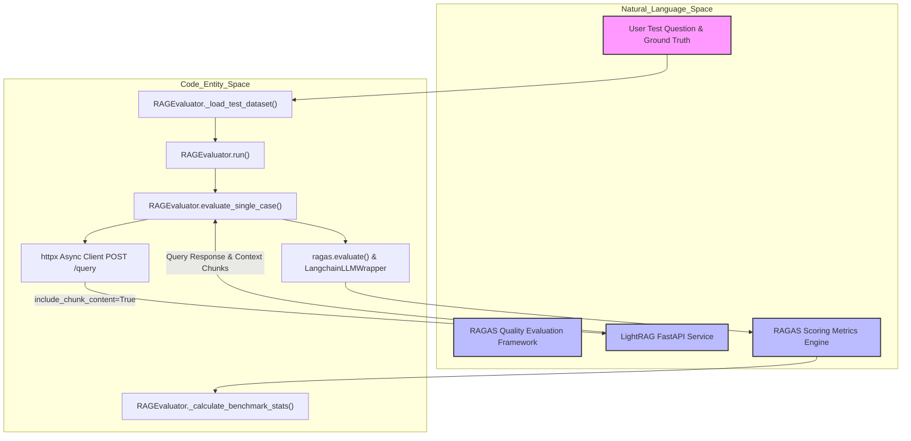
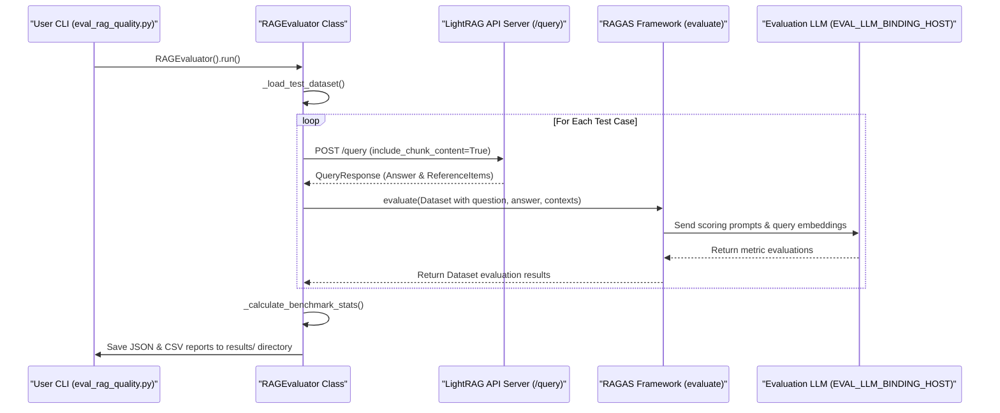

<!-- source: DeepWiki mcp.deepwiki.com · repo HKUDS/LightRAG · page 9.1 RAG Quality Evaluation · fetched 2026-11-09 -->

# RAG Quality Evaluation

<details>
<summary>Relevant source files</summary>

The following files were used as context for generating this wiki page:

- [lightrag/evaluation/__init__.py](lightrag/evaluation/__init__.py)
- [lightrag/evaluation/eval_rag_quality.py](lightrag/evaluation/eval_rag_quality.py)
- [lightrag/evaluation/sample_dataset.json](lightrag/evaluation/sample_dataset.json)
- [lightrag/evaluation/sample_documents/01_lightrag_overview.md](lightrag/evaluation/sample_documents/01_lightrag_overview.md)
- [lightrag/evaluation/sample_documents/02_rag_architecture.md](lightrag/evaluation/sample_documents/02_rag_architecture.md)
- [lightrag/evaluation/sample_documents/03_lightrag_improvements.md](lightrag/evaluation/sample_documents/03_lightrag_improvements.md)
- [lightrag/evaluation/sample_documents/04_supported_databases.md](lightrag/evaluation/sample_documents/04_supported_databases.md)
- [lightrag/evaluation/sample_documents/05_evaluation_and_deployment.md](lightrag/evaluation/sample_documents/05_evaluation_and_deployment.md)
- [lightrag/evaluation/sample_documents/README.md](lightrag/evaluation/sample_documents/README.md)
- [tests/evaluation/test_eval_rag_quality.py](tests/evaluation/test_eval_rag_quality.py)

</details>


## Purpose and Scope

This page documents the RAG quality evaluation subsystem in LightRAG, which provides a quantitative benchmarking framework based on **RAGAS** (Retrieval Augmented Generation Assessment) [lightrag/evaluation/eval_rag_quality.py:3-9](). The subsystem is implemented primarily in `lightrag/evaluation/eval_rag_quality.py` and offers automated, reference-free assessment of retrieval accuracy, context precision, answer relevance, and faithfulness [lightrag/evaluation/eval_rag_quality.py:5-9](). It is designed for developers and operators looking to track regression, evaluate custom LLM and embedding bindings, and validate query performance against curated test datasets [lightrag/evaluation/eval_rag_quality.py:11-38]().

Sources: [lightrag/evaluation/eval_rag_quality.py:1-38](), [lightrag/evaluation/__init__.py:1-14]()

---

## RAGAS-based Evaluation Metrics

The evaluation framework measures five core indicators to evaluate generation and retrieval quality [lightrag/evaluation/eval_rag_quality.py:115-123]():

| Metric | Description | Target Score |
| :--- | :--- | :--- |
| **faithfulness** | Measures factual accuracy of the generated answer based exclusively on the retrieved context, detecting hallucinations [lightrag/evaluation/eval_rag_quality.py:5-6]() | > 0.80 |
| **answer_relevance** | Evaluates how directly and appropriately the generated answer addresses the user query [lightrag/evaluation/eval_rag_quality.py:7]() | > 0.80 |
| **context_recall** | Assesses whether all necessary information required to answer the question was successfully retrieved [lightrag/evaluation/eval_rag_quality.py:8]() | > 0.80 |
| **context_precision** | Measures the proportion of relevant content in the retrieved chunks relative to noise and irrelevant text [lightrag/evaluation/eval_rag_quality.py:9]() | > 0.80 |
| **ragas_score** | Composite average score combining all four component metrics [lightrag/evaluation/eval_rag_quality.py:115-123]() | > 0.80 |

### Robust NaN and Failure Handling

The evaluation harness includes built-in robustness mechanisms implemented via `_is_nan()` and statistical aggregation routines [lightrag/evaluation/eval_rag_quality.py:110-123](), [tests/evaluation/test_eval_rag_quality.py:119-180]():
- **Partial NaN Metrics**: If a specific metric evaluates to `float('nan')` due to LLM parsing errors or malformed inputs, the framework computes the average over the successfully scored metrics without penalizing the run as a complete zero [tests/evaluation/test_eval_rag_quality.py:128-136]().
- **All-NaN Failures**: If all metrics return `NaN`, the case is classified as an execution failure rather than a successful 0.0 score, preserving clean statistics in both CSV exports and benchmark summaries [tests/evaluation/test_eval_rag_quality.py:119-126]().

Sources: [lightrag/evaluation/eval_rag_quality.py:5-9, 110-123](), [tests/evaluation/test_eval_rag_quality.py:119-180]()

---

## Core Components and Data Flow

### Architecture and Interaction Flow

The following diagram bridges the natural language concepts of RAG evaluation to the concrete code entities within the LightRAG repository:



Sources: [lightrag/evaluation/eval_rag_quality.py:126-405](), [lightrag/api/routers/query_routes.py:14-191]()

---

## RAGEvaluator Implementation Details

The evaluation process is orchestrated by the `RAGEvaluator` class [lightrag/evaluation/eval_rag_quality.py:126-405]():

- **Initialization (`__init__`)**: Validates the availability of optional `ragas` and `datasets` dependencies [lightrag/evaluation/eval_rag_quality.py:150-156](). Configures evaluation LLMs and embeddings with fallback chains supporting custom endpoints and API keys (`EVAL_LLM_BINDING_API_KEY`, `OPENAI_API_KEY`) [lightrag/evaluation/eval_rag_quality.py:157-185]().
- **Dataset Loading (`_load_test_dataset`)**: Reads JSON test suites supporting UTF-8 encodings [tests/evaluation/test_eval_rag_quality.py:14-35]().
- **Single Case Evaluation (`evaluate_single_case`)**: Asynchronously queries the LightRAG API endpoint with `include_chunk_content=True`, packages responses into a dataset format, and invokes `ragas.evaluate()` [lightrag/evaluation/eval_rag_quality.py:304-370]().
- **Benchmark Statistics (`_calculate_benchmark_stats`)**: Aggregates successful/failed test counts, success rates, minimum/maximum scores, and averages across `_METRIC_NAMES` [lightrag/evaluation/eval_rag_quality.py:115-123](), [tests/evaluation/test_eval_rag_quality.py:138-180]().

Sources: [lightrag/evaluation/eval_rag_quality.py:126-405](), [tests/evaluation/test_eval_rag_quality.py:14-180]()

---

## Sample Dataset and Reference Documents

### Dataset Format (`sample_dataset.json`)

The evaluation pipeline consumes JSON datasets structured with test cases containing questions, ground truths, and project identifiers [lightrag/evaluation/sample_dataset.json:1-34]():

```json
{
  "test_cases": [
    {
      "question": "How does LightRAG solve the hallucination problem in large language models?",
      "ground_truth": "LightRAG solves the hallucination problem by combining large language models with external knowledge retrieval...",
      "project": "lightrag_evaluation_sample"
    }
  ]
}
```

### Reference Documents

A set of reference Markdown documents is provided under `lightrag/evaluation/sample_documents/` (e.g., `01_lightrag_overview.md`, `02_rag_architecture.md`, `03_lightrag_improvements.md`, `04_supported_databases.md`, `05_evaluation_and_deployment.md`) [lightrag/evaluation/sample_documents/README.md:1-17](). These documents are indexed into LightRAG prior to evaluation to ensure grounding context is available during retrieval [lightrag/evaluation/sample_documents/README.md:5-9]().

Sources: [lightrag/evaluation/sample_dataset.json:1-34](), [lightrag/evaluation/sample_documents/README.md:1-21]()

---

## Configuration: `EVAL_LLM_BINDING_HOST` and Environment Variables

The evaluation harness accepts several environment variables to configure scoring models and endpoints:

| Environment Variable | Default Value | Purpose |
| :--- | :--- | :--- |
| `EVAL_LLM_MODEL` | `gpt-4o-mini` | LLM model used by RAGAS to score answers [lightrag/evaluation/eval_rag_quality.py:168] |
| `EVAL_EMBEDDING_MODEL` | `text-embedding-3-large` | Embedding model used for vector comparisons in RAGAS [lightrag/evaluation/eval_rag_quality.py:179] |
| `EVAL_LLM_BINDING_API_KEY` | `OPENAI_API_KEY` fallback | API key for the evaluation LLM [lightrag/evaluation/eval_rag_quality.py:158-160] |
| `EVAL_LLM_BINDING_HOST` | `None` | Custom OpenAI-compatible endpoint URL for local LLMs (e.g., vLLM, Ollama) [lightrag/evaluation/eval_rag_quality.py:35, 169] |
| `EVAL_EMBEDDING_BINDING_HOST` | `EVAL_LLM_BINDING_HOST` fallback | Custom endpoint URL for embedding generation [lightrag/evaluation/eval_rag_quality.py:182-184] |
| `EVAL_MAX_CONCURRENT` | `2` | Maximum concurrent evaluation tasks [lightrag/evaluation/eval_rag_quality.py:308] |

Sources: [lightrag/evaluation/eval_rag_quality.py:35, 138-185]()

---

## Results Output

Once execution completes, the results are saved into `lightrag/evaluation/results/` in two formats [lightrag/evaluation/eval_rag_quality.py:29-31]():
- **JSON Export (`results_YYYYMMDD_HHMMSS.json`)**: Contains detailed records for every test case, including retrieved chunks, raw generated answers, and individual metric scores [lightrag/evaluation/eval_rag_quality.py:418-435]().
- **CSV Export (`results_YYYYMMDD_HHMMSS.csv`)**: Provides a tabular summary of scores per test case and aggregated metrics suitable for spreadsheet analysis [lightrag/evaluation/eval_rag_quality.py:437-458]().

Sources: [lightrag/evaluation/eval_rag_quality.py:29-31, 418-458]()

---

## Execution Flow Sequence Diagram



Sources: [lightrag/evaluation/eval_rag_quality.py:304-458](), [lightrag/api/routers/query_routes.py:14-191]()

---

### Sources

- [lightrag/evaluation/eval_rag_quality.py:1-458]()
- [lightrag/evaluation/__init__.py:1-25]()
- [tests/evaluation/test_eval_rag_quality.py:1-193]()
- [lightrag/evaluation/sample_dataset.json:1-34]()
- [lightrag/evaluation/sample_documents/README.md:1-21]()
- [lightrag/api/routers/query_routes.py:14-191]()

---

