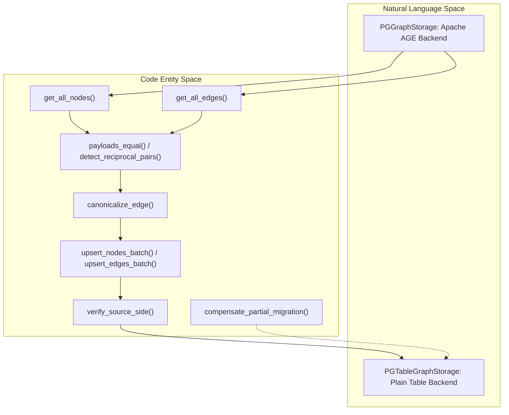
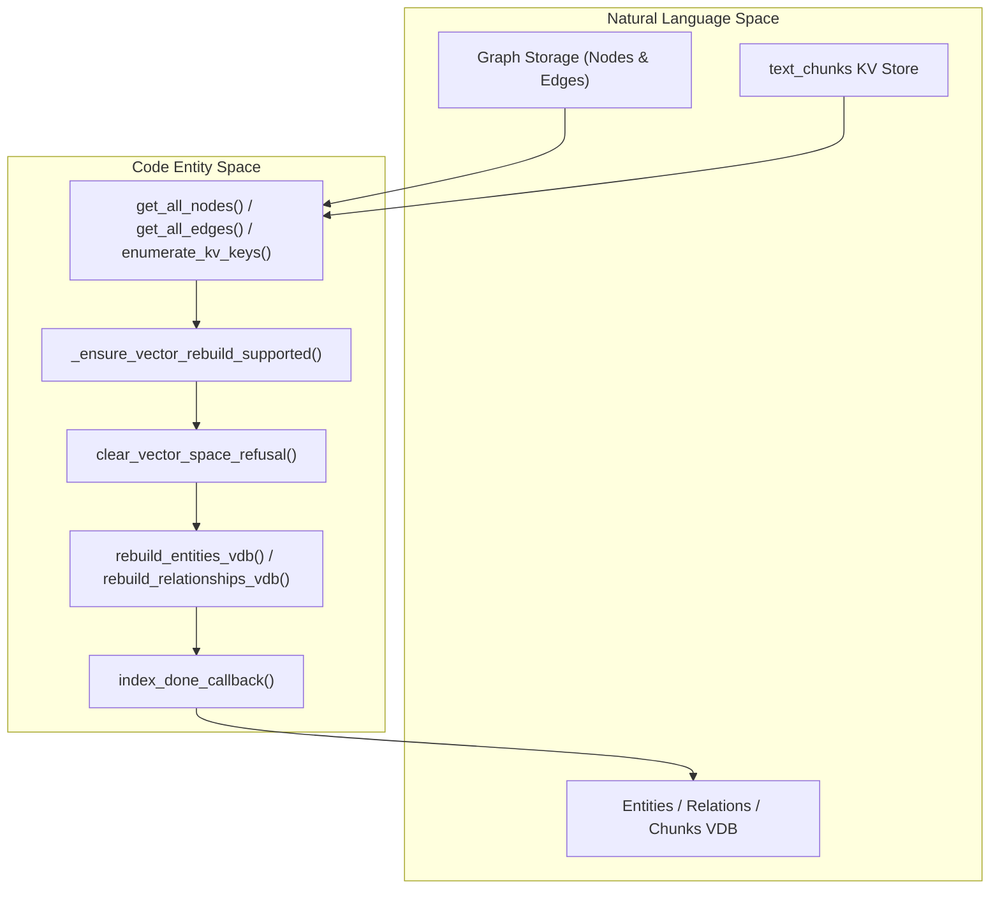

<!-- source: DeepWiki mcp.deepwiki.com · repo HKUDS/LightRAG · page 9.2 Maintenance and Developer Tools · fetched 2026-11-09 -->

# Maintenance and Developer Tools

Relevant source files

The following files were used as context for generating this wiki page:

- [lightrag/kg/noop_vector_db_impl.py](lightrag/kg/noop_vector_db_impl.py)
- [lightrag/kg/vector_space.py](lightrag/kg/vector_space.py)
- [lightrag/tools/README_CHUNK_TRACKING_REPAIR.md](lightrag/tools/README_CHUNK_TRACKING_REPAIR.md)
- [lightrag/tools/README_CLEAN_LLM_QUERY_CACHE.md](lightrag/tools/README_CLEAN_LLM_QUERY_CACHE.md)
- [lightrag/tools/README_MIGRATE_GRAPH_STORAGE.md](lightrag/tools/README_MIGRATE_GRAPH_STORAGE.md)
- [lightrag/tools/README_MIGRATE_LLM_CACHE.md](lightrag/tools/README_MIGRATE_LLM_CACHE.md)
- [lightrag/tools/README_REBUILD_VDB.md](lightrag/tools/README_REBUILD_VDB.md)
- [lightrag/tools/README_SOURCE_CONFLICT_REPAIR.md](lightrag/tools/README_SOURCE_CONFLICT_REPAIR.md)
- [lightrag/tools/chunk_tracking_repair.py](lightrag/tools/chunk_tracking_repair.py)
- [lightrag/tools/clean_llm_query_cache.py](lightrag/tools/clean_llm_query_cache.py)
- [lightrag/tools/migrate_graph_storage.py](lightrag/tools/migrate_graph_storage.py)
- [lightrag/tools/migrate_llm_cache.py](lightrag/tools/migrate_llm_cache.py)
- [lightrag/tools/rebuild_vdb.py](lightrag/tools/rebuild_vdb.py)
- [lightrag/tools/source_conflict_repair.py](lightrag/tools/source_conflict_repair.py)
- [tests/api/routes/test_source_conflict_routes.py](tests/api/routes/test_source_conflict_routes.py)
- [tests/kg/noop_impl/__init__.py](tests/kg/noop_impl/__init__.py)
- [tests/kg/noop_impl/test_noop_vector_storage.py](tests/kg/noop_impl/test_noop_vector_storage.py)
- [tests/kg/opensearch_impl/test_llm_cache_tools_opensearch.py](tests/kg/opensearch_impl/test_llm_cache_tools_opensearch.py)
- [tests/kg/test_vector_space.py](tests/kg/test_vector_space.py)
- [tests/tools/__init__.py](tests/tools/__init__.py)
- [tests/tools/conftest.py](tests/tools/conftest.py)
- [tests/tools/test_chunk_tracking_repair.py](tests/tools/test_chunk_tracking_repair.py)
- [tests/tools/test_clean_llm_query_cache_modes.py](tests/tools/test_clean_llm_query_cache_modes.py)
- [tests/tools/test_migrate_graph_storage.py](tests/tools/test_migrate_graph_storage.py)
- [tests/tools/test_migrate_graph_storage_networkx.py](tests/tools/test_migrate_graph_storage_networkx.py)
- [tests/tools/test_migrate_llm_cache.py](tests/tools/test_migrate_llm_cache.py)
- [tests/tools/test_rebuild_vdb.py](tests/tools/test_rebuild_vdb.py)
- [tests/tools/test_source_conflict_repair_cli.py](tests/tools/test_source_conflict_repair_cli.py)

This page covers the maintenance, diagnostic, and developer tools located under the `lightrag/tools/` directory. These tools ensure data integrity, facilitate backend migrations, repair corrupted tracking or vector states, clean caches, and maintain consistency across knowledge graphs, vector storages, and KV caches.

---

## 1. Graph Storage Migration

The graph storage migration tool (`migrate_graph_storage.py`) migrates an already-extracted knowledge graph between different graph storage backends (Phase 1 supports migrating from Apache AGE `PGGraphStorage` to the plain-table `PGTableGraphStorage`) without requiring document re-extraction [lightrag/tools/migrate_graph_storage.py:2-7]().

### Purpose and Invariants

- **Public API Only**: Reads via `get_all_nodes()` / `get_all_edges()` and writes via `upsert_nodes_batch()` / `upsert_edges_batch()`, utilizing `remove_nodes()` / `remove_edges()` for compensation on partial failures [lightrag/tools/migrate_graph_storage.py:5-8]().
- **Canonical Edge Ordering**: Ensures each undirected edge is stored exactly once in canonical order using Python's `min()` and `max()` on endpoint IDs (`src_id = min(a, b)`, `tgt_id = max(a, b)`), avoiding SQL collation mismatches [lightrag/tools/migrate_graph_storage.py:22-27]().
- **Fail-Closed Validation**: Refuses migration on duplicate node IDs, reciprocal directed pairs, or self-loops (`source == target`) [lightrag/tools/migrate_graph_storage.py:29-36]().
- **Type-Strict Verification**: Uses `payloads_equal()` for structural comparison where every leaf must match in exact Python type and value, preventing silent type coercions [lightrag/tools/migrate_graph_storage.py:44-49]().

### Data Flow Diagram: Graph Storage Migration

Sources: [lightrag/tools/migrate_graph_storage.py:1-139](), [tests/tools/test_migrate_graph_storage.py:1-42](), [lightrag/tools/README_MIGRATE_GRAPH_STORAGE.md:1-65]()

---

## 2. Vector Storage Rebuild Tool

The `lightrag-rebuild-vdb` tool (`rebuild_vdb.py`) restores synchronization between LightRAG's authoritative data sources (graph nodes, graph edges, and the `text_chunks` KV store) and its vector storages (`entities_vdb`, `relationships_vdb`, and `chunks_vdb`) [lightrag/tools/rebuild_vdb.py:3-15]().

### Key Features and Behavior

- **Drop and Rebuild**: Resolves drift caused by runtime write failures or vector-graph divergence by dropping and re-populating vector indices from authoritative sources [lightrag/tools/rebuild_vdb.py:7-10]().
- **Vector Space Provenance**: Tolerates `VectorSpaceMismatchError` when attaching containers created under a different embedding model or dimension [lightrag/tools/rebuild_vdb.py:21-28](). It clears the refusal by calling `drop()` followed by `re-initialization` in the active embedding space [lightrag/tools/rebuild_vdb.py:152-166]().
- **Consistency Diagnostics**: Provides a diagnostic check mode to inspect missing vector records without triggering a full write operation [lightrag/tools/rebuild_vdb.py:38-47]().
- **Batch Processing**: Uses configurable batching (`DEFAULT_BATCH_SIZE = 500`) with periodic flushes to manage memory [lightrag/tools/rebuild_vdb.py:98-102]().

### Data Flow Diagram: VDB Rebuild

Sources: [lightrag/tools/rebuild_vdb.py:1-166](), [tests/tools/test_rebuild_vdb.py:1-83](), [lightrag/tools/README_REBUILD_VDB.md:1-68]()

---

## 3. LLM Cache Migration Tool

The LLM Cache Migration Tool (`migrate_llm_cache.py`) transfers default-mode LLM response caches (`extract`, `summary`, and `analysis`) between different KV storage backends (`JsonKVStorage`, `RedisKVStorage`, `PGKVStorage`, `MongoKVStorage`, `OpenSearchKVStorage`) while respecting workspace isolation [lightrag/tools/migrate_llm_cache.py:2-20]().

### Implementation Details

- Filters keys matching default prefixes (`default:extract:*`, `default:summary:*`, `default:analysis:*`) [lightrag/tools/migrate_llm_cache.py:71-82]().
- Batches migration operations (default batch size 1000) and records detailed statistics (`MigrationStats`) covering successful batches, failed batches, and error payloads [lightrag/tools/migrate_llm_cache.py:65-127]().
- Resolves workspace scopes via backend-specific environment variables (`POSTGRES_WORKSPACE`, `MONGODB_WORKSPACE`, etc.) with fallback to the generic `WORKSPACE` variable [lightrag/tools/migrate_llm_cache.py:57-161]().

Sources: [lightrag/tools/migrate_llm_cache.py:1-212]()

---

## 4. LLM Query Cache Cleanup Tool

The LLM Query Cache Cleanup Tool (`clean_llm_query_cache.py`) cleans transient query and keyword caches across all active RAG query modes (`mix`, `hybrid`, `local`, `global`, `naive`) from KV storage backends [lightrag/tools/clean_llm_query_cache.py:3-19]().

### Features

- Evaluates cache key patterns (`*:query:*`, `*:keywords:*`) for each supported query mode [lightrag/tools/clean_llm_query_cache.py:65-71]().
- Computes pre- and post-cleanup counts and reports batch-level execution results via `CleanupStats` [lightrag/tools/clean_llm_query_cache.py:80-120]().
- Integrates shared update flags (`set_all_update_flags`) to signal storage cache invalidation [lightrag/kg/shared_storage.py](), [lightrag/tools/clean_llm_query_cache.py:35]().

Sources: [lightrag/tools/clean_llm_query_cache.py:1-211]()

---

## 5. Chunk Tracking Repair Tool

The offline chunk-tracking repair tool (`chunk_tracking_repair.py`) removes orphan tracking keys in `entity_chunks` and `relation_chunks` KV namespaces when corresponding objects no longer exist in the graph [lightrag/tools/chunk_tracking_repair.py:2-17]().

### Implementation Highlights

- **SQLite-Backed Durable Plan (`_DiskPlan`)**: Builds a local SQLite database plan (`_DiskPlan`) to hold object universes and replacement rows, allowing resumable execution and bounding memory consumption [lightrag/tools/chunk_tracking_repair.py:66-135]().
- **Offline-Only Invariant**: Requires all API servers, pipeline workers, and writers using the target backing store to be shut down before running `--apply`, avoiding race conditions with in-memory pipeline reservations [lightrag/tools/chunk_tracking_repair.py:7-17]().
- **Attribution Reconstruction**: Preserves authoritative rows for live graph objects and reconstructs missing tracking data from cached extraction results without relying on graph `source_id` truncation [tests/tools/test_chunk_tracking_repair.py:9-20]().

Sources: [lightrag/tools/chunk_tracking_repair.py:1-192](), [tests/tools/test_chunk_tracking_repair.py:1-205](), [lightrag/tools/README_CHUNK_TRACKING_REPAIR.md:1-85]()

---

## 6. Source Conflict Repair Tool

The Source Conflict Repair tool (`source_conflict_repair.py`) addresses canonical source key collisions where multiple primary documents claim the same hint-stripped base filename [lightrag/tools/source_conflict_repair.py:2-9]().

### Safety and Operation Model

- **No Deletion Policy**: Demoted candidates are marked as duplicates (`metadata.is_duplicate=true`) linked to the selected primary (`original_doc_id=<primary>`), while preserving status and `full_docs` entries [lightrag/tools/source_conflict_repair.py:10-17]().
- **Compare-And-Set (CAS)**: Commits execute via CAS guards, failing loudly if concurrent ingest or deletion operations alter the candidate set [lightrag/tools/source_conflict_repair.py:51-57]().
- **Ingress Fences**: Integrates with pipeline locks (`source_candidate_set_lock`, `enqueue_serialize_lock`) to coordinate with active workers during online repairs [lightrag/tools/source_conflict_repair.py:101-143]().

Sources: [lightrag/tools/source_conflict_repair.py:2-143](), [tests/tools/test_source_conflict_repair_cli.py:1-100]()

---

## 7. Additional Maintenance Utilities

LightRAG includes additional administrative tools and modules under `lightrag/tools/`:
- **`kg_integrity_repair.py`**: Audits and repairs knowledge graph structures, fixing missing references and recovery anchors (`full_entities`, `full_relations`).
- **Password Hashing**: Manages credential hashing to support OAuth2 password flows and JWT authentication in the FastAPI server.

Sources: [lightrag/tools/kg_integrity_repair.py](), [lightrag/tools/rebuild_vdb.py:1-62]()

---

## Summary Diagram: Natural Language System to Code Entities

```mermaid
graph TD
    subgraph "Natural Language Maintenance Operations"
        NL_GraphMigrate["Graph Storage Backend Migration"]
        NL_VDBRebuild["Vector Storage Index Rebuild"]
        NL_CacheMigrate["LLM Response Cache Transfer"]
        NL_QueryClean["Query Cache Cleanup"]
        NL_ChunkRepair["Orphan Chunk Tracking Repair"]
        NL_SourceConflict["Source Conflict Resolution"]
    end

    subgraph "Code Entity Space"
        CodeGraph["lightrag/tools/migrate_graph_storage.py"]
        CodeVDB["lightrag/tools/rebuild_vdb.py"]
        CodeCacheMigrate["lightrag/tools/migrate_llm_cache.py"]
        CodeQueryClean["lightrag/tools/clean_llm_query_cache.py"]
        CodeChunkRepair["lightrag/tools/chunk_tracking_repair.py"]
        CodeSourceConflict["lightrag/tools/source_conflict_repair.py"]
        CodeIntegrity["lightrag/tools/kg_integrity_repair.py"]
    end

    NL_GraphMigrate --> CodeGraph
    NL_VDBRebuild --> CodeVDB
    NL_CacheMigrate --> CodeCacheMigrate
    NL_QueryClean --> CodeQueryClean
    NL_ChunkRepair --> CodeChunkRepair
    NL_SourceConflict --> CodeSourceConflict
    NL_SourceConflict --> CodeIntegrity
```

Sources: [lightrag/tools/migrate_graph_storage.py:1-65](), [lightrag/tools/rebuild_vdb.py:1-62](), [lightrag/tools/migrate_llm_cache.py:1-20](), [lightrag/tools/clean_llm_query_cache.py:1-19](), [lightrag/tools/chunk_tracking_repair.py:1-17](), [lightrag/tools/source_conflict_repair.py:1-17]()

---

