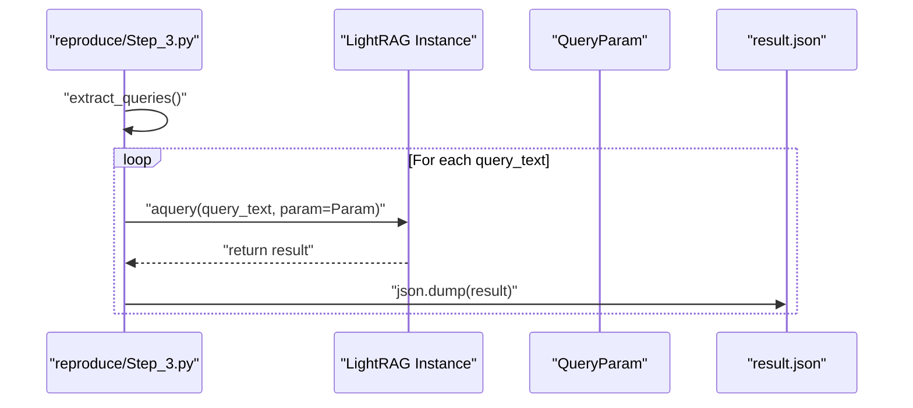
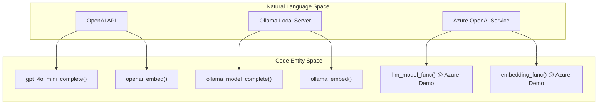
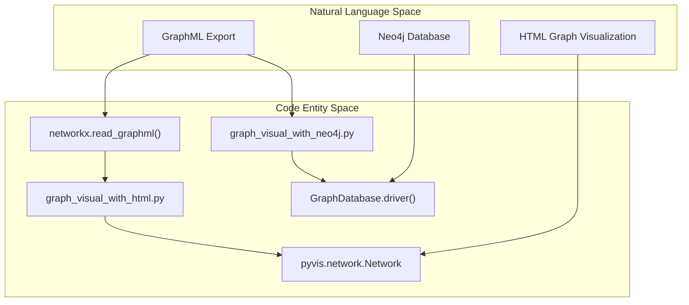

<!-- source: DeepWiki mcp.deepwiki.com · repo HKUDS/LightRAG · page 9.3 Usage Examples and Benchmarks · fetched 2026-11-09 -->

# Usage Examples and Benchmarks

Relevant source files

The following files were used as context for generating this wiki page:

- [.gitignore](.gitignore)
- [examples/generate_query.py](examples/generate_query.py)
- [examples/graph_visual_with_html.py](examples/graph_visual_with_html.py)
- [examples/graph_visual_with_neo4j.py](examples/graph_visual_with_neo4j.py)
- [examples/lightrag_azure_openai_demo.py](examples/lightrag_azure_openai_demo.py)
- [examples/lightrag_ollama_demo.py](examples/lightrag_ollama_demo.py)
- [examples/lightrag_openai_compatible_demo.py](examples/lightrag_openai_compatible_demo.py)
- [examples/lightrag_openai_demo.py](examples/lightrag_openai_demo.py)
- [examples/lightrag_openai_mongodb_graph_demo.py](examples/lightrag_openai_mongodb_graph_demo.py)
- [examples/rerank_example.py](examples/rerank_example.py)
- [lightrag/rerank.py](lightrag/rerank.py)
- [reproduce/Step_0.py](reproduce/Step_0.py)
- [reproduce/Step_1.py](reproduce/Step_1.py)
- [reproduce/Step_1_openai_compatible.py](reproduce/Step_1_openai_compatible.py)
- [reproduce/Step_2.py](reproduce/Step_2.py)
- [reproduce/Step_3.py](reproduce/Step_3.py)
- [reproduce/Step_3_openai_compatible.py](reproduce/Step_3_openai_compatible.py)
- [tests/chunker/test_rerank_chunking.py](tests/chunker/test_rerank_chunking.py)

This page details practical usage examples and benchmark setups for LightRAG, illustrating integration with various LLM providers, specialized storage backends, reranking mechanisms, graph visualization, as well as instructions to reproduce evaluation runs. It covers official demo scripts, community samples, and batch query processing for benchmarking.

---

## 9.3.1 Official Usage Examples

The `examples/` directory contains curated scripts that demonstrate initialization, insertion, and query with LightRAG across multiple LLM and embedding providers, plus advanced scenarios like reranking and graph visualization.

### OpenAI Demos

- **Standard OpenAI Demo**: Uses `gpt_4o_mini_complete` for LLM completion and `openai_embed` for embeddings. The demo clears previous files, performs insertion of a sample book, then executes queries in multiple retrieval modes (`naive`, `local`, `global`, and `hybrid`) [examples/lightrag_openai_demo.py:1-187]().
  
- **OpenAI-Compatible Demo**: Wraps OpenAI-compatible models such as DeepSeek or Upstage via `openai_complete_if_cache` with custom `base_url` and `api_key`. Embeddings use `ollama_embed` with manual wrapping to avoid double decorations [examples/lightrag_openai_compatible_demo.py:1-128](), [reproduce/Step_3_openai_compatible.py:12-83]().

Usage Flow:
1. Clear previous persistent files.
2. Initialize `LightRAG` with provider-specific LLM and embedding functions.
3. Run insertions with `rag.ainsert()` (async).
4. Query with `rag.aquery()`, specifying `QueryParam.mode`.
5. Print or stream query results.

Sources:  
[examples/lightrag_openai_demo.py:1-187](),  
[examples/lightrag_openai_compatible_demo.py:1-128](),  
[reproduce/Step_3_openai_compatible.py:12-83]()

### Ollama-Local Demo

Demonstrates local LLM model usage via Ollama binding:

- Uses `ollama_model_complete` and `ollama_embed`.
- Customizes LLM context window (`num_ctx`) in `llm_model_kwargs` for large context support.
- Wraps embedding function carefully to avoid double wrapping by accessing `.func` attribute on `EmbeddingFunc`.
- Supports async streaming of query responses [examples/lightrag_ollama_demo.py:1-190]().

Sources:  
[examples/lightrag_ollama_demo.py:1-190]()

### Azure OpenAI Demo

Illustrates integration with Azure OpenAI:

- Defines LLM and embedding clients using `openai.AzureOpenAI`.
- Uses environment-configured deployment names and endpoints.
- Demonstrates async LLM completion and embedding functions.
- Shows document insertion and queries using multiple retrieval modes [examples/lightrag_azure_openai_demo.py:1-125]().

Sources:  
[examples/lightrag_azure_openai_demo.py:1-125]()

---

## 9.3.2 Specialized Storage and Visualization Examples

LightRAG supports multiple storage backends beyond default local files.

| Storage Type         | Example Script                                      | Description                                  |
|----------------------|---------------------------------------------------|----------------------------------------------|
| MongoDB Graph Storage| `examples/lightrag_openai_mongodb_graph_demo.py`  | Demonstrates MongoDB graph integration.      |
| Neo4j Graph Storage  | `examples/graph_visual_with_neo4j.py`              | Imports graph data into Neo4j from GraphML XML, batching writes [examples/graph_visual_with_neo4j.py:1-186]().|
| Vector Storage       | `examples/unofficial-sample/lightrag_openai_neo4j_milvus_redis_demo.py` | Shows combination of Milvus vector DB and Neo4j storage. |
| HTML Visualization   | `examples/graph_visual_with_html.py`                | Uses NetworkX and Pyvis for interactive graph visualization in browser [examples/graph_visual_with_html.py:1-34](). |

These examples showcase transformations from serialized KG exports (GraphML) to graph databases and interactive graph UIs.

Sources:  
[examples/lightrag_openai_mongodb_graph_demo.py:1-30](),  
[examples/graph_visual_with_neo4j.py:1-186](),  
[examples/graph_visual_with_html.py:1-34]()

---

## 9.3.3 Reranking Example

Reranking is an important post-processing step to refine retrieved documents' order based on contextual relevance.

- The example script `examples/rerank_example.py` configures a rerank function using Cohere's API with chunking to respect token limits.
- It uses environment variables to control rerank settings such as `RERANK_MODEL`, `RERANK_BINDING_HOST`, and toggles chunking [examples/rerank_example.py:1-199]().
- Demonstrates creating a `LightRAG` instance configured with the rerank function and tests queries with and without rerank enabled.
- Shows direct rerank invocation over a document collection for debugging.

Key reranking functions (`cohere_rerank`, `chunk_documents_for_rerank`) handle splitting long documents into overlapping chunks, perform model scoring, and aggregate scores back to original documents [lightrag/rerank.py:1-179](), [tests/chunker/test_rerank_chunking.py:1-169]().

Sources:  
[examples/rerank_example.py:1-199](),  
[lightrag/rerank.py:1-179](),  
[tests/chunker/test_rerank_chunking.py:1-169]()

---

## 9.3.4 Reproduce and Benchmarking Scripts

Benchmarking and batch evaluation workflows come in staged scripts under the `reproduce/` directory:

- **Step_1.py** executes batch insertion of text documents into LightRAG with retry logic to ensure robustness [reproduce/Step_1.py:9-48]().
- **Step_3.py** reads queries from evaluation files, runs batch asynchronous queries through LightRAG's `aquery()`, and stores results/errors as JSON [reproduce/Step_3.py:7-66]().

### Batch Query Processing Data Flow

Sources:  
[reproduce/Step_1.py:9-48](),  
[reproduce/Step_3.py:7-66]()

---

## 9.3.5 Overview Diagrams Bridging Natural Language Space to Code Entities

### Diagram 1: LLM Provider Integration to Code Entities

Sources:  
[examples/lightrag_openai_demo.py:1-187](),  
[examples/lightrag_ollama_demo.py:1-190](),  
[examples/lightrag_azure_openai_demo.py:1-125]()

### Diagram 2: Storage Backend Usage & Graph Visualization

Sources:  
[examples/graph_visual_with_neo4j.py:1-186](),  
[examples/graph_visual_with_html.py:1-34]()

---

## 9.3.6 Community Samples and Extended Examples

Several community-contributed and unofficial samples illustrate various scenarios:

- Cloudflare integration: `lightrag_cloudflare_demo.py`
- Bedrock (AWS) LLM integration: `lightrag_bedrock_demo.py`
- LlamaIndex integration with LightRAG: example integration pipelines.
- Local inference benchmarks using `vLLM`.
- NVIDIA and HuggingFace API integrations.
- LiteLLM and Opik examples for on-prem/local usage.

These samples demonstrate advanced usage patterns and multi-provider orchestration.

Sources:  
[examples/unofficial-sample/]()

---

## Summary Table of Key Example Categories

| Example Category            | Sample Script(s)                                      | Description                                                  |
|----------------------------|------------------------------------------------------|--------------------------------------------------------------|
| OpenAI Provider             | `examples/lightrag_openai_demo.py`                   | Basic OpenAI integration, multiple query modes               |
| OpenAI-Compatible Providers | `examples/lightrag_openai_compatible_demo.py`        | Compatible APIs with custom base URLs and tokens             |
| Ollama Local LLM            | `examples/lightrag_ollama_demo.py`                    | Runs local Ollama LLM server with streaming output           |
| Azure OpenAI                | `examples/lightrag_azure_openai_demo.py`              | Azure-specific setup for LLM and embedding clients           |
| Graph Storage               | `examples/lightrag_openai_mongodb_graph_demo.py`     | MongoDB graph backend example                                 |
| Graph DB Visualization      | `examples/graph_visual_with_neo4j.py`, `graph_visual_with_html.py` | Neo4j import and Pyvis HTML graph visualizations              |
| Rerank Demonstration        | `examples/rerank_example.py`                          | Integration of rerank APIs with custom chunking              |
| Reproduce Benchmark Steps   | `reproduce/Step_1.py`, `reproduce/Step_3.py`          | Batch ingestion and query benchmarking scripts               |

Sources:  
[examples/lightrag_openai_demo.py:1-187](),  
[examples/lightrag_openai_compatible_demo.py:1-128](),  
[examples/lightrag_ollama_demo.py:1-190](),  
[examples/lightrag_azure_openai_demo.py:1-125](),  
[examples/lightrag_openai_mongodb_graph_demo.py:1-30](),  
[examples/graph_visual_with_neo4j.py:1-186](),  
[examples/graph_visual_with_html.py:1-34](),  
[examples/rerank_example.py:1-199](),  
[reproduce/Step_1.py:9-48](),  
[reproduce/Step_3.py:7-66]()

---

# References

- Official example scripts demonstrating provider integration, insertion, query modes, and streaming: `examples/lightrag_openai_demo.py`, `examples/lightrag_openai_compatible_demo.py`, `examples/lightrag_ollama_demo.py`, `examples/lightrag_azure_openai_demo.py`
- Rerank utilities and example: `lightrag/rerank.py`, `examples/rerank_example.py`
- Graph visualization and Neo4j ingestion example: `examples/graph_visual_with_neo4j.py`, `examples/graph_visual_with_html.py`
- Batch evaluation and query reproduction: `reproduce/Step_1.py`, `reproduce/Step_3.py`
- Community and unofficial sample scripts in `examples/unofficial-sample/`

Sources:  
[examples/lightrag_openai_demo.py:1-187](),  
[examples/lightrag_openai_compatible_demo.py:1-128](),  
[examples/lightrag_ollama_demo.py:1-190](),  
[examples/lightrag_azure_openai_demo.py:1-125](),  
[examples/lightrag_openai_mongodb_graph_demo.py:1-30](),  
[examples/graph_visual_with_neo4j.py:1-186](),  
[examples/graph_visual_with_html.py:1-34](),  
[examples/rerank_example.py:1-199](),  
[lightrag/rerank.py:1-179](),  
[reproduce/Step_3.py:7-66](),  
[reproduce/Step_1.py:9-48]()

---

