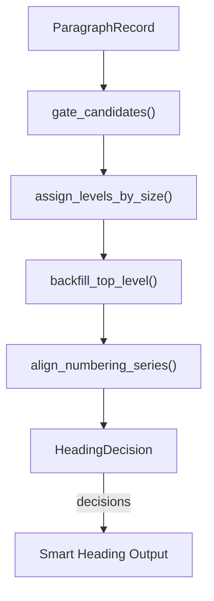
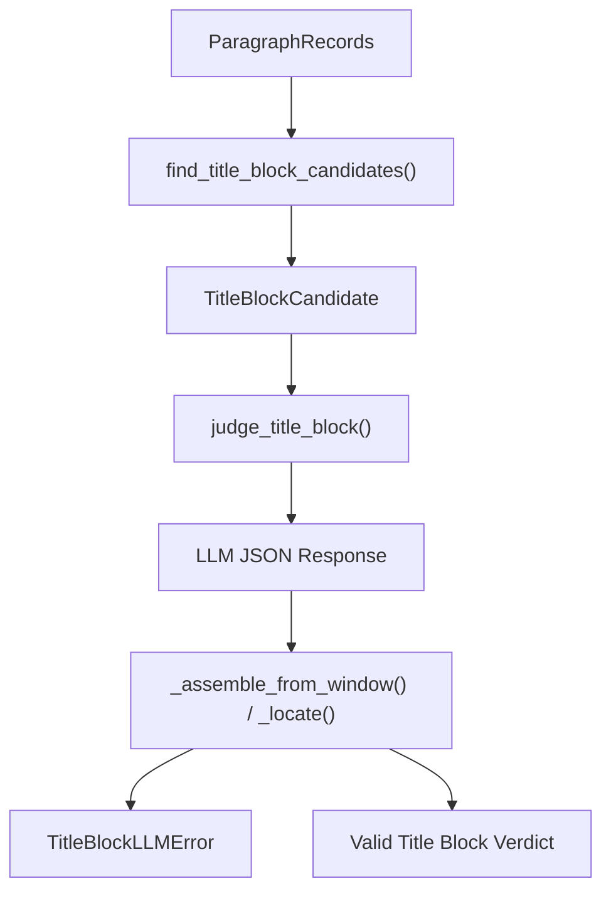
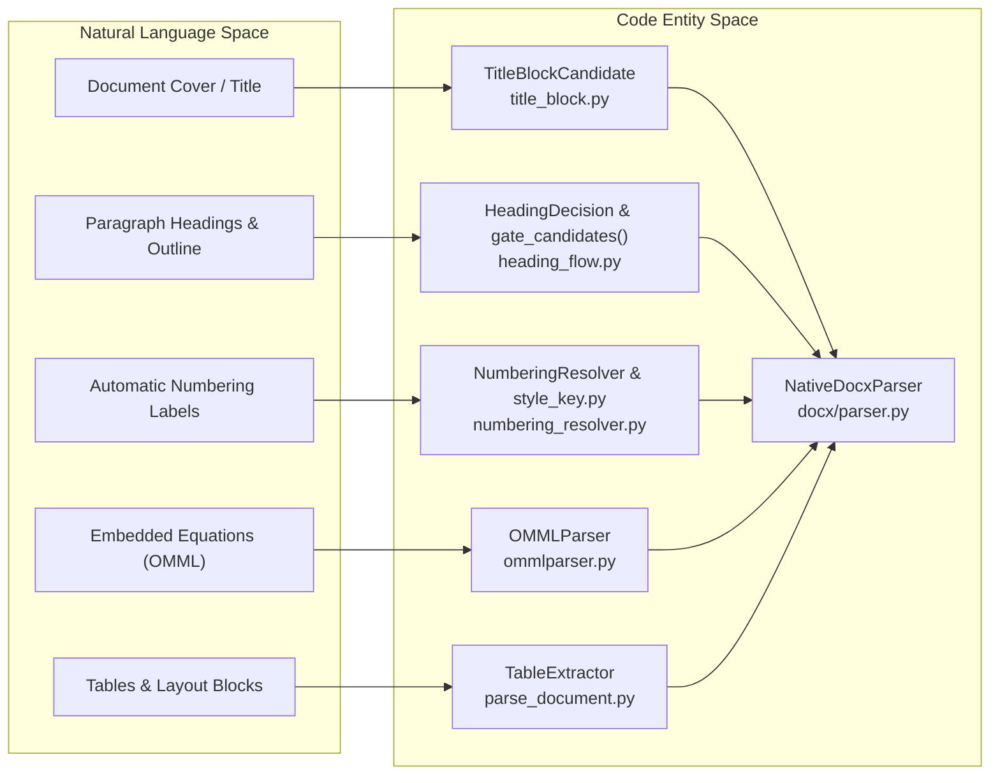

<!-- source: DeepWiki mcp.deepwiki.com · repo HKUDS/LightRAG · extra page Native DOCX Parser and Smart Heading · fetched 2026-11-09 -->

# Native DOCX Parser and Smart Heading

Relevant source files

The following files were used as context for generating this wiki page:

- [lightrag/parser/docx/numbering_resolver.py](lightrag/parser/docx/numbering_resolver.py)
- [lightrag/parser/docx/omml/ommlparser.py](lightrag/parser/docx/omml/ommlparser.py)
- [lightrag/parser/docx/parse_document.py](lightrag/parser/docx/parse_document.py)
- [lightrag/parser/docx/parser.py](lightrag/parser/docx/parser.py)
- [lightrag/parser/docx/smart_heading/features.py](lightrag/parser/docx/smart_heading/features.py)
- [lightrag/parser/docx/smart_heading/guardrails.py](lightrag/parser/docx/smart_heading/guardrails.py)
- [lightrag/parser/docx/smart_heading/heading_flow.py](lightrag/parser/docx/smart_heading/heading_flow.py)
- [lightrag/parser/docx/smart_heading/nlp.py](lightrag/parser/docx/smart_heading/nlp.py)
- [lightrag/parser/docx/smart_heading/style_key.py](lightrag/parser/docx/smart_heading/style_key.py)
- [lightrag/parser/docx/smart_heading/title_block.py](lightrag/parser/docx/smart_heading/title_block.py)
- [lightrag/parser/docx/zip_budget.py](lightrag/parser/docx/zip_budget.py)
- [lightrag/parser/native_base.py](lightrag/parser/native_base.py)
- [tests/parser/docx/golden/smart_heading/citation_swallows_heading.docx](tests/parser/docx/golden/smart_heading/citation_swallows_heading.docx)
- [tests/parser/docx/test_numbering_resolver.py](tests/parser/docx/test_numbering_resolver.py)
- [tests/parser/docx/test_omml_latex_delimiters.py](tests/parser/docx/test_omml_latex_delimiters.py)
- [tests/parser/docx/test_smart_heading_e2e.py](tests/parser/docx/test_smart_heading_e2e.py)
- [tests/parser/docx/test_smart_heading_features.py](tests/parser/docx/test_smart_heading_features.py)
- [tests/parser/docx/test_smart_heading_flow.py](tests/parser/docx/test_smart_heading_flow.py)
- [tests/parser/docx/test_smart_heading_guardrails.py](tests/parser/docx/test_smart_heading_guardrails.py)
- [tests/parser/docx/test_smart_heading_guards.py](tests/parser/docx/test_smart_heading_guards.py)
- [tests/parser/docx/test_smart_heading_skeleton.py](tests/parser/docx/test_smart_heading_skeleton.py)
- [tests/parser/docx/test_smart_heading_style_key.py](tests/parser/docx/test_smart_heading_style_key.py)
- [tests/parser/docx/test_smart_heading_title_block.py](tests/parser/docx/test_smart_heading_title_block.py)
- [tests/parser/docx/test_smart_heading_wiring.py](tests/parser/docx/test_smart_heading_wiring.py)
- [tests/parser/docx/test_zip_budget.py](tests/parser/docx/test_zip_budget.py)
- [tests/pipeline/test_multimodal_path_containment.py](tests/pipeline/test_multimodal_path_containment.py)

## Purpose and Scope

The Native DOCX parser is a core subsystem within the document ingestion pipeline (`[lightrag/parser/native_base.py:59-116]()`). It reads `.docx` files, parses structural blocks, extracts headings using a sophisticated multi-stage **smart heading** pipeline, enforces resource and zip budgets, resolves automatic numbering schemes, and converts OMML equation blocks into LaTeX representations.

This page documents:
- The **smart_heading** pipeline (`[lightrag/parser/docx/smart_heading/heading_flow.py:1-183]()`), covering candidate gating, font-size leveling, top-level backfill, series alignment, and anchoring.
- Title block discovery and LLM-based verification with strict locate-back validation (`[lightrag/parser/docx/smart_heading/title_block.py:1-164]`).
- Defensive guardrails (`[lightrag/parser/docx/smart_heading/guardrails.py:1-123]()`) preventing false heading detections.
- Numbering resolvers (`[lightrag/parser/docx/numbering_resolver.py:1-138]()`) and style key classifications (`[lightrag/parser/docx/smart_heading/style_key.py:1-180]()`).
- OMML equation parsing (`[lightrag/parser/docx/omml/ommlparser.py:1-144]()`) and table extraction (`[lightrag/parser/docx/parse_document.py:1-179]()`).

Sources: `[lightrag/parser/native_base.py:59-116]()`, `[lightrag/parser/docx/smart_heading/heading_flow.py:1-183]()`, `[lightrag/parser/docx/smart_heading/title_block.py:1-164]()`, `[lightrag/parser/docx/smart_heading/guardrails.py:1-123]()`, `[lightrag/parser/docx/numbering_resolver.py:1-138]()`, `[lightrag/parser/docx/smart_heading/style_key.py:1-180]()`, `[lightrag/parser/docx/omml/ommlparser.py:1-144]()`, `[lightrag/parser/docx/parse_document.py:1-179]()`.

---

## 1. Smart Heading Parsing Flow

The smart heading workflow is orchestrated in `[lightrag/parser/docx/smart_heading/heading_flow.py:1-183]()`. It processes per-sub-document paragraph records through candidate gating, font-size leveling, numbering alignment, and outline anchoring.

### Pipeline Stages
1. **Candidate Gate**: Evaluates `outline_level`, font size tiers, numbering, bold formatting, and centered companion lines, while filtering out strong-body matches, homophones, and caption prefixes `[lightrag/parser/docx/smart_heading/heading_flow.py:5-8]()`.
2. **Font-Size Leveling**: Groups candidates into size bands and assigns consecutive levels `[lightrag/parser/docx/smart_heading/heading_flow.py:9-12]()`.
3. **Top-Level Backfill**: Absorbs chapter markers (`CnChapter`, `EnChapter`, `EnNum`) as level-1 headings based on ordinal linkage `[lightrag/parser/docx/smart_heading/heading_flow.py:13-14]()`.
4. **Numbering Series Alignment**: Aligns open-interval numbering series using shallow tie-breaks and subtree shifts `[lightrag/parser/docx/smart_heading/heading_flow.py:15-16]()`.

### Key Class: `HeadingDecision`
The `HeadingDecision` dataclass `[lightrag/parser/docx/smart_heading/heading_flow.py:136-181]()` threads mutable per-record verdicts through the pipeline, tracking heading state, level, font size, outline levels, numbering classifications, centering, boldness, and audit rule trails.

### Diagram: Smart Heading Flow to Code Entities

Sources: `[lightrag/parser/docx/smart_heading/heading_flow.py:1-181]()`, `[tests/parser/docx/test_smart_heading_flow.py:9-102]()`.

---

## 2. Title Block Discovery and LLM Judgment

Document main title blocks are identified using heuristic windows and verified via a synchronous LLM judge in `[lightrag/parser/docx/smart_heading/title_block.py:1-164]()`.

### Candidate Windows and Validation
- **Candidate Windows**: Contiguous runs of paragraphs lacking strong-body evidence that contain a visually dominant title line `[lightrag/parser/docx/smart_heading/title_block.py:1-6]`.
- **Locate-Back Validation**: LLM-generated main/sub titles must match window text exactly, folded (case/punctuation/width-agnostic), or assembled from source-order fragments (`_assemble_from_window`). Invalid or hallucinated answers raise `TitleBlockLLMError` `[lightrag/parser/docx/smart_heading/title_block.py:7-30]()`.

### Key Classes & Functions
- `TitleBlockCandidate`: Holds metadata for candidate window spans.
- `judge_title_block()`: Invokes the synchronous LLM bridge and validates output structures `[lightrag/parser/docx/smart_heading/title_block.py:55-80]()`.
- `compose_doc_title()` and `compose_title_heading()`: Format the final H1 and document title strings.

### Diagram: Title Block to LLM Judgment Flow

Sources: `[lightrag/parser/docx/smart_heading/title_block.py:1-164]()`, `[tests/parser/docx/test_smart_heading_title_block.py:1-79]()`.

---

## 3. Guardrails: Defensive Heading Classification

Guardrails in `[lightrag/parser/docx/smart_heading/guardrails.py:1-123]()` apply negative voting rules ("do-no-harm: ties break toward 'not a heading'") to prevent misclassification.

### Key Checks
- **Caption & Homophone Vetoes**: Filters out table/figure captions and NER-confused entities.
- **Strong-Body Heuristics**: Identifies multi-sentence or overly long prose using `strong_body_reason()` and explicit internal sentence boundaries.
- **Length Caps**: Enforces weighted character length caps (`heading_max_chars()`) with environment overrides (`DOCX_SMART_HEADING_MAX_CHARS`) and truncates headings with ellipses (`truncate_to_heading_length()`) `[lightrag/parser/docx/smart_heading/guardrails.py:69-149]()`.

Sources: `[lightrag/parser/docx/smart_heading/guardrails.py:1-149]()`.

---

## 4. Numbering Resolver and Style Keys

Automatic numbering resolution and regex style classification map document paragraphs to structured outline levels.

### NumberingResolver
- Defined in `[lightrag/parser/docx/numbering_resolver.py:1-138]`.
- Parses `numbering.xml` and `styles.xml` to resolve abstract numbering templates (`abstractNum`), levels (`ilvl`), number formats (`numFmt` such as `decimal`, `lowerLetter`, `chineseCounting`), and style-inheritance chains.
- Tracks active counters and handles out-of-range or unsupported format warnings.

### StyleKey Classification
- Defined in `[lightrag/parser/docx/smart_heading/style_key.py:1-125]`.
- Classifies twelve numbering shapes into distinct `styleKey` categories (e.g., `CnChapter`, `MultiLevelNum`, `EnNum`, `RomanNum`) with defined priority order and ordinal parsing rules.

Sources: `[lightrag/parser/docx/numbering_resolver.py:1-138]`, `[lightrag/parser/docx/smart_heading/style_key.py:1-125]()`, `[tests/parser/docx/test_numbering_resolver.py:1-130]()`.

---

## 5. OMML Equation Parsing and LaTeX Conversion

Embedded equations in Word's OMML format are converted to LaTeX in `[lightrag/parser/docx/omml/ommlparser.py:1-144]()`.

### OMMLParser Implementation
- Converts `m:oMath` XML trees into LaTeX strings `[lightrag/parser/docx/omml/ommlparser.py:92-144]()`.
- Normalizes delimiters and fullwidth/CJK brackets (`_normalize_delimiter`, `_normalize_separator`), correctly pairing `\left` and `\right` (escaping curly braces as `\left\{` and `\right\}`) `[lightrag/parser/docx/omml/ommlparser.py:62-90]()`.
- Maps standard math functions (`sin`, `cos`, `log`), symbols, and accents to LaTeX equivalents.

Sources: `[lightrag/parser/docx/omml/ommlparser.py:1-144]()`, `[tests/parser/docx/test_omml_latex_delimiters.py:1-72]()`.

---

## 6. Zip Budget Enforcement and Table Extraction

Parsing DOCX packages requires strict resource controls and robust table serialization.

- **Zip Budgets**: Managed via `[lightrag/parser/docx/zip_budget.py]()` to guard against archive bombs or excessive memory consumption during XML unzipping.
- **Table Extraction**: `TableExtractor` in `[lightrag/parser/docx/parse_document.py]()` parses XML table rows, columns, merged cells, and nested content into structured JSON representations for intermediate sidecar IR.

Sources: `[lightrag/parser/docx/parse_document.py:1-179]()`.

---

## 7. Natural Language to Code Entity Space Mapping

The following diagram illustrates how natural language document features and parsing concepts map onto the underlying LightRAG codebase entities.

Sources: `[lightrag/parser/docx/smart_heading/title_block.py:1-164]`, `[lightrag/parser/docx/smart_heading/heading_flow.py:1-183]`, `[lightrag/parser/docx/numbering_resolver.py:1-138]`, `[lightrag/parser/docx/smart_heading/style_key.py:1-125]`, `[lightrag/parser/docx/omml/ommlparser.py:1-144]`, `[lightrag/parser/docx/parse_document.py:1-179]`, `[lightrag/parser/docx/parser.py]()`.

---

