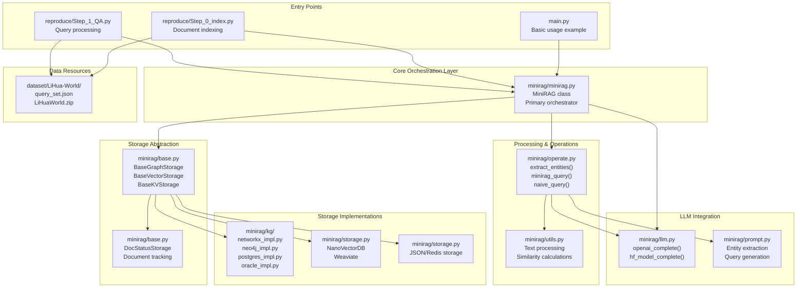
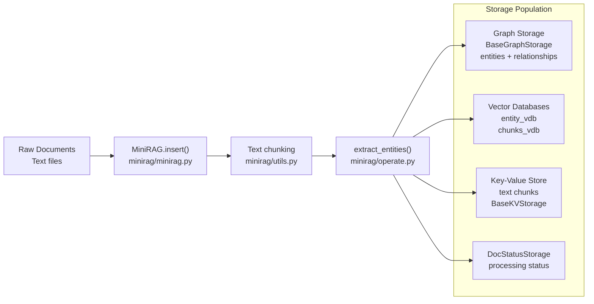
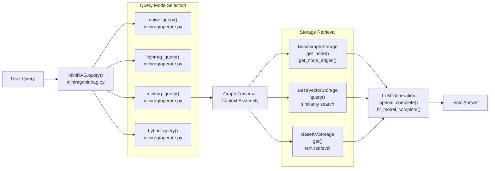

<!-- source: DeepWiki mcp.deepwiki.com · repo HKUDS/MiniRAG · page 1 Overview · fetched 2026-11-09 -->

# Overview

<details>
<summary>Relevant source files</summary>

The following files were used as context for generating this wiki page:

- [MANIFEST.in](MANIFEST.in)
- [README.md](README.md)
- [README_CN.md](README_CN.md)
- [README_JA.md](README_JA.md)
- [pyproject.toml](pyproject.toml)

</details>


This document provides a high-level introduction to MiniRAG, its design philosophy, and system architecture. It explains the core workflow, key components, and how they interact to enable efficient Retrieval-Augmented Generation (RAG) on Small Language Models (SLMs).

For detailed information about specific subsystems, see [System Architecture](#3) and [Core Concepts](#4). For practical usage examples, refer to [Usage Examples](#8).

## What is MiniRAG?

MiniRAG is a lightweight Retrieval-Augmented Generation framework designed to enable Small Language Models (1.5B-4B parameters) to achieve strong RAG performance. Unlike traditional RAG systems that rely on large language models with advanced semantic understanding capabilities, MiniRAG employs a simplified approach through heterogeneous graph indexing and topology-enhanced retrieval.

The framework addresses a critical challenge: existing RAG systems experience severe performance degradation when using SLMs due to their limited semantic understanding and text processing capabilities. MiniRAG achieves comparable performance to LLM-based methods while requiring only 25% of the storage space.

**Key Performance Metrics:**
- 53.29% accuracy with Phi-3.5-mini-instruct on LiHua-World dataset
- 13.48 percentage point improvement over baseline LightRAG (39.81%)
- 25% storage footprint compared to traditional approaches

**Sources:** [README.md:1-35](), [README_CN.md:1-29](), [README_JA.md:1-31]()

## System Purpose and Scope

MiniRAG serves as a complete RAG solution with the following capabilities:

| Capability | Description |
|------------|-------------|
| **Document Indexing** | Ingests raw text documents, extracts entities and relationships, builds knowledge graph |
| **Multi-mode Querying** | Supports five query strategies (naive, light, mini, hybrid, global) for different use cases |
| **Storage Abstraction** | Pluggable backend support for 10+ databases (Neo4j, PostgreSQL, TiDB, etc.) |
| **SLM Optimization** | Specifically designed for resource-constrained environments with small models |
| **Benchmark Evaluation** | Includes LiHua-World dataset for comprehensive performance assessment |

**Sources:** [README.md:30-88](), [pyproject.toml:1-22]()

## Core Components and Code Architecture

The following diagram maps MiniRAG's logical components to their concrete implementations in the codebase:



**Sources:** [README.md:96-131](), [README_CN.md:89-123](), [README_JA.md:93-127]()

## Two-Phase Workflow

MiniRAG operates in two distinct phases, implemented through a clear separation of concerns in the codebase:

### Phase 1: Document Indexing



During indexing, the system:
1. Accepts documents through `MiniRAG.insert()` method in [minirag/minirag.py]()
2. Chunks documents using utilities in [minirag/utils.py]()
3. Extracts entities and relationships via `extract_entities()` in [minirag/operate.py]()
4. Populates three storage types: graph (entities/relationships), vector (embeddings), and key-value (text chunks)
5. Tracks processing status using `DocStatusStorage` in [minirag/base.py]()

**Sources:** [README.md:36-41](), [minirag/minirag.py]()

### Phase 2: Query and Retrieval



During querying, the system:
1. Accepts queries through `MiniRAG.query()` method in [minirag/minirag.py]()
2. Selects query mode (naive, light, mini, hybrid, global) based on `QueryParam` configuration
3. Performs topology-enhanced retrieval using graph traversal operations in [minirag/operate.py]()
4. Retrieves relevant context from graph, vector, and key-value storage backends
5. Generates answers using LLM integration functions in [minirag/llm.py]()

**Sources:** [README.md:36-41]()

## Repository Structure

The codebase is organized into clear functional modules:

| Directory/File | Purpose |
|----------------|---------|
| `minirag/minirag.py` | Core `MiniRAG` class - main orchestrator for insert and query operations |
| `minirag/base.py` | Abstract storage interfaces: `BaseGraphStorage`, `BaseVectorStorage`, `BaseKVStorage` |
| `minirag/operate.py` | RAG operations: entity extraction, query processing for all modes |
| `minirag/llm.py` | LLM integration: OpenAI, HuggingFace, NVIDIA, OpenRouter APIs |
| `minirag/storage.py` | Concrete storage implementations: NanoVectorDB, JSON storage |
| `minirag/kg/` | Graph database implementations: Neo4j, PostgreSQL, TiDB, Oracle |
| `minirag/utils.py` | Utility functions: text processing, similarity calculations, graph operations |
| `minirag/prompt.py` | Prompt templates for entity extraction and query generation |
| `reproduce/Step_0_index.py` | Script for indexing datasets into knowledge graph |
| `reproduce/Step_1_QA.py` | Script for running query experiments and evaluation |
| `dataset/LiHua-World/` | Benchmark dataset with query sets and evaluation data |

**Sources:** [README.md:96-131](), [README_CN.md:89-123]()

## Quick Start Example

The simplest way to use MiniRAG involves three steps:

```python
# 1. Initialize MiniRAG with working directory
rag = MiniRAG(working_dir="./workspace")

# 2. Index documents (one-time setup)
rag.insert("Your document content here")

# 3. Query the knowledge graph
result = rag.query("Your question", param=QueryParam(mode="mini"))
```

For complete reproduction of benchmark results:
- Use [reproduce/Step_0_index.py]() to index the LiHua-World dataset
- Use [reproduce/Step_1_QA.py]() to run evaluation experiments

**Sources:** [README.md:57-68](), [README_CN.md:51-62](), [README_JA.md:54-65]()

## Supported Models and Backends

MiniRAG supports multiple LLM providers and storage backends through its abstraction layers:

**Language Models:**
- Small Language Models: Phi-3.5-mini-instruct, GLM-Edge-1.5B-Chat, Qwen2.5-3B-Instruct, MiniCPM3-4B
- Large Language Models: gpt-4o-mini (for comparison)
- Integration: OpenAI API, HuggingFace models, NVIDIA API, OpenRouter

**Storage Backends:**
- Graph: NetworkX (in-memory), Neo4j, PostgreSQL, TiDB, Oracle, and 5+ additional databases
- Vector: NanoVectorDB, Weaviate, Chroma
- Key-Value: JSON files, Redis, MongoDB

See [LLM and Embedding Integration](#6) for detailed model configuration and [Storage Implementations](#5) for backend setup instructions.

**Sources:** [README.md:25-29](), [README_CN.md:20-23]()

## Performance Characteristics

MiniRAG achieves strong performance across different model sizes and question types:

| Model | Size | LiHua-World Accuracy | Storage Reduction |
|-------|------|----------------------|-------------------|
| Phi-3.5-mini-instruct | 3.8B | 53.29% | 75% |
| GLM-Edge-1.5B-Chat | 1.5B | 52.51% | 75% |
| Qwen2.5-3B-Instruct | 3B | 48.75% | 75% |
| MiniCPM3-4B | 4B | 51.25% | 75% |

Compared to baselines (NaiveRAG: ~42%, LightRAG: ~39%), MiniRAG shows 10-14 percentage point improvements when using small models. The framework achieves this through two key technical innovations detailed in [Key Innovations](#1.2).

**Sources:** [README.md:73-88](), [README_CN.md:67-82]()

## Related Projects and Acknowledgments

MiniRAG builds upon and extends the following projects:
- **LightRAG**: Foundation codebase providing base storage abstractions and query modes
- **nano-graphrag**: Graph processing utilities and algorithms
- **VideoRAG**: Related project by the same team for video understanding

The framework is available on PyPI as `minirag-hku` or `lightrag-hku` for easy installation and deployment.

**Sources:** [README.md:158-161](), [README_CN.md:151-152](), [pyproject.toml:5-7]()

---

