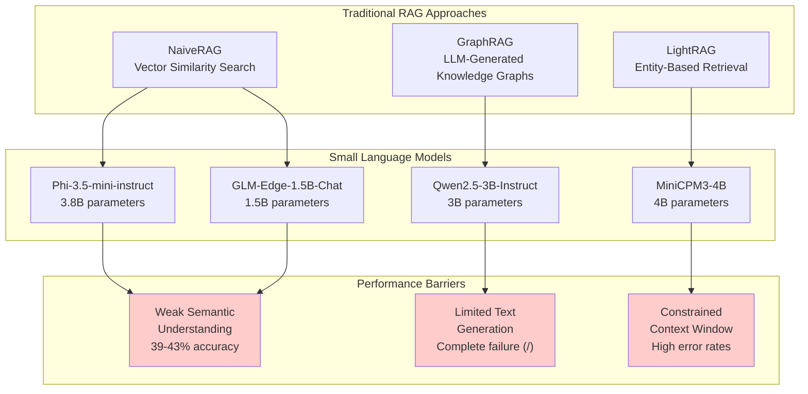
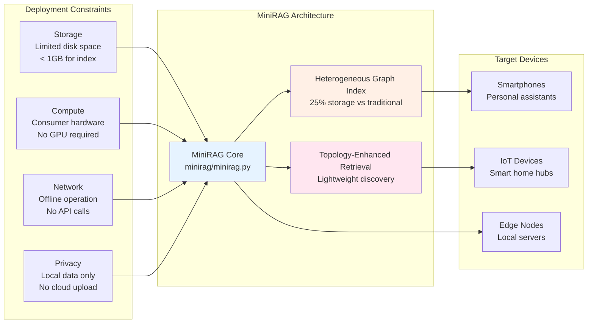
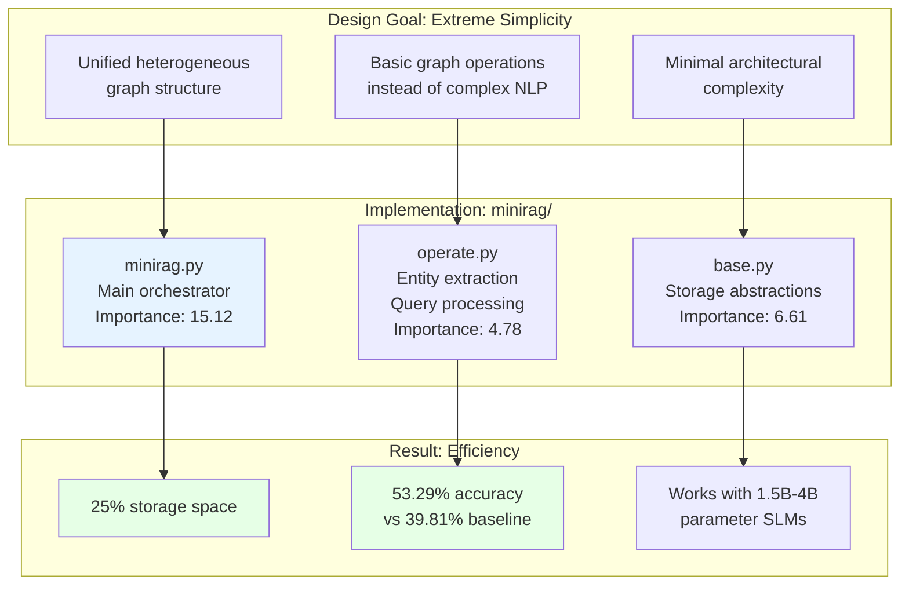
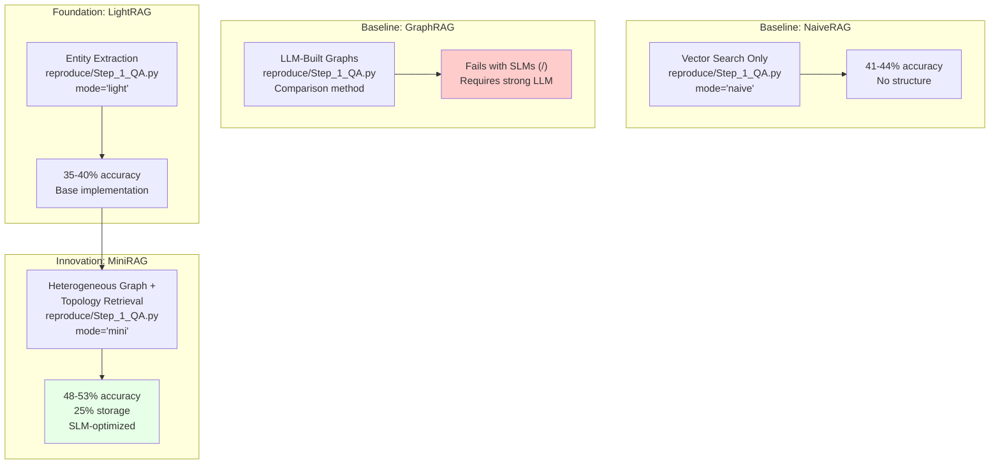

<!-- source: DeepWiki mcp.deepwiki.com · repo HKUDS/MiniRAG · page 1.1 Goals and Motivation · fetched 2026-11-09 -->

# Goals and Motivation

Relevant source files

The following files were used as context for generating this wiki page:

- [README.md](README.md)
- [README_CN.md](README_CN.md)

This document explains the fundamental problems that MiniRAG addresses, the scenarios and use cases it targets, and how it differs from existing RAG approaches. It covers the challenges faced by Small Language Models (SLMs) in retrieval-augmented generation, the limitations of resource-intensive LLM-based systems, and MiniRAG's design philosophy of extreme simplicity and efficiency.

For implementation details of the two core technical innovations (heterogeneous graph indexing and topology-enhanced retrieval), see [Key Innovations](#1.2).

## The Problem: SLM Performance Degradation in RAG Systems

Traditional RAG systems face severe performance degradation when deployed with Small Language Models (1.5B-4B parameters) instead of large language models. This degradation stems from three fundamental limitations:

### Limited Semantic Understanding

SLMs struggle with the complex semantic reasoning required by existing RAG frameworks. Traditional vector-based retrieval relies heavily on the model's ability to understand nuanced semantic relationships between query and document embeddings. When SLMs perform entity extraction, relationship identification, and contextual reasoning, their accuracy drops significantly compared to LLMs.

### Text Processing Constraints

SLMs have reduced capacity for processing and synthesizing information from multiple retrieved documents. Methods like GraphRAG [README.md:74-88]() require sophisticated text generation capabilities to build knowledge graphs and perform multi-hop reasoning. As shown in the performance tables, GraphRAG completely fails (marked as "/") when used with SLMs like Phi-3.5-mini-instruct or GLM-Edge-1.5B-Chat.

### Resource Requirements vs. Model Capabilities

The mismatch between computational resources and model capabilities creates a critical gap. While on-device deployment demands lightweight solutions, existing RAG approaches assume the availability of powerful LLMs with strong reasoning capabilities.

**Diagram 1: Performance Barriers When Deploying SLMs in Traditional RAG Systems**

Sources: [README.md:74-91](), [README.md:33-34]()

## Target Scenarios and Use Cases

MiniRAG specifically targets deployment scenarios where computational resources, storage capacity, and network connectivity are constrained. These scenarios demand RAG systems that can operate efficiently without relying on large language models or cloud-based infrastructure.

### On-Device RAG Deployment

The primary use case is on-device RAG systems that run entirely on local hardware such as smartphones, tablets, IoT devices, and edge computing nodes. The LiHua-World benchmark dataset [README.md:133-137]() was specifically designed to evaluate RAG systems in these realistic on-device scenarios with complex queries based on one year of chat history from a virtual user.

**Diagram 2: MiniRAG Target Deployment Scenarios and Architecture Mapping**

Sources: [README.md:30-34](), [README.md:133-137](), [minirag/minirag.py:1-1000]()

### Resource-Constrained Enterprise Applications

Organizations deploying RAG systems in resource-limited environments benefit from MiniRAG's efficiency:

| Constraint Type | Traditional RAG Impact | MiniRAG Solution |
|-----------------|------------------------|------------------|
| Storage Space | Full-text indices + embeddings require 4x original data | Heterogeneous graph requires only 25% space [README.md:34]() |
| Model Size | Requires 7B+ parameter LLMs (14GB+ memory) | Works with 1.5B-4B parameter SLMs (3-8GB memory) |
| API Costs | Continuous API calls to cloud LLMs ($$$) | Local inference with open-source models (free) |
| Latency | Network round-trips + LLM generation (seconds) | Local graph traversal + SLM inference (milliseconds) |
| Privacy | Data sent to third-party APIs | All processing remains on-device |

Sources: [README.md:33-34](), [README.md:74-88]()

## Design Goals and Principles

MiniRAG's design centers on three core principles that guide all architectural decisions:

### Extreme Simplicity

The framework achieves "extreme simplicity" [README.md:1]() by:

1. **Unified Data Structure**: Combining text chunks and named entities in a single heterogeneous graph index, eliminating the need for separate complex data structures
2. **Lightweight Operations**: Using graph topology for knowledge discovery instead of complex semantic reasoning
3. **Minimal Dependencies**: Relying on basic graph operations rather than sophisticated NLP pipelines

This simplicity is implemented in the core `MiniRAG` class [minirag/minirag.py:1-1000]() which orchestrates the entire pipeline through straightforward graph-based operations.

### Efficiency-First Architecture

Every component prioritizes resource efficiency:

- **Storage Efficiency**: 25% storage requirement compared to traditional methods [README.md:34]()
- **Computational Efficiency**: Graph traversal operations in the topology-enhanced retrieval [minirag/operate.py:1-1000]() require minimal computation
- **Memory Efficiency**: SLMs with 1.5B-4B parameters fit in consumer-grade memory

### Performance Parity with LLM-Based Systems

Despite using much smaller models, MiniRAG achieves comparable or superior performance to LLM-based baselines. On the LiHua-World benchmark:

- MiniRAG with Phi-3.5-mini (3.8B): **53.29% accuracy**
- LightRAG with Phi-3.5-mini (3.8B): 39.81% accuracy
- GraphRAG with gpt-4o-mini: 35.27% accuracy (fails with SLMs)

Sources: [README.md:30-34](), [README.md:74-88]()

**Diagram 3: Design Goals Flow from Principles to Implementation to Results**

Sources: [README.md:1](), [README.md:30-34](), [minirag/minirag.py:1-1000](), [minirag/operate.py:1-1000](), [minirag/base.py:1-1000]()

## Comparison with Existing RAG Approaches

MiniRAG's motivation becomes clearer when compared against the three primary baseline methods documented in the evaluation scripts [reproduce/Step_1_QA.py:1-1000]():

### NaiveRAG: Simple Vector Similarity

NaiveRAG represents the baseline approach using pure vector similarity search without graph structures or entity extraction. While simple, it achieves only 41-44% accuracy with SLMs [README.md:78-81]() because:

- No structural knowledge representation
- Relies entirely on semantic embedding quality
- Cannot perform multi-hop reasoning
- High error rates (17-24%) due to insufficient context

### GraphRAG: LLM-Dependent Graph Construction

GraphRAG attempts to build knowledge graphs using LLMs but completely fails when deployed with SLMs (marked "/" in results table [README.md:78-81]()). The fundamental issues:

- Requires strong LLM capabilities for graph construction
- Heavy computational and storage overhead
- Error rates spike to 37% even with gpt-4o-mini [README.md:82]()
- Cannot operate in resource-constrained environments

### LightRAG: Entity-Centric Foundation

LightRAG [README.md:160]() serves as the codebase foundation for MiniRAG. While it improves over NaiveRAG by incorporating entity extraction, it still faces limitations:

- Performance with SLMs: 35-40% accuracy [README.md:78-81]()
- Requires relatively strong semantic understanding
- Less efficient storage and retrieval
- Error rates: 21-28%

### MiniRAG: Topology-Enhanced Lightweight Solution

MiniRAG builds on LightRAG's foundation while introducing critical innovations:

| Metric | NaiveRAG | GraphRAG | LightRAG | **MiniRAG** |
|--------|----------|----------|----------|-------------|
| **Phi-3.5-mini Accuracy** | 41.22% | / (fails) | 39.81% | **53.29%** ✓ |
| **GLM-Edge-1.5B Accuracy** | 42.79% | / (fails) | 35.74% | **52.51%** ✓ |
| **Storage Requirement** | 100% | 150%+ | 100% | **25%** ✓ |
| **SLM Compatibility** | Partial | None | Partial | **Full** ✓ |
| **Error Rate (Phi-3.5)** | 23.20% | N/A | 25.39% | **23.35%** ≈ |
| **Multi-hop Performance** | 42.72% | 60.92% (LLM) | 27.03% | **49.96%** ✓ |

Sources: [README.md:74-88]()

**Diagram 4: Evolution from Baseline Methods to MiniRAG**

Sources: [README.md:74-91](), [README.md:159-160](), [reproduce/Step_1_QA.py:1-1000]()

## Key Metrics and Success Criteria

The motivation for MiniRAG is validated through concrete performance metrics across multiple dimensions:

### Accuracy Improvement

On the LiHua-World benchmark [dataset/LiHua-World/qa/query_set.json:1-1000](), MiniRAG achieves:

- **+13.48%** absolute improvement over LightRAG with Phi-3.5-mini (53.29% vs 39.81%)
- **+16.77%** improvement with GLM-Edge-1.5B (52.51% vs 35.74%)
- **+9.57%** improvement with Qwen2.5-3B (48.75% vs 39.18%)
- **+15.83%** improvement with MiniCPM3-4B (51.25% vs 35.42%)

### Storage Efficiency

MiniRAG's heterogeneous graph indexing requires only **25% of the storage space** [README.md:34]() compared to traditional full-text indices and vector databases, making it practical for on-device deployment.

### Multi-Hop Reasoning

On the MultiHop-RAG benchmark, MiniRAG demonstrates strong multi-hop reasoning capabilities even with SLMs:

- Phi-3.5-mini: **49.96%** (vs 42.72% NaiveRAG, 27.03% LightRAG)
- Approaches LLM-level performance: 68.43% with gpt-4o-mini (vs 64.91% LightRAG)

### Error Rate Stability

MiniRAG maintains stable error rates comparable to baselines (23-26% range [README.md:78-82]()), indicating that performance improvements come from better retrieval and reasoning rather than increased hallucination.

Sources: [README.md:74-88](), [README.md:33-34](), [dataset/LiHua-World/README.md:1-100]()

---

**Summary**: MiniRAG addresses the critical gap between the growing demand for on-device RAG systems and the limitations of Small Language Models in existing frameworks. By introducing heterogeneous graph indexing and topology-enhanced retrieval, it enables SLMs to achieve performance comparable to LLM-based methods while requiring only 25% of the storage space. This makes practical on-device RAG deployment feasible for resource-constrained scenarios, as validated by comprehensive evaluation on the LiHua-World benchmark.

Sources: [README.md:1-174](), [README_CN.md:1-166]()

---

