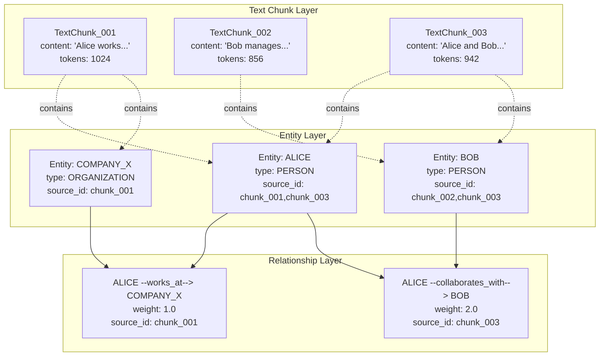
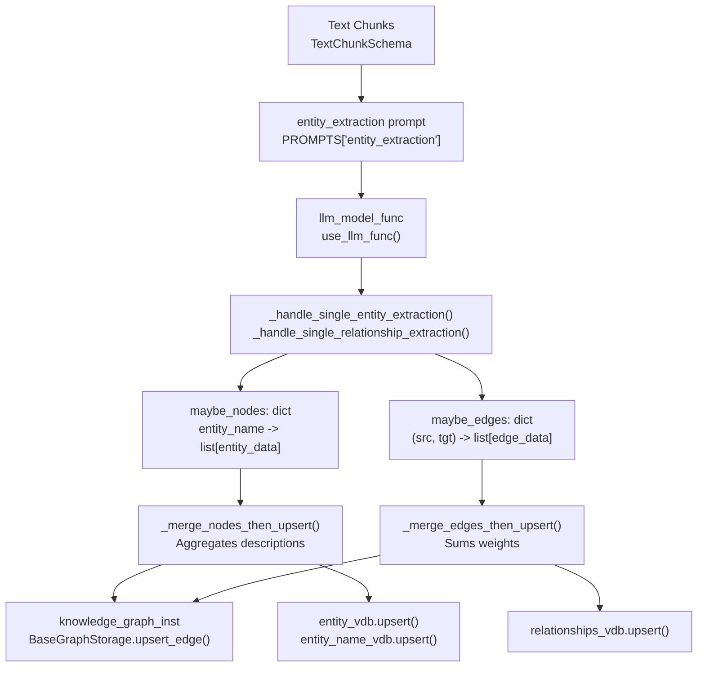
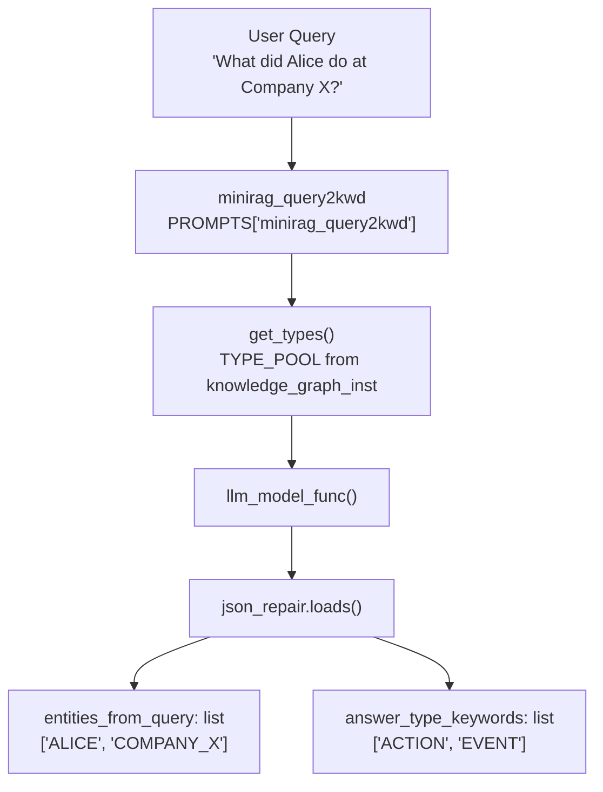
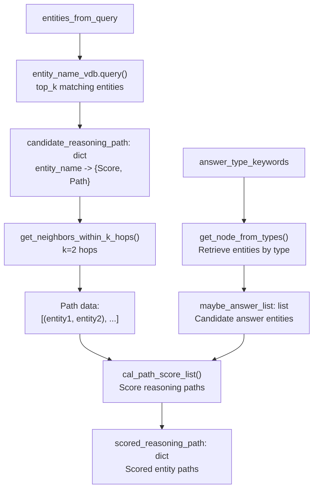
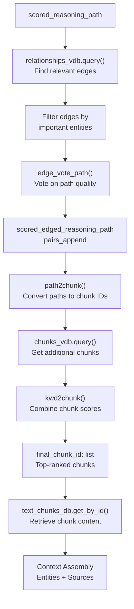
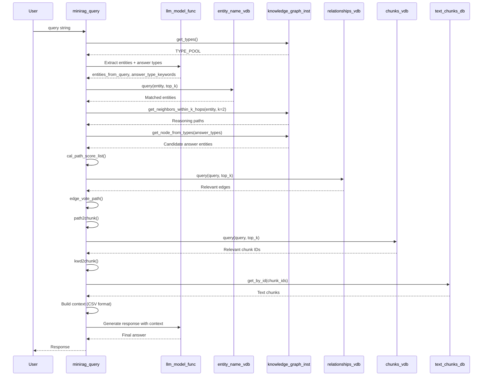
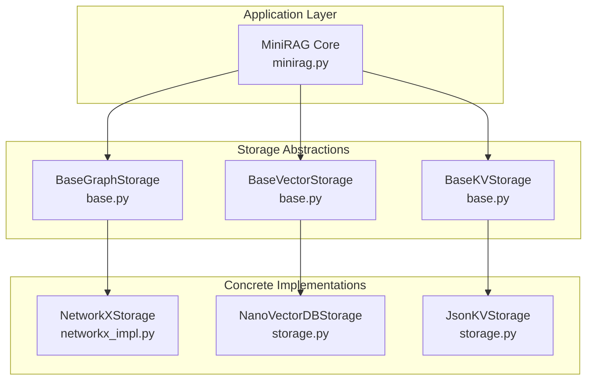
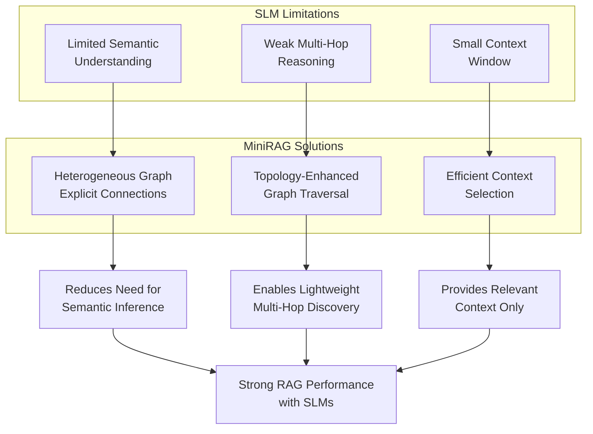
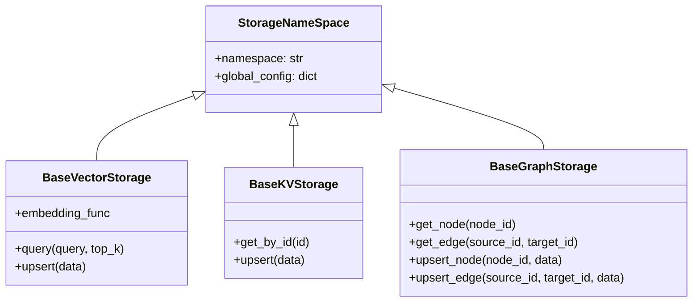
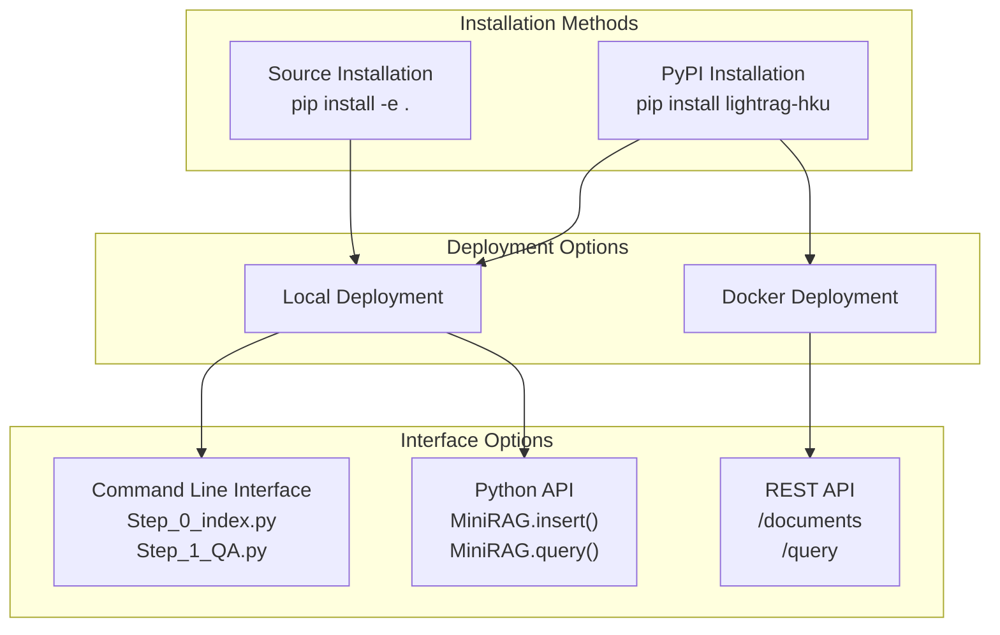

<!-- source: DeepWiki mcp.deepwiki.com · repo HKUDS/MiniRAG · page 1.2 Key Innovations · fetched 2026-11-09 -->

# Key Innovations

<details>
<summary>Relevant source files</summary>

The following files were used as context for generating this wiki page:

- [README.md](README.md)
- [minirag/api/requirements.txt](minirag/api/requirements.txt)
- [minirag/operate.py](minirag/operate.py)

</details>


MiniRAG introduces two core technical innovations that enable Small Language Models (SLMs) to achieve strong RAG performance while using only 25% of the storage space compared to traditional methods. These innovations address the fundamental limitations of SLMs in semantic understanding and complex reasoning tasks.

The two key innovations are:

1. **Heterogeneous Graph Indexing**: A unified graph structure combining text chunks and named entities that reduces semantic understanding requirements
2. **Topology-Enhanced Retrieval**: A lightweight graph traversal approach that enables efficient knowledge discovery without advanced language capabilities

On the LiHua-World benchmark, MiniRAG achieves 53.29% accuracy with Phi-3.5-mini (vs 39.81% baseline), demonstrating significant performance improvements over NaiveRAG and LightRAG when using SLMs.

Sources: [README.md:30-35](), [README.md:74-82]()

## Innovation 1: Heterogeneous Graph Indexing

### Overview

MiniRAG's heterogeneous graph indexing mechanism creates a unified structure that combines text chunks and named entities into a single graph. This approach reduces the semantic understanding burden on SLMs by providing explicit, pre-computed connections between information pieces.

### Graph Structure

The heterogeneous graph index consists of three types of elements:

| Element Type | Stored In | Key Attributes | Purpose |
|--------------|-----------|----------------|---------|
| **Text Chunk Nodes** | `chunks_vdb` (vector DB)<br>`text_chunks_db` (KV store) | `content`, `tokens`, `chunk_order_index` | Original document fragments with embeddings |
| **Entity Nodes** | `entity_vdb` (vector DB)<br>`entity_name_vdb` (vector DB)<br>`knowledge_graph_inst` (graph DB) | `entity_name`, `entity_type`, `description`, `source_id` | Named entities extracted from text |
| **Relationship Edges** | `relationships_vdb` (vector DB)<br>`knowledge_graph_inst` (graph DB) | `src_id`, `tgt_id`, `keywords`, `weight`, `description` | Connections between entities |

#### Heterogeneous Graph Index Structure



Sources: [minirag/operate.py:233-408](), [minirag/base.py:1-50]()

### Entity Extraction Process

The entity extraction process is implemented in `extract_entities()` and follows these steps:

#### Entity Extraction Pipeline



Sources: [minirag/operate.py:233-408]()

### Implementation Details

The extraction process uses LLM-based entity recognition with configurable gleaning:

```
extract_entities() parameters:
- chunks: dict[str, TextChunkSchema]
- knowledge_graph_inst: BaseGraphStorage
- entity_vdb, entity_name_vdb, relationships_vdb: BaseVectorStorage
- global_config['entity_extract_max_gleaning']: int (default: 1)
```

Key implementation functions:
- `_handle_single_entity_extraction()` [minirag/operate.py:70-88](): Parses entity records
- `_handle_single_relationship_extraction()` [minirag/operate.py:91-114](): Parses relationship records
- `_merge_nodes_then_upsert()` [minirag/operate.py:117-163](): Aggregates duplicate entities
- `_merge_edges_then_upsert()` [minirag/operate.py:166-230](): Merges relationship data

The heterogeneous graph structure enables multiple retrieval pathways:
- **Vector-based**: Search entities or relationships by semantic similarity
- **Graph-based**: Traverse connections between entities
- **Hybrid**: Combine vector search with graph traversal

Sources: [minirag/operate.py:233-408](), [README.md:31-35]()

## Innovation 2: Topology-Enhanced Retrieval

### Overview

MiniRAG's topology-enhanced retrieval approach leverages the graph structure to discover relevant information through lightweight graph traversal operations, eliminating the need for advanced language understanding capabilities. This is particularly effective for multi-hop reasoning queries.

### MiniRAG Query Architecture

The topology-enhanced retrieval is implemented in `minirag_query()` and consists of three main phases:

#### Phase 1: Query Analysis and Entity Extraction



Sources: [minirag/operate.py:1409-1449]()

#### Phase 2: Graph Traversal and Path Discovery



Sources: [minirag/operate.py:1252-1319]()

#### Phase 3: Edge Voting and Chunk Retrieval



Sources: [minirag/operate.py:1320-1406]()

### Complete MiniRAG Retrieval Flow

#### minirag_query() End-to-End Process



Sources: [minirag/operate.py:1409-1479]()

### Key Algorithms

The topology-enhanced retrieval uses several specialized algorithms:

| Algorithm | Function | Purpose |
|-----------|----------|---------|
| **Path Scoring** | `cal_path_score_list()` [minirag/utils.py]() | Scores reasoning paths based on entity connections to answer candidates |
| **Edge Voting** | `edge_vote_path()` [minirag/utils.py]() | Votes on edge quality based on entity importance |
| **Path to Chunk** | `path2chunk()` [minirag/operate.py:1124-1209]() | Converts reasoning paths to relevant chunk IDs with scoring |
| **Keyword to Chunk** | `kwd2chunk()` [minirag/operate.py:1220-1249]() | Aggregates chunk scores from multiple entity paths |

### Advantages Over Traditional RAG

The topology-enhanced approach provides several advantages:

1. **Reduced Semantic Load**: Graph structure provides explicit connections without requiring the SLM to infer relationships
2. **Multi-Hop Reasoning**: Natural support for multi-hop queries through k-hop neighbor traversal
3. **Answer Type Guidance**: Uses entity types to guide retrieval toward likely answer entities
4. **Hybrid Scoring**: Combines vector similarity, graph topology, and path voting for robust retrieval

Sources: [minirag/operate.py:1409-1479](), [README.md:31-35]()

## Performance Achievements

MiniRAG's two core innovations enable significant performance improvements while reducing storage requirements.

### Storage Efficiency

MiniRAG achieves **25% storage usage** compared to traditional RAG methods through:

1. **Unified Graph Structure**: Single heterogeneous graph eliminates redundant entity representations
2. **Modular Storage Architecture**: Separate storage backends for different data types avoid duplication
3. **Efficient Entity Indexing**: Named entities stored once with references to source chunks

The storage architecture uses three abstraction layers:



Sources: [README.md:31-35](), [minirag/base.py:1-100]()

### Accuracy Results on LiHua-World Benchmark

MiniRAG demonstrates substantial accuracy improvements across multiple small language models:

#### LiHua-World Dataset Results

| Model | Parameters | NaiveRAG | LightRAG | **MiniRAG** | Improvement |
|-------|------------|----------|----------|-------------|-------------|
| Phi-3.5-mini-instruct | ~3.8B | 41.22% | 39.81% | **53.29%** | +13.48% |
| GLM-Edge-1.5B-Chat | 1.5B | 42.79% | 35.74% | **52.51%** | +16.77% |
| Qwen2.5-3B-Instruct | 3B | 43.73% | 39.18% | **48.75%** | +9.57% |
| MiniCPM3-4B | 4B | 43.42% | 35.42% | **51.25%** | +15.83% |
| gpt-4o-mini | 8B | 46.55% | **56.90%** | 54.08% | -2.82% |

Sources: [README.md:74-82]()

#### MultiHop-RAG Dataset Results

| Model | Parameters | NaiveRAG | LightRAG | **MiniRAG** | Improvement |
|-------|------------|----------|----------|-------------|-------------|
| Phi-3.5-mini-instruct | ~3.8B | 42.72% | 27.03% | **49.96%** | +22.93% |
| GLM-Edge-1.5B-Chat | 1.5B | 44.44% | / | **51.41%** | +6.97% |
| Qwen2.5-3B-Instruct | 3B | 39.48% | 21.91% | **48.55%** | +26.64% |
| MiniCPM3-4B | 4B | 39.24% | 19.48% | **47.77%** | +28.29% |
| gpt-4o-mini | 8B | 53.60% | 64.91% | **68.43%** | +3.52% |

Sources: [README.md:83-88]()

### Key Performance Insights

The performance results demonstrate several important findings:

1. **SLM Performance**: MiniRAG enables SLMs (1.5B-4B parameters) to achieve 48-53% accuracy, comparable to baseline LLM performance
2. **Multi-Hop Superiority**: The topology-enhanced retrieval shows particularly strong improvements on multi-hop reasoning tasks (+23-28%)
3. **GraphRAG Failure**: Traditional GraphRAG fails completely with SLMs (marked as "/" in tables), highlighting the need for MiniRAG's lightweight approach
4. **LLM Competitiveness**: Even with larger models like gpt-4o-mini, MiniRAG remains competitive or superior

### Why MiniRAG Succeeds with Small Models

The success with SLMs stems from the two core innovations:



Sources: [README.md:30-35](), [README.md:74-88]()

## Storage Efficiency

MiniRAG achieves significant storage efficiency compared to traditional RAG approaches:

- Requires only 25% of the storage space of traditional methods
- Uses modular storage architecture with separate components for different data types
- Minimizes redundancy through the graph structure



The storage architecture includes:

| Storage Type | Purpose | Implementations |
|--------------|---------|----------------|
| Vector Storage | Stores embeddings for chunks and entities | NanoVectorDBStorage |
| Key-Value Storage | Stores original text and metadata | JsonKVStorage |
| Graph Storage | Stores relationships between entities and chunks | NetworkXStorage, Neo4jStorage |
| Document Status Storage | Tracks document processing status | JsonDocStatusStorage |

Sources: [README.md:31]()

## Multi-Database Support

MiniRAG supports integration with multiple heterogeneous graph databases for flexibility in different deployment scenarios:

| Database | Advantages | Implementation |
|----------|------------|----------------|
| Neo4j | Native graph operations, scalable | `neo4j_impl.py` |
| PostgreSQL | Widely available, SQL-based | Extension of graph storage |
| TiDB | Distributed SQL database | Extension of graph storage |
| Oracle | Enterprise-grade reliability | `oracle_impl.py` |
| NetworkX | Simple, in-memory, great for development | Default implementation |

This multi-database support allows users to choose the most appropriate backend based on their existing infrastructure, performance requirements, and deployment constraints.

Sources: [README.md:23](), [README.md:98-104]()

## Performance with Small Language Models

MiniRAG enables small language models to achieve performance comparable to or better than traditional RAG approaches with larger models. The framework has been tested with various SLMs:

| Model | Size | Performance with MiniRAG |
|-------|------|----------------------------|
| Phi-3.5-mini-instruct | ~1.4B parameters | 53.29% accuracy on LiHua-World |
| GLM-Edge-1.5B-Chat | 1.5B parameters | 52.51% accuracy on LiHua-World |
| Qwen2.5-3B-Instruct | 3B parameters | 48.75% accuracy on LiHua-World |
| MiniCPM3-4B | 4B parameters | 51.25% accuracy on LiHua-World |

MiniRAG consistently outperforms NaiveRAG, GraphRAG, and LightRAG across all tested models, especially on multi-hop reasoning tasks.

Sources: [README.md:66-85]()

## Deployment Options

MiniRAG supports multiple deployment options to fit different use cases:



The flexibility in deployment options makes MiniRAG suitable for a wide range of applications, from development and testing to production systems.

Sources: [README.md:40-47](), [README.md:56-62](), [README.md:25]()

---

