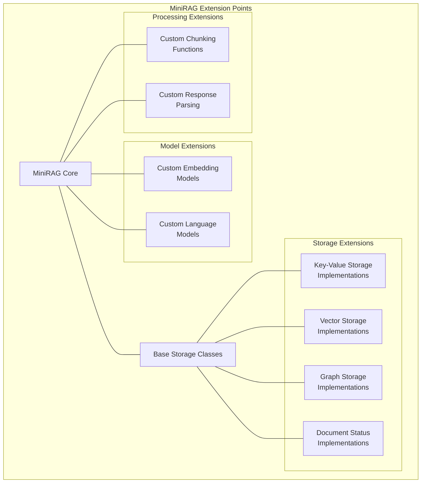
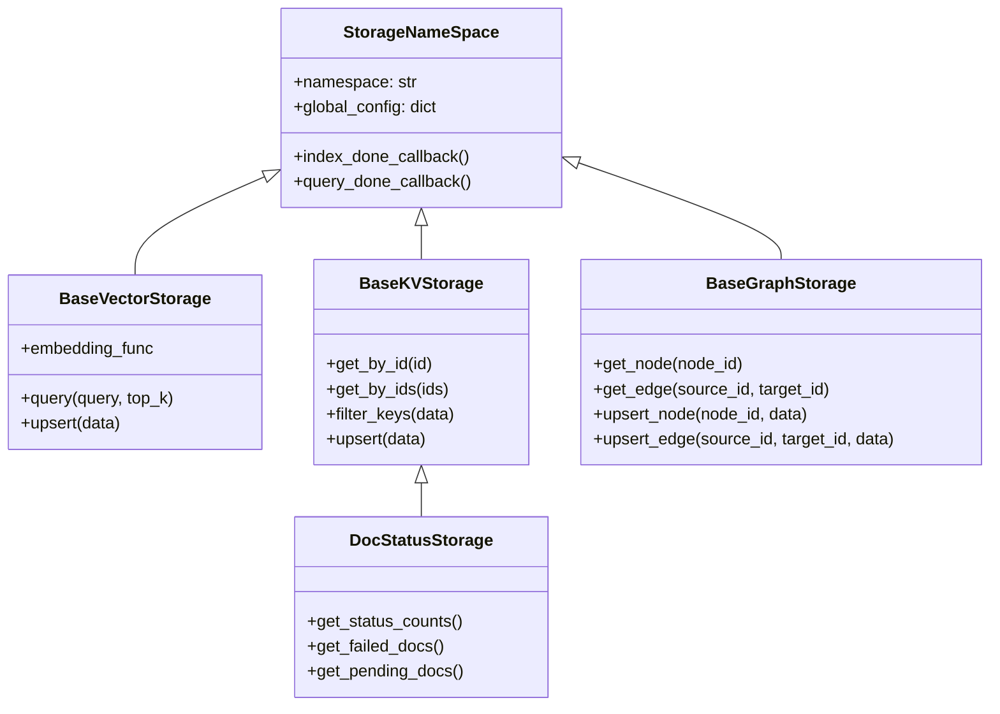
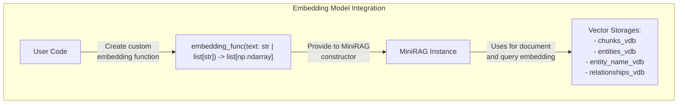
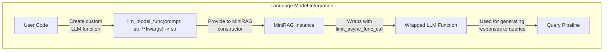
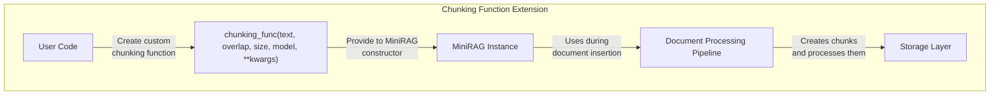
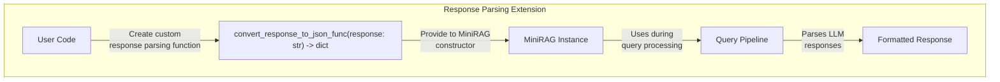
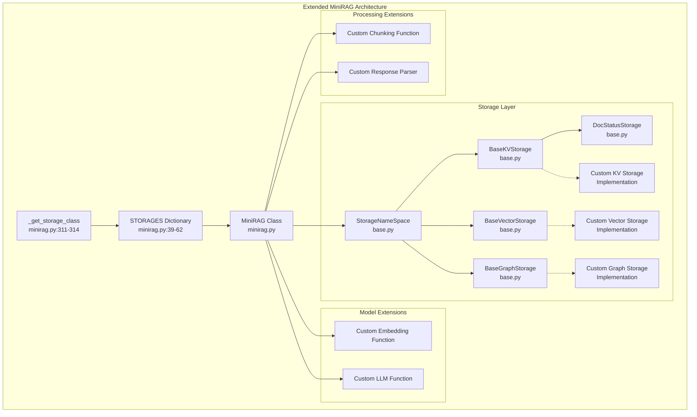

<!-- source: DeepWiki mcp.deepwiki.com · repo HKUDS/MiniRAG · page 10 Extending MiniRAG · fetched 2026-11-09 -->

# Extending MiniRAG

<details>
<summary>Relevant source files</summary>

The following files were used as context for generating this wiki page:

- [minirag/__init__.py](minirag/__init__.py)
- [minirag/base.py](minirag/base.py)
- [minirag/kg/weaviate_impl.py](minirag/kg/weaviate_impl.py)
- [minirag/minirag.py](minirag/minirag.py)
- [tests/test_weaviate.py](tests/test_weaviate.py)

</details>


This document describes how to extend and customize MiniRAG to add new capabilities or integrate with different systems. MiniRAG's architecture is designed to be modular and extensible, allowing developers to add custom storage backends, embedding models, language models, and other components.

For information about the overall architecture, see [System Architecture](#2).

## Extension Points Overview

MiniRAG provides several extension points that allow developers to customize its behavior:

1. **Storage Backends** - Add support for new databases or storage systems
2. **Embedding Models** - Integrate custom text embedding models
3. **Language Models** - Use different LLMs for response generation
4. **Chunking Functions** - Customize document splitting logic
5. **Add-on Parameters** - Extend functionality through additional parameters



Sources: [minirag/minirag.py:169-176](), [minirag/minirag.py:39-62]()

## Adding Custom Storage Backends

MiniRAG uses a storage abstraction layer defined by base classes in `base.py`. To add a new storage backend, you need to implement one or more of these base classes.

### Storage Class Hierarchy



Sources: [minirag/base.py:48-196]()

### Implementation Steps

To add a new storage backend:

1. Create a new file in the `minirag/kg/` directory (e.g., `minirag/kg/my_storage_impl.py`)
2. Implement the relevant storage class(es) by inheriting from the base classes
3. Register your storage class in the `STORAGES` dictionary in `minirag/minirag.py`

### Example: Adding a New Vector Storage Backend

Here's how you would implement a new vector storage backend:

1. Create a file `minirag/kg/my_vector_db_impl.py` 
2. Implement the `MyVectorDBStorage` class that inherits from `BaseVectorStorage`
3. Implement the required methods: `query()` and `upsert()`
4. Add your class to the `STORAGES` dictionary in `minirag/minirag.py`

```python
# Required methods to implement for BaseVectorStorage
async def query(self, query: str, top_k: int) -> list[dict]:
    # Implement vector similarity search
    pass

async def upsert(self, data: dict[str, dict]):
    # Implement vector storage insertion/update
    pass
```

### Registering a New Storage Backend

Add your storage class to the `STORAGES` dictionary in `minirag/minirag.py`:

```python
STORAGES = {
    # Existing storages...
    "MyVectorDBStorage": ".kg.my_vector_db_impl",
}
```

Then you can use it when initializing MiniRAG:

```python
rag = MiniRAG(
    vector_storage="MyVectorDBStorage",
    # Other parameters...
)
```

Sources: [minirag/minirag.py:39-62](), [minirag/minirag.py:311-314]()

## Customizing Embedding Models

MiniRAG uses embedding models to convert text to vector representations. You can provide your own embedding function when initializing MiniRAG.

### Embedding Function Interface

Your embedding function should:
- Accept a string or list of strings
- Return a list of vectors (numpy arrays)
- Be compatible with async operations



Sources: [minirag/minirag.py:155-157](), [minirag/base.py:7-7]()

### Example Implementation

```python
import numpy as np
from sentence_transformers import SentenceTransformer

# Create an embedding function using SentenceTransformer
model = SentenceTransformer('all-MiniLM-L6-v2')

async def my_embedding_func(text):
    if isinstance(text, str):
        text = [text]
    # Get embeddings from the model
    embeddings = model.encode(text)
    return embeddings

# Initialize MiniRAG with custom embedding function
rag = MiniRAG(
    embedding_func=my_embedding_func,
    # Other parameters...
)
```

MiniRAG will apply a wrapper to your embedding function using `limit_async_func_call` to manage concurrency:

```python
self.embedding_func = limit_async_func_call(self.embedding_func_max_async)(
    self.embedding_func
)
```

Sources: [minirag/minirag.py:243-245]()

## Integrating Custom Language Models

MiniRAG uses language models for generating responses to queries. You can integrate your own LLM by providing a custom model function.

### LLM Function Interface

Your LLM function should:
- Accept a prompt string and optional parameters
- Return a string response or streamed response
- Be compatible with async operations



Sources: [minirag/minirag.py:160-166](), [minirag/minirag.py:296-302]()

### Example Implementation

```python
from transformers import AutoTokenizer, AutoModelForCausalLM

# Load model and tokenizer
model_name = "meta-llama/Llama-3.2-1B-Instruct"
tokenizer = AutoTokenizer.from_pretrained(model_name)
model = AutoModelForCausalLM.from_pretrained(model_name)

async def my_llm_func(prompt, hashing_kv=None, **kwargs):
    # If caching is enabled and we have a cached response, return it
    if hashing_kv:
        cache_key = hash(prompt)
        cached_response = await hashing_kv.get_by_id(cache_key)
        if cached_response:
            return cached_response
    
    # Generate response with the model
    inputs = tokenizer(prompt, return_tensors="pt")
    outputs = model.generate(**inputs, max_length=kwargs.get("max_length", 512))
    response = tokenizer.decode(outputs[0], skip_special_tokens=True)
    
    # Cache the response if caching is enabled
    if hashing_kv:
        await hashing_kv.upsert({cache_key: response})
    
    return response

# Initialize MiniRAG with custom LLM function
rag = MiniRAG(
    llm_model_func=my_llm_func,
    llm_model_name="my-custom-llm",
    llm_model_max_token_size=4096,
    llm_model_max_async=8,
    llm_model_kwargs={"temperature": 0.7},
    # Other parameters...
)
```

The LLM function is wrapped with `limit_async_func_call` to manage concurrency, similar to the embedding function:

```python
self.llm_model_func = limit_async_func_call(self.llm_model_max_async)(
    partial(
        self.llm_model_func,
        hashing_kv=self.llm_response_cache,
        **self.llm_model_kwargs,
    )
)
```

Sources: [minirag/minirag.py:296-302]()

## Custom Chunking Functions

MiniRAG uses chunking functions to split input documents into manageable pieces. You can provide your own chunking function to customize how documents are split.

### Chunking Function Interface

Your chunking function should:
- Accept a document string and chunking parameters
- Return a list of chunk dictionaries with content and metadata
- Each chunk should have at least a "content" field



Sources: [minirag/minirag.py:181-182](), [minirag/minirag.py:356-371](), [minirag/minirag.py:480-490]()

### Example Implementation

```python
def my_custom_chunking(
    text, chunk_overlap_token_size, chunk_token_size, tiktoken_model_name, **kwargs
):
    # Custom logic to split text into chunks
    # For example, split by paragraphs instead of token count
    paragraphs = text.split("\n\n")
    chunks = []
    
    for i, para in enumerate(paragraphs):
        if para.strip():  # Skip empty paragraphs
            chunk = {
                "content": para,
                "chunk_order_index": i,
                "tokens": len(para.split())  # Approximate token count
            }
            chunks.append(chunk)
    
    return chunks

# Initialize MiniRAG with custom chunking function
rag = MiniRAG(
    chunking_func=my_custom_chunking,
    chunking_func_kwargs={"min_paragraph_length": 50},
    # Other parameters...
)
```

The custom chunking function is used during document insertion:

```python
chunks = {
    compute_mdhash_id(dp["content"], prefix="chunk-"): {
        **dp,
        "full_doc_id": doc_id,
    }
    for dp in self.chunking_func(
        status_doc.content,
        self.chunk_overlap_token_size,
        self.chunk_token_size,
        self.tiktoken_model_name,
    )
}
```

Sources: [minirag/minirag.py:480-490]()

## Add-on Parameters

MiniRAG allows you to pass additional parameters for custom extensions using the `addon_params` field.

### Using Add-on Parameters

```python
# Initialize MiniRAG with add-on parameters
rag = MiniRAG(
    addon_params={
        "custom_extension": {
            "parameter1": "value1",
            "parameter2": "value2",
        },
        "another_extension": {
            "setting": True,
        }
    },
    # Other parameters...
)
```

These parameters are accessible through the `global_config` dictionary passed to storage classes and other components:

```python
class MyCustomStorage(BaseVectorStorage):
    def __init__(self, namespace, global_config, embedding_func, **kwargs):
        super().__init__(namespace, global_config, embedding_func, **kwargs)
        # Access custom parameters
        extension_params = global_config.get("addon_params", {}).get("custom_extension", {})
        self.parameter1 = extension_params.get("parameter1")
```

Sources: [minirag/minirag.py:174-174](), [minirag/minirag.py:198-199]()

## Custom Response Parsing

MiniRAG allows you to customize how LLM responses are parsed by providing a custom response parsing function.



Sources: [minirag/minirag.py:175-175](), [minirag/minirag.py:22-22]()

### Example Implementation

```python
def my_custom_response_parser(response: str) -> dict:
    # Custom logic to parse the LLM response
    # For example, extract structured data in a specific format
    
    # Simple example: extract key-value pairs
    result = {}
    for line in response.strip().split('\n'):
        if ':' in line:
            key, value = line.split(':', 1)
            result[key.strip()] = value.strip()
    
    return result

# Initialize MiniRAG with custom response parser
rag = MiniRAG(
    convert_response_to_json_func=my_custom_response_parser,
    # Other parameters...
)
```

## Putting It All Together

The following diagram shows how all the extension points integrate into the MiniRAG architecture:



Sources: [minirag/minirag.py:39-62](), [minirag/minirag.py:311-314](), [minirag/base.py:48-196]()

## Example: Complete Custom Configuration

Here's an example that combines multiple extension points:

```python
from minirag import MiniRAG

# Custom embedding function
async def my_embedding_func(text):
    # Implementation details...
    return embeddings

# Custom LLM function
async def my_llm_func(prompt, **kwargs):
    # Implementation details...
    return response

# Custom chunking function
def my_chunking_func(text, overlap, size, model, **kwargs):
    # Implementation details...
    return chunks

# Custom response parser
def my_response_parser(response):
    # Implementation details...
    return parsed_response

# Initialize MiniRAG with all custom components
rag = MiniRAG(
    # Storage backends
    kv_storage="MyCustomKVStorage",
    vector_storage="MyCustomVectorStorage",
    graph_storage="MyCustomGraphStorage",
    doc_status_storage="MyCustomDocStatusStorage",
    
    # Custom functions
    embedding_func=my_embedding_func,
    llm_model_func=my_llm_func,
    chunking_func=my_chunking_func,
    convert_response_to_json_func=my_response_parser,
    
    # Function parameters
    embedding_func_max_async=32,
    llm_model_max_async=16,
    chunking_func_kwargs={"custom_param": True},
    
    # Add-on parameters
    addon_params={
        "my_extension": {
            "feature_flag": True,
            "custom_threshold": 0.75,
        }
    },
    
    # Other configuration...
    working_dir="./my_custom_minirag"
)
```

Sources: [minirag/minirag.py:119-184]()

---

