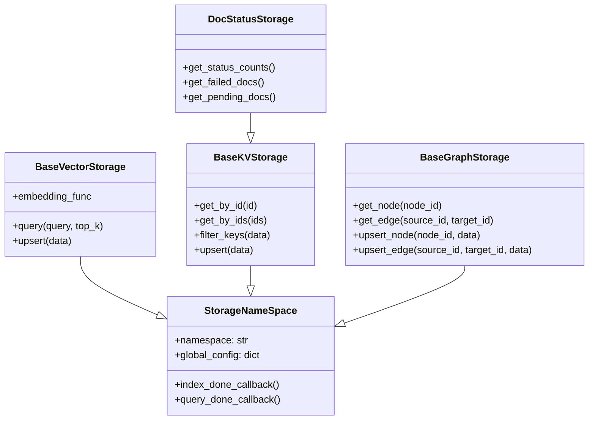
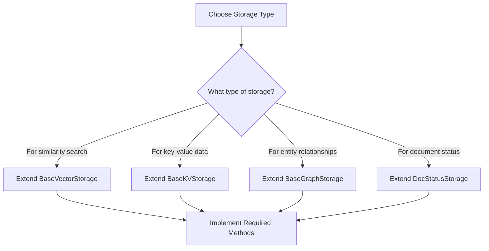
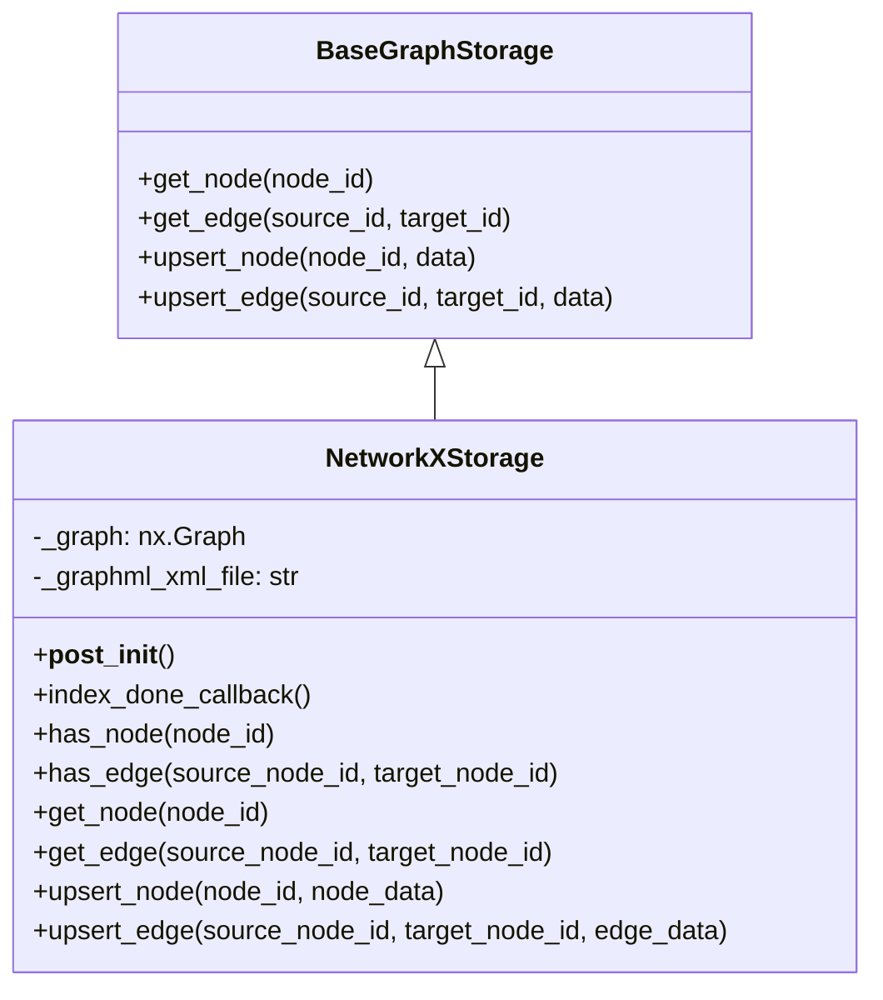
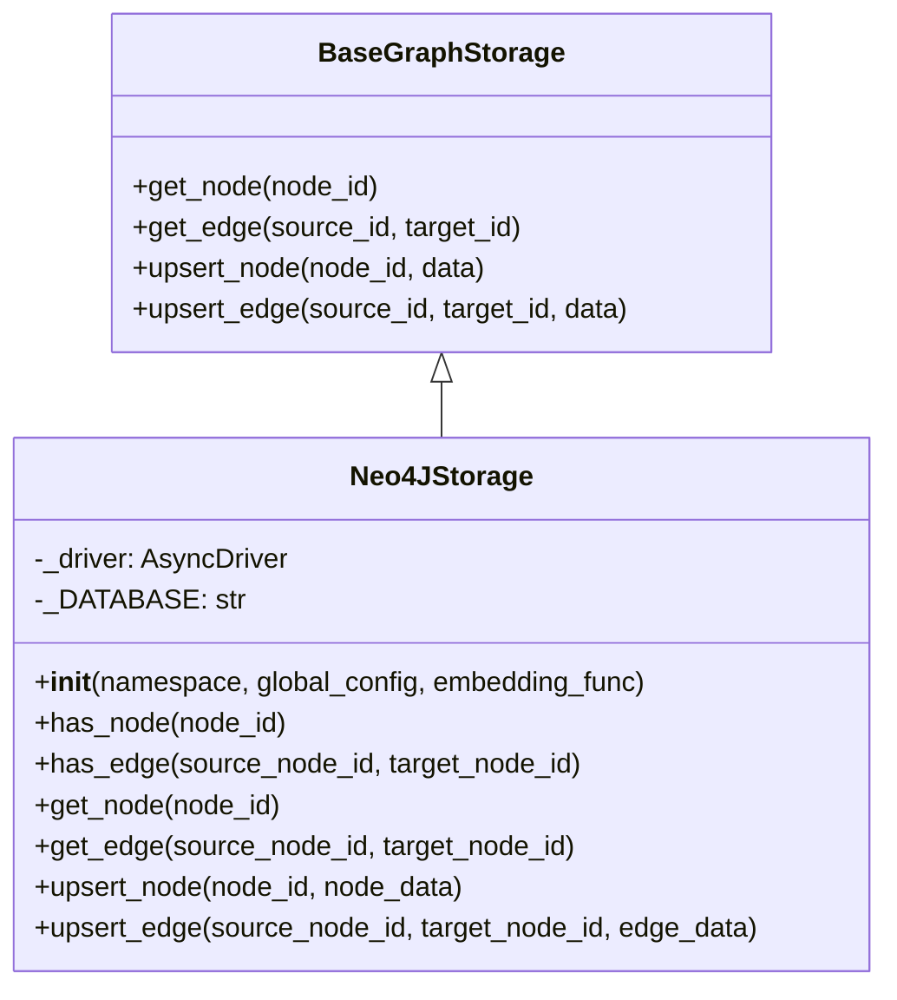
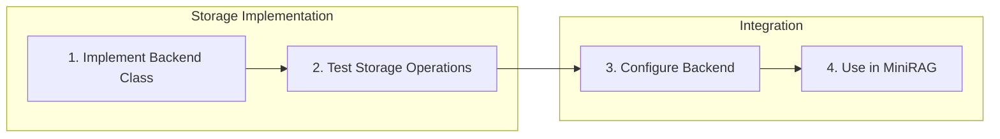

<!-- source: DeepWiki mcp.deepwiki.com · repo HKUDS/MiniRAG · page 10.1 Adding Storage Backends · fetched 2026-11-09 -->

# Adding Storage Backends

<details>
<summary>Relevant source files</summary>

The following files were used as context for generating this wiki page:

- [minirag/__init__.py](minirag/__init__.py)
- [minirag/base.py](minirag/base.py)
- [minirag/kg/networkx_impl.py](minirag/kg/networkx_impl.py)

</details>


This document outlines how to implement custom storage backends for MiniRAG. The MiniRAG system is designed with a flexible storage layer that allows for different storage implementations to be added. This guide explains the storage architecture, steps to create new storage backends, and best practices for implementation.

For information about using existing storage backends, see [Storage Implementations](#5).

## 1. Storage Architecture Overview

MiniRAG's storage layer is built on a set of abstract base classes that define the interfaces for different types of storage. All storage components inherit from a common `StorageNameSpace` class, which provides basic namespace functionality and lifecycle hooks.



Sources: [minirag/base.py:48-197]()

### 1.1 Storage Types

MiniRAG uses four main types of storage:

1. **Vector Storage**: Stores embeddings for efficient similarity search
2. **Key-Value Storage**: Stores general data with key-based access
3. **Graph Storage**: Stores entity relationships in a graph structure
4. **Document Status Storage**: Tracks the processing status of documents

## 2. Implementing a New Storage Backend

### 2.1 Choose the Appropriate Base Class

To add a new storage backend, first determine which base class to extend based on the type of storage:



Sources: [minirag/base.py:62-197]()

### 2.2 Implementing Required Methods

Each base class requires you to implement specific methods. The following sections detail the required methods for each storage type.

#### 2.2.1 Vector Storage

To implement a custom vector storage backend, extend `BaseVectorStorage` and implement these methods:

```python
# Required methods for BaseVectorStorage
async def query(self, query: str, top_k: int) -> list[dict]:
    # Perform similarity search and return top_k items
    
async def upsert(self, data: dict[str, dict]):
    # Add or update vectors in the storage
```

Sources: [minirag/base.py:62-75]()

#### 2.2.2 Key-Value Storage

To implement a custom key-value storage backend, extend `BaseKVStorage` and implement these methods:

```python
# Required methods for BaseKVStorage
async def all_keys(self) -> list[str]:
    # Return all keys in the storage
    
async def get_by_id(self, id: str) -> Union[T, None]:
    # Retrieve item by id
    
async def get_by_ids(self, ids: list[str], fields: Union[set[str], None] = None) -> list[Union[T, None]]:
    # Retrieve multiple items by ids
    
async def filter_keys(self, data: list[str]) -> set[str]:
    # Return keys that don't exist in storage
    
async def upsert(self, data: dict[str, T]):
    # Add or update items in storage
    
async def drop(self):
    # Clear all data from storage
```

Sources: [minirag/base.py:77-100]()

#### 2.2.3 Graph Storage

To implement a custom graph storage backend, extend `BaseGraphStorage` and implement these methods:

```python
# Required methods for BaseGraphStorage
async def get_types(self) -> tuple[list[str], list[str]]:
    # Return node types in the graph
    
async def has_node(self, node_id: str) -> bool:
    # Check if node exists
    
async def has_edge(self, source_node_id: str, target_node_id: str) -> bool:
    # Check if edge exists
    
async def node_degree(self, node_id: str) -> int:
    # Get number of edges for node
    
async def edge_degree(self, src_id: str, tgt_id: str) -> int:
    # Get combined degree of source and target nodes
    
async def get_node(self, node_id: str) -> Union[dict, None]:
    # Retrieve node data
    
async def get_edge(self, source_node_id: str, target_node_id: str) -> Union[dict, None]:
    # Retrieve edge data
    
async def get_node_edges(self, source_node_id: str) -> Union[list[tuple[str, str]], None]:
    # Get all edges for a node
    
async def upsert_node(self, node_id: str, node_data: dict[str, str]):
    # Add or update node
    
async def upsert_edge(self, source_node_id: str, target_node_id: str, edge_data: dict[str, str]):
    # Add or update edge
    
async def delete_node(self, node_id: str):
    # Remove node from graph
```

Sources: [minirag/base.py:103-148]()

#### 2.2.4 Document Status Storage

To implement a custom document status storage backend, extend `DocStatusStorage` and implement these methods in addition to the `BaseKVStorage` methods:

```python
# Required methods for DocStatusStorage (in addition to BaseKVStorage methods)
async def get_status_counts(self) -> dict[str, int]:
    # Return counts of documents in each status
    
async def get_failed_docs(self) -> dict[str, DocProcessingStatus]:
    # Return all failed documents
    
async def get_pending_docs(self) -> dict[str, DocProcessingStatus]:
    # Return all pending documents
```

Sources: [minirag/base.py:184-197]()

### 2.3 Implementing Storage Lifecycle Methods

Each storage class inherits the following methods from `StorageNameSpace`:

```python
# Storage lifecycle methods
async def index_done_callback(self):
    """Called after indexing is complete"""
    pass

async def query_done_callback(self):
    """Called after a query is complete"""
    pass
```

These methods can be overridden to perform actions like committing transactions or persisting data after operations.

Sources: [minirag/base.py:53-59]()

## 3. Example Implementation: NetworkX Graph Storage

Let's examine how `NetworkXStorage` implements `BaseGraphStorage` as a reference:



Sources: [minirag/kg/networkx_impl.py:69-276]()

Key implementation details:

1. **Initialization**: The `__post_init__` method initializes the NetworkX graph and loads existing data if available.

```python
def __post_init__(self):
    self._graphml_xml_file = os.path.join(
        self.global_config["working_dir"], f"graph_{self.namespace}.graphml"
    )
    preloaded_graph = NetworkXStorage.load_nx_graph(self._graphml_xml_file)
    if preloaded_graph is not None:
        logger.info(f"Loaded graph from {self._graphml_xml_file}...")
    self._graph = preloaded_graph or nx.Graph()
    # ...
```

Sources: [minirag/kg/networkx_impl.py:132-144]()

2. **Lifecycle Methods**: The `index_done_callback` method persists the graph after indexing.

```python
async def index_done_callback(self):
    NetworkXStorage.write_nx_graph(self._graph, self._graphml_xml_file)
```

Sources: [minirag/kg/networkx_impl.py:146-147]()

3. **Node Operations**: Methods to add, query, and manage nodes.

```python
async def has_node(self, node_id: str) -> bool:
    return self._graph.has_node(node_id)

async def get_node(self, node_id: str) -> Union[dict, None]:
    return self._graph.nodes.get(node_id)

async def upsert_node(self, node_id: str, node_data: dict[str, str]):
    self._graph.add_node(node_id, **node_data)
```

Sources: [minirag/kg/networkx_impl.py:196-222]()

4. **Edge Operations**: Methods to add, query, and manage edges.

```python
async def has_edge(self, source_node_id: str, target_node_id: str) -> bool:
    return self._graph.has_edge(source_node_id, target_node_id)

async def get_edge(self, source_node_id: str, target_node_id: str) -> Union[dict, None]:
    return self._graph.edges.get((source_node_id, target_node_id))

async def upsert_edge(self, source_node_id: str, target_node_id: str, edge_data: dict[str, str]):
    self._graph.add_edge(source_node_id, target_node_id, **edge_data)
```

Sources: [minirag/kg/networkx_impl.py:199-227]()

## 4. Example Implementation: Neo4j Graph Storage

For comparison, let's look at the Neo4j implementation which provides a different backend for graph storage:



Sources: [minirag/kg/neo4j_impl.py:30-557]()

Key implementation differences:

1. **Connection Management**: The Neo4j implementation manages a database connection.

```python
def __init__(self, namespace, global_config, embedding_func):
    super().__init__(
        namespace=namespace,
        global_config=global_config,
        embedding_func=embedding_func,
    )
    self._driver = None
    self._driver_lock = asyncio.Lock()
    URI = os.environ["NEO4J_URI"]
    USERNAME = os.environ["NEO4J_USERNAME"]
    PASSWORD = os.environ["NEO4J_PASSWORD"]
    # ...
```

Sources: [minirag/kg/neo4j_impl.py:36-54]()

2. **Database Operations**: Uses Cypher queries to perform graph operations.

```python
async def get_node(self, node_id: str) -> Union[dict, None]:
    async with self._driver.session(database=self._DATABASE) as session:
        entity_name_label = node_id.strip('"')
        query = f"MATCH (n:`{entity_name_label}`) RETURN n"
        result = await session.run(query)
        record = await result.single()
        if record:
            node = record["n"]
            node_dict = dict(node)
            # ...
            return node_dict
        return None
```

Sources: [minirag/kg/neo4j_impl.py:141-154]()

3. **Error Handling**: Includes retry mechanisms for database operations.

```python
@retry(
    stop=stop_after_attempt(3),
    wait=wait_exponential(multiplier=1, min=4, max=10),
    retry=retry_if_exception_type(
        (
            neo4jExceptions.ServiceUnavailable,
            neo4jExceptions.TransientError,
            neo4jExceptions.WriteServiceUnavailable,
            neo4jExceptions.ClientError,
        )
    ),
)
async def upsert_node(self, node_id: str, node_data: Dict[str, Any]):
    # Implementation...
```

Sources: [minirag/kg/neo4j_impl.py:294-332]()

## 5. Implementation Guidelines

When implementing a new storage backend, follow these guidelines:

### 5.1 Implementation Checklist

1. **Select the appropriate base class** based on storage type
2. **Implement all required methods** defined in the base class
3. **Handle errors appropriately** for robustness
4. **Implement lifecycle methods** for proper resource management
5. **Add appropriate configuration options** for your backend

### 5.2 Best Practices

1. **Efficient Query Implementation**: Implement query methods efficiently, considering:
   - Caching strategies
   - Batch operations
   - Connection pooling (for database backends)

2. **Error Handling**: Use try/except blocks and retries for robustness:
   
   ```python
   try:
       # Perform storage operation
   except Exception as e:
       logger.error(f"Error during operation: {str(e)}")
       # Implement appropriate error handling
   ```

3. **Resource Management**: Properly manage resources in lifecycle methods:
   
   ```python
   async def index_done_callback(self):
       # Save/commit changes after indexing
       
   async def query_done_callback(self):
       # Save/commit changes after querying
   ```

4. **Configuration Options**: Make your implementation configurable:
   
   ```python
   def __post_init__(self):
       # Access configuration from global_config
       self.connection_timeout = self.global_config.get("connection_timeout", 30)
   ```

## 6. Integration with MiniRAG

After implementing your storage backend, you need to integrate it with MiniRAG for use.



### 6.1 Configuration Example

When configuring MiniRAG to use your custom storage backend, you'll need to provide the appropriate configuration:

```python
# Example configuration with custom graph storage
config = {
    "working_dir": "./data",
    "graph_storage": {
        "type": "MyCustomGraphStorage",
        "config": {
            # Custom configuration options for your storage backend
        }
    },
    # Other configuration options...
}

# Initialize MiniRAG with this configuration
rag = MiniRAG(config)
```

## 7. Testing Your Storage Backend

When developing a new storage backend, thoroughly test it to ensure it meets all requirements:

1. **Unit Tests**: Test each method individually
2. **Integration Tests**: Test interactions with MiniRAG
3. **Performance Tests**: Benchmark against other storage backends
4. **Error Handling Tests**: Verify robustness under failure conditions

## Conclusion

Adding custom storage backends to MiniRAG allows you to adapt the system to your specific requirements and infrastructure. By following the guidelines in this document and understanding the existing implementations, you can create efficient and reliable storage solutions that integrate seamlessly with MiniRAG.

For more information about using specific storage implementations, see [Vector Storage](#5.1), [Key-Value Storage](#5.2), [Graph Storage](#5.3), and [Document Status Storage](#5.4).

---

