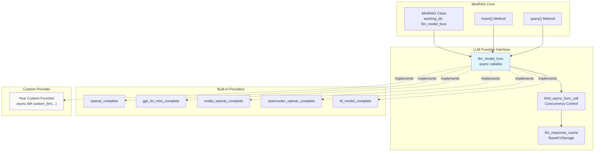
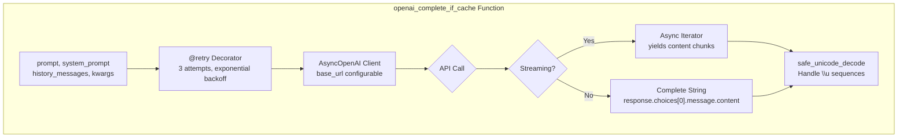
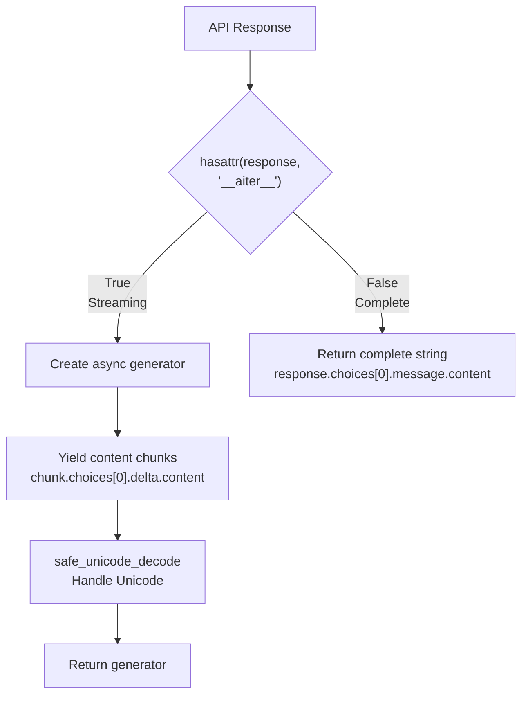
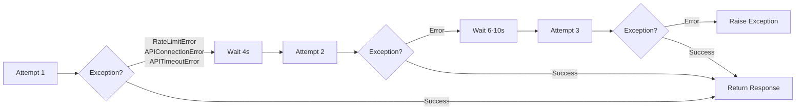
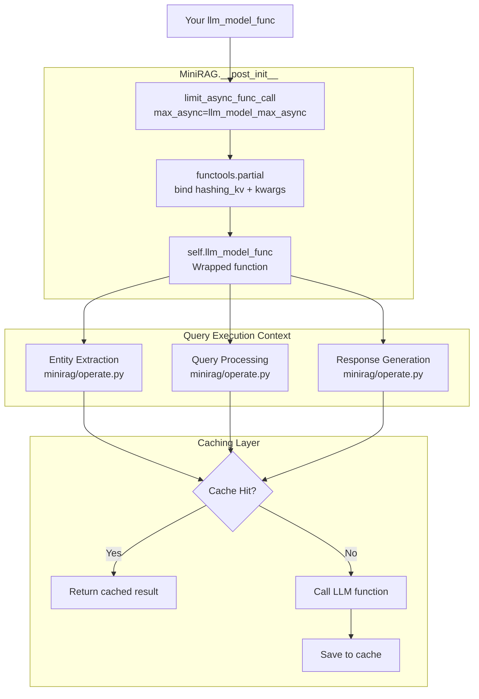
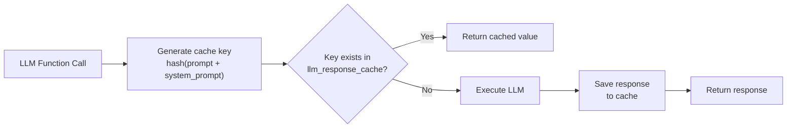

<!-- source: DeepWiki mcp.deepwiki.com · repo HKUDS/MiniRAG · page 10.2 Custom LLM Integration · fetched 2026-11-09 -->

# Custom LLM Integration

<details>
<summary>Relevant source files</summary>

The following files were used as context for generating this wiki page:

- [main.py](main.py)
- [minirag/llm/openai.py](minirag/llm/openai.py)
- [minirag/prompt.py](minirag/prompt.py)

</details>


This page explains how to integrate custom Language Models (LLMs) with MiniRAG, allowing you to use different LLM providers beyond the built-in OpenAI and HuggingFace implementations. MiniRAG supports streaming responses, automatic retry logic, and multiple API providers out of the box. For information about using custom embedding models, see page 10.3.

## Overview

MiniRAG provides a flexible LLM integration architecture through the `llm_model_func` parameter. The system uses LLMs for:

1. **Entity Extraction**: Identifying entities and relationships from text chunks during indexing
2. **Query Processing**: Extracting entities from user queries
3. **Response Generation**: Synthesizing final answers from retrieved context

### LLM Integration Architecture



Sources: [minirag/llm/openai.py:93-241](), [main.py:58-72]()

## Function Signature Requirements

All LLM functions integrated with MiniRAG must conform to a specific asynchronous signature:

### Required Signature

```python
from typing import Union, List
from collections.abc import AsyncIterator

async def custom_llm_function(
    prompt: str, 
    system_prompt: str = None, 
    history_messages: List[dict] = [], 
    **kwargs
) -> Union[str, AsyncIterator[str]]:
    """
    Custom LLM function for MiniRAG integration.
    
    Args:
        prompt: The user's input text
        system_prompt: Optional system-level instruction
        history_messages: List of prior conversation messages
        **kwargs: Additional parameters (hashing_kv, keyword_extraction, etc.)
    
    Returns:
        Either a complete string response or an async iterator for streaming
    """
    # Your implementation here
    pass
```

### Function Behavior

| Aspect | Requirement |
|--------|-------------|
| **Execution** | Must be asynchronous (async def) |
| **Return Type** | `str` for complete responses, `AsyncIterator[str]` for streaming |
| **Error Handling** | Should handle API failures gracefully |
| **Parameters** | Must accept `prompt`, `system_prompt`, `history_messages`, and `**kwargs` |
| **Cache Support** | Will automatically receive `hashing_kv` in kwargs for caching |

Sources: [minirag/llm/openai.py:93-153](), [minirag/llm/openai.py:156-169]()

## Built-in LLM Providers

MiniRAG includes several pre-implemented LLM functions with retry logic and streaming support.

### OpenAI-Compatible Providers

#### Core Implementation: openai_complete_if_cache

The foundation for all OpenAI-compatible integrations is `openai_complete_if_cache`, which includes:



Sources: [minirag/llm/openai.py:81-153]()

The retry decorator configuration:

| Parameter | Value | Purpose |
|-----------|-------|---------|
| `stop` | `stop_after_attempt(3)` | Maximum 3 retry attempts |
| `wait` | `wait_exponential(multiplier=1, min=4, max=10)` | Exponential backoff: 4-10 seconds |
| `retry` | `RateLimitError, APIConnectionError, APITimeoutError` | Retries on these exceptions |

Sources: [minirag/llm/openai.py:81-87]()

### Provider-Specific Functions

#### 1. OpenAI Standard Models

```python
# Generic OpenAI interface
async def openai_complete(
    prompt, 
    system_prompt=None, 
    history_messages=[], 
    keyword_extraction=False, 
    **kwargs
) -> Union[str, AsyncIterator[str]]:
    # Uses model from kwargs["hashing_kv"].global_config["llm_model_name"]
    pass

# GPT-4o
async def gpt_4o_complete(prompt, system_prompt=None, history_messages=[], **kwargs) -> str:
    # Fixed model: "gpt-4o"
    pass

# GPT-4o-mini (recommended for MiniRAG)
async def gpt_4o_mini_complete(prompt, system_prompt=None, history_messages=[], **kwargs) -> str:
    # Fixed model: "gpt-4o-mini"
    pass
```

Sources: [minirag/llm/openai.py:156-199]()

#### 2. NVIDIA API Integration

```python
async def nvidia_openai_complete(
    prompt, 
    system_prompt=None, 
    history_messages=[], 
    keyword_extraction=False, 
    **kwargs
) -> str:
    # Model: "nvidia/llama-3.1-nemotron-70b-instruct"
    # Base URL: "https://integrate.api.nvidia.com/v1"
    # Context length: 128k tokens
    pass
```

Sources: [minirag/llm/openai.py:202-216]()

#### 3. OpenRouter Integration

```python
async def openrouter_openai_complete(
    prompt, 
    system_prompt=None, 
    history_messages=[], 
    keyword_extraction=False, 
    api_key: str = None, 
    **kwargs
) -> str:
    # Default model: "google/gemini-2.0-flash-001"
    # Base URL: "https://openrouter.ai/api/v1"
    # Supports custom api_key parameter
    pass
```

Sources: [minirag/llm/openai.py:218-241]()

### HuggingFace Models

For local or self-hosted models, MiniRAG supports HuggingFace Transformers:

```python
from minirag.llm.hf import hf_model_complete
from transformers import AutoModel, AutoTokenizer

# Example from main.py
rag = MiniRAG(
    working_dir="./LiHua-World",
    llm_model_func=hf_model_complete,
    llm_model_name="microsoft/Phi-3.5-mini-instruct",
    llm_model_max_token_size=200,
    # ... other config
)
```

Supported Small Language Models:
- `microsoft/Phi-3.5-mini-instruct`
- `THUDM/glm-edge-1.5b-chat`
- `openbmb/MiniCPM3-4B`
- `Qwen/Qwen2.5-3B-Instruct`

Sources: [main.py:35-72]()

## Implementing a Custom LLM Provider

### Step 1: Create Your Async Function

```python
import os
from typing import Union
from collections.abc import AsyncIterator

async def my_custom_llm(
    prompt: str,
    system_prompt: str = None,
    history_messages: list = [],
    **kwargs
) -> Union[str, AsyncIterator[str]]:
    """
    Custom LLM implementation example.
    """
    # Extract common kwargs
    hashing_kv = kwargs.get("hashing_kv")
    keyword_extraction = kwargs.get("keyword_extraction", False)
    
    # Build messages
    messages = []
    if system_prompt:
        messages.append({"role": "system", "content": system_prompt})
    messages.extend(history_messages)
    messages.append({"role": "user", "content": prompt})
    
    # Your LLM API call here
    # Example: response = await my_api_client.generate(messages)
    
    return "Generated response text"
```

### Step 2: Add Retry Logic (Optional)

Use the `tenacity` library for automatic retries:

```python
from tenacity import (
    retry,
    stop_after_attempt,
    wait_exponential,
    retry_if_exception_type,
)

@retry(
    stop=stop_after_attempt(3),
    wait=wait_exponential(multiplier=1, min=4, max=10),
    retry=retry_if_exception_type((ConnectionError, TimeoutError))
)
async def my_custom_llm_with_retry(prompt, system_prompt=None, history_messages=[], **kwargs):
    # Your implementation with automatic retry on specified exceptions
    pass
```

Sources: [minirag/llm/openai.py:81-87]()

### Step 3: Integrate with MiniRAG

```python
from minirag import MiniRAG, QueryParam
from minirag.utils import EmbeddingFunc

rag = MiniRAG(
    working_dir="./my_working_dir",
    llm_model_func=my_custom_llm,
    llm_model_name="my-custom-model-v1",
    llm_model_max_token_size=4096,
    llm_model_max_async=16,
    llm_model_kwargs={
        "temperature": 0.7,
        "top_p": 0.9,
        # Additional model-specific parameters
    },
    # ... embedding and storage config
)
```

Sources: [main.py:58-72]()

## Streaming Support

MiniRAG supports streaming responses for real-time output generation. Your custom LLM function can return an `AsyncIterator[str]` to enable streaming.

### Streaming Implementation Pattern

```python
from collections.abc import AsyncIterator

async def custom_streaming_llm(
    prompt: str,
    system_prompt: str = None,
    history_messages: list = [],
    **kwargs
) -> AsyncIterator[str]:
    """
    Example streaming LLM implementation.
    """
    # Check if streaming is requested (via kwargs or response format)
    if kwargs.get("stream", False):
        async def generate_stream():
            # Yield chunks as they arrive
            async for chunk in your_streaming_api_call():
                if chunk.content:
                    yield chunk.content
        
        return generate_stream()
    else:
        # Return complete response
        return "Complete response"
```

### Streaming in openai_complete_if_cache

The built-in OpenAI integration automatically handles streaming:



Sources: [minirag/llm/openai.py:131-153]()

## Error Handling and Retry Logic

### Built-in Retry Mechanism

All OpenAI-compatible functions use the `@retry` decorator with exponential backoff:



### Exception Types

| Exception | Source | Retry Behavior |
|-----------|--------|----------------|
| `RateLimitError` | OpenAI API | Retry with exponential backoff |
| `APIConnectionError` | Network issues | Retry with exponential backoff |
| `APITimeoutError` | Request timeout | Retry with exponential backoff |
| Other exceptions | Various | Propagate immediately (no retry) |

Sources: [minirag/llm/openai.py:57-87]()

### Custom Error Handling

For your custom LLM function:

```python
async def robust_custom_llm(prompt, system_prompt=None, history_messages=[], **kwargs):
    try:
        # Your API call
        response = await your_api_client.generate(prompt)
        return response.text
    
    except RateLimitError:
        # Handle rate limiting
        logger.warning("Rate limit hit, consider implementing backoff")
        raise  # Let retry decorator handle it
    
    except Exception as e:
        # Log and handle unexpected errors
        logger.error(f"LLM call failed: {e}")
        return PROMPTS["fail_response"]  # Fallback response
```

Sources: [minirag/prompt.py:313]()

## Internal LLM Function Processing

When you provide a custom LLM function to MiniRAG, it undergoes several processing steps for optimization and control.

### Processing Pipeline



### Concurrency Control

The `limit_async_func_call` wrapper ensures that no more than `llm_model_max_async` concurrent requests are made:

| Parameter | Default | Purpose |
|-----------|---------|---------|
| `llm_model_max_async` | 16 | Maximum concurrent LLM calls |
| Effect | Semaphore control | Prevents API rate limit exhaustion |

### Cache Integration

MiniRAG automatically caches LLM responses when `enable_llm_cache=True`:



The cache uses `BaseKVStorage` (typically JSON-based) to persist responses across sessions.

Sources: [minirag/llm/openai.py:109]()

## Configuration Parameters

Configure LLM integration via the `MiniRAG` constructor:

### Core LLM Parameters

| Parameter | Type | Default | Description |
|-----------|------|---------|-------------|
| `llm_model_func` | `Callable` | `gpt_4o_mini_complete` | Async function for LLM calls |
| `llm_model_name` | `str` | `"gpt-4o-mini"` | Model identifier for API calls |
| `llm_model_max_token_size` | `int` | `32768` | Maximum context window size |
| `llm_model_max_async` | `int` | `16` | Concurrent request limit |
| `llm_model_kwargs` | `dict` | `{}` | Additional model parameters |

### Cache and Performance

| Parameter | Type | Default | Description |
|-----------|------|---------|-------------|
| `enable_llm_cache` | `bool` | `True` | Enable response caching |
| `llm_response_cache` | `BaseKVStorage` | Auto-created | Cache storage backend |

### Example Configuration

```python
from minirag import MiniRAG
from minirag.llm.openai import openai_complete

rag = MiniRAG(
    working_dir="./my_rag_system",
    
    # LLM Configuration
    llm_model_func=openai_complete,
    llm_model_name="gpt-4o-mini",
    llm_model_max_token_size=128000,
    llm_model_max_async=32,
    llm_model_kwargs={
        "temperature": 0.7,
        "top_p": 0.95,
        "presence_penalty": 0.0,
        "frequency_penalty": 0.0,
    },
    
    # Cache Configuration
    enable_llm_cache=True,
    
    # Other parameters...
)
```

### Environment Variables

For OpenAI-compatible APIs:

| Variable | Purpose | Example |
|----------|---------|---------|
| `OPENAI_API_KEY` | Authentication | `"sk-..."` |
| `OPENAI_API_BASE` | Custom endpoint | `"https://api.openai.com/v1"` |
| `OPENROUTER_API_KEY` | OpenRouter auth | `"sk-or-v1-..."` |

Set via Python:

```python
import os
os.environ["OPENAI_API_KEY"] = "your-api-key"
os.environ["OPENAI_API_BASE"] = "https://your-custom-endpoint/v1"
```

Sources: [minirag/llm/openai.py:102-108](), [minirag/llm/openai.py:226-227](), [main.py:58-72]()

## Best Practices

When integrating custom LLMs with MiniRAG, consider the following best practices:

1. **Error Handling**: Implement robust error handling in your LLM function to manage API failures, rate limits, and other issues.

2. **Caching**: MiniRAG provides built-in caching for LLM responses. This is enabled by default and can significantly reduce costs and latency for repeated queries.

3. **Concurrency Control**: Use the `llm_model_max_async` parameter to control how many concurrent requests can be made to your LLM, preventing overwhelming the service.

4. **Model Selection**: Choose an appropriate model for each task. For entity extraction, you may need a model with strong analytical capabilities, while for final responses, you might prioritize fluency.

5. **Testing**: Test your custom LLM integration thoroughly, especially with different query types and edge cases.

Sources: [minirag/minirag.py:160-166](), [minirag/minirag.py:296-302]()

## Working with Ollama

For local deployment, you can integrate MiniRAG with Ollama. For more details, see [Ollama Compatibility](#6.3).

## Conclusion

Custom LLM integration in MiniRAG provides flexibility to use the language model that best fits your needs. By following the function signature requirements and best practices outlined in this guide, you can seamlessly integrate any LLM provider or model with MiniRAG.

For more advanced scenarios, consider using the `Model` and `MultiModel` classes to manage multiple LLMs or implement load balancing strategies.

Sources: [minirag/minirag.py:160-166](), [minirag/llm.py:5-33](), [minirag/llm.py:35-84]()

---

