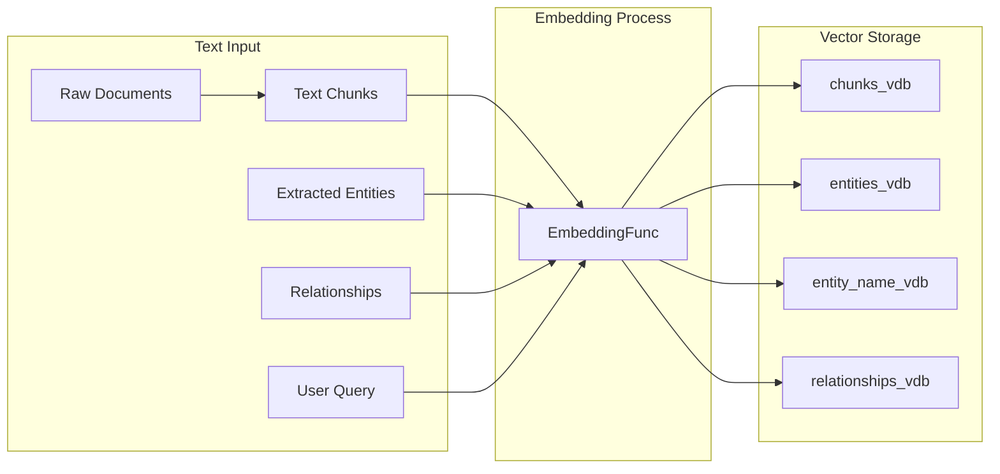
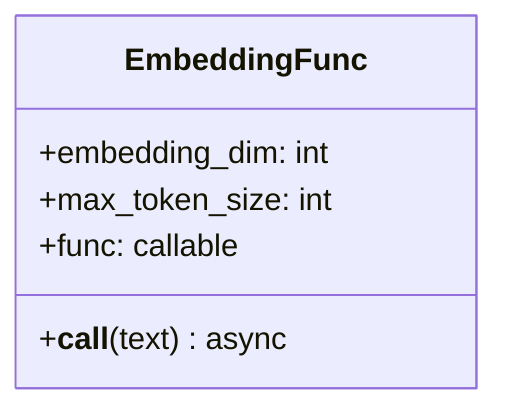
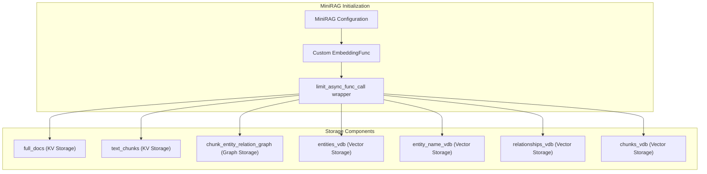
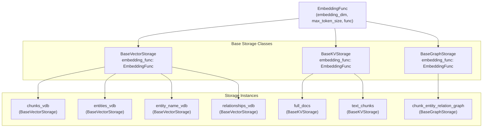

<!-- source: DeepWiki mcp.deepwiki.com · repo HKUDS/MiniRAG · page 10.3 Custom Embedding Models · fetched 2026-11-09 -->

# Custom Embedding Models

<details>
<summary>Relevant source files</summary>

The following files were used as context for generating this wiki page:

- [minirag/__init__.py](minirag/__init__.py)
- [minirag/base.py](minirag/base.py)
- [minirag/utils.py](minirag/utils.py)

</details>


This page explains how to use and implement custom embedding models with MiniRAG. Embedding models convert text into vector representations that enable semantic search capabilities in MiniRAG's vector storage systems. For information about integrating custom language models (LLMs), see [Custom LLM Integration](#9.3).

## Overview of Embedding Models in MiniRAG

Embedding models are a core component of MiniRAG's retrieval system. They convert text chunks, entities, and relationships into vector representations that enable semantic similarity search. MiniRAG uses these embeddings for:

1. Semantic search of document chunks
2. Entity matching
3. Relationship similarity
4. Graph-enhanced retrieval



Sources: [minirag/minirag.py:155-156](), [minirag/minirag.py:243-244](), [minirag/minirag.py:270-294]()

## EmbeddingFunc Class

At the core of MiniRAG's embedding system is the `EmbeddingFunc` class, which encapsulates the embedding function with metadata about its capabilities.



The `EmbeddingFunc` dataclass has three key attributes:
- `embedding_dim`: The dimensionality of the embedding vectors
- `max_token_size`: Maximum number of tokens the model can process
- `func`: The actual async function that performs embedding

When called, the `EmbeddingFunc` instance delegates to its internal function and returns numpy arrays representing the embeddings.

Sources: [minirag/utils.py:45-52]()

## Creating Custom Embedding Models

To create a custom embedding model for MiniRAG, you need to:

1. Implement an async function that converts text to embeddings
2. Wrap it with the `EmbeddingFunc` class or the `wrap_embedding_func_with_attrs` decorator

### Implementation Requirements

Your embedding function must:
- Be asynchronous (use `async def`)
- Accept text input
- Return a numpy array of embeddings
- Handle batching efficiently (for performance)

### Using the Decorator Approach

The `wrap_embedding_func_with_attrs` decorator provides a convenient way to create an `EmbeddingFunc`:

```python
from minirag.utils import wrap_embedding_func_with_attrs
import numpy as np

@wrap_embedding_func_with_attrs(embedding_dim=1536, max_token_size=8192)
async def my_custom_embedding_func(text_or_texts):
    # Your embedding logic here
    # Return numpy array of shape (embedding_dim,) or (batch_size, embedding_dim)
    return np.random.rand(1536)  # Replace with actual embedding logic
```

Sources: [minirag/utils.py:119-126]()

## Integrating Custom Embedding Models with MiniRAG

To use your custom embedding model with MiniRAG, set the `embedding_func` parameter when initializing the `MiniRAG` class:

```python
from minirag import MiniRAG

minirag = MiniRAG(
    embedding_func=my_custom_embedding_func,
    embedding_batch_num=32,  # Batch size for processing embeddings
    embedding_func_max_async=16,  # Maximum concurrent embedding operations
    # Other MiniRAG parameters...
)
```

MiniRAG automatically passes this embedding function to all its storage components that require vector representations:



Sources: [minirag/minirag.py:243-294]()

## Performance Considerations

MiniRAG includes mechanisms to manage the performance of embedding operations:

1. **Concurrency Limits**: The `embedding_func_max_async` parameter (default: 16) limits the number of concurrent embedding operations to prevent overwhelming the embedding service.

2. **Batching**: The `embedding_batch_num` parameter (default: 32) controls the batch size for embedding operations.

3. **Limiting Mechanism**: The `limit_async_func_call` wrapper ensures that embedding operations are throttled to the specified concurrency limit.

These controls are important when using external embedding APIs that might have rate limits or when running on hardware with limited resources.

### Embedding Quantization

MiniRAG provides utility functions for quantizing embeddings to reduce storage space and improve memory efficiency:

| Function | Purpose | Parameters |
|----------|---------|------------|
| `quantize_embedding` | Converts float embeddings to 8-bit integers | `embedding`: numpy array or list<br/>`bits`: quantization bits (default: 8) |
| `dequantize_embedding` | Converts quantized embeddings back to floats | `quantized`: numpy array<br/>`min_val`, `max_val`: stored scaling factors<br/>`bits`: quantization bits (default: 8) |

Quantization process:
1. Calculate min/max values from the embedding
2. Scale values to 0-255 range (for 8-bit)
3. Round to nearest integer and convert to uint8
4. Store min_val and max_val for reconstruction

This can reduce storage by ~75% (from float32 to uint8) with minimal impact on retrieval quality.

Sources: [minirag/utils.py:97-116](), [minirag/utils.py:450-463]()

## Examples

### Using OpenAI Embeddings

Here's an example of how to implement and use OpenAI's embedding model with MiniRAG:

```python
import numpy as np
import openai
from minirag.utils import wrap_embedding_func_with_attrs
from minirag import MiniRAG

@wrap_embedding_func_with_attrs(embedding_dim=1536, max_token_size=8191)
async def openai_embedding_func(text_or_texts):
    # Handle batching
    is_batch = isinstance(text_or_texts, list)
    texts = text_or_texts if is_batch else [text_or_texts]
    
    # Call OpenAI API
    response = await openai.Embedding.acreate(
        input=texts,
        model="text-embedding-ada-002"
    )
    
    # Extract embeddings
    embeddings = [np.array(item["embedding"]) for item in response["data"]]
    
    # Return single embedding or batch
    if not is_batch:
        return embeddings[0]
    return embeddings

# Initialize MiniRAG with the custom embedding function
minirag = MiniRAG(
    embedding_func=openai_embedding_func,
    embedding_func_max_async=5,  # Limit concurrent API calls
    # Other parameters...
)
```

### Using Sentence Transformers

Here's an example using the popular Sentence Transformers library:

```python
import numpy as np
from sentence_transformers import SentenceTransformer
from minirag.utils import wrap_embedding_func_with_attrs
from minirag import MiniRAG

# Load model once at module level
model = SentenceTransformer('all-MiniLM-L6-v2')

@wrap_embedding_func_with_attrs(embedding_dim=384, max_token_size=512)
async def sentence_transformer_embedding_func(text_or_texts):
    # Convert to asynchronous operation
    import asyncio
    
    def _embed(texts):
        return model.encode(texts, convert_to_numpy=True)
    
    # Handle batching
    is_batch = isinstance(text_or_texts, list)
    texts = text_or_texts if is_batch else [text_or_texts]
    
    # Run in thread pool to not block the event loop
    embeddings = await asyncio.get_event_loop().run_in_executor(
        None, _embed, texts
    )
    
    # Return single embedding or batch
    if not is_batch:
        return embeddings[0]
    return embeddings

# Initialize MiniRAG with the custom embedding function
minirag = MiniRAG(
    embedding_func=sentence_transformer_embedding_func,
    embedding_func_max_async=10,
    # Other parameters...
)
```

### Using Quantized Embeddings

To save storage space, you can implement quantization in your embedding function:

```python
import numpy as np
from minirag.utils import wrap_embedding_func_with_attrs, quantize_embedding, dequantize_embedding
from minirag import MiniRAG

@wrap_embedding_func_with_attrs(embedding_dim=384, max_token_size=512)
async def quantized_embedding_func(text_or_texts):
    # Get original embeddings (your implementation)
    embeddings = await get_embeddings(text_or_texts)
    
    # Quantize to reduce storage
    quantized, min_val, max_val = quantize_embedding(embeddings, bits=8)
    
    # Store quantized values and scaling factors
    # You would typically store min_val and max_val alongside the quantized data
    
    # For immediate use, dequantize back to float32
    dequantized = dequantize_embedding(quantized, min_val, max_val, bits=8)
    
    return dequantized
```

This approach reduces embedding storage requirements by approximately 75% while maintaining retrieval quality.

## Integration with Storage Components

MiniRAG automatically integrates your custom embedding model with all storage components that require vector operations through the base storage classes. The `embedding_func` is stored in the following base classes:



### Storage Class Attributes

| Storage Class | Embedding Attribute | Purpose |
|---------------|---------------------|---------|
| `BaseVectorStorage` | `embedding_func: EmbeddingFunc` | Vector similarity search operations |
| `BaseKVStorage` | `embedding_func: EmbeddingFunc` | Key-value storage with embedding support |
| `BaseGraphStorage` | `embedding_func: EmbeddingFunc` | Graph storage with optional node embeddings |

During initialization, MiniRAG passes your custom `embedding_func` to all storage instances that extend these base classes, ensuring consistency across:

1. **Vector Storages**: Document chunks, entity descriptions, entity names, and relationships
2. **Key-Value Storages**: Full document storage and text chunk storage
3. **Graph Storage**: The chunk-entity-relation graph structure

This integrated approach ensures all text-to-vector transformations use the same embedding model throughout the system.

Sources: [minirag/base.py:63-74](), [minirag/base.py:78-100](), [minirag/base.py:104-148]()

## Best Practices

1. **Dimensionality Consistency**: Ensure your embedding model's dimension is consistent with your vector database requirements.

2. **Async Implementation**: Always implement embedding functions as async to work with MiniRAG's asynchronous architecture.

3. **Batching Support**: Design your embedding function to efficiently handle both single texts and batches.

4. **Error Handling**: Include robust error handling in your embedding function, especially when using external APIs.

5. **Resource Management**: Set appropriate concurrency limits with `embedding_func_max_async` to prevent overwhelming resources.

6. **Cache Embeddings**: For production systems, consider implementing caching for frequent embedding operations.

7. **Model Size vs. Performance**: Balance embedding model size with performance requirements - larger models may provide better semantic understanding but at the cost of speed.

---

