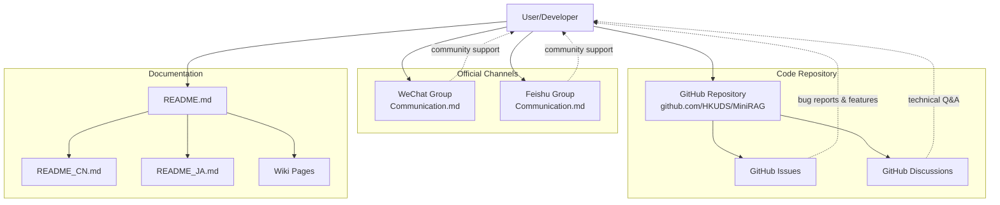
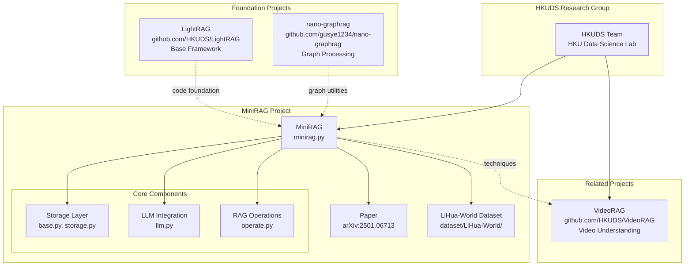
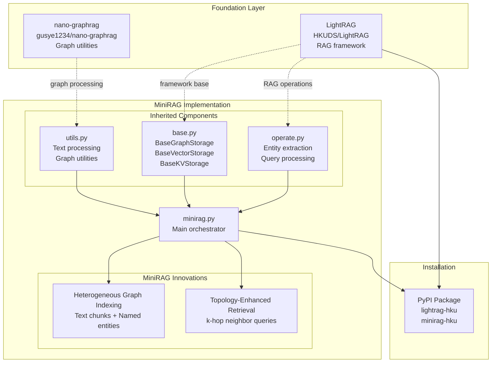
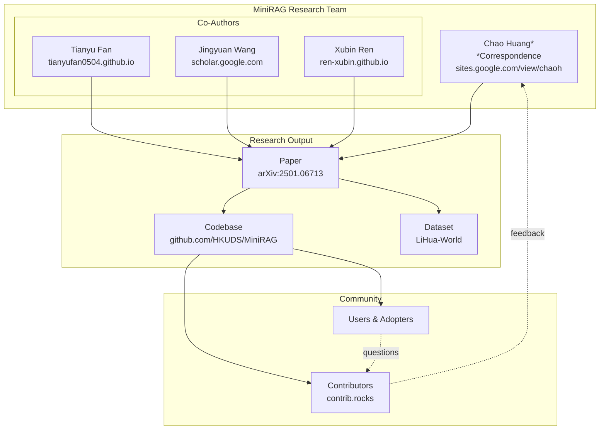

<!-- source: DeepWiki mcp.deepwiki.com · repo HKUDS/MiniRAG · page 11 Community and Support · fetched 2026-11-09 -->

# Community and Support

<details>
<summary>Relevant source files</summary>

The following files were used as context for generating this wiki page:

- [Communication.md](Communication.md)
- [README.md](README.md)

</details>


This document provides information on how to get help with MiniRAG, connect with other users and developers, contribute to the project, and properly acknowledge the work. It covers official communication channels, related projects in the HKUDS ecosystem, contribution guidelines, and citation information.

For technical documentation on extending MiniRAG with custom implementations, see [Extending MiniRAG](#10).

---

## Communication Channels

MiniRAG maintains active community discussion groups on two primary platforms for users to seek support, share experiences, and discuss implementation details.

### Official Discussion Groups

| Platform | Access Method | Purpose |
|----------|---------------|---------|
| **WeChat** | Scan QR code in [Communication.md](Communication.md:1-6)() | Real-time chat, quick questions, community updates |
| **Feishu** | Scan QR code in [Communication.md](Communication.md:1-6)() | Structured discussions, technical documentation sharing |

Both platforms are hosted by HKUDS (Hong Kong University Data Science Lab) and provide direct access to the development team and active community members.

**Communication Channels Overview**



Sources: [README.md:5-6](), [Communication.md:1-6]()

### Accessing the QR Codes

The QR codes for joining both WeChat and Feishu groups are available in the Communication.md file. The image is hosted at the HKUDS GitHub organization profile location and displays both platform options.

```bash
# View the communication guide
cat Communication.md
```

Sources: [Communication.md:1-6]()

---

## Related Projects

MiniRAG is part of a broader ecosystem of projects developed by the HKUDS team, focusing on efficient retrieval-augmented generation for various modalities and deployment scenarios.

### VideoRAG

**VideoRAG** is a related project released by the HKUDS team in February 2025 that extends RAG capabilities to extremely long-context video understanding scenarios.

| Project | Repository | Release Date | Focus Area |
|---------|-----------|--------------|------------|
| **MiniRAG** | [github.com/HKUDS/MiniRAG](https://github.com/HKUDS/MiniRAG) | January 2025 | Small model RAG for text |
| **VideoRAG** | [github.com/HKUDS/VideoRAG](https://github.com/HKUDS/VideoRAG) | February 2025 | Long-context video understanding |

The VideoRAG project applies similar principles of efficient retrieval and lightweight processing to video modality, addressing challenges in understanding extended video content.

Sources: [README.md:27]()

**MiniRAG Ecosystem and Related Projects**



Sources: [README.md:27](), [README.md:158-160]()

---

## Contributing

MiniRAG welcomes contributions from the community. The project maintains a public contributor graph and acknowledges all participants.

### Contribution Overview

The project displays its contributor history using the contrib.rocks service, which automatically generates visual representations of all GitHub contributors.

**Contributor Recognition**

Contributors are publicly acknowledged in the README.md file at lines 149-155. The contributor graph is automatically generated from GitHub commit history and displays all individuals who have contributed code, documentation, or other improvements to the repository.

```markdown
# From README.md
<a href="https://github.com/HKUDS/MiniRAG/graphs/contributors">
  
</a>
```

### How to Contribute

1. **Fork the Repository**: Create a personal fork of [github.com/HKUDS/MiniRAG](https://github.com/HKUDS/MiniRAG)
2. **Create a Branch**: Work on features or fixes in dedicated branches
3. **Submit Pull Requests**: Submit PRs with clear descriptions of changes
4. **Follow Code Standards**: Maintain consistency with existing codebase patterns

For technical details on implementing custom storage backends, LLM providers, or embedding models, refer to [Extending MiniRAG](#10).

Sources: [README.md:149-155]()

---

## Acknowledgments

MiniRAG builds upon foundational work from two key open-source projects that provide core functionality for graph processing and RAG operations.

### Foundation Projects

| Project | Repository | Contribution to MiniRAG |
|---------|-----------|-------------------------|
| **LightRAG** | [github.com/HKUDS/LightRAG](https://github.com/HKUDS/LightRAG) | Base framework for RAG operations, storage abstractions, and query processing |
| **nano-graphrag** | [github.com/gusye1234/nano-graphrag](https://github.com/gusye1234/nano-graphrag) | Graph processing utilities and lightweight graph operations |

MiniRAG extends LightRAG's architecture with innovations specifically designed for Small Language Models (SLMs), including heterogeneous graph indexing and topology-enhanced retrieval. The relationship between these projects is evident in the codebase structure:

- MiniRAG can be installed via `pip install lightrag-hku` as noted in [README.md:52-55]()
- The storage abstraction layer in [minirag/base.py]() inherits architectural patterns from LightRAG
- Graph processing utilities leverage concepts from nano-graphrag

**Dependency and Acknowledgment Relationships**



Sources: [README.md:158-160](), [README.md:52-55]()

### Acknowledgment Text

The following acknowledgment appears in the README.md file:

> "You may refer to related work that serves as foundations for our framework and code repository, nano-graphrag and LightRAG. Thanks for their wonderful works."

This acknowledgment is located at [README.md:158-160]() and recognizes the technical contributions of both foundational projects.

Sources: [README.md:158-160]()

---

## Citation

When using MiniRAG in academic research or publications, please cite the original paper using the following BibTeX entry.

### BibTeX Citation

```bibtex
@article{fan2025minirag,
  title={MiniRAG: Towards Extremely Simple Retrieval-Augmented Generation},
  author={Fan, Tianyu and Wang, Jingyuan and Ren, Xubin and Huang, Chao},
  journal={arXiv preprint arXiv:2501.06713},
  year={2025}
}
```

### Paper Information

| Field | Value |
|-------|-------|
| **Title** | MiniRAG: Towards Extremely Simple Retrieval-Augmented Generation |
| **Authors** | Tianyu Fan, Jingyuan Wang, Xubin Ren, Chao Huang |
| **Venue** | arXiv preprint |
| **arXiv ID** | 2501.06713 |
| **Year** | 2025 |
| **Link** | [https://arxiv.org/abs/2501.06713](https://arxiv.org/abs/2501.06713) |

### Author Affiliations

The author information with links to their profiles is available in [README.md:12](). The corresponding author is Chao Huang, indicated by an asterisk in the author list.

**Research Team Structure**



Sources: [README.md:12](), [README.md:162-170]()

---

## Star History

MiniRAG tracks its GitHub star history to monitor community interest and adoption. The star history chart is automatically generated and embedded in the README.md file.

The project uses the star-history.com service to display growth over time, supporting both light and dark color schemes for accessibility.

Sources: [README.md:139-147]()

---

## Multi-Language Documentation

MiniRAG provides documentation in multiple languages to support its international user base:

| Language | File | Purpose |
|----------|------|---------|
| **English** | [README.md]() | Primary documentation for international audience |
| **Chinese (中文)** | [README_CN.md]() | 中文用户的完整文档 |
| **Japanese (日本語)** | [README_JA.md]() | 日本語ユーザー向けドキュメント |

These translations are maintained in the repository root and provide comprehensive coverage of installation, usage, and technical details in each respective language.

Sources: [README.md:18-20]()

---

## Getting Help

When seeking support for MiniRAG, follow this escalation path:

1. **Check Documentation**: Review the wiki pages and README files in your preferred language
2. **Search Issues**: Look through [GitHub Issues](https://github.com/HKUDS/MiniRAG/issues) for similar problems
3. **Join Discussion Groups**: Ask questions in WeChat or Feishu groups for community support
4. **Report Bugs**: Create a GitHub issue with reproduction steps and environment details
5. **Contact Team**: For research collaborations or specific inquiries, contact the corresponding author

For questions about specific implementations:
- Storage backends: See [Storage Implementations](#5)
- LLM integration: See [LLM and Embedding Integration](#6)
- Custom extensions: See [Extending MiniRAG](#10)

Sources: [README.md:5-6](), [Communication.md:1-6]()