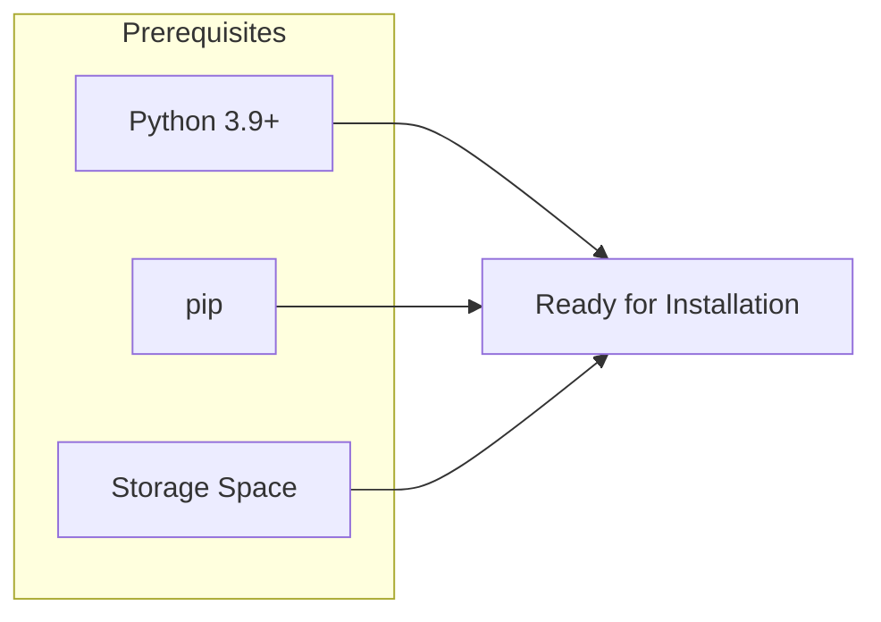
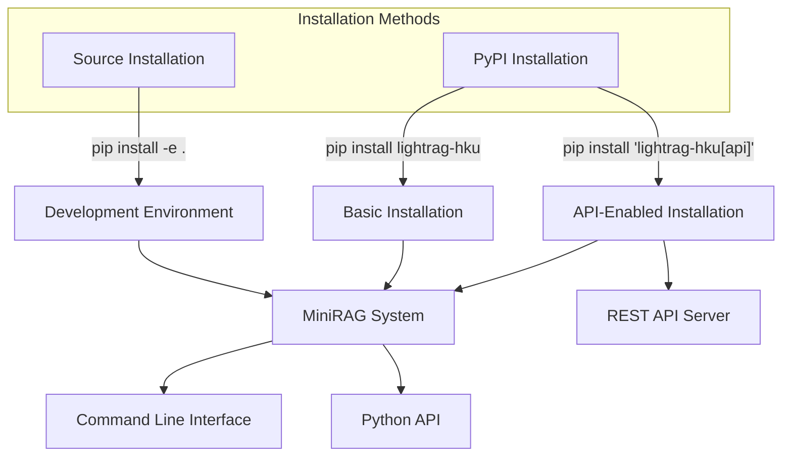
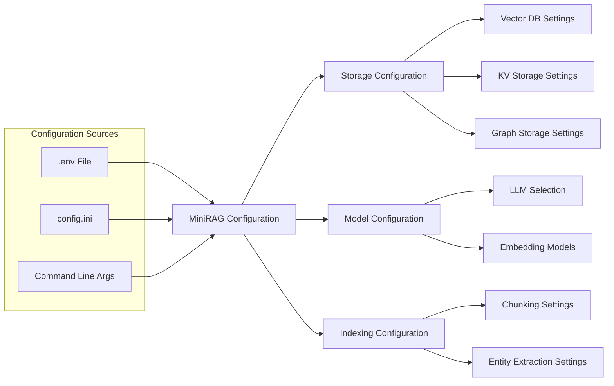
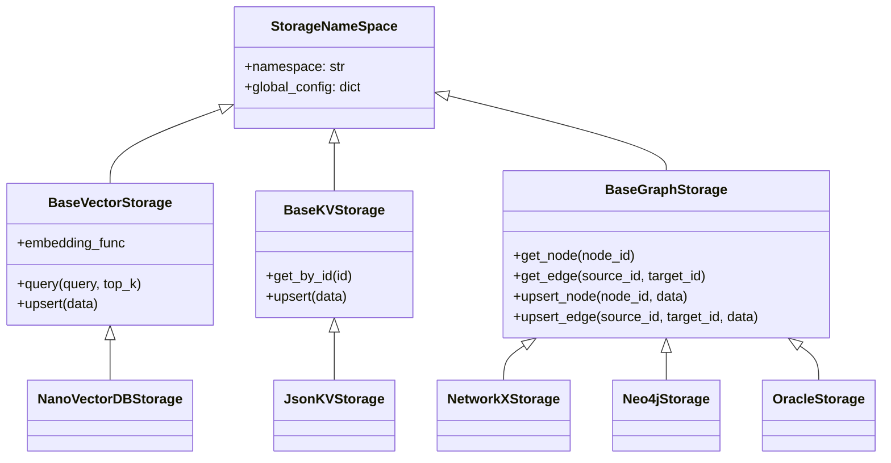
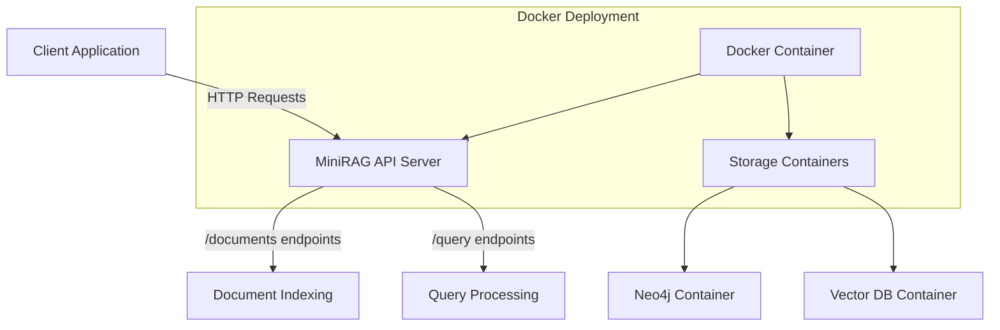

<!-- source: DeepWiki mcp.deepwiki.com · repo HKUDS/MiniRAG · page 2 Installation and Setup · fetched 2026-11-09 -->

# Installation and Setup

<details>
<summary>Relevant source files</summary>

The following files were used as context for generating this wiki page:

- [MANIFEST.in](MANIFEST.in)
- [README.md](README.md)
- [README_JA.md](README_JA.md)
- [pyproject.toml](pyproject.toml)

</details>


This page provides comprehensive instructions for installing and setting up MiniRAG, a lightweight retrieval-augmented generation system. It covers different installation methods, configuration options, and deployment strategies. For details about how to use MiniRAG after installation, see [Usage Examples](#8).

## Prerequisites

Before installing MiniRAG, ensure your system meets the following requirements:

- Python 3.9 or higher
- Sufficient disk space for storage backends
- Pip package manager



Sources: [setup.py:59]()

## Installation Options

MiniRAG can be installed in multiple ways, depending on your needs and preferences.

### Installation from Source (Recommended)

Installing from source provides the most up-to-date version of MiniRAG and is recommended for development and experimentation.

```bash
# Clone the repository
git clone https://github.com/HKUDS/MiniRAG
cd MiniRAG

# Install in development mode
pip install -e .
```

### Installation from PyPI

MiniRAG is available on PyPI under the package name `lightrag-hku` (since MiniRAG is based on LightRAG).

```bash
# Install basic version
pip install lightrag-hku

# Install with API support
pip install "lightrag-hku[api]"
```



Sources: [README.md:40-52](), [setup.py:40-70]()

## Dependencies

MiniRAG relies on various libraries for different functionality areas. Core dependencies are installed automatically when you install the package.

### Core Dependencies

| Category | Libraries |
|----------|-----------|
| Network & Communication | accelerate, aiofiles, aiohttp, httpx |
| Database | networkx, nltk |
| Core Processing | numpy, pydantic |
| Document Processing | PyPDF2, python-docx, python-pptx |
| LLM Integration | tiktoken |
| Utilities | json_repair, tenacity, tqdm, xxhash |

Additional dependencies for API functionality are installed when using the `[api]` extra.

Sources: [requirements.txt:1-34](), [setup.py:62-64]()

## Configuration

MiniRAG uses a combination of environment variables and configuration files to customize its behavior.

### Environment Variables

Create a `.env` file in your project root with the following variables:

```
# LLM Configuration
LLM_MODEL=gpt-4o-mini  # or any other supported model
LLM_API_KEY=your_api_key_here

# Storage Configuration
VECTOR_DB_PATH=./storage/vector_db
KV_STORAGE_PATH=./storage/kv_storage
GRAPH_STORAGE_PATH=./storage/graph_storage
```

### Configuration File

You can also create a `config.ini` file for more detailed configuration:

```
[Storage]
vector_db_type=nano
kv_storage_type=json
graph_storage_type=networkx

[Indexing]
chunk_size=1000
chunk_overlap=200
```



Sources: [requirements.txt:4](), [setup.py:24-34]()

## Storage Backend Options

MiniRAG supports multiple storage backends for different components of the system.

### Vector Storage

For storing embeddings and performing vector searches:
- NanoVectorDB (default, lightweight in-memory)
- Other compatible vector databases

### Key-Value Storage

For storing document chunks and metadata:
- JSON files (default, simple file-based storage)
- Other key-value stores

### Graph Storage

For storing the heterogeneous knowledge graph:
- NetworkX (default, in-memory graph)
- Neo4j (for production deployments)
- Oracle
- PostgreSQL
- TiDB



Sources: [README.md:22-23](), [minirag/kg/neo4j_impl.py](), [minirag/kg/oracle_impl.py]()

## Docker Deployment

MiniRAG provides Docker support for containerized deployment, making it easier to set up in production environments.

### Prerequisites for Docker Deployment

- Docker and Docker Compose installed
- Sufficient system resources for containers

### Setting Up with Docker

1. Clone the repository if you haven't already:
   ```bash
   git clone https://github.com/HKUDS/MiniRAG
   cd MiniRAG
   ```

2. Build and run the Docker containers:
   ```bash
   docker-compose up -d
   ```

This will start the MiniRAG API server and any required database containers.



Sources: [README.md:24-25]()

## Verification and Testing

After installation, verify that MiniRAG is working correctly by running a simple test:

```bash
# Navigate to the MiniRAG directory
cd MiniRAG

# Run the indexing example
python reproduce/Step_0_index.py

# Run the Q&A example
python reproduce/Step_1_QA.py
```

If everything is set up correctly, you should see output indicating successful document indexing and query processing.

Sources: [README.md:60-65]()

## Next Steps

After completing the installation and setup, you can:

1. Index your documents following the [Document Indexing](#8.1) guide
2. Start asking questions with [Question Answering](#8.2)
3. Explore advanced configurations and customizations in [Extending MiniRAG](#9)

## Troubleshooting

### Common Installation Issues

- **Dependency conflicts**: Use a virtual environment to avoid conflicts with existing packages
- **Permission errors**: Use `sudo` or administrator privileges when needed, or consider using a user-level installation with `pip install --user`
- **Missing dependencies**: Ensure all required dependencies are installed with `pip install -r requirements.txt`

### Docker Issues

- **Container fails to start**: Check Docker logs with `docker-compose logs`
- **API not responding**: Verify port mappings and network configurations in your Docker Compose file

Sources: [README.md:53-55]()

---

