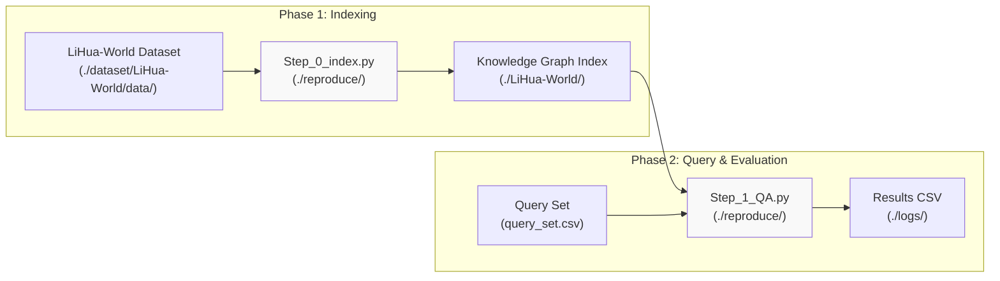
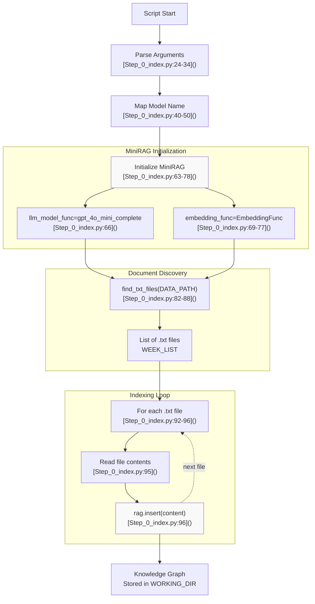
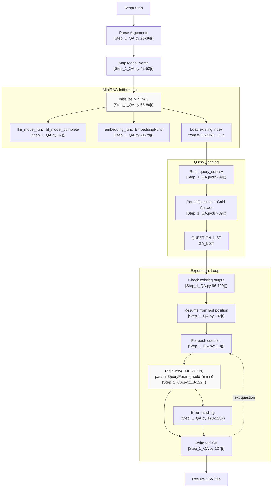
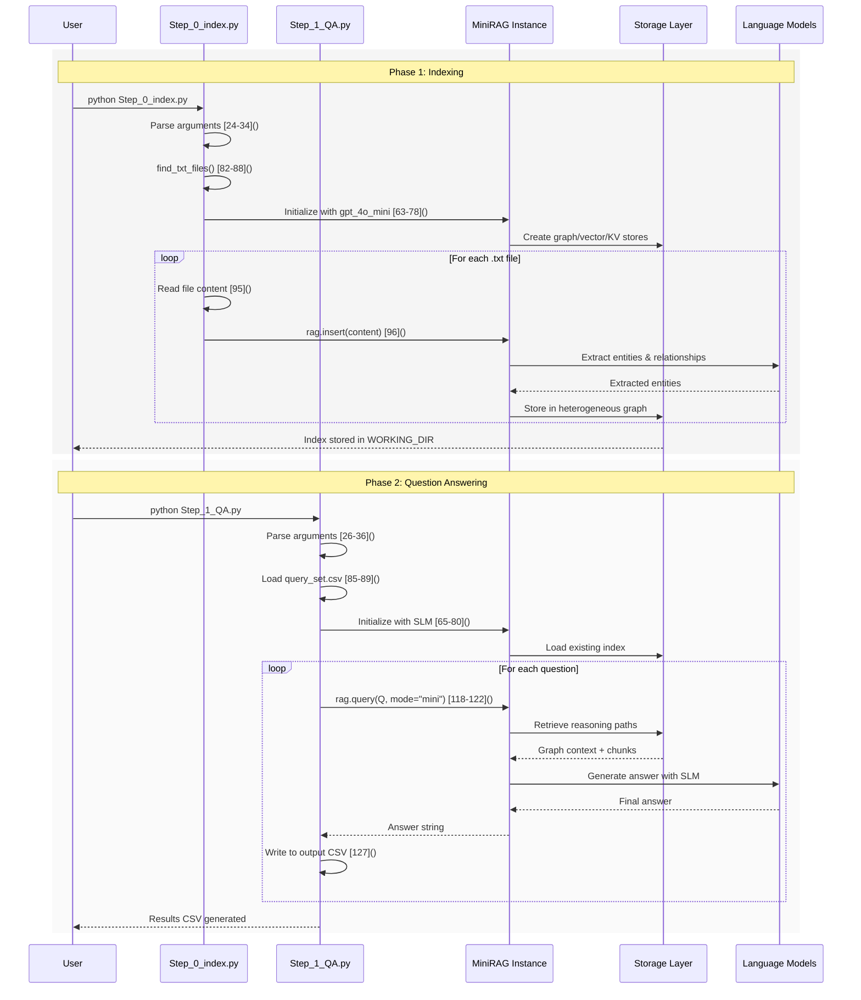

<!-- source: DeepWiki mcp.deepwiki.com · repo HKUDS/MiniRAG · page 2.2 Quick Start Guide · fetched 2026-11-09 -->

# Quick Start Guide

<details>
<summary>Relevant source files</summary>

The following files were used as context for generating this wiki page:

- [README.md](README.md)
- [reproduce/Step_0_index.py](reproduce/Step_0_index.py)
- [reproduce/Step_1_QA.py](reproduce/Step_1_QA.py)

</details>


This guide walks you through the fastest path to running MiniRAG using the reproduction scripts provided in the repository. You will learn how to index documents into the knowledge graph and perform question-answering queries using either Small Language Models or LLMs.

For installation instructions, see [Installation Options](#2.1). For detailed configuration options beyond the defaults used here, see [Configuration](#2.3). For programmatic usage beyond these scripts, see [Usage Examples](#8).

---

## Overview of the Two-Phase Quick Start

MiniRAG's quick start follows a two-phase pipeline implemented in the reproduction scripts:



**Sources:** [README.md:57-68](), [reproduce/Step_0_index.py:1-97](), [reproduce/Step_1_QA.py:1-135]()

---

## Prerequisites and Dataset Preparation

Before running the quick start scripts, ensure you have:

1. **Installed MiniRAG** following [Installation Options](#2.1)
2. **LiHua-World dataset** located at `./dataset/LiHua-World/data/`
3. **Query set** available at `./dataset/LiHua-World/qa/query_set.csv`

The dataset comes pre-packaged in the repository as `LiHuaWorld.zip` and should be extracted before use.

### Directory Structure

```
MiniRAG/
├── dataset/
│   └── LiHua-World/
│       ├── data/              # Text documents (.txt files)
│       └── qa/
│           ├── query_set.csv  # Questions and gold answers
│           └── query_set.json
├── reproduce/
│   ├── Step_0_index.py        # Indexing script
│   └── Step_1_QA.py           # QA script
└── logs/                      # Output directory (created automatically)
```

**Sources:** [README.md:59-61](), [README.md:99-131]()

---

## Phase 1: Document Indexing with Step_0_index.py

### Purpose

`Step_0_index.py` indexes all text documents in the dataset into MiniRAG's heterogeneous graph structure, creating the knowledge base required for subsequent queries.

### Command-Line Arguments

| Argument | Default Value | Description |
|----------|---------------|-------------|
| `--model` | `"PHI"` | LLM model identifier: `"PHI"`, `"GLM"`, `"MiniCPM"`, or `"qwen"` |
| `--workingdir` | `"./LiHua-World"` | Directory where the knowledge graph index will be stored |
| `--datapath` | `"./dataset/LiHua-World/data/"` | Path to the input text documents |
| `--outputpath` | `"./logs/Default_output.csv"` | (Not used in indexing, but accepted for consistency) |
| `--querypath` | `"./dataset/LiHua-World/qa/query_set.csv"` | (Not used in indexing, but accepted for consistency) |

**Sources:** [reproduce/Step_0_index.py:24-34]()

### Running the Indexing Script

```bash
python ./reproduce/Step_0_index.py --model PHI --workingdir ./LiHua-World
```

This command will:
1. Initialize a `MiniRAG` instance with the specified model
2. Recursively find all `.txt` files in the data path
3. Process each file through the insertion pipeline
4. Store the resulting knowledge graph in the working directory

### Step_0_index.py Internal Workflow



**Sources:** [reproduce/Step_0_index.py:1-97]()

### Model Selection

The script maps command-line model identifiers to HuggingFace model names:

| `--model` Value | Actual Model Name |
|-----------------|-------------------|
| `"PHI"` | `"microsoft/Phi-3.5-mini-instruct"` |
| `"GLM"` | `"THUDM/glm-edge-1.5b-chat"` |
| `"MiniCPM"` | `"openbmb/MiniCPM3-4B"` |
| `"qwen"` | `"Qwen/Qwen2.5-3B-Instruct"` |

**Note:** For indexing, `Step_0_index.py` uses `gpt_4o_mini_complete` by default at [Step_0_index.py:66](), regardless of the `--model` argument. This is because entity extraction requires more capable language understanding. The specified model will be used during the query phase.

**Sources:** [reproduce/Step_0_index.py:40-50](), [reproduce/Step_0_index.py:66]()

### Expected Output

After successful indexing, you will find the following structure in your working directory:

```
./LiHua-World/
├── graph_chunk_entity_relation.graphml  # Graph structure
├── chunks_vdb/                          # Text chunk embeddings
├── entity_vdb/                          # Entity embeddings
├── entity_name_vdb/                     # Entity name embeddings
├── relationships_vdb/                   # Relationship embeddings
└── doc_status.json                      # Document processing status
```

**Sources:** [reproduce/Step_0_index.py:63-78]()

---

## Phase 2: Question Answering with Step_1_QA.py

### Purpose

`Step_1_QA.py` loads the indexed knowledge graph and evaluates MiniRAG's question-answering performance on the LiHua-World query set, recording results to a CSV file.

### Command-Line Arguments

| Argument | Default Value | Description |
|----------|---------------|-------------|
| `--model` | `"PHI"` | LLM model for query processing: `"PHI"`, `"GLM"`, `"MiniCPM"`, or `"qwen"` |
| `--workingdir` | `"./LiHua-World"` | Directory containing the indexed knowledge graph |
| `--querypath` | `"./dataset/LiHua-World/qa/query_set.csv"` | Path to the query set CSV |
| `--outputpath` | `"./logs/Default_output.csv"` | Output file for recording answers |
| `--datapath` | `"./dataset/LiHua-World/data/"` | (Not used in QA, but accepted for consistency) |

**Sources:** [reproduce/Step_1_QA.py:26-36]()

### Running the QA Script

```bash
python ./reproduce/Step_1_QA.py --model PHI --workingdir ./LiHua-World --outputpath ./logs/PHI_results.csv
```

This command will:
1. Initialize a `MiniRAG` instance with the specified Small Language Model
2. Load the query set from `query_set.csv`
3. Process each question using `mode="mini"` query strategy
4. Record results (Question, Gold Answer, MiniRAG Answer) to the output CSV

### Step_1_QA.py Internal Workflow



**Sources:** [reproduce/Step_1_QA.py:1-135]()

### Resume Capability

The script supports resuming interrupted experiments. If the output file already exists, it:
1. Reads previously processed questions at [Step_1_QA.py:96-100]()
2. Counts completed rows at [Step_1_QA.py:102]()
3. Continues from the next unprocessed question at [Step_1_QA.py:110]()

This allows you to safely interrupt and restart long-running evaluations.

**Sources:** [reproduce/Step_1_QA.py:96-103]()

### Query Processing

Each question is processed using the **"mini" query mode**, which leverages MiniRAG's topology-enhanced retrieval:

```python
minirag_answer = rag.query(QUESTION, param=QueryParam(mode="mini"))
```

The `mode="mini"` parameter activates:
- Entity extraction from the query
- Graph traversal for reasoning paths
- Lightweight knowledge discovery
- Context-aware answer generation

For details on other query modes, see [Query Modes](#4.3).

**Sources:** [reproduce/Step_1_QA.py:118-122]()

### Output Format

The script generates a CSV file with the following columns:

| Column | Description |
|--------|-------------|
| `Question` | Original query from query_set.csv |
| `Gold Answer` | Human-annotated correct answer |
| `minirag` | Answer generated by MiniRAG |

Example output:

```csv
Question,Gold Answer,minirag
"Who is LiHua's best friend?","Zhang Wei","According to the context, LiHua's best friend is Zhang Wei..."
"What did LiHua do last weekend?","Visited the museum","LiHua visited the museum with friends last weekend..."
```

**Sources:** [reproduce/Step_1_QA.py:93](), [reproduce/Step_1_QA.py:127]()

---

## Complete End-to-End Workflow

The following diagram illustrates how the two scripts interact with MiniRAG's core components:



**Sources:** [reproduce/Step_0_index.py:1-97](), [reproduce/Step_1_QA.py:1-135]()

---

## Common Quick Start Scenarios

### Scenario 1: Basic Evaluation with Phi-3.5

```bash
# Step 1: Index the dataset
python ./reproduce/Step_0_index.py --model PHI --workingdir ./workdir_phi

# Step 2: Run QA evaluation
python ./reproduce/Step_1_QA.py --model PHI --workingdir ./workdir_phi --outputpath ./logs/phi_results.csv
```

### Scenario 2: Testing Multiple Models

```bash
# Index once (uses gpt-4o-mini for entity extraction)
python ./reproduce/Step_0_index.py --workingdir ./shared_index

# Evaluate with different SLMs
python ./reproduce/Step_1_QA.py --model PHI --workingdir ./shared_index --outputpath ./logs/phi.csv
python ./reproduce/Step_1_QA.py --model GLM --workingdir ./shared_index --outputpath ./logs/glm.csv
python ./reproduce/Step_1_QA.py --model qwen --workingdir ./shared_index --outputpath ./logs/qwen.csv
python ./reproduce/Step_1_QA.py --model MiniCPM --workingdir ./shared_index --outputpath ./logs/minicpm.csv
```

### Scenario 3: Custom Dataset

```bash
# Place your .txt files in a custom directory
mkdir -p ./dataset/MyData/

# Index your data
python ./reproduce/Step_0_index.py --datapath ./dataset/MyData/ --workingdir ./MyData_index

# Query with your own questions (modify Step_1_QA.py or use main.py)
```

**Sources:** [README.md:64-68]()

---

## Key Configuration Points

Both scripts share critical configuration that connects to MiniRAG's core functionality:

### Embedding Configuration

```python
embedding_func=EmbeddingFunc(
    embedding_dim=384,
    max_token_size=1000,
    func=lambda texts: hf_embed(
        texts,
        tokenizer=AutoTokenizer.from_pretrained(EMBEDDING_MODEL),
        embed_model=AutoModel.from_pretrained(EMBEDDING_MODEL)
    )
)
```

- Uses `sentence-transformers/all-MiniLM-L6-v2` for embeddings
- 384-dimensional vectors for efficient storage
- Maximum 1000 tokens per text chunk

**Sources:** [reproduce/Step_0_index.py:19](), [reproduce/Step_0_index.py:69-77](), [reproduce/Step_1_QA.py:21](), [reproduce/Step_1_QA.py:71-79]()

### LLM Model Functions

| Script | LLM Function | Purpose |
|--------|--------------|---------|
| `Step_0_index.py` | `gpt_4o_mini_complete` | Entity extraction (requires strong understanding) |
| `Step_1_QA.py` | `hf_model_complete` | Answer generation with Small Language Models |

**Sources:** [reproduce/Step_0_index.py:66](), [reproduce/Step_1_QA.py:67]()

### Token Limits

```python
llm_model_max_token_size=200
```

Both scripts use a 200-token limit for generated responses, balancing answer quality with generation speed.

**Sources:** [reproduce/Step_0_index.py:69](), [reproduce/Step_1_QA.py:69]()

---

## Troubleshooting

### Issue: ModuleNotFoundError

**Symptom:** `ModuleNotFoundError: No module named 'minirag'`

**Solution:** Ensure you've installed MiniRAG following [Installation Options](#2.1). The scripts add the parent directory to `sys.path` at [Step_0_index.py:8]() and [Step_1_QA.py:8]().

### Issue: HuggingFace Authentication

**Symptom:** Cannot download gated models

**Solution:** Uncomment and configure the login token at the top of both scripts:

```python
from huggingface_hub import login
your_token = "INPUT YOUR TOKEN HERE"
login(your_token)
```

**Sources:** [reproduce/Step_0_index.py:1-3](), [reproduce/Step_1_QA.py:1-3]()

### Issue: Out of Memory

**Symptom:** CUDA out of memory errors during processing

**Solution:** 
- Reduce batch size in embedding generation
- Use CPU instead of GPU
- Process documents in smaller batches

### Issue: Dataset Not Found

**Symptom:** `FileNotFoundError` when accessing dataset

**Solution:** Ensure the LiHua-World dataset is extracted:
```bash
cd ./dataset/LiHua-World/data/
unzip LiHuaWorld.zip
```

**Sources:** [README.md:59-61]()

---

## Next Steps

After completing this quick start:

1. **Understand Configuration:** Read [Configuration](#2.3) to customize query parameters, chunk sizes, and model settings
2. **Explore Query Modes:** Learn about different retrieval strategies in [Query Modes](#4.3)
3. **Evaluate Performance:** Analyze your results against the benchmark in [Evaluation Methodology](#7.3)
4. **Custom Integration:** See [Usage Examples](#8) for programmatic usage beyond the reproduction scripts

For the underlying technical concepts, see [Heterogeneous Graph Indexing](#4.1) and [Topology-Enhanced Retrieval](#4.2).

**Sources:** [README.md:1-174]()

---

