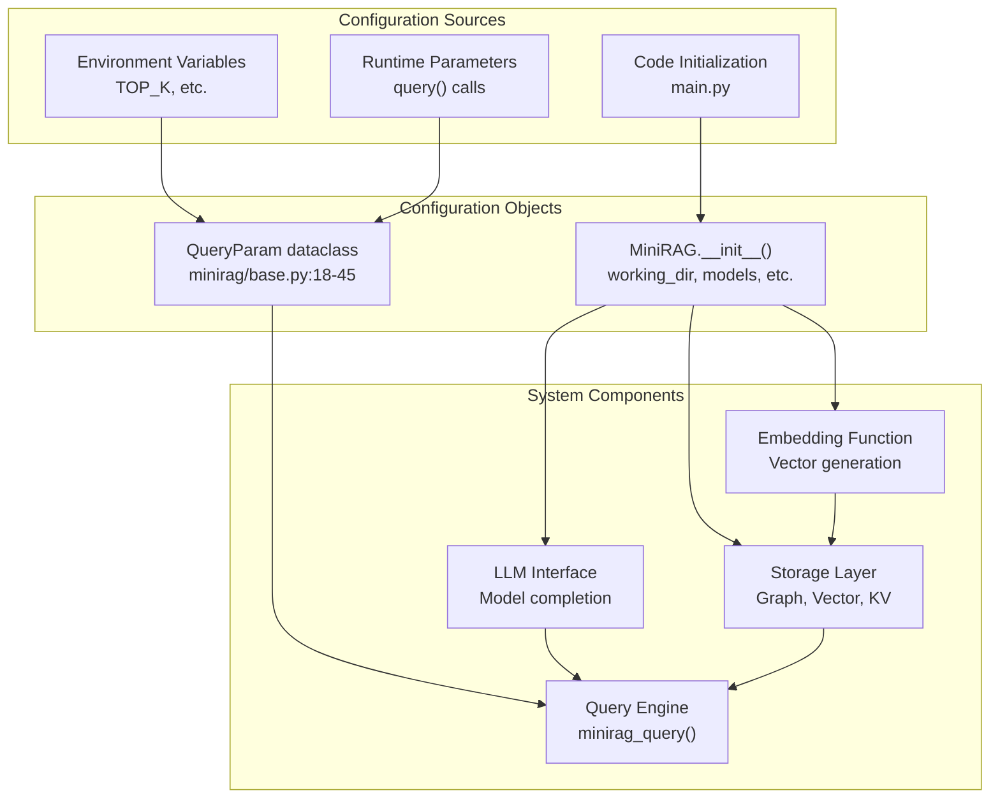
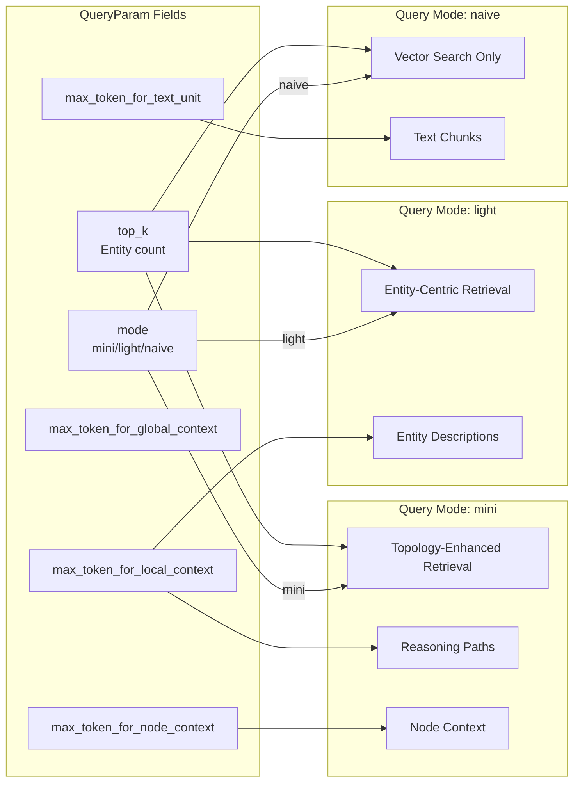
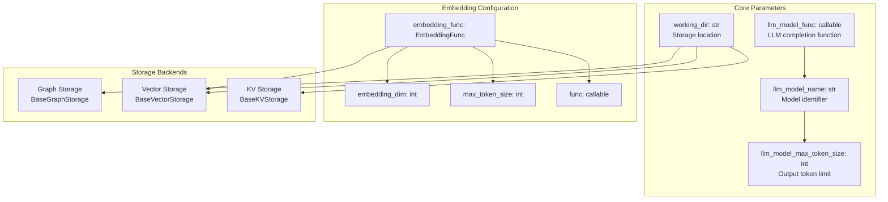

<!-- source: DeepWiki mcp.deepwiki.com · repo HKUDS/MiniRAG · page 2.3 Configuration · fetched 2026-11-09 -->

# Configuration

<details>
<summary>Relevant source files</summary>

The following files were used as context for generating this wiki page:

- [main.py](main.py)
- [minirag/__init__.py](minirag/__init__.py)
- [minirag/base.py](minirag/base.py)
- [minirag/prompt.py](minirag/prompt.py)

</details>


This page documents the configuration system in MiniRAG, covering query-time parameters, initialization settings, and environment variables. Configuration in MiniRAG is divided into two main categories: **QueryParam** settings that control query behavior at runtime, and **MiniRAG initialization** parameters that set up storage, models, and working directories.

For information about storage backend implementations and their specific configuration, see [Storage Implementations](#5). For details on LLM and embedding model integration, see [LLM and Embedding Integration](#6).

---

## Overview of Configuration Architecture

MiniRAG uses a two-tier configuration approach: initialization-time configuration establishes the system's infrastructure, while query-time configuration customizes retrieval and generation behavior.

**Configuration Flow: Environment to Runtime**



**Sources:** [minirag/base.py:18-45](), [main.py:58-72]()

---

## QueryParam Configuration

The `QueryParam` dataclass defines all query-time configuration parameters. These settings control retrieval strategy, context size, response format, and other runtime behaviors.

### Core Query Parameters

| Parameter | Type | Default | Description |
|-----------|------|---------|-------------|
| `mode` | `Literal["light", "naive", "mini"]` | `"mini"` | Query mode selection (see [Query Modes](#4.3)) |
| `only_need_context` | `bool` | `False` | Return only retrieved context without LLM generation |
| `only_need_prompt` | `bool` | `False` | Return only the formatted prompt without execution |
| `response_type` | `str` | `"Multiple Paragraphs"` | Desired format of generated response |
| `stream` | `bool` | `False` | Enable streaming response generation |

**Sources:** [minirag/base.py:18-24]()

### Retrieval Configuration

The following parameters control the scope and size of retrieved context:

| Parameter | Type | Default | Description |
|-----------|------|---------|-------------|
| `top_k` | `int` | `60` (from `TOP_K` env var) | Number of top entities/relationships to retrieve |
| `max_token_for_text_unit` | `int` | `4000` | Maximum tokens for original text chunks |
| `max_token_for_global_context` | `int` | `4000` | Maximum tokens for relationship descriptions |
| `max_token_for_local_context` | `int` | `4000` | Maximum tokens for entity descriptions |
| `max_token_for_node_context` | `int` | `500` | Maximum tokens per node (critical for SLMs) |

**Sources:** [minirag/base.py:25-35]()

The `max_token_for_node_context` parameter is particularly important for Small Language Models, as noted in the comment at line 35: "For Mini, if too long, SLM may fail to generate any response."

### Keyword and History Configuration

| Parameter | Type | Default | Description |
|-----------|------|---------|-------------|
| `hl_keywords` | `list[str]` | `[]` | High-level keywords for query expansion |
| `ll_keywords` | `list[str]` | `[]` | Low-level keywords for entity matching |
| `conversation_history` | `list[dict]` | `[]` | Previous conversation turns for context |
| `history_turns` | `int` | `3` | Number of conversation pairs to consider |

**Sources:** [minirag/base.py:37-45]()

The `conversation_history` list should contain dictionaries with `"role"` (either `"user"` or `"assistant"`) and `"content"` keys.

**QueryParam Field Mapping to Query Modes**



**Sources:** [minirag/base.py:18-45]()

---

## MiniRAG Initialization Configuration

The `MiniRAG` class constructor accepts parameters that establish the system's core infrastructure. These settings cannot be changed after initialization without creating a new instance.

### Initialization Parameters

**MiniRAG Initialization Parameter Structure**



**Sources:** [main.py:58-72]()

### Working Directory Configuration

The `working_dir` parameter specifies the base directory for all persistent storage:

```python
working_dir = "./LiHua-World"  # Example from main.py:47
```

MiniRAG creates subdirectories within this path for different storage backends (graph database, vector databases, key-value stores). The directory structure is managed automatically.

**Sources:** [main.py:47,58-72]()

### LLM Configuration

Three parameters control the language model integration:

1. **`llm_model_func`**: A callable that performs model completion. Common options:
   - `hf_model_complete` for HuggingFace models
   - `openai_complete` for OpenAI API models
   - Custom functions matching the expected signature

2. **`llm_model_name`**: String identifier for the model, examples:
   - `"microsoft/Phi-3.5-mini-instruct"`
   - `"THUDM/glm-edge-1.5b-chat"`
   - `"openbmb/MiniCPM3-4B"`
   - `"Qwen/Qwen2.5-3B-Instruct"`

3. **`llm_model_max_token_size`**: Maximum tokens for model output (e.g., `200`)

**Sources:** [main.py:35-72]()

### Embedding Function Configuration

The `embedding_func` parameter accepts an `EmbeddingFunc` dataclass instance with three fields:

```python
EmbeddingFunc(
    embedding_dim=384,           # Dimensionality of embedding vectors
    max_token_size=1000,        # Maximum tokens to embed at once
    func=lambda texts: ...      # Actual embedding function
)
```

**Sources:** [main.py:63-71](), [minirag/utils.py (EmbeddingFunc)]()

---

## Environment Variables

MiniRAG supports configuration via environment variables, which provide system-wide defaults.

| Variable | Type | Default | Usage | Code Reference |
|----------|------|---------|-------|----------------|
| `TOP_K` | `int` | `60` | Default number of entities to retrieve | [minirag/base.py:25]() |

Additional environment variables may be used by specific storage backends or LLM providers.

**Sources:** [minirag/base.py:25]()

---

## Configuration Examples

### Example 1: Basic HuggingFace Configuration

This example demonstrates configuring MiniRAG with a Small Language Model from HuggingFace:

```python
from minirag import MiniRAG, QueryParam
from minirag.llm.hf import hf_model_complete, hf_embed
from minirag.utils import EmbeddingFunc
from transformers import AutoModel, AutoTokenizer

# Initialize MiniRAG with Phi-3.5 model
rag = MiniRAG(
    working_dir="./my_knowledge_base",
    llm_model_func=hf_model_complete,
    llm_model_max_token_size=200,
    llm_model_name="microsoft/Phi-3.5-mini-instruct",
    embedding_func=EmbeddingFunc(
        embedding_dim=384,
        max_token_size=1000,
        func=lambda texts: hf_embed(
            texts,
            tokenizer=AutoTokenizer.from_pretrained(
                "sentence-transformers/all-MiniLM-L6-v2"
            ),
            embed_model=AutoModel.from_pretrained(
                "sentence-transformers/all-MiniLM-L6-v2"
            ),
        ),
    ),
)

# Query with custom parameters
response = rag.query(
    "What is the capital of France?",
    param=QueryParam(
        mode="mini",
        top_k=50,
        max_token_for_node_context=400,
    )
)
```

**Sources:** [main.py:35-72,93-96]()

### Example 2: Model Selection via Command-Line

The main.py script demonstrates a pattern for selecting models dynamically:

```python
import argparse

parser = argparse.ArgumentParser()
parser.add_argument("--model", type=str, default="PHI")
args = parser.parse_args()

# Map model names to HuggingFace identifiers
model_map = {
    "PHI": "microsoft/Phi-3.5-mini-instruct",
    "GLM": "THUDM/glm-edge-1.5b-chat",
    "MiniCPM": "openbmb/MiniCPM3-4B",
    "qwen": "Qwen/Qwen2.5-3B-Instruct",
}

llm_model_name = model_map.get(args.model)
```

**Sources:** [main.py:19-46]()

### Example 3: Query Mode Comparison

Different query modes require different QueryParam configurations:

```python
# Naive mode: Simple vector search
naive_result = rag.query(
    query,
    param=QueryParam(
        mode="naive",
        top_k=10,  # Fewer chunks needed
        max_token_for_text_unit=2000,
    )
)

# Light mode: Entity-centric retrieval
light_result = rag.query(
    query,
    param=QueryParam(
        mode="light",
        top_k=60,
        max_token_for_local_context=4000,  # Entity descriptions
    )
)

# Mini mode: Topology-enhanced retrieval (recommended for SLMs)
mini_result = rag.query(
    query,
    param=QueryParam(
        mode="mini",
        top_k=60,
        max_token_for_node_context=500,  # Critical for SLMs
        max_token_for_local_context=4000,
    )
)
```

**Sources:** [minirag/base.py:19]()

### Example 4: Context-Only Retrieval

For debugging or custom generation pipelines, retrieve context without LLM generation:

```python
context = rag.query(
    "What technologies does the company use?",
    param=QueryParam(
        mode="mini",
        only_need_context=True,  # Skip LLM generation
        top_k=40,
    )
)

# `context` contains the retrieved graph paths and text chunks
# Process it with custom logic or a different LLM
```

**Sources:** [minirag/base.py:20]()

### Example 5: Conversation History Configuration

Enable multi-turn conversations by providing history:

```python
# Build conversation history
history = [
    {"role": "user", "content": "What is MiniRAG?"},
    {"role": "assistant", "content": "MiniRAG is a RAG system for SLMs..."},
    {"role": "user", "content": "How does it compare to GraphRAG?"},
    {"role": "assistant", "content": "MiniRAG uses less storage..."},
]

# Query with conversation context
response = rag.query(
    "Can you elaborate on the storage efficiency?",
    param=QueryParam(
        mode="mini",
        conversation_history=history,
        history_turns=2,  # Use last 2 complete turns
    )
)
```

**Sources:** [minirag/base.py:40-45]()

---

## Configuration Best Practices

### Token Limits for Small Language Models

When using Small Language Models (1.5B-4B parameters), carefully tune token limits:

- **`max_token_for_node_context=500`**: Default is appropriate for most SLMs
- Reduce `max_token_for_local_context` and `max_token_for_global_context` if the model produces empty responses
- Increase `llm_model_max_token_size` cautiously; SLMs may fail with very long outputs

**Sources:** [minirag/base.py:35]()

### Top-K Selection

The `top_k` parameter significantly impacts retrieval quality and performance:

| Query Complexity | Recommended `top_k` | Rationale |
|------------------|---------------------|-----------|
| Simple, single-hop | 20-40 | Fewer entities needed |
| Multi-hop reasoning | 60-80 | More paths to explore |
| Summarization | 40-60 | Broader context coverage |

**Sources:** [minirag/base.py:25]()

### Working Directory Structure

Ensure the working directory has sufficient space and appropriate permissions. MiniRAG creates the directory automatically if it doesn't exist:

```python
import os
working_dir = "./data/minirag"
if not os.path.exists(working_dir):
    os.makedirs(working_dir)  # Or use os.mkdir for single level
```

**Sources:** [main.py:55-56]()

---

## Configuration Validation

MiniRAG performs minimal validation at initialization and query time. Consider implementing validation for:

1. **Valid mode strings**: Ensure `mode` is one of `"naive"`, `"light"`, `"mini"`
2. **Token limits**: Verify token parameters are positive integers
3. **Working directory**: Check for write permissions before initialization
4. **Model compatibility**: Ensure embedding dimensions match vector storage expectations

**Sources:** [minirag/base.py:18-45]()

---

