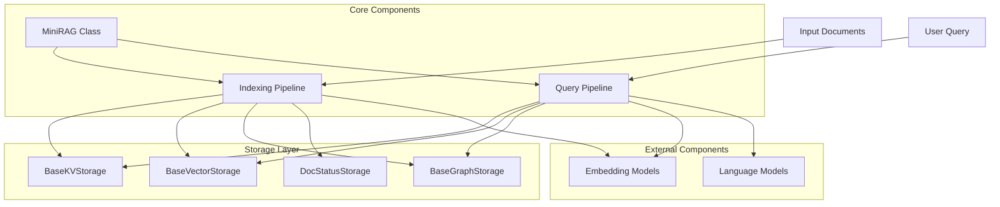
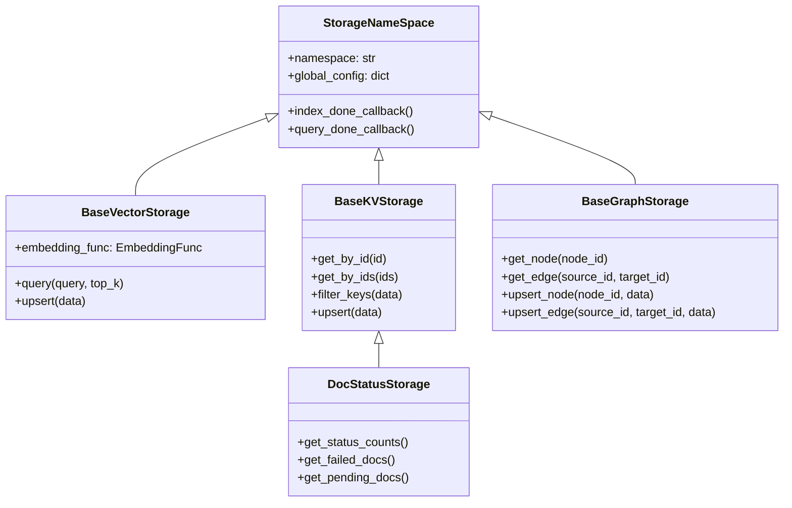
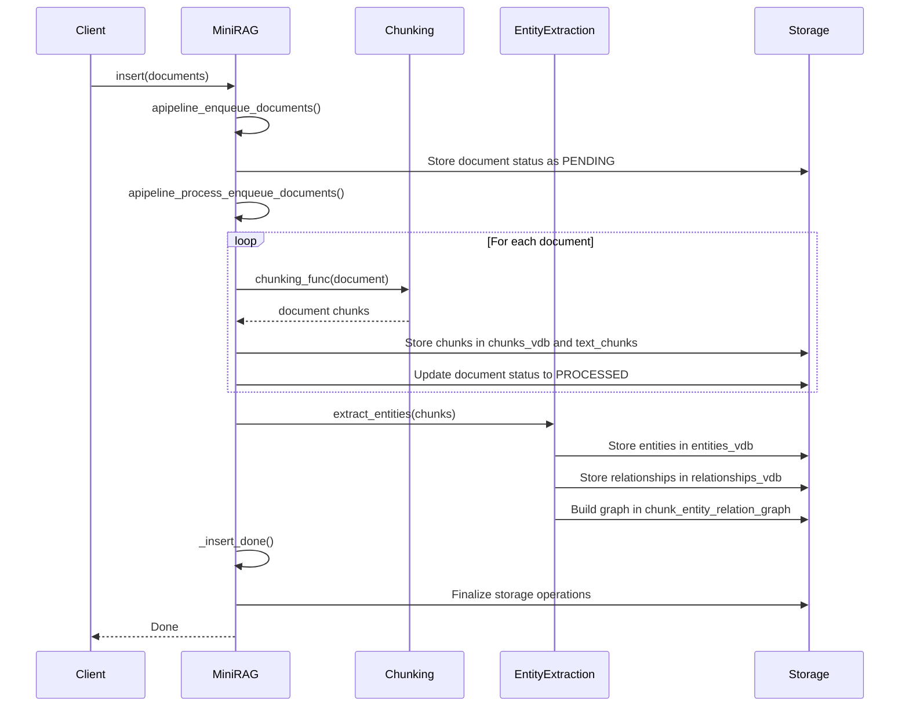
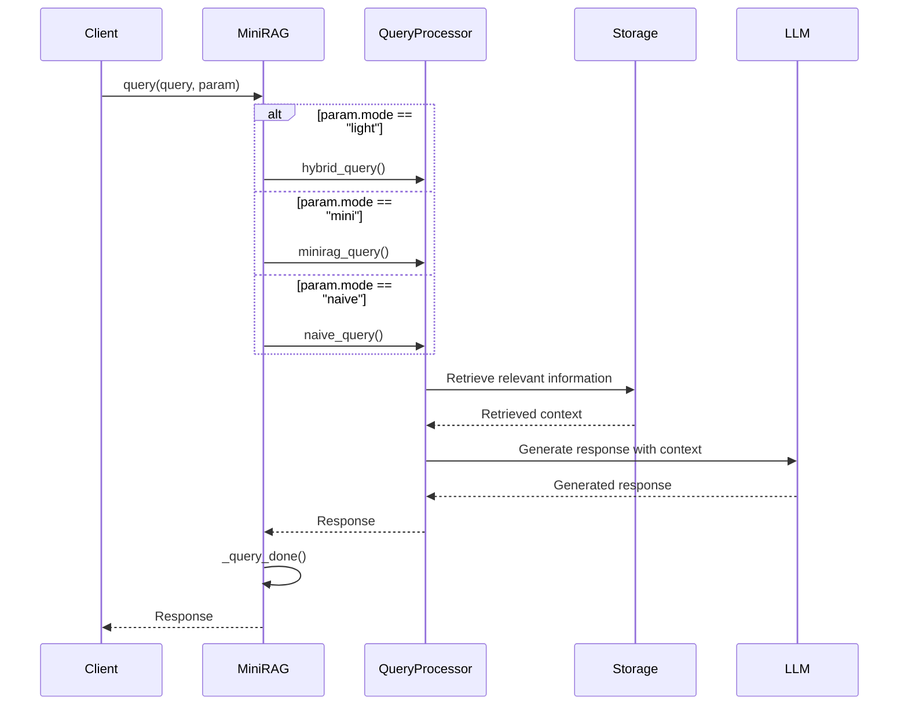
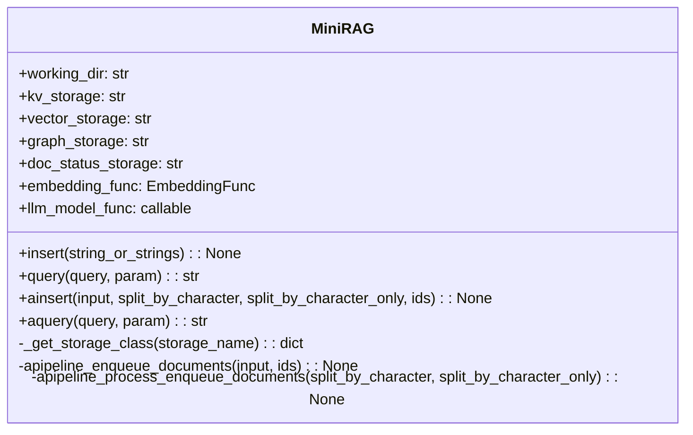
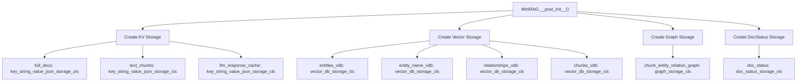
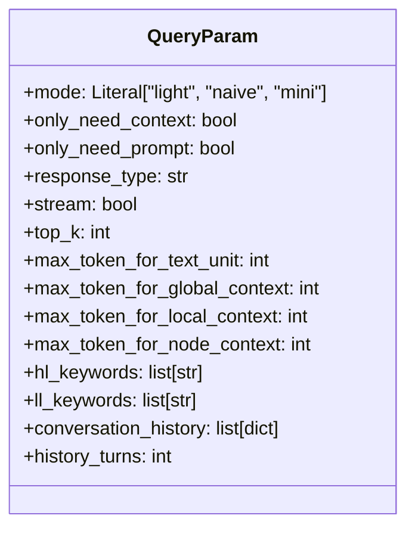

<!-- source: DeepWiki mcp.deepwiki.com · repo HKUDS/MiniRAG · page 3 System Architecture · fetched 2026-11-09 -->

# System Architecture

<details>
<summary>Relevant source files</summary>

The following files were used as context for generating this wiki page:

- [README.md](README.md)
- [minirag/kg/weaviate_impl.py](minirag/kg/weaviate_impl.py)
- [minirag/minirag.py](minirag/minirag.py)
- [tests/test_weaviate.py](tests/test_weaviate.py)

</details>


This document provides an overview of the MiniRAG system architecture. It explains the high-level design, key components, and how they interact to provide retrieval-augmented generation capabilities optimized for small language models (SLMs). For details about specific components, see [Core Components](#2.1), [Data Flow](#2.2), and [Storage Layer](#2.3).

## High-Level Architecture Overview

The MiniRAG system is built with a modular architecture that separates concerns across several logical layers while providing flexibility through pluggable components.

### System Architecture Diagram



Sources: [minirag/minirag.py:119-607](), [minirag/base.py:49-149]()

## Architecture Design Principles

MiniRAG is built on several key architectural principles:

1. **Modular Design**: The system is composed of interchangeable components that can be swapped without affecting the overall functionality.

2. **Storage Abstraction**: All storage operations are performed through abstract interfaces that allow multiple backend implementations.

3. **Workflow Separation**: Document processing and query processing follow separate, well-defined workflows.

4. **Extensibility**: The system can be extended with new storage backends, embedding models, and language models.

5. **Heterogeneous Graph Indexing**: Documents are processed into a graph structure that connects text chunks with entities and their relationships.

6. **Multi-Mode Querying**: Support for different retrieval strategies (light, naive, mini) to optimize for different use cases.

### Storage System Design



Sources: [minirag/base.py:49-197]()

## Component Interaction in Key Workflows

### Document Indexing Workflow

The document indexing workflow processes input documents into a queryable knowledge base:



Sources: [minirag/minirag.py:336-385](), [minirag/minirag.py:387-446](), [minirag/minirag.py:447-511]()

### Query Processing Workflow

The query processing workflow retrieves relevant information and generates responses:



Sources: [minirag/minirag.py:529-576]()

## Key Classes and Their Roles

### MiniRAG Class

The `MiniRAG` class serves as the main entry point and orchestrator for the entire system:



The `MiniRAG` class is responsible for:

1. **System Initialization**: Setting up storage instances and processing pipelines
2. **Document Processing**: Managing the document indexing workflow
3. **Query Processing**: Handling user queries and generating responses
4. **Storage Management**: Coordinating operations across multiple storage backends

Sources: [minirag/minirag.py:119-607]()

### Storage Component Initialization

During initialization, `MiniRAG` creates multiple storage instances:



Sources: [minirag/minirag.py:186-308]()

### Query Parameter Configuration

The `QueryParam` class configures how queries are processed:



The `QueryParam` class controls:

1. **Query Mode**: Determines which retrieval strategy to use
2. **Response Format**: Configures the response format and token limits
3. **Retrieval Parameters**: Sets parameters for retrieval, such as number of items to retrieve
4. **Context Control**: Controls how much context to include in the prompt

Sources: [minirag/base.py:18-46]()

### Storage System Implementation

The storage system is based on abstract base classes with multiple concrete implementations:

| Storage Type | Base Class | Available Implementations |
|--------------|------------|---------------------------|
| Vector Storage | `BaseVectorStorage` | NanoVectorDBStorage, ChromaVectorDBStorage, OracleVectorDBStorage, TiDBVectorDBStorage, MilvusVectorDBStorage, PGVectorStorage |
| Key-Value Storage | `BaseKVStorage` | JsonKVStorage, OracleKVStorage, MongoKVStorage, RedisKVStorage, TiDBKVStorage, PGKVStorage |
| Graph Storage | `BaseGraphStorage` | NetworkXStorage, Neo4JStorage, OracleGraphStorage, MongoGraphStorage, TiDBGraphStorage, PGGraphStorage, AGEStorage, GremlinStorage |
| Document Status Storage | `DocStatusStorage` | JsonDocStatusStorage, PGDocStatusStorage |

The storage implementations are dynamically loaded using a lazy import mechanism:

```python
def _get_storage_class(self, storage_name: str) -> dict:
    import_path = STORAGES[storage_name]
    storage_class = lazy_external_import(import_path, storage_name)
    return storage_class
```

Sources: [minirag/minirag.py:39-62](), [minirag/minirag.py:311-314]()

## Summary

The MiniRAG system architecture is built on a modular design with clear separation of concerns. The system is centered around the `MiniRAG` class, which orchestrates the interaction between various components. The storage layer provides a flexible foundation with pluggable backends, while the document processing and query processing pipelines implement the core functionality.

Key architectural features include:

1. **Modular Storage System**: Abstract base classes with multiple implementations
2. **Heterogeneous Graph Indexing**: Building a graph that connects document chunks with entities
3. **Multiple Query Modes**: Different retrieval strategies for different use cases
4. **Extensible Design**: Support for custom storage backends, embedding models, and language models

For more details about specific aspects of the architecture, refer to:
- [Core Components](#2.1) for information about each component's responsibilities
- [Data Flow](#2.2) for a detailed explanation of data flow during indexing and querying
- [Storage Layer](#2.3) for information about storage implementations

Sources: [minirag/minirag.py](), [minirag/base.py](), [main.py]()

---

