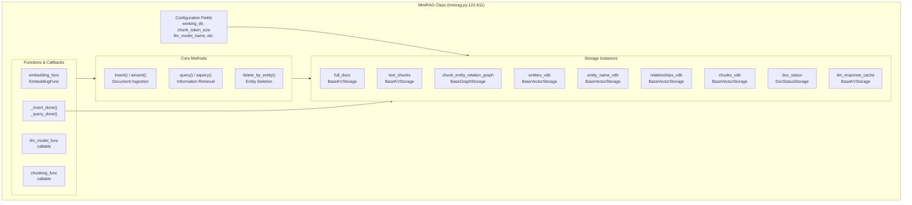
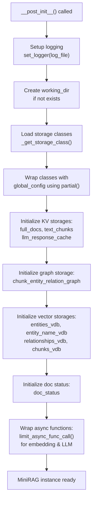
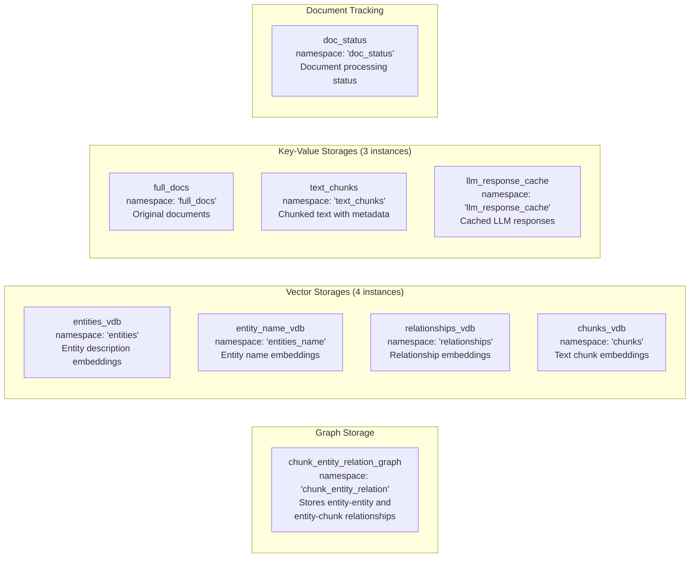
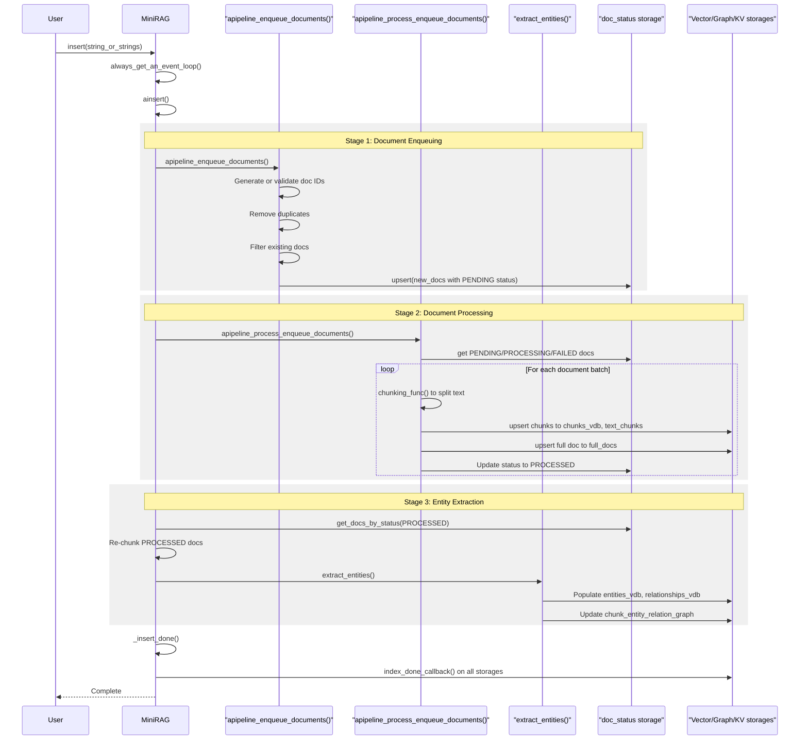
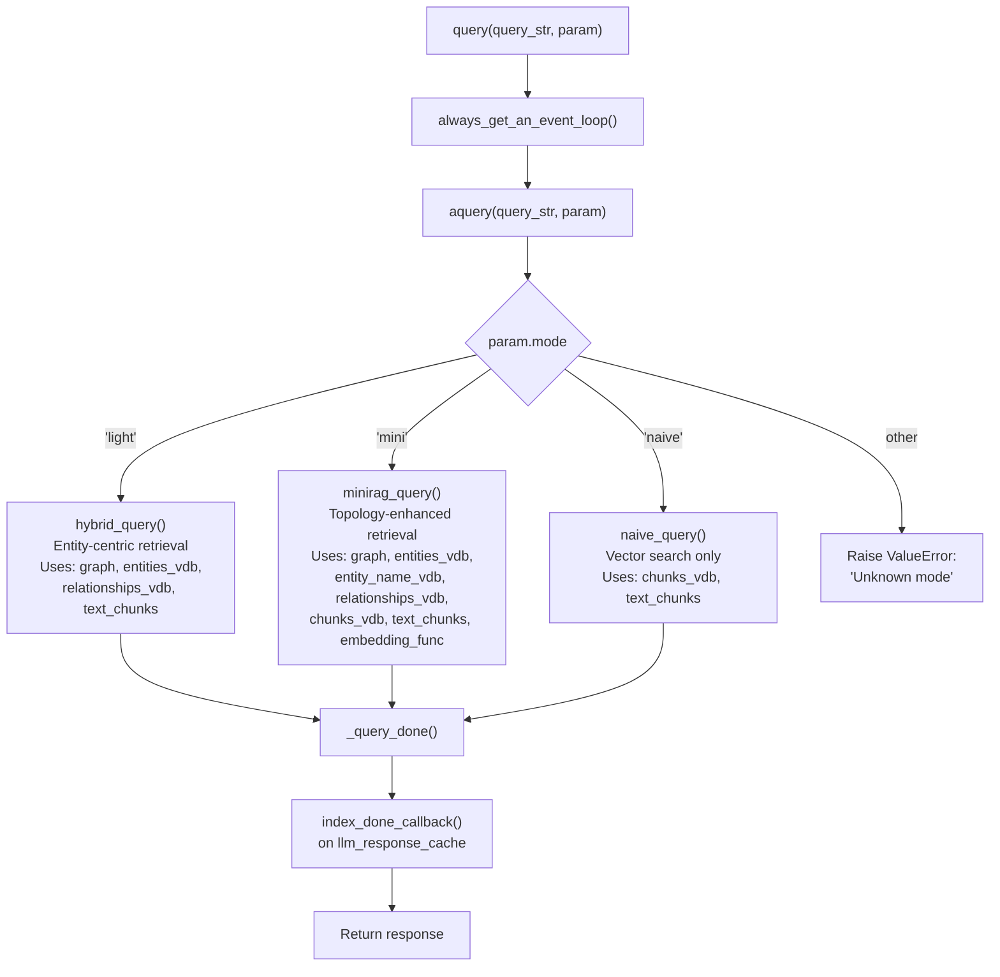
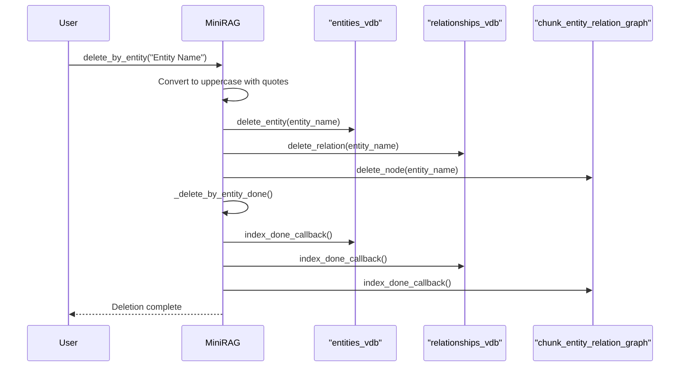
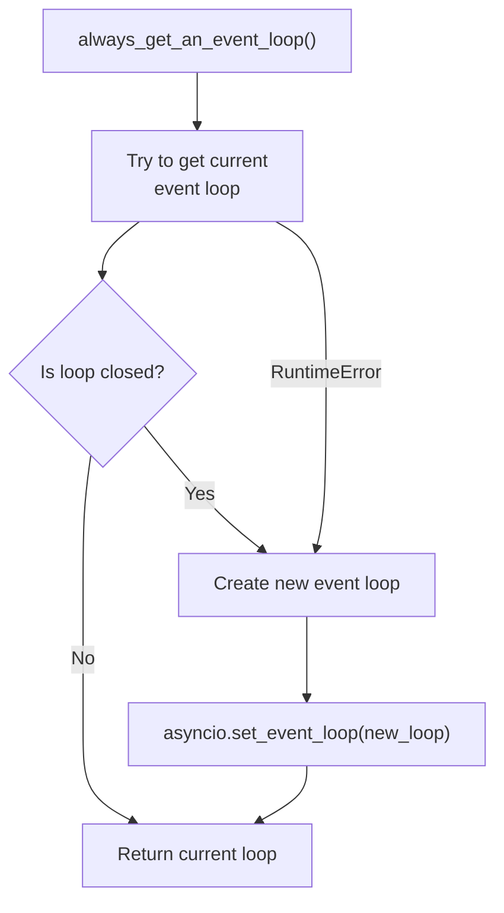

<!-- source: DeepWiki mcp.deepwiki.com · repo HKUDS/MiniRAG · page 3.1 Core MiniRAG Class · fetched 2026-11-09 -->

# Core MiniRAG Class

<details>
<summary>Relevant source files</summary>

The following files were used as context for generating this wiki page:

- [minirag/__init__.py](minirag/__init__.py)
- [minirag/base.py](minirag/base.py)
- [minirag/kg/weaviate_impl.py](minirag/kg/weaviate_impl.py)
- [minirag/minirag.py](minirag/minirag.py)
- [tests/test_weaviate.py](tests/test_weaviate.py)

</details>


This document describes the `MiniRAG` class, the central orchestrator that manages the entire MiniRAG system lifecycle. It handles initialization of storage backends, coordinates document ingestion, executes queries across multiple retrieval modes, and maintains the connection between all system components.

For details on the storage interfaces that MiniRAG manages, see [Storage Abstraction Layer](#3.2). For the data processing workflows that MiniRAG orchestrates, see [Data Processing Pipeline](#3.3). For query execution strategies, see [Query Modes](#4.3).

---

## Class Overview and Role

The `MiniRAG` class serves as the primary entry point for all RAG operations. It is implemented as a Python dataclass at [minirag/minirag.py:122-611]() and acts as a facade pattern, coordinating between:

- **Storage Layer**: Graph, vector, and key-value storage instances
- **Processing Layer**: Entity extraction and query execution logic
- **LLM Layer**: Language model and embedding function integrations
- **Document Tracking**: Status management for ingested documents

Users interact with MiniRAG through three main operations:
1. `insert()` - Ingest and index documents into the knowledge graph
2. `query()` - Retrieve information using various query modes
3. `delete_by_entity()` - Remove specific entities and their relationships

**Sources:** [minirag/minirag.py:122-611]()

---

## MiniRAG Class Structure

The following diagram shows the key components and relationships within the MiniRAG class:



**Sources:** [minirag/minirag.py:122-188](), [minirag/minirag.py:254-313]()

---

## Configuration Fields

The `MiniRAG` dataclass contains extensive configuration options organized into several categories:

| Category | Fields | Purpose |
|----------|--------|---------|
| **Working Directory** | `working_dir` | Base path for all storage and logs, defaults to timestamped cache directory |
| **Storage Selection** | `kv_storage`, `vector_storage`, `graph_storage`, `doc_status_storage` | String names of storage backend classes to instantiate |
| **Text Chunking** | `chunk_token_size`, `chunk_overlap_token_size`, `tiktoken_model_name` | Controls document splitting parameters |
| **Entity Extraction** | `entity_extract_max_gleaning`, `entity_summary_to_max_tokens` | Entity extraction iteration and summarization limits |
| **Node Embedding** | `node_embedding_algorithm`, `node2vec_params` | Graph node embedding configuration (not used in MiniRAG) |
| **Embedding Function** | `embedding_func`, `embedding_batch_num`, `embedding_func_max_async` | Text-to-vector conversion and parallelization |
| **LLM Configuration** | `llm_model_func`, `llm_model_name`, `llm_model_max_token_size`, `llm_model_kwargs` | Language model settings and parameters |
| **Performance** | `llm_model_max_async`, `max_parallel_insert`, `enable_llm_cache` | Concurrency and caching controls |
| **Extension Points** | `addon_params`, `convert_response_to_json_func`, `chunking_func` | Customization hooks |

**Default Storage Backends:**
- Graph: `NetworkXStorage` (in-memory graph)
- Vector: `NanoVectorDBStorage` (lightweight vector DB)
- Key-Value: `JsonKVStorage` (JSON file-based)
- Document Status: `JsonDocStatusStorage` (JSON file-based)

**Sources:** [minirag/minirag.py:124-188]()

---

## Initialization Process

The initialization workflow in `__post_init__()` follows a specific sequence to set up all system components:



**Key Initialization Steps:**

1. **Logging Setup** [minirag/minirag.py:191-193](): Creates log file in working directory
2. **Storage Class Loading** [minirag/minirag.py:207-215](): Uses lazy import pattern via `_get_storage_class()` to load backend implementations from `STORAGES` dictionary [minirag/minirag.py:39-66]()
3. **Partial Application** [minirag/minirag.py:217-227](): Wraps storage classes with `global_config` parameter using `functools.partial`
4. **Storage Instantiation** [minirag/minirag.py:228-313](): Creates all storage instances with appropriate namespaces
5. **Function Wrapping** [minirag/minirag.py:247-306](): Applies async concurrency limits to embedding and LLM functions

**Sources:** [minirag/minirag.py:190-313]()

---

## Storage Instance Management

MiniRAG creates and manages nine distinct storage instances, each with a specific namespace and purpose:



**Storage Instance Details:**

| Instance | Type | Namespace | Purpose |
|----------|------|-----------|---------|
| `full_docs` | BaseKVStorage | `full_docs` | Stores complete original documents by doc_id |
| `text_chunks` | BaseKVStorage | `text_chunks` | Stores chunked text with metadata (tokens, order, full_doc_id) |
| `chunk_entity_relation_graph` | BaseGraphStorage | `chunk_entity_relation` | Graph connecting entities, relationships, and chunks |
| `entities_vdb` | BaseVectorStorage | `entities` | Vector embeddings of entity descriptions for semantic search |
| `entity_name_vdb` | BaseVectorStorage | `entities_name` | Vector embeddings of entity names for name-based retrieval |
| `relationships_vdb` | BaseVectorStorage | `relationships` | Vector embeddings of entity relationships |
| `chunks_vdb` | BaseVectorStorage | `chunks` | Vector embeddings of text chunks for naive retrieval |
| `doc_status` | DocStatusStorage | `doc_status` | Tracks document processing status (PENDING/PROCESSING/PROCESSED/FAILED) |
| `llm_response_cache` | BaseKVStorage | `llm_response_cache` | Caches LLM responses to avoid redundant API calls (optional) |

**Sources:** [minirag/minirag.py:228-313]()

---

## Document Ingestion Workflow

The `insert()` and `ainsert()` methods handle document ingestion through a multi-stage pipeline:



### Stage 1: Document Enqueuing

The `apipeline_enqueue_documents()` method [minirag/minirag.py:391-449]() performs:

1. **ID Generation/Validation**: Uses MD5 hash with `compute_mdhash_id()` if IDs not provided
2. **Deduplication**: Ensures unique content by creating reverse mapping
3. **Status Initialization**: Creates `DocProcessingStatus` with `DocStatus.PENDING`
4. **Filtering**: Calls `doc_status.filter_keys()` to exclude already-processed documents
5. **Storage**: Upserts new documents to `doc_status` storage

### Stage 2: Document Processing

The `apipeline_process_enqueue_documents()` method [minirag/minirag.py:451-514]() processes documents in batches:

1. **Batch Retrieval**: Fetches documents with status PENDING, PROCESSING, or FAILED
2. **Batch Creation**: Splits into batches of size `max_parallel_insert` (default: 2)
3. **Chunking**: Applies `chunking_func` (default: `chunking_by_token_size`) to each document
4. **Parallel Upsert**: Uses `asyncio.gather()` to store chunks in multiple storages simultaneously
5. **Status Update**: Marks documents as `DocStatus.PROCESSED`

### Stage 3: Entity Extraction

After processing, the main `ainsert()` method [minirag/minirag.py:362-387]() performs entity extraction:

1. **Retrieve Processed Docs**: Gets all documents with `DocStatus.PROCESSED`
2. **Re-chunking**: Chunks content again (to get full metadata)
3. **Entity Extraction**: Calls `extract_entities()` from [minirag/operate.py]()
4. **Graph Population**: Updates `chunk_entity_relation_graph`, `entities_vdb`, `entity_name_vdb`, `relationships_vdb`

**Sources:** [minirag/minirag.py:340-389](), [minirag/minirag.py:391-449](), [minirag/minirag.py:451-514]()

---

## Query Execution Workflow

The `query()` and `aquery()` methods route queries to different retrieval strategies based on `QueryParam.mode`:



### Query Mode Routing

The routing logic at [minirag/minirag.py:537-572]() determines the execution path:

| Mode | Function | Storage Requirements | Use Case |
|------|----------|---------------------|----------|
| `"light"` | `hybrid_query()` | graph, entities_vdb, relationships_vdb, text_chunks | Entity-centric retrieval with relationship context |
| `"mini"` | `minirag_query()` | graph, entities_vdb, entity_name_vdb, relationships_vdb, chunks_vdb, text_chunks, embedding_func | Topology-enhanced retrieval with graph traversal |
| `"naive"` | `naive_query()` | chunks_vdb, text_chunks | Simple vector similarity search on chunks |

Each query function receives:
- The query string
- Relevant storage instances
- `QueryParam` object with configuration
- Global configuration dictionary via `asdict(self)`

**Query Parameter Passthrough:**

The `QueryParam` object (see [Query Modes](#4.3)) contains settings like:
- `top_k`: Number of entities/chunks to retrieve
- `max_token_for_*`: Token limits for context assembly
- `only_need_context`: Return context without LLM generation
- `only_need_prompt`: Return prompt without LLM generation
- `stream`: Enable streaming response

**Sources:** [minirag/minirag.py:533-580]()

---

## Entity Deletion

The `delete_by_entity()` method removes specific entities and their associated data:



**Implementation Details:**

The `adelete_by_entity()` method [minirag/minirag.py:586-599]() performs:

1. **Name Normalization**: Converts entity name to uppercase and wraps in quotes (format: `"ENTITY"`)
2. **Entity Deletion**: Calls `entities_vdb.delete_entity()` to remove entity vectors
3. **Relationship Deletion**: Calls `relationships_vdb.delete_relation()` to remove associated relationships
4. **Graph Node Deletion**: Calls `chunk_entity_relation_graph.delete_node()` to remove graph node
5. **Callback Execution**: Runs `_delete_by_entity_done()` to commit changes via `index_done_callback()`

**Note:** This operation does not remove the underlying text chunks that mentioned the entity, only the entity metadata and graph connections.

**Sources:** [minirag/minirag.py:582-611]()

---

## Lifecycle Management

MiniRAG implements callback patterns to handle post-operation cleanup and persistence:

### Insert Completion Callback

The `_insert_done()` method [minirag/minirag.py:516-531]() is called after document insertion completes:

```python
async def _insert_done(self):
    tasks = []
    for storage_inst in [
        self.full_docs,
        self.text_chunks,
        self.llm_response_cache,
        self.entities_vdb,
        self.entity_name_vdb,
        self.relationships_vdb,
        self.chunks_vdb,
        self.chunk_entity_relation_graph,
    ]:
        if storage_inst is None:
            continue
        tasks.append(cast(StorageNameSpace, storage_inst).index_done_callback())
    await asyncio.gather(*tasks)
```

This ensures all storage backends commit their in-memory changes to persistent storage.

### Query Completion Callback

The `_query_done()` method [minirag/minirag.py:574-580]() commits LLM cache updates:

```python
async def _query_done(self):
    tasks = []
    for storage_inst in [self.llm_response_cache]:
        if storage_inst is None:
            continue
        tasks.append(cast(StorageNameSpace, storage_inst).index_done_callback())
    await asyncio.gather(*tasks)
```

### Deletion Completion Callback

The `_delete_by_entity_done()` method [minirag/minirag.py:601-611]() commits entity deletions:

```python
async def _delete_by_entity_done(self):
    tasks = []
    for storage_inst in [
        self.entities_vdb,
        self.relationships_vdb,
        self.chunk_entity_relation_graph,
    ]:
        if storage_inst is None:
            continue
        tasks.append(cast(StorageNameSpace, storage_inst).index_done_callback())
    await asyncio.gather(*tasks)
```

**Purpose of Callbacks:**

The `index_done_callback()` method defined in `BaseStorageNameSpace` [minirag/base.py:53-55]() allows each storage implementation to:
- Flush in-memory buffers to disk
- Commit database transactions
- Update indices
- Perform cleanup operations

**Sources:** [minirag/minirag.py:516-531](), [minirag/minirag.py:574-580](), [minirag/minirag.py:601-611]()

---

## Event Loop Management

MiniRAG handles asyncio event loop complexities through the `always_get_an_event_loop()` function:



**Implementation:**

The function at [minirag/minirag.py:97-119]() ensures an event loop always exists:

```python
def always_get_an_event_loop() -> asyncio.AbstractEventLoop:
    try:
        # Try to get the current event loop
        current_loop = asyncio.get_event_loop()
        if current_loop.is_closed():
            raise RuntimeError("Event loop is closed.")
        return current_loop

    except RuntimeError:
        # If no event loop exists or it is closed, create a new one
        logger.info("Creating a new event loop in main thread.")
        new_loop = asyncio.new_event_loop()
        asyncio.set_event_loop(new_loop)
        return new_loop
```

**Usage in Synchronous Methods:**

All public synchronous methods (`insert()`, `query()`, `delete_by_entity()`) use this pattern:

```python
def insert(self, string_or_strings):
    loop = always_get_an_event_loop()
    return loop.run_until_complete(self.ainsert(string_or_strings))
```

This allows MiniRAG to provide a simple synchronous API while internally using async operations for performance.

**Sources:** [minirag/minirag.py:97-119](), [minirag/minirag.py:340-342](), [minirag/minirag.py:533-535](), [minirag/minirag.py:582-584]()

---

## Lazy Storage Loading

MiniRAG uses a lazy import pattern to avoid loading all storage backend dependencies at startup:

### Storage Registry

The `STORAGES` dictionary [minirag/minirag.py:39-66]() maps storage class names to their module paths:

```python
STORAGES = {
    "NetworkXStorage": ".kg.networkx_impl",
    "JsonKVStorage": ".kg.json_kv_impl",
    "NanoVectorDBStorage": ".kg.nano_vector_db_impl",
    "JsonDocStatusStorage": ".kg.jsondocstatus_impl",
    "Neo4JStorage": ".kg.neo4j_impl",
    # ... 10+ more storage backends
}
```

### Lazy Import Function

The `lazy_external_import()` function [minirag/minirag.py:77-94]() defers module loading:

```python
def lazy_external_import(module_name: str, class_name: str):
    """Lazily import a class from an external module based on the package of the caller."""
    
    # Get the caller's module and package
    import inspect
    caller_frame = inspect.currentframe().f_back
    module = inspect.getmodule(caller_frame)
    package = module.__package__ if module else None

    def import_class(*args, **kwargs):
        import importlib
        module = importlib.import_module(module_name, package=package)
        cls = getattr(module, class_name)
        return cls(*args, **kwargs)

    return import_class
```

### Storage Class Resolution

The `_get_storage_class()` method [minirag/minirag.py:315-318]() resolves storage classes:

```python
def _get_storage_class(self, storage_name: str) -> dict:
    import_path = STORAGES[storage_name]
    storage_class = lazy_external_import(import_path, storage_name)
    return storage_class
```

**Benefits:**
- Only loads required storage backend dependencies
- Reduces startup time
- Allows optional dependencies (e.g., Neo4j, Weaviate)
- Supports pluggable storage architecture

**Sources:** [minirag/minirag.py:39-66](), [minirag/minirag.py:77-94](), [minirag/minirag.py:315-318]()

---

## Configuration Summary Table

Key configuration fields and their impact on system behavior:

| Configuration | Default Value | Impact | Location |
|---------------|---------------|--------|----------|
| `working_dir` | `./minirag_cache_{timestamp}` | Base directory for all storage and logs | [minirag/minirag.py:124-126]() |
| `chunk_token_size` | `1200` | Size of text chunks for processing | [minirag/minirag.py:138]() |
| `chunk_overlap_token_size` | `100` | Overlap between consecutive chunks | [minirag/minirag.py:139]() |
| `entity_extract_max_gleaning` | `1` | Number of entity extraction iterations | [minirag/minirag.py:143]() |
| `embedding_func_max_async` | `16` | Max concurrent embedding operations | [minirag/minirag.py:161]() |
| `llm_model_max_async` | `16` | Max concurrent LLM calls | [minirag/minirag.py:169]() |
| `max_parallel_insert` | `2` (from env var) | Parallel document processing limit | [minirag/minirag.py:188]() |
| `enable_llm_cache` | `True` | Whether to cache LLM responses | [minirag/minirag.py:175]() |
| `kv_storage` | `"JsonKVStorage"` | KV storage backend class name | [minirag/minirag.py:130]() |
| `vector_storage` | `"NanoVectorDBStorage"` | Vector storage backend class name | [minirag/minirag.py:131]() |
| `graph_storage` | `"NetworkXStorage"` | Graph storage backend class name | [minirag/minirag.py:132]() |

**Sources:** [minirag/minirag.py:124-188]()

---

## Usage Example

Basic usage pattern for the MiniRAG class:

```python
from minirag import MiniRAG, QueryParam

# Initialize with configuration
rag = MiniRAG(
    working_dir="./my_rag_storage",
    chunk_token_size=800,
    llm_model_name="gpt-4o-mini",
    embedding_func=my_embedding_function,
    llm_model_func=my_llm_function
)

# Insert documents
documents = [
    "First document content...",
    "Second document content..."
]
rag.insert(documents)

# Query with different modes
response_mini = rag.query(
    "What is the relationship between X and Y?",
    param=QueryParam(mode="mini", top_k=60)
)

response_naive = rag.query(
    "What is X?",
    param=QueryParam(mode="naive", top_k=10)
)

# Delete entity
rag.delete_by_entity("EntityName")
```

For complete examples, see [Document Indexing](#8.1) and [Question Answering](#8.2).

**Sources:** [minirag/minirag.py:122-611](), [minirag/__init__.py:1-6]()

---

