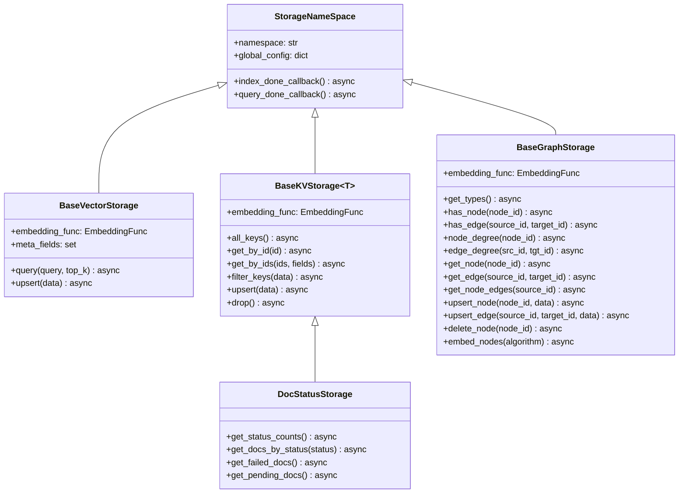
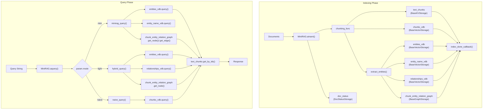
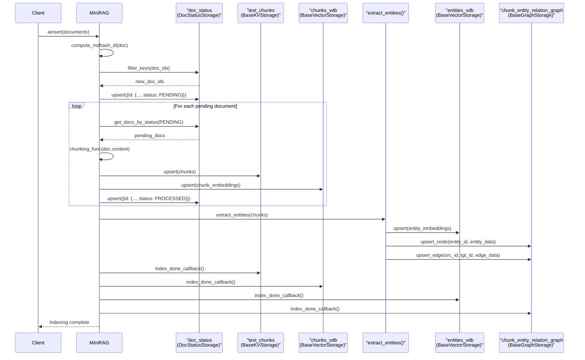
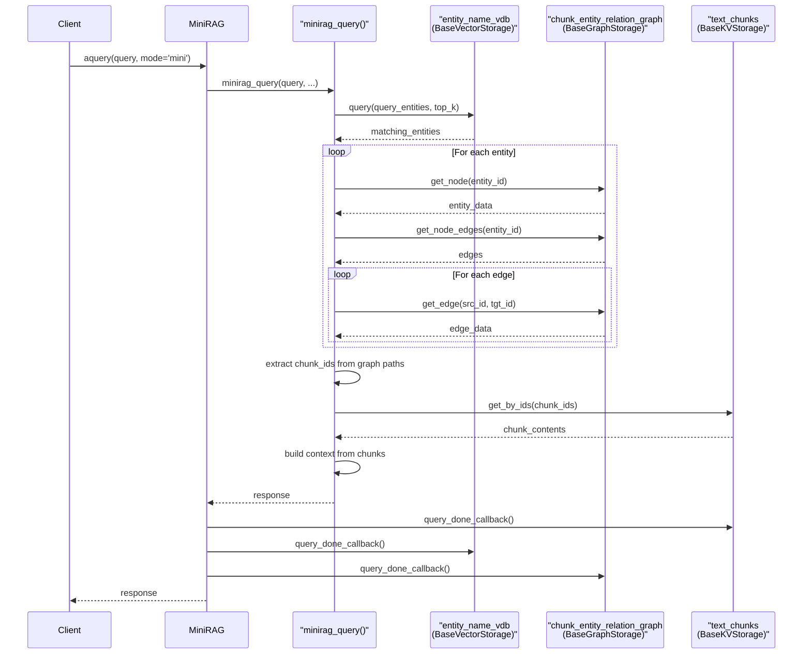

<!-- source: DeepWiki mcp.deepwiki.com · repo HKUDS/MiniRAG · page 3.2 Storage Abstraction Layer · fetched 2026-11-09 -->

# Storage Abstraction Layer

<details>
<summary>Relevant source files</summary>

The following files were used as context for generating this wiki page:

- [minirag/__init__.py](minirag/__init__.py)
- [minirag/base.py](minirag/base.py)
- [minirag/kg/weaviate_impl.py](minirag/kg/weaviate_impl.py)
- [minirag/minirag.py](minirag/minirag.py)
- [tests/test_weaviate.py](tests/test_weaviate.py)

</details>


## Introduction

The Storage Abstraction Layer defines the core interfaces that enable MiniRAG's pluggable storage architecture. This layer consists of three primary abstract base classes—`BaseGraphStorage`, `BaseVectorStorage`, and `BaseKVStorage`—each defining a contract for a specific storage concern. The abstraction layer allows MiniRAG to support over 10 different database backends (NetworkX, Neo4j, PostgreSQL, TiDB, Oracle, Weaviate, Chroma, etc.) without changing core system logic.

All storage abstractions inherit from `StorageNameSpace`, which provides namespace isolation and lifecycle callbacks. The abstractions are defined in [minirag/base.py:48-198]() and instantiated through a lazy-loading mechanism in [minirag/minirag.py:39-66]().

For concrete implementations of these abstractions, see [Storage Implementations](#5).

Sources: [minirag/base.py:48-198](), [minirag/minirag.py:39-66](), [minirag/minirag.py:207-227]()

## Architecture Overview

The Storage Abstraction Layer uses an interface-based design where abstract base classes define contracts that concrete implementations must fulfill. This design enables the pluggable storage architecture, allowing MiniRAG to switch between different database backends by changing configuration strings.

### Storage Abstraction Hierarchy



Sources: [minirag/base.py:48-198]()

## Core Storage Abstractions

### StorageNameSpace Base Class

`StorageNameSpace` is the root base class for all storage abstractions, defined in [minirag/base.py:48-59](). It provides:

| Field | Type | Purpose |
|-------|------|---------|
| `namespace` | `str` | Isolates storage instances by data type (e.g., "entities", "chunks", "relationships") |
| `global_config` | `dict` | Provides access to system-wide configuration settings |

**Lifecycle Callbacks:**
- `async def index_done_callback()`: Called after indexing operations to commit/persist changes
- `async def query_done_callback()`: Called after query operations to perform cleanup

These callbacks are invoked by the `MiniRAG` class in [minirag/minirag.py:516-531]() after indexing and [minirag/minirag.py:574-580]() after querying.

Sources: [minirag/base.py:48-59](), [minirag/minirag.py:516-531](), [minirag/minirag.py:574-580]()

### BaseVectorStorage Interface

`BaseVectorStorage` defines the contract for vector similarity search operations, defined in [minirag/base.py:62-74]().

**Core Methods:**

| Method | Signature | Purpose |
|--------|-----------|---------|
| `query` | `async query(query: str, top_k: int) -> list[dict]` | Perform semantic similarity search |
| `upsert` | `async upsert(data: dict[str, dict])` | Insert or update vector embeddings |

**Fields:**
- `embedding_func: EmbeddingFunc` - Function to generate embeddings from text
- `meta_fields: set` - Set of metadata fields to store alongside vectors

The MiniRAG system creates four instances of `BaseVectorStorage`:
- `entities_vdb` - Stores entity descriptions ([minirag/minirag.py:273-278]())
- `entity_name_vdb` - Stores entity names ([minirag/minirag.py:281-286]())
- `relationships_vdb` - Stores relationship descriptions ([minirag/minirag.py:288-293]())
- `chunks_vdb` - Stores text chunk embeddings ([minirag/minirag.py:294-298]())

Sources: [minirag/base.py:62-74](), [minirag/minirag.py:273-298]()

### BaseKVStorage Interface

`BaseKVStorage[T]` is a generic interface for key-value storage, defined in [minirag/base.py:77-101]().

**Core Methods:**

| Method | Signature | Purpose |
|--------|-----------|---------|
| `all_keys` | `async all_keys() -> list[str]` | Retrieve all keys in storage |
| `get_by_id` | `async get_by_id(id: str) -> Union[T, None]` | Retrieve single value by key |
| `get_by_ids` | `async get_by_ids(ids: list[str], fields: Union[set[str], None]) -> list[Union[T, None]]` | Retrieve multiple values, optionally filtering fields |
| `filter_keys` | `async filter_keys(data: list[str]) -> set[str]` | Return keys that don't exist in storage |
| `upsert` | `async upsert(data: dict[str, T])` | Insert or update key-value pairs |
| `drop` | `async drop()` | Delete all data in the storage |

The MiniRAG system creates three instances of `BaseKVStorage`:
- `full_docs` - Stores complete document content ([minirag/minirag.py:254-258]())
- `text_chunks` - Stores chunked document segments ([minirag/minirag.py:259-263]())
- `llm_response_cache` - Caches LLM responses ([minirag/minirag.py:237-245]())

Sources: [minirag/base.py:77-101](), [minirag/minirag.py:237-263]()

### BaseGraphStorage Interface

`BaseGraphStorage` defines the contract for graph database operations, defined in [minirag/base.py:103-149]().

**Node Operations:**

| Method | Signature | Purpose |
|--------|-----------|---------|
| `has_node` | `async has_node(node_id: str) -> bool` | Check if node exists |
| `get_node` | `async get_node(node_id: str) -> Union[dict, None]` | Retrieve node data |
| `upsert_node` | `async upsert_node(node_id: str, node_data: dict[str, str])` | Insert or update node |
| `delete_node` | `async delete_node(node_id: str)` | Remove node from graph |
| `node_degree` | `async node_degree(node_id: str) -> int` | Get number of edges connected to node |

**Edge Operations:**

| Method | Signature | Purpose |
|--------|-----------|---------|
| `has_edge` | `async has_edge(source_node_id: str, target_node_id: str) -> bool` | Check if edge exists |
| `get_edge` | `async get_edge(source_node_id: str, target_node_id: str) -> Union[dict, None]` | Retrieve edge data |
| `upsert_edge` | `async upsert_edge(source_node_id: str, target_node_id: str, edge_data: dict[str, str])` | Insert or update edge |
| `get_node_edges` | `async get_node_edges(source_node_id: str) -> Union[list[tuple[str, str]], None]` | Get all edges from a node |
| `edge_degree` | `async edge_degree(src_id: str, tgt_id: str) -> int` | Get weight/degree of edge |

**Graph Metadata:**

| Method | Signature | Purpose |
|--------|-----------|---------|
| `get_types` | `async get_types() -> tuple[list[str], list[str]]` | Return (node_types, edge_types) |
| `embed_nodes` | `async embed_nodes(algorithm: str) -> tuple[np.ndarray, list[str]]` | Generate node embeddings (not used in MiniRAG) |

The MiniRAG system creates one instance of `BaseGraphStorage`:
- `chunk_entity_relation_graph` - Stores the heterogeneous graph of chunks, entities, and relationships ([minirag/minirag.py:264-268]())

Sources: [minirag/base.py:103-149](), [minirag/minirag.py:264-268]()

### DocStatusStorage Interface

`DocStatusStorage` extends `BaseKVStorage` with specialized methods for tracking document processing status, defined in [minirag/base.py:184-198]().

**Specialized Methods:**

| Method | Signature | Purpose |
|--------|-----------|---------|
| `get_status_counts` | `async get_status_counts() -> dict[str, int]` | Count documents in each status |
| `get_docs_by_status` | `async get_docs_by_status(status: DocStatus) -> dict[str, DocProcessingStatus]` | Retrieve documents by status |
| `get_failed_docs` | `async get_failed_docs() -> dict[str, DocProcessingStatus]` | Get all failed documents |
| `get_pending_docs` | `async get_pending_docs() -> dict[str, DocProcessingStatus]` | Get all pending documents |

**Document Status Types** (`DocStatus` enum, [minirag/base.py:151-157]()):
- `PENDING` - Document queued for processing
- `PROCESSING` - Document currently being processed
- `PROCESSED` - Document successfully processed
- `FAILED` - Document processing failed

The MiniRAG system creates one instance of `DocStatusStorage`:
- `doc_status` - Tracks processing status of all documents ([minirag/minirag.py:308-313]())

Sources: [minirag/base.py:151-198](), [minirag/minirag.py:308-313]()

## Pluggable Storage Architecture

MiniRAG's storage abstraction layer enables a pluggable architecture where storage backends can be swapped by changing configuration strings. This is implemented through the `STORAGES` registry in [minirag/minirag.py:39-66]().

### Storage Registry and Lazy Loading

The `STORAGES` dictionary maps storage class names to their module paths:

| Storage Class | Module | Supported Backends |
|---------------|--------|-------------------|
| `NetworkXStorage` | `.kg.networkx_impl` | In-memory graph |
| `Neo4JStorage` | `.kg.neo4j_impl` | Neo4j native graph database |
| `PGGraphStorage`, `AGEStorage` | `.kg.postgres_impl`, `.kg.age_impl` | PostgreSQL with graph extensions |
| `TiDBGraphStorage` | `.kg.tidb_impl` | TiDB distributed graph |
| `MongoGraphStorage` | `.kg.mongo_impl` | MongoDB graph storage |
| `GremlinStorage` | `.kg.gremlin_impl` | Gremlin-compatible graph databases |
| `WeaviateGraphStorage` | `.kg.weaviate_impl` | Weaviate graph storage |
| `OracleGraphStorage` | `.kg.oracle_impl` | Oracle graph database |
| `NanoVectorDBStorage` | `.kg.nano_vector_db_impl` | Lightweight vector DB |
| `ChromaVectorDBStorage` | `.kg.chroma_impl` | Chroma vector database |
| `MilvusVectorDBStorge` | `.kg.milvus_impl` | Milvus vector database |
| `WeaviateVectorStorage` | `.kg.weaviate_impl` | Weaviate vector storage |
| `TiDBVectorDBStorage` | `.kg.tidb_impl` | TiDB vector storage |
| `PGVectorStorage` | `.kg.postgres_impl` | PostgreSQL pgvector |
| `OracleVectorDBStorage` | `.kg.oracle_impl` | Oracle vector storage |
| `JsonKVStorage` | `.kg.json_kv_impl` | JSON file-based storage |
| `RedisKVStorage` | `.kg.redis_impl` | Redis in-memory KV store |
| `MongoKVStorage` | `.kg.mongo_impl` | MongoDB document store |
| `WeaviateKVStorage` | `.kg.weaviate_impl` | Weaviate KV storage |
| `TiDBKVStorage` | `.kg.tidb_impl` | TiDB KV storage |
| `PGKVStorage` | `.kg.postgres_impl` | PostgreSQL KV storage |
| `OracleKVStorage` | `.kg.oracle_impl` | Oracle KV storage |
| `JsonDocStatusStorage` | `.kg.jsondocstatus_impl` | JSON-based doc status tracking |
| `PGDocStatusStorage` | `.kg.postgres_impl` | PostgreSQL doc status tracking |

**Lazy Loading Mechanism** ([minirag/minirag.py:77-94]()):

The `lazy_external_import` function dynamically imports storage classes only when needed:

```python
def lazy_external_import(module_name: str, class_name: str):
    """Lazily import a class from an external module based on the package of the caller."""
    
    def import_class(*args, **kwargs):
        import importlib
        module = importlib.import_module(module_name, package=package)
        cls = getattr(module, class_name)
        return cls(*args, **kwargs)
    
    return import_class
```

This approach reduces startup time and memory usage by loading only the storage backends actually configured.

Sources: [minirag/minirag.py:39-94]()

### MiniRAG Storage Initialization

The `MiniRAG` class initializes storage instances in its `__post_init__` method ([minirag/minirag.py:190-313]()):

**Configuration Phase** ([minirag/minirag.py:207-227]()):
```python
# Load storage classes
self.key_string_value_json_storage_cls: Type[BaseKVStorage] = (
    self._get_storage_class(self.kv_storage)
)
self.vector_db_storage_cls: Type[BaseVectorStorage] = self._get_storage_class(
    self.vector_storage
)
self.graph_storage_cls: Type[BaseGraphStorage] = self._get_storage_class(
    self.graph_storage
)

# Bind global config via partial
self.key_string_value_json_storage_cls = partial(
    self.key_string_value_json_storage_cls, global_config=global_config
)
```

**Storage Instance Creation** ([minirag/minirag.py:254-313]()):

The MiniRAG system creates nine storage instances:

```mermaid
graph TB
    subgraph "MiniRAG Storage Instances"
        full_docs["full_docs<br/>BaseKVStorage<br/>namespace='full_docs'"]
        text_chunks["text_chunks<br/>BaseKVStorage<br/>namespace='text_chunks'"]
        llm_cache["llm_response_cache<br/>BaseKVStorage<br/>namespace='llm_response_cache'"]
        
        entities_vdb["entities_vdb<br/>BaseVectorStorage<br/>namespace='entities'"]
        entity_name_vdb["entity_name_vdb<br/>BaseVectorStorage<br/>namespace='entities_name'"]
        relationships_vdb["relationships_vdb<br/>BaseVectorStorage<br/>namespace='relationships'"]
        chunks_vdb["chunks_vdb<br/>BaseVectorStorage<br/>namespace='chunks'"]
        
        graph["chunk_entity_relation_graph<br/>BaseGraphStorage<br/>namespace='chunk_entity_relation'"]
        
        doc_status["doc_status<br/>DocStatusStorage<br/>namespace='doc_status'"]
    end
    
    subgraph "Storage Types"
        kv_type["Key-Value<br/>Storage"]
        vec_type["Vector<br/>Storage"]
        graph_type["Graph<br/>Storage"]
        status_type["Status<br/>Storage"]
    end
    
    full_docs --> kv_type
    text_chunks --> kv_type
    llm_cache --> kv_type
    
    entities_vdb --> vec_type
    entity_name_vdb --> vec_type
    relationships_vdb --> vec_type
    chunks_vdb --> vec_type
    
    graph --> graph_type
    
    doc_status --> status_type
```

Each instance is created with:
- A unique `namespace` for data isolation
- The `global_config` dictionary
- An `embedding_func` for generating embeddings
- Optional `meta_fields` for vector storage instances

Sources: [minirag/minirag.py:207-313]()

## Storage Abstraction Usage

The storage abstractions are used throughout MiniRAG's indexing and query pipelines.

### Storage Instances in MiniRAG Workflow



Sources: [minirag/minirag.py:340-389](), [minirag/minirag.py:537-572]()

### Storage Method Call Patterns

The following table shows which abstract methods are called during different operations:

| Operation | Storage Instance | Abstract Methods Called |
|-----------|------------------|------------------------|
| **Document Insertion** | `doc_status` | `filter_keys()`, `upsert()`, `get_docs_by_status()` |
| | `text_chunks` | `upsert()` |
| | `chunks_vdb` | `upsert()` |
| | `full_docs` | `upsert()` |
| **Entity Extraction** | `entities_vdb` | `upsert()` |
| | `entity_name_vdb` | `upsert()` |
| | `relationships_vdb` | `upsert()` |
| | `chunk_entity_relation_graph` | `upsert_node()`, `upsert_edge()` |
| **Mini Query** | `entity_name_vdb` | `query()` |
| | `chunk_entity_relation_graph` | `get_node()`, `get_edge()`, `has_node()`, `get_node_edges()` |
| | `text_chunks` | `get_by_ids()` |
| **Light Query** | `entities_vdb` | `query()` |
| | `relationships_vdb` | `query()` |
| | `chunk_entity_relation_graph` | `get_node()` |
| | `text_chunks` | `get_by_ids()` |
| **Naive Query** | `chunks_vdb` | `query()` |
| | `text_chunks` | `get_by_ids()` |
| **Entity Deletion** | `entities_vdb` | `delete_entity()` (if implemented) |
| | `relationships_vdb` | `delete_relation()` (if implemented) |
| | `chunk_entity_relation_graph` | `delete_node()` |

Sources: [minirag/minirag.py:340-611](), [minirag/operate.py]()

## Integration with MiniRAG Core

The storage abstractions integrate with the `MiniRAG` class through several key methods.

### Indexing Integration

During document insertion, the `MiniRAG.ainsert()` method ([minirag/minirag.py:344-389]()) orchestrates storage operations:

**Sequence Diagram: Document Insertion**



Sources: [minirag/minirag.py:344-389](), [minirag/minirag.py:516-531]()

### Query Integration

During query processing, the `MiniRAG.aquery()` method ([minirag/minirag.py:537-572]()) dispatches to different query modes:

**Sequence Diagram: Mini Query Mode**



Sources: [minirag/minirag.py:537-580](), [minirag/operate.py]()

## Configuring Storage Backends

Storage backends are configured in the `MiniRAG` dataclass through three string fields ([minirag/minirag.py:130-132]()):

```python
@dataclass
class MiniRAG:
    kv_storage: str = field(default="JsonKVStorage")
    vector_storage: str = field(default="NanoVectorDBStorage")
    graph_storage: str = field(default="NetworkXStorage")
```

These strings must match keys in the `STORAGES` registry. To use a different backend:

**Example 1: Using PostgreSQL Storage**
```python
rag = MiniRAG(
    working_dir="./data",
    kv_storage="PGKVStorage",
    vector_storage="PGVectorStorage",
    graph_storage="PGGraphStorage",
    # PostgreSQL connection config would be in global_config or environment
)
```

**Example 2: Using Weaviate Storage**
```python
rag = MiniRAG(
    working_dir="./data",
    kv_storage="WeaviateKVStorage",
    vector_storage="WeaviateVectorStorage",
    graph_storage="WeaviateGraphStorage",
)
```

**Example 3: Mixed Storage Backends**
```python
rag = MiniRAG(
    working_dir="./data",
    kv_storage="RedisKVStorage",        # Redis for key-value
    vector_storage="ChromaVectorDBStorage",  # Chroma for vectors
    graph_storage="Neo4JStorage",       # Neo4j for graph
)
```

The storage backend resolution happens in `_get_storage_class()` ([minirag/minirag.py:315-318]()), which uses `lazy_external_import()` to dynamically load the implementation.

Sources: [minirag/minirag.py:130-132](), [minirag/minirag.py:207-227](), [minirag/minirag.py:315-318]()

## Storage Backend Requirements

Each storage backend implementation must:

1. **Inherit from the appropriate base class**: `BaseVectorStorage`, `BaseKVStorage`, `BaseGraphStorage`, or `DocStatusStorage`
2. **Implement all abstract methods**: All methods marked as abstract in the base class must be implemented
3. **Accept initialization parameters**: Constructor must accept `namespace`, `global_config`, and `embedding_func`
4. **Provide lifecycle callbacks**: Implement `index_done_callback()` and `query_done_callback()` if needed

**Example Storage Implementation Structure**:

```python
from minirag.base import BaseVectorStorage
from dataclasses import dataclass

@dataclass
class MyCustomVectorStorage(BaseVectorStorage):
    def __post_init__(self):
        # Initialize backend client
        working_dir = self.global_config["working_dir"]
        self.client = MyVectorDBClient(working_dir, self.namespace)
    
    async def query(self, query: str, top_k: int) -> list[dict]:
        # Generate embedding
        embedding = await self.embedding_func([query])
        # Query backend
        return self.client.similarity_search(embedding[0], top_k)
    
    async def upsert(self, data: dict[str, dict]):
        # Generate embeddings for all items
        contents = [v["content"] for v in data.values()]
        embeddings = await self.embedding_func(contents)
        # Insert into backend
        for (key, value), embedding in zip(data.items(), embeddings):
            self.client.insert(key, embedding, value)
    
    async def index_done_callback(self):
        # Persist changes if needed
        self.client.flush()
```

For detailed examples of concrete implementations, see [Storage Implementations](#5).

Sources: [minirag/base.py:62-149]()

## Summary

The Storage Layer in MiniRAG provides a flexible, extensible foundation for persistent data storage. Key features include:

- **Abstraction**: Common interfaces for different storage types
- **Isolation**: Namespace-based separation of storage concerns
- **Persistence**: File-based storage for vectors, key-values, graphs, and document status
- **Integration**: Seamless connection with indexing and query pipelines

For specific implementation details on vector storage, key-value storage, and graph storage, see the corresponding sections in [Storage Implementations](#5).

Sources: [minirag/base.py:48-198]()

---

