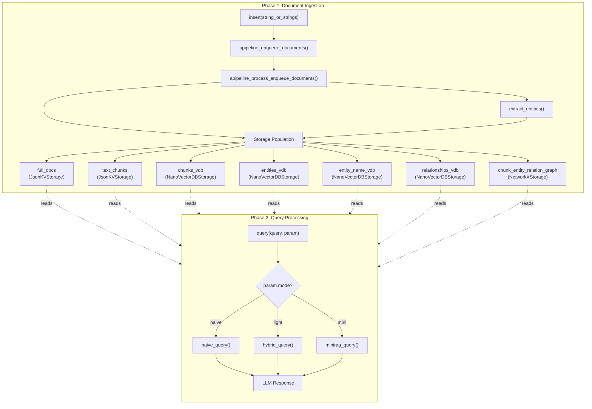
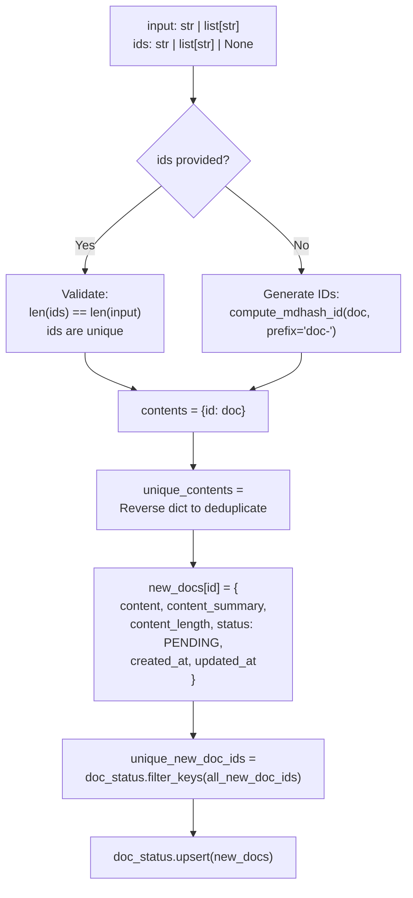
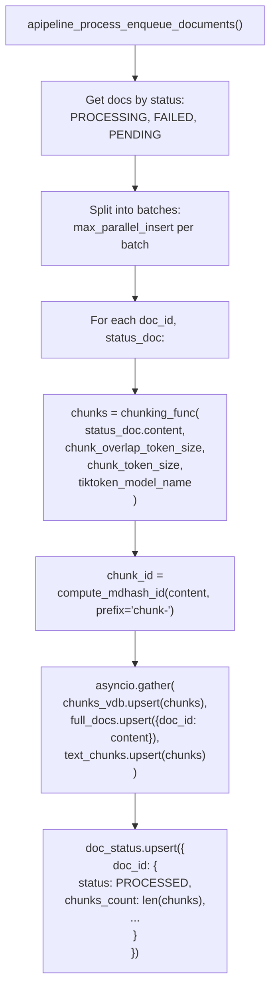
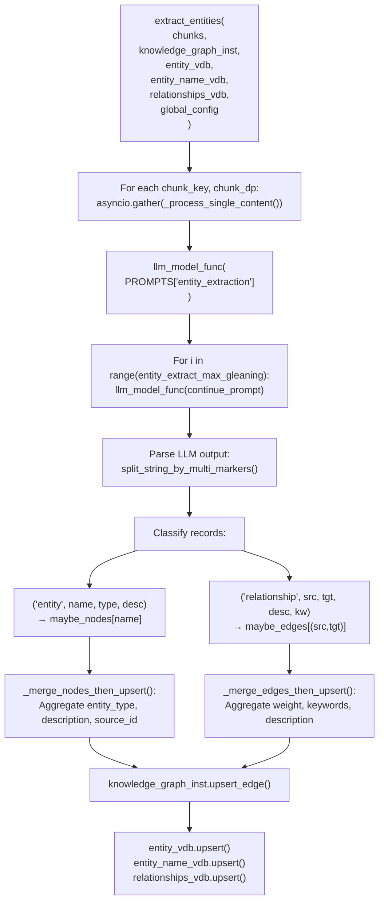
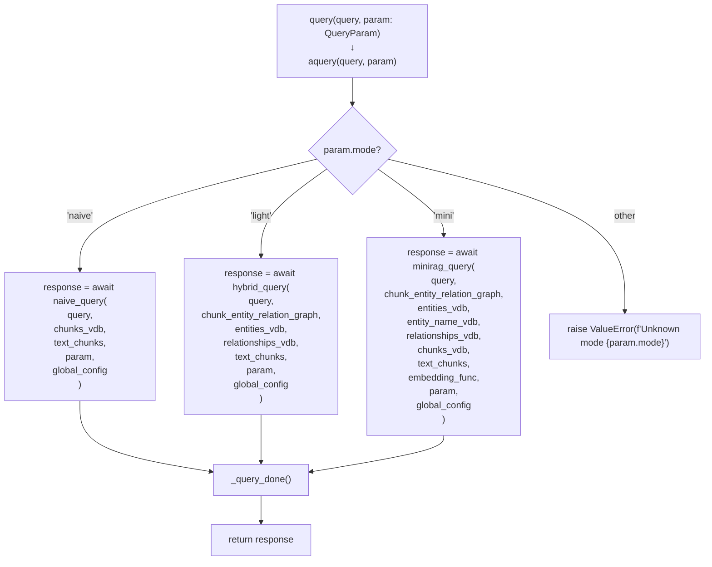
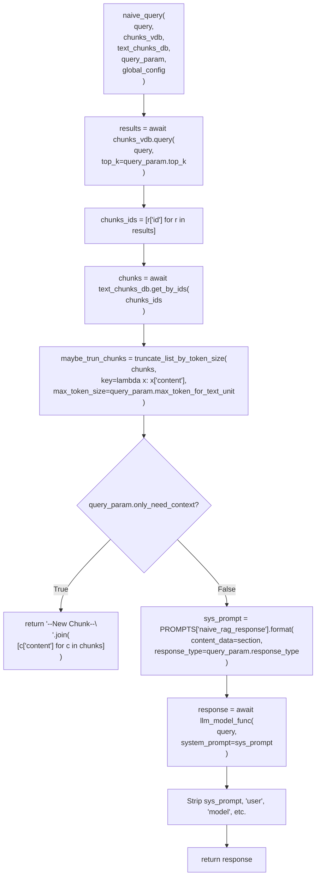
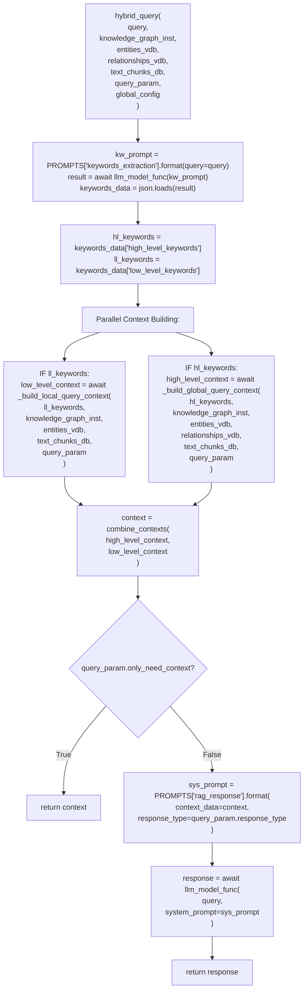
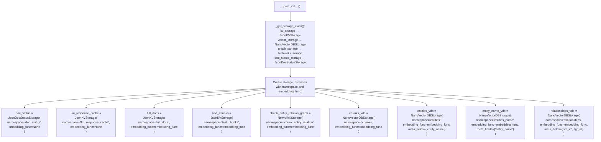
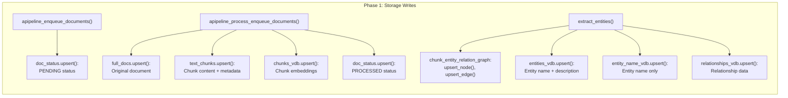
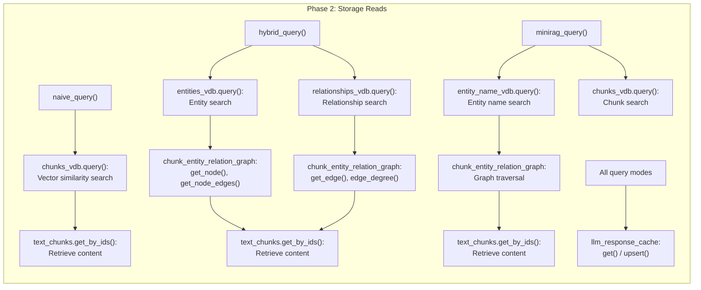

<!-- source: DeepWiki mcp.deepwiki.com · repo HKUDS/MiniRAG · page 3.3 Data Processing Pipeline · fetched 2026-11-09 -->

# Data Processing Pipeline

<details>
<summary>Relevant source files</summary>

The following files were used as context for generating this wiki page:

- [minirag/api/requirements.txt](minirag/api/requirements.txt)
- [minirag/kg/weaviate_impl.py](minirag/kg/weaviate_impl.py)
- [minirag/minirag.py](minirag/minirag.py)
- [minirag/operate.py](minirag/operate.py)
- [tests/test_weaviate.py](tests/test_weaviate.py)

</details>


This page documents the two-phase workflow in MiniRAG: **Phase 1 (Document Ingestion)** transforms raw documents into a heterogeneous knowledge graph, and **Phase 2 (Query Processing)** retrieves relevant information and generates responses. See page 3.1 for the `MiniRAG` class and page 3.2 for storage abstractions.

## 1. Two-Phase Pipeline Overview

MiniRAG processes data through two distinct phases executed by the `MiniRAG` class in [minirag/minirag.py](minirag/minirag.py):

**Phase 1: Document Ingestion Pipeline**
- Entry point: `insert()` / `ainsert()` methods [minirag/minirag.py:340-389]()
- Transforms documents → text chunks → entities/relations → knowledge graph
- Populates: `full_docs`, `text_chunks`, `chunks_vdb`, `entities_vdb`, `entity_name_vdb`, `relationships_vdb`, `chunk_entity_relation_graph`

**Phase 2: Query Processing Pipeline**
- Entry point: `query()` / `aquery()` methods [minirag/minirag.py:533-572]()
- Dispatches to: `naive_query()`, `hybrid_query()`, or `minirag_query()` based on `QueryParam.mode`
- Reads from: All storage instances populated in Phase 1
- Generates: Context-enhanced LLM responses

### High-Level Two-Phase Architecture



Sources: [minirag/minirag.py:340-389](), [minirag/minirag.py:533-572](), [minirag/minirag.py:254-298]()

## 2. Phase 1: Document Ingestion

Phase 1 transforms raw documents into the heterogeneous knowledge graph through three sub-stages executed by `ainsert()` [minirag/minirag.py:344-389]().

### 2.1 Document Enqueue: `apipeline_enqueue_documents()`

The first sub-stage [minirag/minirag.py:391-449]() validates, deduplicates, and enqueues documents for processing.

**Document Enqueue Pipeline (`apipeline_enqueue_documents`)**



**Key Operations:**

| Step | Code Location | Description |
|------|---------------|-------------|
| ID generation | [minirag/minirag.py:416]() | Uses `compute_mdhash_id()` with prefix `"doc-"` |
| Deduplication | [minirag/minirag.py:418-423]() | Reverses content→id mapping to remove duplicate content |
| Metadata enrichment | [minirag/minirag.py:424-433]() | Adds `content_summary`, `content_length`, `status`, timestamps |
| Filtering existing | [minirag/minirag.py:437]() | `doc_status.filter_keys()` returns only new doc IDs |
| Status storage | [minirag/minirag.py:448]() | Stores in `doc_status` with `DocStatus.PENDING` |

Sources: [minirag/minirag.py:391-449](), [minirag/utils.py:compute_mdhash_id]()

### 2.2 Chunk Processing: `apipeline_process_enqueue_documents()`

The second sub-stage [minirag/minirag.py:451-514]() chunks documents and stores them across multiple storage instances.

**Chunk Processing Pipeline (`apipeline_process_enqueue_documents`)**



**Key Operations:**

| Operation | Code Location | Storage Target |
|-----------|---------------|----------------|
| Get pending docs | [minirag/minirag.py:461-465]() | `doc_status.get_docs_by_status()` |
| Batch processing | [minirag/minirag.py:476-479]() | Controlled by `max_parallel_insert` config |
| Chunking | [minirag/minirag.py:484-495]() | Calls `chunking_func` (default: `chunking_by_token_size`) |
| Generate chunk IDs | [minirag/minirag.py:485]() | `compute_mdhash_id(content, prefix="chunk-")` |
| Parallel storage | [minirag/minirag.py:496-500]() | `chunks_vdb`, `full_docs`, `text_chunks` |
| Update status | [minirag/minirag.py:501-513]() | Sets `DocStatus.PROCESSED` |

**`chunking_by_token_size()` Function** [minirag/operate.py:36-54]()

Default chunking implementation:
- Tokenizes with `encode_string_by_tiktoken()`
- Creates overlapping windows: `range(0, len(tokens), max_token_size - overlap_token_size)`
- Returns list of dicts: `{"tokens": int, "content": str, "chunk_order_index": int}`

Sources: [minirag/minirag.py:451-514](), [minirag/operate.py:36-54](), [minirag/utils.py:compute_mdhash_id]()

### 2.3 Entity Extraction: `extract_entities()`

The third sub-stage [minirag/minirag.py:377-387]() calls `extract_entities()` [minirag/operate.py:233-408]() to extract entities and relationships using LLM.

**Entity Extraction Pipeline (`extract_entities`)**



**Key Operations:**

| Operation | Code Location | Description |
|-----------|---------------|-------------|
| Prompt formatting | [minirag/operate.py:249-256]() | Uses `PROMPTS["entity_extraction"]` with delimiters |
| LLM extraction | [minirag/operate.py:271]() | `llm_model_func(hint_prompt)` |
| Gleaning loop | [minirag/operate.py:274-287]() | Iterative refinement up to `entity_extract_max_gleaning` times |
| Record parsing | [minirag/operate.py:289-292]() | Splits by `record_delimiter` and `completion_delimiter` |
| Entity handling | [minirag/operate.py:304-309]() | `_handle_single_entity_extraction()` |
| Relation handling | [minirag/operate.py:311-317]() | `_handle_single_relationship_extraction()` |
| Node merging | [minirag/operate.py:117-163]() | `_merge_nodes_then_upsert()` aggregates duplicate entities |
| Edge merging | [minirag/operate.py:166-230]() | `_merge_edges_then_upsert()` aggregates duplicate relationships |
| Vector storage | [minirag/operate.py:364-406]() | Stores in `entities_vdb`, `entity_name_vdb`, `relationships_vdb` |

**Entity Extraction Format:**

Entities: `("entity", "<NAME>", "<TYPE>", "<DESCRIPTION>")`  
Relationships: `("relationship", "<SRC>", "<TGT>", "<DESCRIPTION>", "<KEYWORDS>", <WEIGHT>)`

Sources: [minirag/minirag.py:377-387](), [minirag/operate.py:233-408](), [minirag/operate.py:70-114](), [minirag/operate.py:117-230]()

## 3. Phase 2: Query Processing

Phase 2 retrieves relevant information and generates responses. Entry point is `aquery()` [minirag/minirag.py:537-572]() which dispatches to mode-specific functions based on `QueryParam.mode`.

### 3.1 Query Dispatch: `aquery()`

The `aquery()` method [minirag/minirag.py:537-572]() routes queries to one of three implementations in [minirag/operate.py](minirag/operate.py).

**Query Dispatch Logic**



**Mode Comparison:**

| Mode | Function | Storage Used | Key Characteristic |
|------|----------|--------------|-------------------|
| `"naive"` | `naive_query()` | `chunks_vdb`, `text_chunks` | Direct vector similarity search |
| `"light"` | `hybrid_query()` | All except `entity_name_vdb`, `chunks_vdb` | Local + global context combining |
| `"mini"` | `minirag_query()` | All storage instances | Topology-enhanced graph traversal |

Sources: [minirag/minirag.py:537-572](), [minirag/minirag.py:533-535]()

### 3.2 Naive Mode: `naive_query()`

Simplest mode using direct vector similarity search without knowledge graph [minirag/operate.py:1076-1121]().

**Naive Query Pipeline**



**Key Characteristics:**
- **No graph traversal**: Only uses vector similarity
- **Simple retrieval**: Direct `chunks_vdb.query()` → `text_chunks_db.get_by_ids()`
- **Token truncation**: Uses `truncate_list_by_token_size()` to fit context window
- **Prompt template**: Uses `PROMPTS["naive_rag_response"]` [minirag/operate.py:1100]()

Sources: [minirag/operate.py:1076-1121](), [minirag/minirag.py:561-568]()

### 3.3 Light Mode: `hybrid_query()`

Combines local (entity-centric) and global (relationship-centric) contexts [minirag/operate.py:918-1004]().

**Hybrid Query Pipeline**



**Context Building Functions:**

| Function | Storage Query | Graph Operation | Output |
|----------|---------------|-----------------|--------|
| `_build_local_query_context()` [minirag/operate.py:483-563]() | `entities_vdb.query()` | `get_node()`, `get_node_edges()` | CSV tables: entities, relationships, sources |
| `_build_global_query_context()` [minirag/operate.py:754-847]() | `relationships_vdb.query()` | `get_edge()`, `edge_degree()` | CSV tables: relationships, entities, sources |
| `combine_contexts()` [minirag/operate.py:1007-1073]() | N/A | N/A | Merged CSV tables with deduplication |

Sources: [minirag/operate.py:918-1004](), [minirag/operate.py:483-563](), [minirag/operate.py:754-847](), [minirag/minirag.py:538-546]()

### 3.4 Mini Mode: `minirag_query()`

Most advanced mode using topology-enhanced retrieval with knowledge graph traversal. Implementation in [minirag/operate.py](minirag/operate.py) (function not shown in provided files, but called at [minirag/minirag.py:548-559]()).

**Mini Mode Characteristics:**

The `minirag_query()` function is called with all storage instances:
```python
response = await minirag_query(
    query,
    self.chunk_entity_relation_graph,    # Graph for traversal
    self.entities_vdb,                   # Entity descriptions
    self.entity_name_vdb,                # Entity names only
    self.relationships_vdb,              # Relationship data
    self.chunks_vdb,                     # Chunk embeddings
    self.text_chunks,                    # Chunk content
    self.embedding_func,                 # Embedding function
    param,
    asdict(self),
)
```

**Key Differences from Light Mode:**
- Uses `entity_name_vdb` for precise entity matching
- Uses `chunks_vdb` for chunk-level similarity
- Implements graph topology-based reasoning paths
- Optimized for small language models with reduced semantic understanding burden

Sources: [minirag/minirag.py:548-559]()

## 4. Storage Layer Interaction

MiniRAG instantiates 8 storage instances in `__post_init__()` [minirag/minirag.py:190-313]().

### 4.1 Storage Instance Initialization

**Storage Instances Created in `MiniRAG.__post_init__()`**



**Storage Instance Reference Table:**

| Attribute | Type | Namespace | Purpose | Embedding |
|-----------|------|-----------|---------|-----------|
| `doc_status` | `JsonDocStatusStorage` | `"doc_status"` | Document processing status tracking | None |
| `llm_response_cache` | `JsonKVStorage` | `"llm_response_cache"` | Cache LLM responses | None |
| `full_docs` | `JsonKVStorage` | `"full_docs"` | Original document content | Yes |
| `text_chunks` | `JsonKVStorage` | `"text_chunks"` | Chunked text content | Yes |
| `chunk_entity_relation_graph` | `NetworkXStorage` | `"chunk_entity_relation"` | Knowledge graph (nodes + edges) | Yes |
| `chunks_vdb` | `NanoVectorDBStorage` | `"chunks"` | Chunk embeddings for similarity search | Yes |
| `entities_vdb` | `NanoVectorDBStorage` | `"entities"` | Entity embeddings (name + description) | Yes |
| `entity_name_vdb` | `NanoVectorDBStorage` | `"entities_name"` | Entity name-only embeddings | Yes |
| `relationships_vdb` | `NanoVectorDBStorage` | `"relationships"` | Relationship embeddings | Yes |

Sources: [minirag/minirag.py:228-313](), [minirag/minirag.py:207-227]()

### 4.2 Storage Usage by Phase

**Phase 1 (Indexing) Storage Writes:**



**Phase 2 (Query) Storage Reads:**



Sources: [minirag/minirag.py:391-514](), [minirag/operate.py:233-408](), [minirag/minirag.py:537-572]()

## 5. Configuration Parameters

Key configuration parameters affecting the data processing pipeline:

### 5.1 Document Processing Configuration

| Parameter | Type | Default | Impact |
|-----------|------|---------|--------|
| `chunk_token_size` | `int` | `1200` | Maximum tokens per chunk in `chunking_by_token_size()` |
| `chunk_overlap_token_size` | `int` | `100` | Overlap between adjacent chunks |
| `tiktoken_model_name` | `str` | `"gpt-4o-mini"` | Tokenizer model for chunking |
| `chunking_func` | `callable` | `chunking_by_token_size` | Custom chunking function |
| `max_parallel_insert` | `int` | `int(os.getenv("MAX_PARALLEL_INSERT", 2))` | Parallel document batch size |

### 5.2 Entity Extraction Configuration

| Parameter | Type | Default | Impact |
|-----------|------|---------|--------|
| `entity_extract_max_gleaning` | `int` | `1` | Iterative LLM extraction rounds |
| `entity_summary_to_max_tokens` | `int` | `500` | Max tokens for entity/relation summaries |
| `llm_model_func` | `callable` | Required | LLM function for entity extraction |
| `llm_model_max_async` | `int` | `16` | Parallel LLM calls limit |

### 5.3 Storage Configuration

| Parameter | Type | Default | Impact |
|-----------|------|---------|--------|
| `kv_storage` | `str` | `"JsonKVStorage"` | Key-value storage implementation |
| `vector_storage` | `str` | `"NanoVectorDBStorage"` | Vector storage implementation |
| `graph_storage` | `str` | `"NetworkXStorage"` | Graph storage implementation |
| `doc_status_storage` | `str` | `"JsonDocStatusStorage"` | Document status tracking implementation |
| `working_dir` | `str` | `"./minirag_cache_{timestamp}"` | Storage directory |

### 5.4 Query Configuration (via `QueryParam`)

| Parameter | Type | Default | Impact |
|-----------|------|---------|--------|
| `mode` | `str` | Required | Query mode: `"naive"`, `"light"`, `"mini"` |
| `top_k` | `int` | Varies | Number of results from vector search |
| `max_token_for_text_unit` | `int` | Varies | Token limit for retrieved chunks |
| `max_token_for_local_context` | `int` | Varies | Token limit for local context (light mode) |
| `max_token_for_global_context` | `int` | Varies | Token limit for global context (light mode) |
| `only_need_context` | `bool` | `False` | Return context without LLM generation |

Sources: [minirag/minirag.py:122-189](), [minirag/base.py:QueryParam]()

## 6. Configuration Impact on Data Flow

Configuration parameters significantly affect how data flows through MiniRAG:

| Configuration Parameter | Impact on Data Flow |
|-------------------------|---------------------|
| `chunk_token_size` | Controls size of text chunks during document processing |
| `chunk_overlap_token_size` | Determines overlap between adjacent chunks |
| `entity_extract_max_gleaning` | Controls how many rounds of entity extraction are performed |
| `embedding_func` | Function used to convert text to vector embeddings |
| `embedding_func_max_async` | Limits parallel embedding operations |
| `llm_model_func` | Function used for generating LLM responses |
| `kv_storage`, `vector_storage`, `graph_storage` | Determine storage implementations used |
| `max_parallel_insert` | Controls parallelism during document insertion |

Sources: [minirag/minirag.py:118-185](), [minirag/operate.py:242-247]()

---

