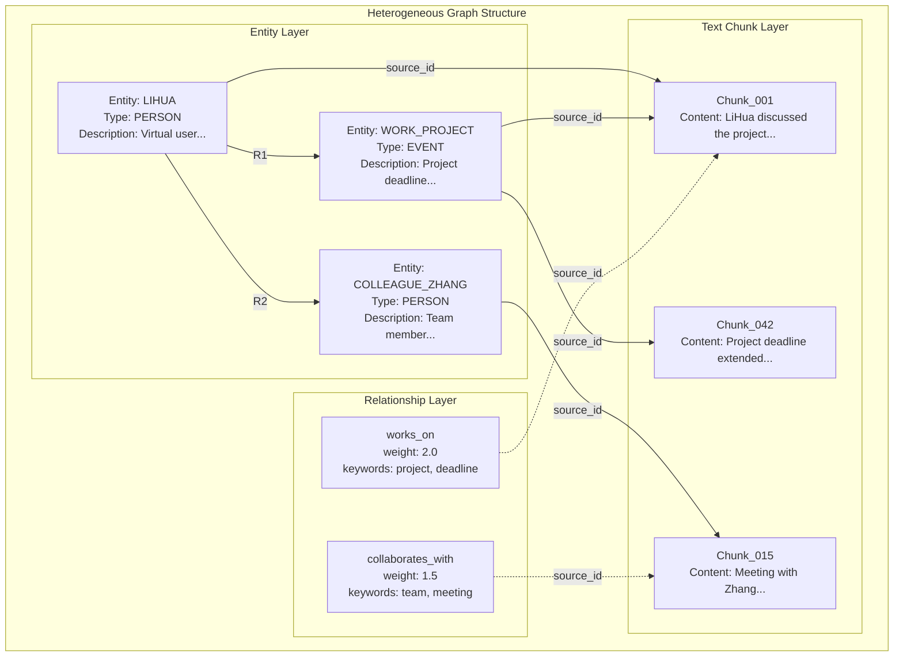
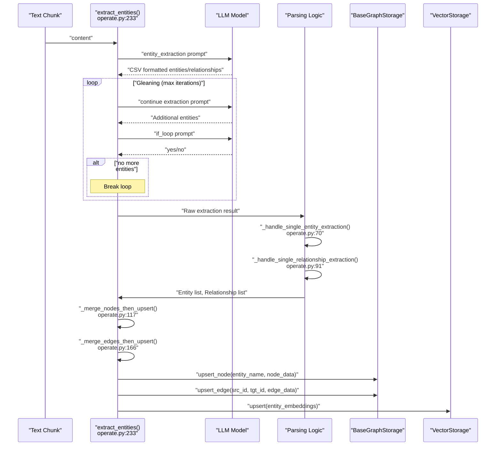
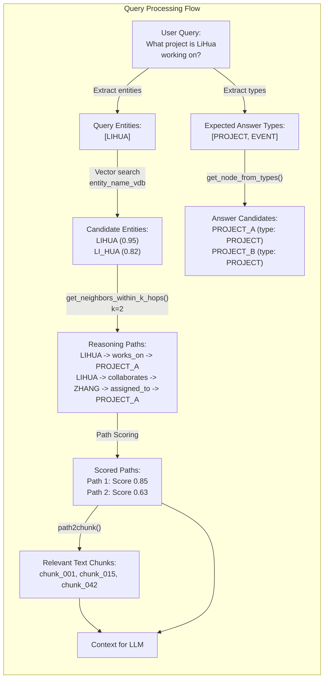
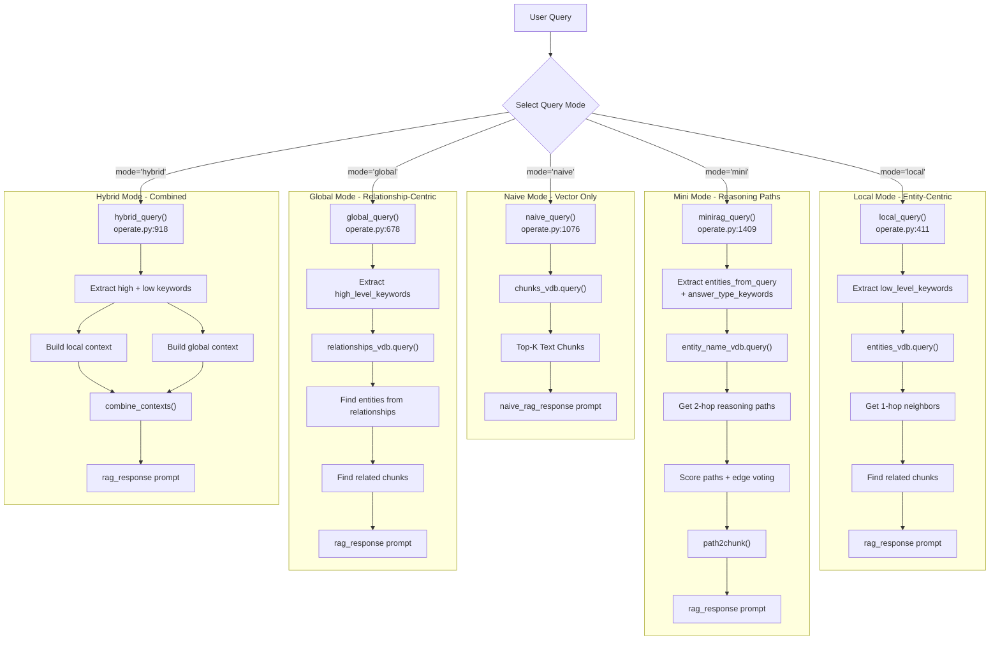
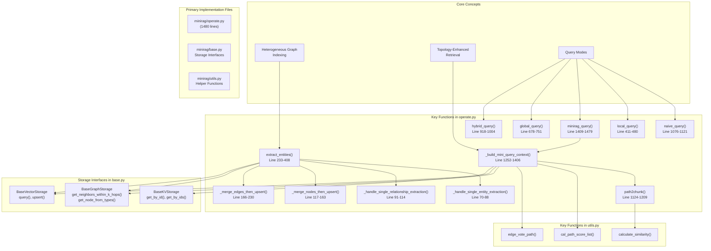

<!-- source: DeepWiki mcp.deepwiki.com · repo HKUDS/MiniRAG · page 4 Core Concepts · fetched 2026-11-09 -->

# Core Concepts

<details>
<summary>Relevant source files</summary>

The following files were used as context for generating this wiki page:

- [README.md](README.md)
- [minirag/api/requirements.txt](minirag/api/requirements.txt)
- [minirag/operate.py](minirag/operate.py)

</details>


This page provides a comprehensive technical explanation of the core algorithms and concepts that power MiniRAG. It covers the two fundamental innovations—heterogeneous graph indexing and topology-enhanced retrieval—as well as the five query modes that balance performance and complexity. 

For implementation details of these concepts in the codebase, see [System Architecture](#3). For specific storage backend implementations, see [Storage Implementations](#5). For practical usage examples, see [Usage Examples](#8).

## Overview

MiniRAG achieves efficient RAG performance on Small Language Models (SLMs) through two key technical innovations that work together to reduce the semantic understanding burden placed on the language model:

1. **Heterogeneous Graph Indexing**: Unifies text chunks and named entities into a single graph structure, providing explicit semantic relationships rather than relying solely on embedding similarity
2. **Topology-Enhanced Retrieval**: Leverages graph structure for efficient knowledge discovery through traversal, enabling reasoning without requiring advanced language capabilities

These innovations are implemented across the indexing and query phases, creating a two-stage pipeline that separates knowledge organization from retrieval.

**Sources:** [README.md:30-34](), [README.md:36-40]()

---

## Heterogeneous Graph Indexing

### Concept and Structure

Heterogeneous graph indexing combines two types of nodes in a unified graph structure:

1. **Entity Nodes**: Named entities extracted from documents (people, places, concepts)
2. **Text Chunk Nodes**: Implicitly represented through source IDs stored in entity and relationship metadata

This dual representation allows the system to navigate between semantic concepts (entities) and raw text evidence (chunks) efficiently. Unlike traditional knowledge graphs that only store entities and relationships, or vector databases that only store embeddings, MiniRAG's heterogeneous structure maintains explicit links between both levels of abstraction.



**Sources:** [README.md:30-34](), [minirag/operate.py:117-163]()

### Entity Extraction Process

The entity extraction process transforms raw text into structured graph elements through LLM-based extraction. The workflow follows a multi-step gleaning approach to ensure comprehensive extraction:



**Sources:** [minirag/operate.py:233-408](), [minirag/operate.py:70-114]()

### Entity and Relationship Schema

The extraction process follows a structured CSV format with specific delimiters defined in the prompt system:

| Element Type | Format | Attributes | Example |
|--------------|--------|------------|---------|
| **Entity** | `("entity", NAME, TYPE, DESCRIPTION)` | entity_name, entity_type, description, source_id | `("entity", "LIHUA", "PERSON", "Virtual user in chat logs")` |
| **Relationship** | `("relationship", SRC, TGT, DESC, KEYWORDS, WEIGHT)` | src_id, tgt_id, description, keywords, weight, source_id | `("relationship", "LIHUA", "PROJECT", "works on", "deadline, task", 1.0)` |

The schema uses several key separators defined in [minirag/prompt.py]():
- **Tuple Delimiter**: Separates attributes within a record
- **Record Delimiter**: Separates multiple extraction records
- **Completion Delimiter**: Marks end of extraction
- **GRAPH_FIELD_SEP**: Used to concatenate multiple values (e.g., multiple source_ids)

**Sources:** [minirag/operate.py:74-88](), [minirag/operate.py:95-114]()

### Node and Edge Merging Strategy

When processing multiple chunks that reference the same entities, MiniRAG merges information to create consolidated nodes and edges:

**Node Merging** [minirag/operate.py:117-163]():
1. Check if entity already exists in graph
2. Aggregate entity types (most common wins)
3. Concatenate descriptions using `GRAPH_FIELD_SEP`
4. Combine source_ids from all chunks mentioning this entity

**Edge Merging** [minirag/operate.py:166-230]():
1. Check if edge already exists between nodes
2. Sum weights from all occurrences
3. Concatenate descriptions and keywords
4. Combine source_ids
5. Create placeholder nodes for missing entities (`"UNKNOWN"` type)

This merging strategy ensures that entities mentioned across multiple documents are unified into single nodes with comprehensive metadata, enabling more accurate retrieval.

**Sources:** [minirag/operate.py:117-230]()

---

## Topology-Enhanced Retrieval

### Graph Traversal Fundamentals

Topology-enhanced retrieval exploits the explicit graph structure to discover relevant information through traversal rather than purely semantic similarity. This approach is particularly effective for SLMs because it reduces the model's burden—instead of understanding complex relationships through language alone, the model can follow pre-computed graph connections.

The core concept involves finding **reasoning paths** between query entities and potential answer entities by traversing the graph structure.



**Sources:** [minirag/operate.py:1252-1407](), [minirag/operate.py:1409-1479]()

### K-Hop Neighbor Discovery

The `get_neighbors_within_k_hops()` method (implemented in [BaseGraphStorage interface](minirag/base.py)) performs breadth-first traversal to find all nodes reachable within k steps from a starting entity. For MiniRAG's mini query mode, k=2 is typically used:

**K-Hop Example:**
- **1-hop neighbors**: Direct connections (e.g., LIHUA → PROJECT_A)
- **2-hop neighbors**: Connections through intermediary (e.g., LIHUA → ZHANG → PROJECT_B)

The reasoning path structure returned is a dictionary mapping path tuples to metadata:

```python
# Conceptual structure returned by get_neighbors_within_k_hops
{
    ("LIHUA", "PROJECT_A"): {"score": 0.85, "path_length": 1},
    ("LIHUA", "ZHANG", "PROJECT_B"): {"score": 0.63, "path_length": 2}
}
```

**Sources:** [minirag/operate.py:1289-1292]()

### Path Scoring Algorithm

The `cal_path_score_list()` function [minirag/utils.py]() assigns scores to reasoning paths based on:

1. **Vector similarity score**: Distance of starting entity from query embedding
2. **Path length**: Shorter paths generally more relevant
3. **Answer type match**: Bonus for paths ending at expected answer types
4. **Edge voting**: Relationships that appear in relationship vector search results boost connected paths

The scoring formula combines these factors to rank paths:

```
path_score = entity_similarity * length_penalty * type_bonus * edge_vote_weight
```

The `edge_vote_path()` function [minirag/utils.py]() cross-references paths with retrieved relationships, identifying which edges in the path appear in top relationship search results. This provides an additional signal for path quality.

**Sources:** [minirag/operate.py:1317-1333](), [minirag/utils.py]()

### From Paths to Chunks

The `path2chunk()` function [minirag/operate.py:1124-1209]() converts scored reasoning paths into ranked text chunks:

1. **Extract source_ids**: For each node and edge in path, retrieve associated chunk IDs
2. **Count occurrences**: Build a Counter of chunk IDs weighted by path scores
3. **Similarity filtering**: For nodes with many chunks, use `calculate_similarity()` to select most relevant
4. **Ranking**: Return top-k chunks by weighted frequency

This ensures that the final context includes text chunks that provide evidence for the reasoning paths, giving the LLM both structured (entities/relationships) and unstructured (original text) information.

**Sources:** [minirag/operate.py:1124-1209](), [minirag/operate.py:1373-1379]()

---

## Query Modes

MiniRAG implements five distinct query modes, each offering different trade-offs between retrieval quality, computational cost, and suitability for SLMs versus LLMs.

### Query Mode Architecture



**Sources:** [minirag/operate.py:411-1479]()

### Naive Mode

**Function:** `naive_query()` [minirag/operate.py:1076-1121]()

The simplest mode that bypasses the knowledge graph entirely. It performs standard vector similarity search on text chunks and directly generates answers.

**Workflow:**
1. Query `chunks_vdb` for top-k most similar chunks
2. Retrieve full chunk content from `text_chunks_db`
3. Truncate chunks to fit within token budget
4. Generate response using `naive_rag_response` prompt

**When to use:** Baseline comparison, simple factual queries, when graph construction overhead isn't justified

**Limitations:** No reasoning across documents, no entity-relationship awareness, relies entirely on embedding similarity

**Sources:** [minirag/operate.py:1076-1121]()

### Local Mode (Light)

**Function:** `local_query()` [minirag/operate.py:411-480]()

Focuses on entity-centric retrieval using immediate graph neighborhoods. Suitable for queries about specific entities where direct relationships provide sufficient context.

**Workflow:**
1. Extract `low_level_keywords` from query
2. Query `entities_vdb` to find relevant entity nodes
3. Retrieve 1-hop neighbors for each entity
4. Find text chunks associated with entities and their neighbors via `_find_most_related_text_unit_from_entities()` [minirag/operate.py:566-641]()
5. Find relationships between entities via `_find_most_related_edges_from_entities()` [minirag/operate.py:644-675]()
6. Format as CSV context with entities, relationships, and sources

**Context Structure:**
```
-----Entities-----
```csv
id,entity,type,description,rank
0,LIHUA,PERSON,"Virtual user",5
1,PROJECT_A,EVENT,"Work deadline",3
```

-----Relationships-----
```csv
id,source,target,description,keywords,weight,rank
0,LIHUA,PROJECT_A,"works on","deadline",2.0,4
```

-----Sources-----
```csv
id,content
0,"LiHua discussed the project deadline..."
```
```

**When to use:** Single-hop questions, entity-focused queries, SLMs with moderate capability

**Sources:** [minirag/operate.py:411-563]()

### Mini Mode (MiniRAG)

**Function:** `minirag_query()` [minirag/operate.py:1409-1479]()

The signature MiniRAG mode that uses topology-enhanced retrieval with reasoning paths. Optimized for SLMs by providing explicit reasoning structure.

**Workflow:**
1. Extract `entities_from_query` and `answer_type_keywords` using `minirag_query2kwd` prompt [minirag/operate.py:1422-1424]()
2. Query `entity_name_vdb` to find candidate entities
3. Call `get_neighbors_within_k_hops(k=2)` to find 2-hop reasoning paths
4. Get nodes matching expected answer types via `get_node_from_types()`
5. Score paths using `cal_path_score_list()` to rank by relevance
6. Query `relationships_vdb` and boost paths with matching edges via `edge_vote_path()`
7. Convert paths to chunks using `path2chunk()` with similarity filtering
8. Build context via `_build_mini_query_context()` [minirag/operate.py:1252-1406]()

**Key Innovation:** The combination of type-based filtering and path scoring reduces the reasoning burden on SLMs by providing pre-computed connection structures.

**When to use:** Multi-hop reasoning, complex queries requiring entity chains, deployment on SLMs (1.5B-4B parameters)

**Sources:** [minirag/operate.py:1409-1479](), [minirag/operate.py:1252-1406]()

### Global Mode

**Function:** `global_query()` [minirag/operate.py:678-751]()

Relationship-centric retrieval that starts from high-level relationships rather than entities. Useful for understanding connections and patterns.

**Workflow:**
1. Extract `high_level_keywords` from query
2. Query `relationships_vdb` to find relevant relationships
3. Retrieve edge metadata and compute edge degrees
4. Find entities involved in relationships via `_find_most_related_entities_from_relationships()` [minirag/operate.py:850-878]()
5. Find associated text chunks via `_find_related_text_unit_from_relationships()` [minirag/operate.py:881-915]()
6. Build context via `_build_global_query_context()` [minirag/operate.py:754-847]()

**When to use:** Queries about relationships/patterns, summarization tasks, understanding system-level connections

**Sources:** [minirag/operate.py:678-847]()

### Hybrid Mode

**Function:** `hybrid_query()` [minirag/operate.py:918-1004]()

Combines local (entity-centric) and global (relationship-centric) contexts for comprehensive coverage. Balances breadth and depth.

**Workflow:**
1. Extract both `high_level_keywords` and `low_level_keywords`
2. Build local context via `_build_local_query_context()` [minirag/operate.py:483-563]()
3. Build global context via `_build_global_query_context()` [minirag/operate.py:754-847]()
4. Merge contexts using `combine_contexts()` [minirag/operate.py:1007-1073]() which:
   - Extracts entity/relationship/source sections from both contexts
   - Deduplicates using `process_combine_contexts()` [minirag/utils.py]()
   - Truncates combined sections to token limits

**When to use:** Complex queries requiring both specific entity information and broader relationship patterns, queries where mode selection is unclear

**Sources:** [minirag/operate.py:918-1073]()

### Mode Comparison Table

| Mode | Storage Used | Graph Traversal | Best For | SLM Performance |
|------|-------------|-----------------|----------|-----------------|
| **Naive** | chunks_vdb only | None | Simple factual queries | Baseline |
| **Local** | entities_vdb, chunks_vdb, graph | 1-hop neighbors | Entity-focused queries | Good |
| **Mini** | entity_name_vdb, relationships_vdb, chunks_vdb, graph | 2-hop reasoning paths | Multi-hop reasoning | Excellent (53.29%) |
| **Global** | relationships_vdb, chunks_vdb, graph | Relationship-centric | Pattern/summarization | Good |
| **Hybrid** | All databases | Both local & global | Complex queries | Very Good |

**Performance Data:** On LiHua-World dataset with Phi-3.5-mini-instruct, MiniRAG's mini mode achieves 53.29% accuracy versus 39.81% for local mode and 41.22% for naive mode [README.md:74-82]().

**Sources:** [README.md:74-89](), [minirag/operate.py:411-1479]()

---

## Code Entity Reference Map

The following diagram maps core concepts to their concrete implementations in the codebase:



**Sources:** [minirag/operate.py:1-1480](), [minirag/base.py](), [minirag/utils.py]()

---

