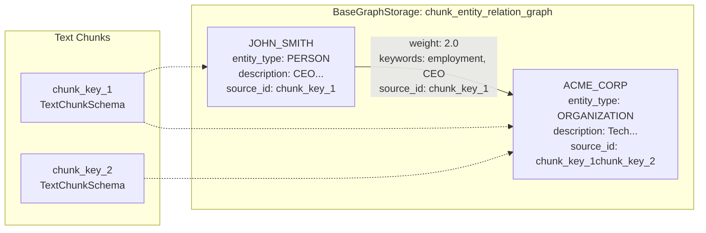
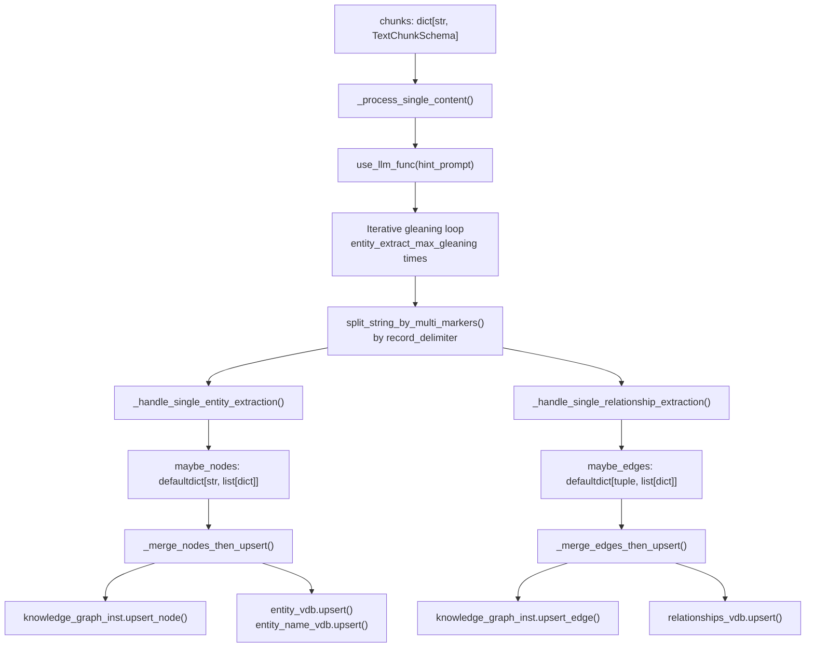
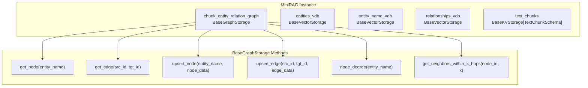
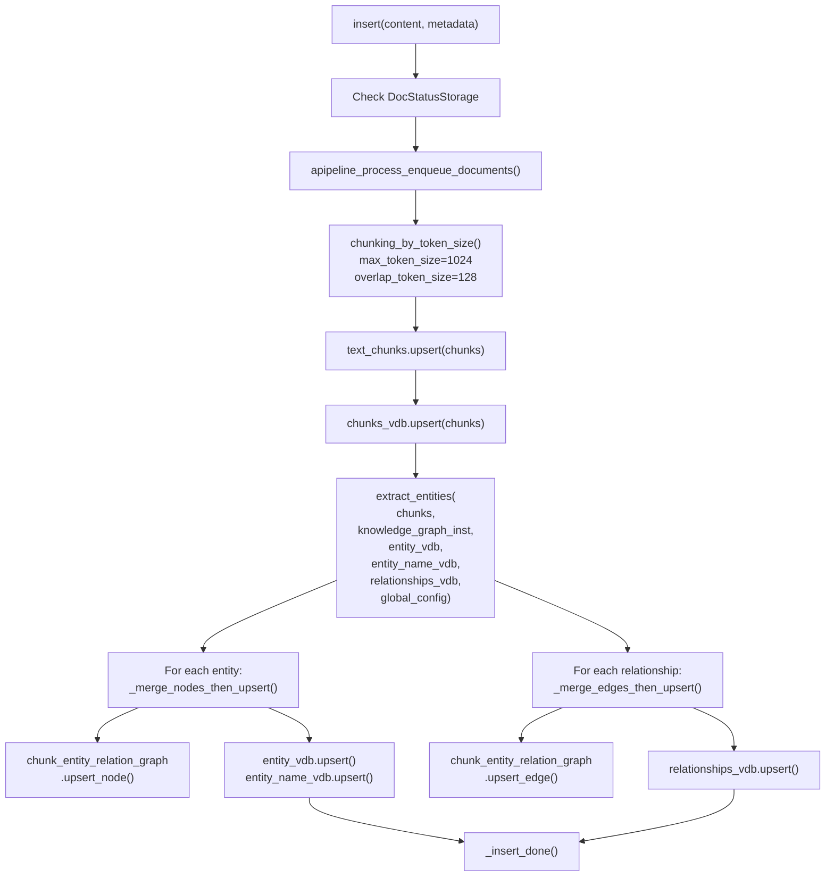

<!-- source: DeepWiki mcp.deepwiki.com · repo HKUDS/MiniRAG · page 4.1 Heterogeneous Graph Indexing · fetched 2026-11-09 -->

# Heterogeneous Graph Indexing

<details>
<summary>Relevant source files</summary>

The following files were used as context for generating this wiki page:

- [README.md](README.md)
- [minirag/api/requirements.txt](minirag/api/requirements.txt)
- [minirag/operate.py](minirag/operate.py)

</details>


Heterogeneous graph indexing is one of MiniRAG's two core innovations (the other being topology-enhanced retrieval). The system extracts named entities and relationships from text chunks using LLM-based extraction, then stores them in a graph structure alongside the original text chunks. This creates a unified index where both entities (nodes) and text chunks (metadata) can be accessed through graph traversal.

The indexing process is implemented in the `extract_entities()` function [minirag/operate.py:233-408]() and integrates three storage components:
- `chunk_entity_relation_graph`: A `BaseGraphStorage` instance storing entity nodes and relationship edges
- Multiple vector databases: `entities_vdb`, `entity_name_vdb`, `relationships_vdb` for semantic search
- `text_chunks`: A `BaseKVStorage` instance mapping chunk IDs to content

For information about how this graph is used during query time, see [Topology-Enhanced Retrieval](#4.2).

## Graph Structure and Data Schema

The heterogeneous graph consists of entity nodes and relationship edges, with each component having specific attributes defined by the extraction prompts in [minirag/prompt.py]().

**Entity Node Schema:**
- `entity_name`: Uppercase normalized entity name (primary key)
- `entity_type`: One of `DEFAULT_ENTITY_TYPES` from prompts
- `description`: Concatenated descriptions from all source chunks (separated by `GRAPH_FIELD_SEP`)
- `source_id`: Concatenated chunk IDs where entity appears (separated by `GRAPH_FIELD_SEP`)

**Relationship Edge Schema:**
- `src_id`, `tgt_id`: Entity names (both normalized to uppercase)
- `weight`: Cumulative weight summed across all mentions (default 1.0 per mention)
- `description`: Concatenated relationship descriptions (separated by `GRAPH_FIELD_SEP`)
- `keywords`: Concatenated keywords (separated by `GRAPH_FIELD_SEP`)
- `source_id`: Concatenated chunk IDs where relationship appears

The `GRAPH_FIELD_SEP` constant (default `"<SEP>"`) is used to join multiple values within a single field, allowing the system to track all source chunks for each entity/relationship.

Sources: [minirag/operate.py:73-88](), [minirag/operate.py:91-114](), [minirag/prompt.py:1-50]()

### Data Flow: Text Chunks to Graph Storage



This diagram shows how text chunks are transformed into entity nodes with relationships. The `source_id` fields track which chunks contain each entity/relationship, enabling retrieval of original text during query processing.

Sources: [minirag/operate.py:117-163](), [minirag/operate.py:166-230](), [minirag/base.py:20-30]()

## Entity and Relationship Extraction Process

The `extract_entities()` function [minirag/operate.py:233-408]() orchestrates LLM-based extraction with the following workflow:

1. **Prompt Construction**: Uses `PROMPTS["entity_extraction"]` [minirag/prompt.py]() with context including:
   - `tuple_delimiter`, `record_delimiter`, `completion_delimiter`
   - `entity_types`: Comma-separated list of allowed entity types
   - `input_text`: The chunk content

2. **Initial Extraction**: Calls `use_llm_func()` with the prompt to extract entities and relationships

3. **Iterative Gleaning**: For `entity_extract_max_gleaning` iterations:
   - Sends `PROMPTS["entiti_continue_extraction"]` to extract additional entities
   - Checks `PROMPTS["entiti_if_loop_extraction"]` to determine if more gleaning is needed
   - Accumulates all extraction results

4. **Parsing**: Splits response by `record_delimiter` and `completion_delimiter`, then parses each record:
   - Entity format: `("entity", "ENTITY_NAME", "ENTITY_TYPE", "DESCRIPTION")`
   - Relationship format: `("relationship", "SOURCE", "TARGET", "DESCRIPTION", "KEYWORDS", WEIGHT)`

5. **Deduplication and Merging**: Groups extracted data by entity name and edge tuple, then merges using:
   - `_merge_nodes_then_upsert()` [minirag/operate.py:117-163]()
   - `_merge_edges_then_upsert()` [minirag/operate.py:166-230]()

Sources: [minirag/operate.py:233-408](), [minirag/operate.py:265-329]()

### Extraction Pipeline: Functions and Data Flow



Each `_process_single_content()` call is executed concurrently using `asyncio.gather()` [minirag/operate.py:332-334](). The function tracks progress with `already_processed`, `already_entities`, and `already_relations` counters displayed using `PROMPTS["process_tickers"]`.

Sources: [minirag/operate.py:265-329](), [minirag/operate.py:332-408]()

## Node and Edge Merging Logic

The `_merge_nodes_then_upsert()` [minirag/operate.py:117-163]() and `_merge_edges_then_upsert()` [minirag/operate.py:166-230]() functions implement merging logic when the same entity or relationship is extracted from multiple chunks.

### Node Merging (`_merge_nodes_then_upsert`)

For each `entity_name`, the function:

1. **Retrieves existing node**: Calls `knowledge_graph_inst.get_node(entity_name)` to check for existing data
2. **Aggregates entity types**: Uses `Counter` to find most common type across all mentions
3. **Concatenates descriptions**: Joins unique descriptions with `GRAPH_FIELD_SEP`
4. **Concatenates source IDs**: Joins all chunk IDs with `GRAPH_FIELD_SEP`
5. **Upserts to graph**: Calls `knowledge_graph_inst.upsert_node(entity_name, node_data)`
6. **Updates vector DBs**: 
   - `entity_vdb`: Stores `entity_name + description` with hash ID prefix `"ent-"`
   - `entity_name_vdb`: Stores just `entity_name` with hash ID prefix `"Ename-"`

### Edge Merging (`_merge_edges_then_upsert`)

For each `(src_id, tgt_id)` tuple, the function:

1. **Retrieves existing edge**: Calls `knowledge_graph_inst.get_edge(src_id, tgt_id)`
2. **Sums weights**: Aggregates all weight values
3. **Concatenates descriptions**: Joins unique descriptions with `GRAPH_FIELD_SEP`
4. **Concatenates keywords**: Joins unique keywords with `GRAPH_FIELD_SEP`
5. **Concatenates source IDs**: Joins all chunk IDs
6. **Creates missing nodes**: If `src_id` or `tgt_id` don't exist, creates nodes with type `"UNKNOWN"`
7. **Upserts to graph**: Calls `knowledge_graph_inst.upsert_edge(src_id, tgt_id, edge_data)`
8. **Updates vector DB**: Stores in `relationships_vdb` with concatenated `keywords + src_id + tgt_id + description` and hash ID prefix `"rel-"`

Both functions use `compute_mdhash_id()` [minirag/utils.py]() to generate consistent hash-based IDs for vector database entries.

Sources: [minirag/operate.py:117-163](), [minirag/operate.py:166-230](), [minirag/operate.py:364-406]()

## Storage Architecture and Interfaces



The `BaseGraphStorage` abstract interface [minirag/base.py]() defines the core graph operations. During extraction, MiniRAG only uses `get_node()`, `get_edge()`, `upsert_node()`, and `upsert_edge()`. The topology methods (`node_degree()`, `get_neighbors_within_k_hops()`) are used during query processing.

Sources: [minirag/base.py:120-180](), [minirag/operate.py:117-230]()

## Graph Storage Backend Implementations

MiniRAG's storage layer uses a factory pattern defined in the `STORAGES` dictionary [minirag/minirag.py:39-62](). Each entry maps a string key to a tuple `(module_path, class_name)`:

| Key | Module Path | Class Name | Backend Technology |
|-----|-------------|------------|-------------------|
| `"NetworkXStorage"` | `minirag.kg.networkx_impl` | `NetworkXStorage` | NetworkX in-memory graph |
| `"Neo4JStorage"` | `minirag.kg.neo4j_impl` | `Neo4JStorage` | Neo4j native graph database |
| `"OracleGraphStorage"` | `minirag.kg.oracle_impl` | `OracleGraphStorage` | Oracle Graph |
| `"TiDBGraphStorage"` | `minirag.kg.tidb_impl` | `TiDBGraphStorage` | TiDB distributed SQL |
| `"PGGraphStorage"` | `minirag.kg.postgres_impl` | `PostgreSQLImpl` | PostgreSQL with custom schema |
| `"AGEStorage"` | `minirag.kg.age_impl` | `AGEStorage` | Apache AGE (Postgres extension) |
| `"GremlinStorage"` | `minirag.kg.gremlin_impl` | `GremlinStorage` | Apache TinkerPop Gremlin |
| `"CozoDB"` | `minirag.kg.cozo_impl` | `CozoStorage` | CozoDB graph database |
| `"FalkorDB"` | `minirag.kg.falkordb_impl` | `FalkorDBStorage` | FalkorDB graph database |
| `"MongoDBAtlas"` | `minirag.kg.mongodb_impl` | `MongoDBStorage` | MongoDB Atlas |

The MiniRAG constructor uses `dynamic_import()` [minirag/storage.py]() to load the specified implementation:

```python
# From minirag/minirag.py initialization
graph_storage_cls = lazy_external_import(*STORAGES[graph_storage])
self.chunk_entity_relation_graph = graph_storage_cls(
    namespace=self.namespace,
    global_config=asdict(self),
    embedding_func=self.embedding_func,
)
```

All implementations must conform to the `BaseGraphStorage` interface, providing methods like `upsert_node()`, `get_node()`, `upsert_edge()`, `get_edge()`, and graph traversal methods.

Sources: [minirag/minirag.py:39-62](), [minirag/minirag.py:259-265](), [minirag/storage.py:1-50]()

## Integration with MiniRAG Insert Pipeline

The graph indexing is triggered during document insertion via `insert()` [minirag/minirag.py:336-385]() or `ainsert()` [minirag/minirag.py:387-424]():



The `extract_entities()` function [minirag/operate.py:233-408]() takes the following parameters:
- `chunks`: dict mapping chunk keys to `TextChunkSchema` objects
- `knowledge_graph_inst`: The `BaseGraphStorage` instance (`chunk_entity_relation_graph`)
- `entity_vdb`, `entity_name_vdb`, `relationships_vdb`: Vector storage instances
- `global_config`: Dictionary containing `llm_model_func`, `entity_extract_max_gleaning`, and other settings

The function returns the updated `knowledge_graph_inst` or `None` if extraction failed.

Sources: [minirag/minirag.py:336-385](), [minirag/minirag.py:370-383](), [minirag/operate.py:233-408]()

## Optimizations and Graph Traversal

MiniRAG's heterogeneous graph indexing implements several optimizations for efficient graph traversal and retrieval:

1. **Edge weighting**: Relationships between entities have weights that represent their importance
2. **Node and edge ranking**: Based on degree (number of connections)
3. **K-hop neighborhood retrieval**: Finding entities within K steps of a given entity
4. **Path scoring**: Scoring potential reasoning paths through the graph

The system uses these optimization techniques during query time to identify the most relevant entities, relationships, and chunks for a given query.

## Advantages of Heterogeneous Graph Indexing

Compared to traditional vector-only indexing, heterogeneous graph indexing offers several advantages:

1. **Captures semantic relationships**: Beyond simple similarity, it represents how entities relate to each other
2. **Enables multi-hop reasoning**: Can connect information across multiple chunks through graph traversal
3. **Supports complex queries**: Better handles queries requiring understanding of relationships
4. **Optimal for SLMs**: Provides structured, relationship-aware context that helps small language models reason effectively

For more details on how the graph is used during query processing, see [Topology-Enhanced Retrieval](#4.2) and [Query Modes](#4.3).

Sources: [minirag/operate.py:918-1004](), [minirag/operate.py:1409-1479]()

---

