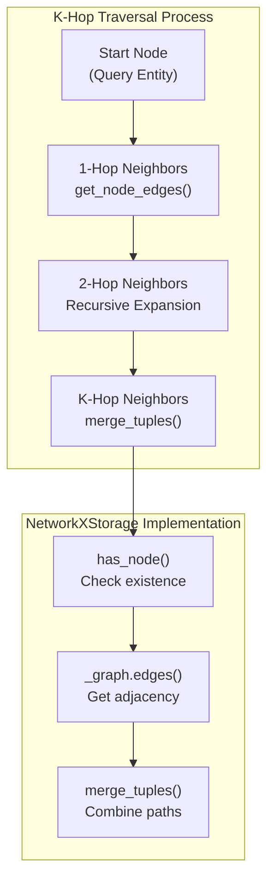
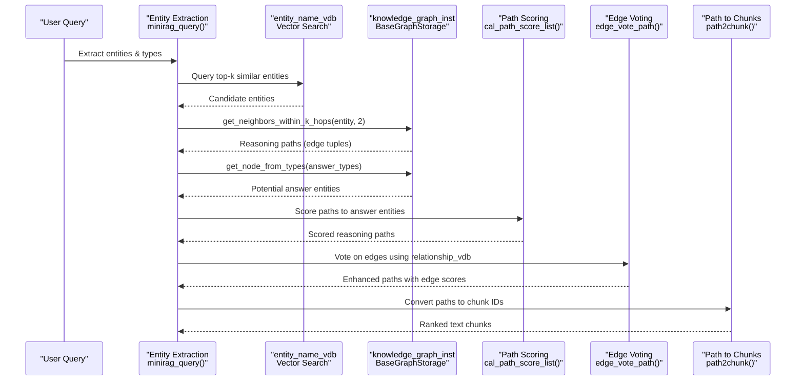
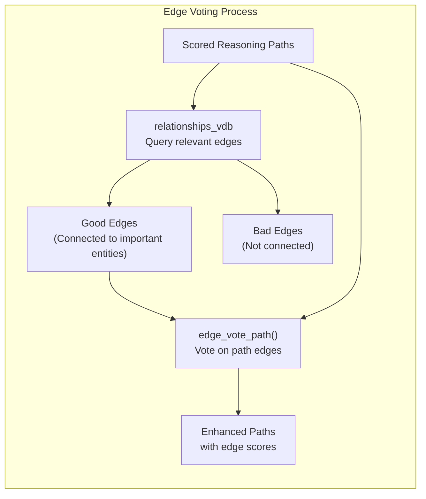
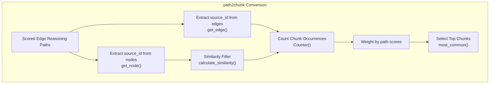
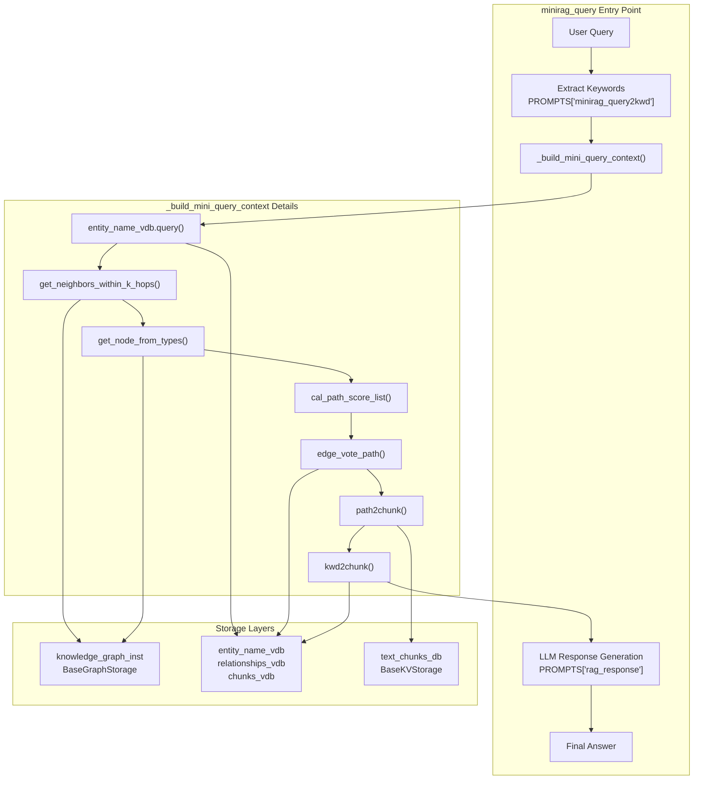
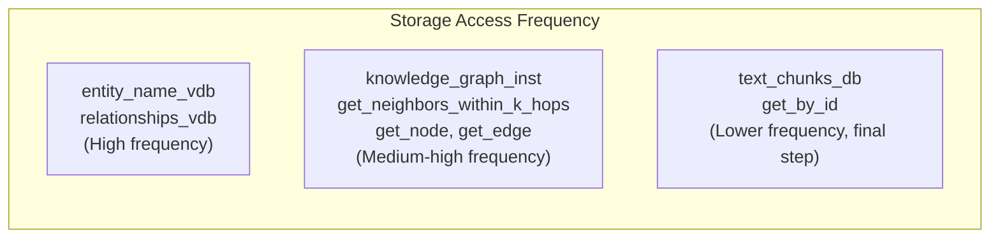

<!-- source: DeepWiki mcp.deepwiki.com · repo HKUDS/MiniRAG · page 4.2 Topology-Enhanced Retrieval · fetched 2026-11-09 -->

# Topology-Enhanced Retrieval

<details>
<summary>Relevant source files</summary>

The following files were used as context for generating this wiki page:

- [minirag/api/requirements.txt](minirag/api/requirements.txt)
- [minirag/kg/networkx_impl.py](minirag/kg/networkx_impl.py)
- [minirag/operate.py](minirag/operate.py)

</details>


## Purpose and Scope

This document describes MiniRAG's topology-enhanced retrieval mechanism, which leverages the structure of the knowledge graph to discover reasoning paths and relevant context for answering queries. This is one of MiniRAG's two core technical innovations (the other being heterogeneous graph indexing, covered in [section 4.1](#4.1)).

Topology-enhanced retrieval enables Small Language Models (SLMs) to perform effective RAG by using graph traversal algorithms to find relevant information, rather than relying on advanced semantic understanding. This page focuses on the algorithms, data structures, and implementation details of the topology-based retrieval process.

For information about the different query modes that utilize this retrieval mechanism, see [Query Modes](#4.3). For details on the underlying graph storage implementations, see [Graph Storage Backends](#5.1).

---

## Overview

Topology-enhanced retrieval exploits the structural properties of the knowledge graph to find reasoning paths between query entities and potential answer entities. Unlike traditional vector search that relies purely on semantic similarity, this approach uses graph connectivity, k-hop neighborhood exploration, and path scoring to identify relevant context.

### Key Characteristics

| Characteristic | Description |
|---------------|-------------|
| **Graph Traversal** | Uses k-hop neighborhood exploration to discover connected entities |
| **Path-Based Reasoning** | Constructs and scores reasoning paths from query entities to answer entities |
| **Entity Type Awareness** | Leverages entity types to identify potential answer nodes |
| **Edge Voting** | Uses edge relevance to reinforce important reasoning paths |
| **Lightweight** | Does not require advanced semantic reasoning from the LLM |

**Sources:** [minirag/operate.py:1252-1406](), Diagram 5 from high-level architecture

---

## K-Hop Neighborhood Exploration

The foundation of topology-enhanced retrieval is the ability to traverse the graph and discover entities within k hops of a starting node.

### Algorithm Overview



### Implementation: `get_neighbors_within_k_hops`

The core k-hop traversal is implemented in `NetworkXStorage`:

[minirag/kg/networkx_impl.py:177-193]()

```python
async def get_neighbors_within_k_hops(self, source_node_id: str, k):
    count = 0
    if await self.has_node(source_node_id):
        source_edge = list(self._graph.edges(source_node_id))
    else:
        print("NO THIS ID:", source_node_id)
        return []
    count = count + 1
    while count < k:
        count = count + 1
        sc_edge = copy.deepcopy(source_edge)
        source_edge = []
        for pair in sc_edge:
            append_edge = list(self._graph.edges(pair[-1]))
            for tuples in merge_tuples([pair], append_edge):
                source_edge.append(tuples)
    return source_edge
```

**Key Components:**

| Component | Purpose |
|-----------|---------|
| `source_node_id` | Starting entity for traversal |
| `k` | Number of hops to explore |
| `source_edge` | List of edge tuples representing paths |
| `merge_tuples()` | Combines path segments into longer paths |

**Sources:** [minirag/kg/networkx_impl.py:177-193](), [minirag/utils.py]() (merge_tuples)

---

## Reasoning Path Discovery

### MiniRAG Query Context Building

The topology-enhanced retrieval is primarily used in the `minirag` query mode through the `_build_mini_query_context` function:



**Sources:** [minirag/operate.py:1252-1406](), [minirag/operate.py:1409-1479]()

### Step-by-Step Process

#### 1. Entity Extraction from Query

[minirag/operate.py:1422-1449]()

The query is first processed to extract:
- **Entities from query**: Entities mentioned or implied in the query
- **Answer type keywords**: Expected entity types for the answer

```python
kw_prompt_temp = PROMPTS["minirag_query2kwd"]
TYPE_POOL, TYPE_POOL_w_CASE = await knowledge_graph_inst.get_types()
kw_prompt = kw_prompt_temp.format(query=query, TYPE_POOL=TYPE_POOL)
result = await use_model_func(kw_prompt)
keywords_data = json_repair.loads(result)
type_keywords = keywords_data.get("answer_type_keywords", [])
entities_from_query = keywords_data.get("entities_from_query", [])[:5]
```

#### 2. Candidate Entity Discovery

[minirag/operate.py:1269-1292]()

For each extracted entity, find similar entities in the graph:

```python
for ent in ent_from_query:
    results_node = await entity_name_vdb.query(ent, top_k=query_param.top_k)
    nodes_from_query_list.append(results_node)
    ent_from_query_dict[ent] = [e["entity_name"] for e in results_node]
```

Then construct reasoning paths from these candidates:

```python
for key in candidate_reasoning_path.keys():
    candidate_reasoning_path[key]["Path"] = \
        await knowledge_graph_inst.get_neighbors_within_k_hops(key, 2)
```

#### 3. Answer Type Filtering

[minirag/operate.py:1311-1319]()

Retrieve entities that match the expected answer types:

```python
node_datas_from_type = await knowledge_graph_inst.get_node_from_types(
    type_keywords
)
maybe_answer_list = [n["entity_name"] for n in node_datas_from_type]
scored_reasoning_path = cal_path_score_list(
    candidate_reasoning_path, maybe_answer_list
)
```

**Sources:** [minirag/operate.py:1269-1319]()

---

## Path Scoring and Edge Voting

### Path Scoring Algorithm

The `cal_path_score_list` function (referenced from utils) scores reasoning paths based on:
1. **Connectivity**: How many hops to reach answer entities
2. **Type matching**: Whether path endpoints match expected answer types
3. **Distance scores**: Semantic similarity from vector search

### Edge Voting Mechanism



[minirag/operate.py:1321-1333]()

```python
results_edge = await relationships_vdb.query(
    originalquery, top_k=len(ent_from_query) * query_param.top_k
)
goodedge = []
badedge = []
for item in results_edge:
    if item["src_id"] in imp_ents or item["tgt_id"] in imp_ents:
        goodedge.append(item)
    else:
        badedge.append(item)
scored_edged_reasoning_path, pairs_append = edge_vote_path(
    scored_reasoning_path, goodedge
)
```

**Sources:** [minirag/operate.py:1321-1333](), [minirag/utils.py]() (edge_vote_path, cal_path_score_list)

---

## Path to Chunk Conversion

Once reasoning paths are scored and enhanced, they need to be converted to actual text chunks for context generation.

### Conversion Process Diagram



### Implementation Details

[minirag/operate.py:1124-1209]()

The `path2chunk` function performs the following:

1. **Extract chunk IDs from edges**:
```python
edge_datas = await asyncio.gather(
    *[knowledge_graph_inst.get_edge(r[0], r[1]) for r in use_edge]
)
text_units = [
    split_string_by_multi_markers(dp["source_id"], [GRAPH_FIELD_SEP])
    for dp in edge_datas
][0]
```

2. **Extract chunk IDs from nodes**:
```python
node_datas = await asyncio.gather(
    *[knowledge_graph_inst.get_node(pathtuple[0])]
)
for dp in node_datas:
    text_units_node = split_string_by_multi_markers(
        dp["source_id"], [GRAPH_FIELD_SEP]
    )
    text_units = text_units + text_units_node
```

3. **Filter nodes by description similarity**:
```python
if len(text_units_node) > 5:
    max_ids = int(max(5, len(text_units_node) / 2))
    should_consider_idx = calculate_similarity(
        descriptionlist_node, query, k=max_ids
    )
    text_units_node = [text_units_node[i] for i in should_consider_idx]
```

4. **Weight chunks by path scores**:
```python
count_dict = Counter(text_units)
total_score = scorelist[0] + scorelist[1] + 1
for key, value in count_dict.items():
    count_dict[key] = value * total_score
```

5. **Select top chunks**:
```python
for id in count_dict.most_common(max_chunks):
    v["Path"].append(id[0])
```

**Sources:** [minirag/operate.py:1124-1209]()

---

## Final Context Assembly

### Keyword to Chunk Mapping

The `kwd2chunk` function aggregates chunk scores across all query entities:

[minirag/operate.py:1220-1249]()

```python
def kwd2chunk(ent_from_query_dict, chunks_ids, chunk_nums):
    final_chunk = Counter()
    for key, list_of_dicts in ent_from_query_dict.items():
        total_id_scores = Counter()
        for d in list_of_dicts:
            score = d["Score"] * 2 if d == list_of_dicts[0] else d["Score"]
            path = d["Path"]
            for id in path:
                if id == path[0] and id in chunks_ids:
                    score = score * 10  # Boost first chunk if in vector search results
                if id in id_scores:
                    id_scores[id] += score
                else:
                    id_scores[id] = score
        final_chunk = final_chunk + total_id_scores
    return [i[0] for i in final_chunk.most_common(chunk_nums)]
```

### Context Structure

[minirag/operate.py:1397-1406]()

The final context returned includes:

| Section | Content | Source |
|---------|---------|--------|
| **Entities** | Scored entities from reasoning paths | `scored_edged_reasoning_path` |
| **Sources** | Relevant text chunks | `final_chunk_id` via `kwd2chunk()` |

```python
return f"""
-----Entities-----
```csv
{entities_context}
```
-----Sources-----
```csv
{text_units_context}
```
"""
```

**Sources:** [minirag/operate.py:1220-1249](), [minirag/operate.py:1397-1406]()

---

## Integration with Query Pipeline

### Complete MiniRAG Query Flow



**Sources:** [minirag/operate.py:1409-1479](), [minirag/operate.py:1252-1406]()

---

## Configuration Parameters

The topology-enhanced retrieval process is controlled by several `QueryParam` settings:

| Parameter | Default | Purpose |
|-----------|---------|---------|
| `top_k` | 60 | Number of candidate entities/edges to retrieve |
| `max_token_for_node_context` | 6000 | Maximum tokens for entity context |
| `max_token_for_text_unit` | 4000 | Maximum tokens for text chunks |

These are configured when creating a query:

```python
query_param = QueryParam(
    mode="mini",
    top_k=60,
    max_token_for_node_context=6000,
    max_token_for_text_unit=4000
)
```

**Sources:** [minirag/base.py]() (QueryParam), [minirag/operate.py:1252-1406]()

---

## Comparison with Other Query Modes

### Topology-Enhanced vs Vector-Only Retrieval

| Aspect | Topology-Enhanced (MiniRAG) | Naive (Vector-Only) |
|--------|---------------------------|---------------------|
| **Primary mechanism** | K-hop graph traversal | Vector similarity search |
| **Context discovery** | Follows graph connections | Independent chunk retrieval |
| **Multi-hop reasoning** | Native support via paths | Limited |
| **Entity relationships** | Explicitly modeled | Implicit in embeddings |
| **Computational cost** | Graph traversal + vector search | Vector search only |

### Topology-Enhanced vs LightRAG

| Aspect | MiniRAG | LightRAG |
|--------|---------|----------|
| **Entity types** | Used for answer filtering | Not emphasized |
| **Path scoring** | Type-aware + edge voting | Degree-based |
| **Chunk selection** | Path-weighted + similarity filter | Source-based aggregation |
| **SLM optimization** | Designed for 1.5B-4B models | Requires stronger models |

**Sources:** High-level architecture Diagram 5, [minirag/operate.py:1409-1479]() vs [minirag/operate.py:411-481]()

---

## Performance Characteristics

### Advantages

1. **Efficient for Small Models**: Reduces semantic understanding burden on the LLM
2. **Multi-hop Reasoning**: Naturally handles questions requiring multiple inference steps
3. **Type-Guided Search**: Uses entity types to focus on relevant answer candidates
4. **Path Interpretability**: Reasoning paths provide explainability

### Trade-offs

1. **Graph Quality Dependency**: Requires well-constructed knowledge graph
2. **Computational Overhead**: K-hop traversal can be expensive for large graphs
3. **Configuration Sensitivity**: Requires tuning of k-hop depth and scoring weights

### Storage Access Patterns



**Sources:** [minirag/operate.py:1252-1406](), Performance analysis from high-level architecture

---

## Key Utility Functions

The topology-enhanced retrieval relies on several utility functions:

| Function | Location | Purpose |
|----------|----------|---------|
| `merge_tuples()` | [minirag/utils.py:68]() | Combines path segments in k-hop traversal |
| `cal_path_score_list()` | [minirag/utils.py:24]() | Scores reasoning paths |
| `edge_vote_path()` | [minirag/utils.py:17]() | Votes on edges to enhance paths |
| `calculate_similarity()` | [minirag/utils.py:23]() | Filters nodes by description similarity |
| `split_string_by_multi_markers()` | [minirag/utils.py:12]() | Extracts source IDs from concatenated strings |
| `truncate_list_by_token_size()` | [minirag/utils.py:11]() | Limits context by token count |

**Sources:** [minirag/utils.py](), [minirag/operate.py:9-25]()

---

## Summary

Topology-enhanced retrieval is the mechanism that enables MiniRAG to achieve strong performance with Small Language Models. By leveraging graph structure through k-hop traversal, path scoring, and edge voting, the system can discover relevant context without requiring advanced semantic reasoning from the LLM.

The key insight is that graph topology encodes structural relationships that can guide retrieval, reducing the burden on the language model to understand complex semantic relationships. This makes MiniRAG particularly effective for on-device deployment scenarios where model size and computational resources are constrained.

**Sources:** [minirag/operate.py:1252-1479](), [minirag/kg/networkx_impl.py:177-193](), High-level architecture diagrams

---

