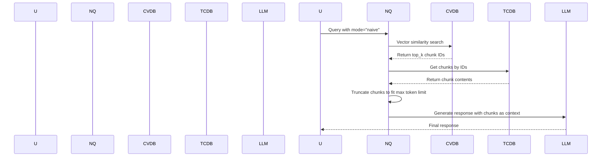
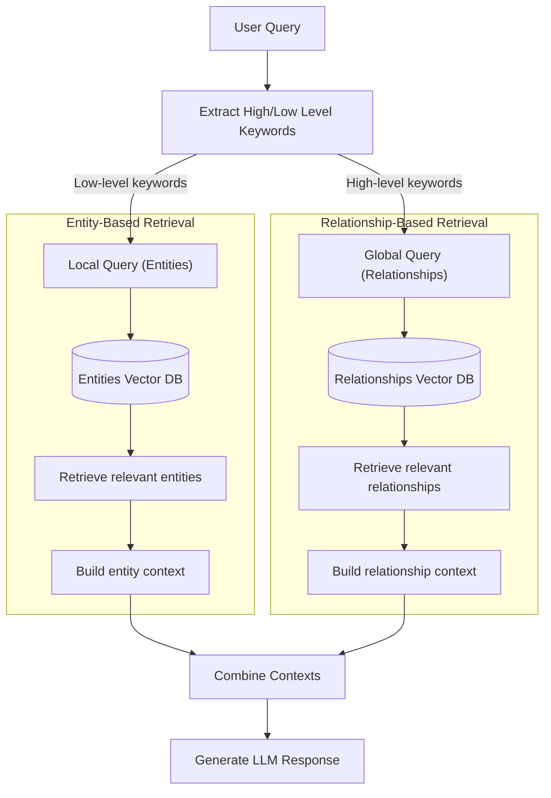
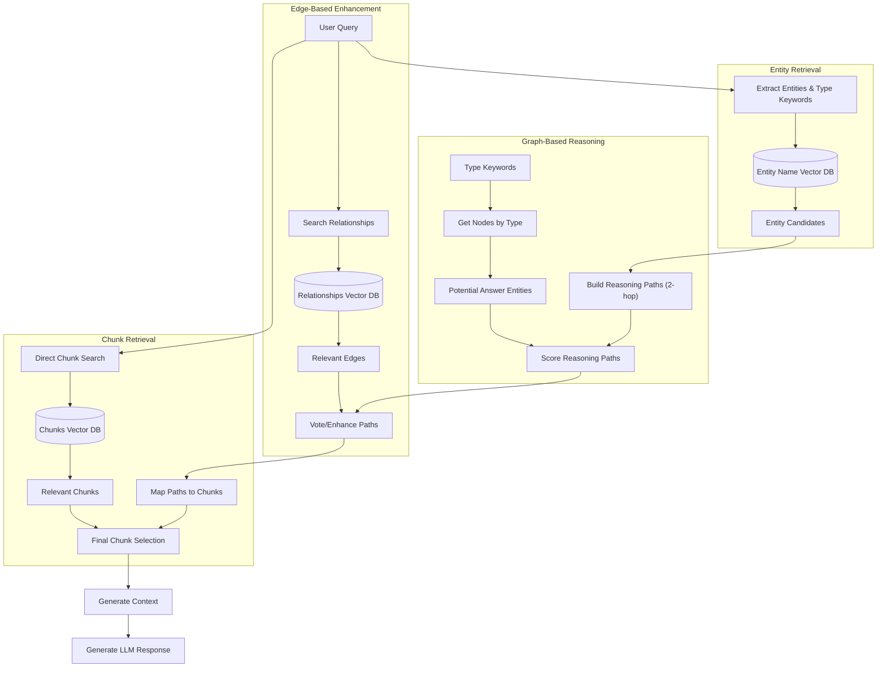

<!-- source: DeepWiki mcp.deepwiki.com · repo HKUDS/MiniRAG · page 4.3 Query Modes · fetched 2026-11-09 -->

# Query Modes

<details>
<summary>Relevant source files</summary>

The following files were used as context for generating this wiki page:

- [minirag/__init__.py](minirag/__init__.py)
- [minirag/api/requirements.txt](minirag/api/requirements.txt)
- [minirag/base.py](minirag/base.py)
- [minirag/operate.py](minirag/operate.py)

</details>


This document details the query modes available in MiniRAG, how they work, and when to use each mode. Query modes determine the retrieval strategy that MiniRAG uses to find relevant information for answering user queries. For information about how these modes are implemented in the topology-enhanced retrieval framework, see [Topology-Enhanced Retrieval](#4.2).

## Overview of Query Modes

MiniRAG offers three query modes, each with different characteristics, advantages, and use cases:

| Mode | Description | Best For | Implementation |
|------|-------------|----------|----------------|
| `naive` | Direct vector retrieval | Simple queries, baseline performance | `naive_query()` function |
| `light` | Hybrid approach combining entity and relationship retrieval | Balance of performance and accuracy | `hybrid_query()` function |
| `mini` | Full topology-enhanced retrieval with reasoning paths | Complex queries requiring reasoning | `minirag_query()` function |

The query mode is specified in the `QueryParam` class:

```python
@dataclass
class QueryParam:
    mode: Literal["light", "naive", "mini"] = "mini"
    # Other parameters...
```

Sources: [minirag/base.py:18-45]()

## Query Mode Architecture

The following diagram illustrates how the three query modes interact with the various components of MiniRAG:

```mermaid
flowchart TD
    UserQuery["User Query"] --> QueryParam{"Query Mode Parameter"}
    
    QueryParam -->|mode="naive"| NaiveQuery["naive_query()"]
    QueryParam -->|mode="light"| HybridQuery["hybrid_query()"]
    QueryParam -->|mode="mini"| MiniRAGQuery["minirag_query()"]
    
    subgraph "Vector Storage Layer"
        ChunksVDB[(Chunks Vector DB)]
        EntitiesVDB[(Entities Vector DB)]
        EntityNameVDB[(Entity Name Vector DB)]
        RelationshipsVDB[(Relationships Vector DB)]
    end
    
    subgraph "Graph Storage Layer"
        KnowledgeGraph[(Knowledge Graph)]
    end
    
    subgraph "KV Storage Layer"
        TextChunksDB[(Text Chunks DB)]
    end
    
    NaiveQuery --> ChunksVDB
    NaiveQuery --> TextChunksDB
    
    HybridQuery --> EntitiesVDB
    HybridQuery --> RelationshipsVDB
    HybridQuery --> KnowledgeGraph
    HybridQuery --> TextChunksDB
    
    MiniRAGQuery --> EntityNameVDB
    MiniRAGQuery --> EntitiesVDB
    MiniRAGQuery --> RelationshipsVDB
    MiniRAGQuery --> ChunksVDB
    MiniRAGQuery --> KnowledgeGraph
    MiniRAGQuery --> TextChunksDB
    
    subgraph "Context Generation"
        NaiveQuery --> NaiveContext["Direct Text Context"]
        HybridQuery --> HybridContext["Combined Entity-Relation Context"]
        MiniRAGQuery --> MiniContext["Topology-Enhanced Context"]
    end
    
    NaiveContext --> LLM["LLM Response Generation"]
    HybridContext --> LLM
    MiniContext --> LLM
```

Sources: [minirag/operate.py:411-1479](), [minirag/base.py:18-45]()

## Naive Mode

Naive mode is the most straightforward approach, using direct vector similarity search without leveraging the graph structure. It provides a baseline for comparison with the more advanced modes.

### How Naive Mode Works



In naive mode, MiniRAG:
1. Performs vector similarity search on the chunks vector database
2. Retrieves the top k chunks based on similarity
3. Truncates the chunks to fit the token limit if necessary
4. Passes the chunks as context to the LLM for response generation

### Implementation Details

The naive query logic is implemented in the `naive_query()` function:

```python
async def naive_query(
    query,
    chunks_vdb: BaseVectorStorage,
    text_chunks_db: BaseKVStorage[TextChunkSchema],
    query_param: QueryParam,
    global_config: dict,
):
    # Retrieve chunks from vector database by similarity
    results = await chunks_vdb.query(query, top_k=query_param.top_k)
    
    # Get the full content of those chunks
    chunks_ids = [r["id"] for r in results]
    chunks = await text_chunks_db.get_by_ids(chunks_ids)
    
    # Truncate chunks to fit token limit
    maybe_trun_chunks = truncate_list_by_token_size(
        chunks,
        key=lambda x: x["content"],
        max_token_size=query_param.max_token_for_text_unit,
    )
    
    # Format chunks for LLM context
    section = "--New Chunk--\n".join([c["content"] for c in maybe_trun_chunks])
    
    # Return context if only context is requested
    if query_param.only_need_context:
        return section
        
    # Generate LLM response
    sys_prompt = PROMPTS["naive_rag_response"].format(
        content_data=section, response_type=query_param.response_type
    )
    response = await use_model_func(query, system_prompt=sys_prompt)
    
    # Clean and return response
    # ...
    return response
```

Sources: [minirag/operate.py:1076-1121]()

### When to Use Naive Mode

Naive mode is recommended when:
- You need a baseline for performance comparison
- Your queries are simple and don't require complex reasoning
- Your dataset doesn't have many interconnected entities and relationships
- You want faster query processing with less computational overhead

## Light Mode (Hybrid)

Light mode combines entity-based and relationship-based retrieval strategies. It extracts both high-level and low-level keywords from the query, then retrieves relevant entities and relationships based on these keywords.

### How Light Mode Works



In light mode, MiniRAG:
1. Extracts high-level and low-level keywords from the query
2. Uses low-level keywords to retrieve relevant entities (local query)
3. Uses high-level keywords to retrieve relevant relationships (global query)
4. Combines the entity and relationship contexts
5. Passes the combined context to the LLM for response generation

### Implementation Details

The light mode query logic is implemented in the `hybrid_query()` function:

```python
async def hybrid_query(
    query,
    knowledge_graph_inst: BaseGraphStorage,
    entities_vdb: BaseVectorStorage,
    relationships_vdb: BaseVectorStorage,
    text_chunks_db: BaseKVStorage[TextChunkSchema],
    query_param: QueryParam,
    global_config: dict,
) -> str:
    # Extract keywords from query
    kw_prompt = PROMPTS["keywords_extraction"].format(query=query)
    result = await use_model_func(kw_prompt)
    
    # Parse keywords
    keywords_data = json.loads(json_text)
    hl_keywords = keywords_data.get("high_level_keywords", [])
    ll_keywords = keywords_data.get("low_level_keywords", [])
    
    # Build local context from entities
    low_level_context = await _build_local_query_context(
        ll_keywords, knowledge_graph_inst, entities_vdb, text_chunks_db, query_param,
    )
    
    # Build global context from relationships
    high_level_context = await _build_global_query_context(
        hl_keywords, knowledge_graph_inst, entities_vdb, relationships_vdb, 
        text_chunks_db, query_param,
    )
    
    # Combine contexts
    context = combine_contexts(high_level_context, low_level_context)
    
    # Generate LLM response
    sys_prompt = PROMPTS["rag_response"].format(
        context_data=context, response_type=query_param.response_type
    )
    response = await use_model_func(query, system_prompt=sys_prompt)
    
    # Clean and return response
    # ...
    return response
```

Sources: [minirag/operate.py:918-1004]()

### When to Use Light Mode

Light mode is recommended when:
- You need a balance between performance and accuracy
- Your queries involve both specific entities and their relationships
- You want to leverage the graph structure without the full computational cost of mini mode
- You're dealing with a medium-sized knowledge base

## Mini Mode

Mini mode is the most sophisticated retrieval strategy, implementing the full MiniRAG approach with topology-enhanced retrieval. It extracts entities from the query, builds reasoning paths through the knowledge graph, and uses these paths to retrieve highly relevant context.

### How Mini Mode Works



In mini mode, MiniRAG:
1. Extracts entities and type keywords from the query
2. Retrieves candidate entities from the entity name vector database
3. Builds reasoning paths through the knowledge graph (up to 2 hops)
4. Scores the reasoning paths based on relevance to potential answer entities
5. Enhances paths with relevant relationships from the vector database
6. Maps paths to document chunks and combines with direct chunk retrieval
7. Generates a rich context with entities and chunks
8. Passes the context to the LLM for response generation

### Implementation Details

The mini mode query logic is implemented in the `minirag_query()` function:

```python
async def minirag_query(
    query,
    knowledge_graph_inst: BaseGraphStorage,
    entities_vdb: BaseVectorStorage,
    entity_name_vdb: BaseVectorStorage,
    relationships_vdb: BaseVectorStorage,
    chunks_vdb: BaseVectorStorage,
    text_chunks_db: BaseKVStorage[TextChunkSchema],
    embedder,
    query_param: QueryParam,
    global_config: dict,
) -> str:
    # Extract entities and type keywords from query
    kw_prompt = PROMPTS["minirag_query2kwd"].format(query=query, TYPE_POOL=TYPE_POOL)
    result = await use_model_func(kw_prompt)
    
    # Parse entities and types
    keywords_data = json_repair.loads(result)
    type_keywords = keywords_data.get("answer_type_keywords", [])
    entities_from_query = keywords_data.get("entities_from_query", [])[:5]
    
    # Build context with topology-enhanced retrieval
    context = await _build_mini_query_context(
        entities_from_query, type_keywords, query, knowledge_graph_inst,
        entities_vdb, entity_name_vdb, relationships_vdb, chunks_vdb,
        text_chunks_db, embedder, query_param,
    )
    
    # Generate LLM response
    sys_prompt = PROMPTS["rag_response"].format(
        context_data=context, response_type=query_param.response_type
    )
    response = await use_model_func(query, system_prompt=sys_prompt)
    
    return response
```

The complex `_build_mini_query_context` function implements the topology-enhanced retrieval, finding reasoning paths through the graph and mapping them to relevant chunks.

Sources: [minirag/operate.py:1409-1479](), [minirag/operate.py:1252-1406]()

### When to Use Mini Mode

Mini mode is recommended when:
- You need the most accurate and comprehensive answers
- Your queries require complex reasoning over heterogeneous knowledge
- You have a rich knowledge graph with many entities and relationships
- You're dealing with multi-hop questions that require connecting multiple facts
- You're using small language models (SLMs) that benefit from enhanced retrieval

## Comparison of Query Modes

The following table summarizes the key differences between the three query modes:

| Feature | Naive Mode | Light Mode | Mini Mode |
|---------|------------|------------|-----------|
| Graph Structure Usage | None | Partial | Full |
| Retrieval Approach | Direct vector search | Entity + relationship retrieval | Topology-enhanced paths |
| Multi-hop Reasoning | No | Limited | Yes (up to 2 hops) |
| Computational Cost | Low | Medium | High |
| Response Quality | Baseline | Good | Best |
| Best For | Simple questions | General queries | Complex reasoning |
| Default | No | No | Yes |

## Setting the Query Mode

To specify the query mode when using MiniRAG:

### Python API

```python
from minirag import MiniRAG, QueryParam

# Create MiniRAG instance
rag = MiniRAG()

# Query with specific mode
response = await rag.query(
    "Who is the founder of Apple?",
    QueryParam(mode="light")  # "light", "naive", or "mini"
)
```

### REST API

```
POST /query
{
    "query": "Who is the founder of Apple?",
    "mode": "mini"  # "light", "naive", or "mini"
}
```

Sources: [minirag/__init__.py:1-6](), [minirag/base.py:18-45]()

## Best Practices

- **Start with Mini Mode**: It's the default and provides the best results in most cases
- **Use Light Mode** for faster responses when dealing with simpler queries
- **Use Naive Mode** for baseline comparison or when your knowledge base is primarily text-based with few entity relationships
- **Adjust `top_k` Parameter**: Increase for more comprehensive results, decrease for faster responses
- **Consider Storage Backends**: Different modes may perform better with different storage backends (e.g., Neo4j for graph-heavy mini mode)

Sources: [minirag/base.py:18-45]()

---

