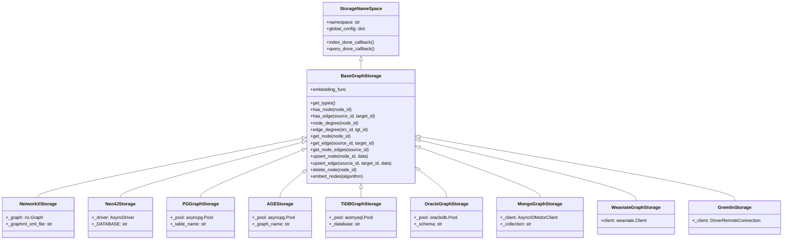
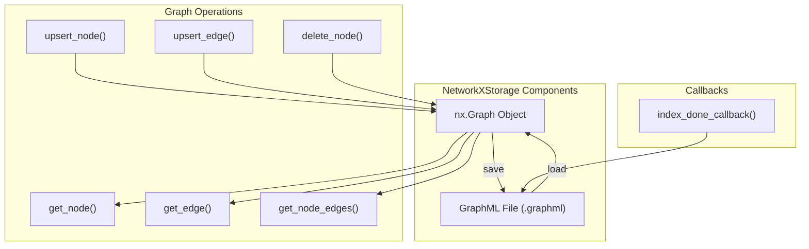
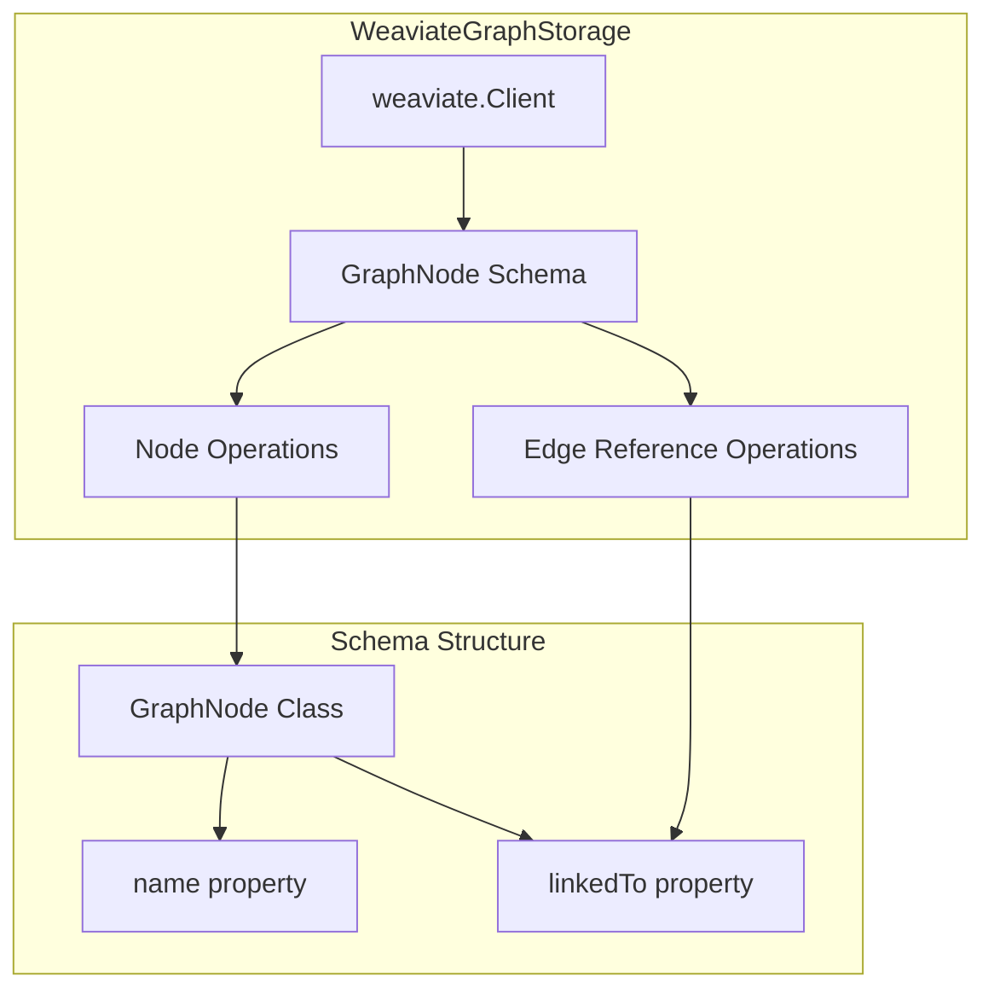
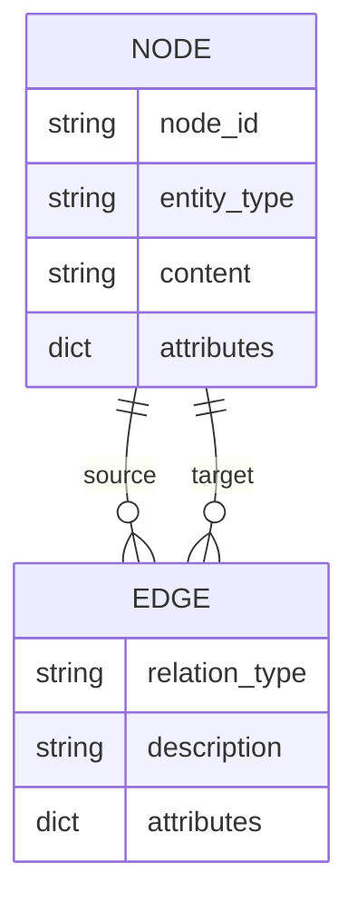
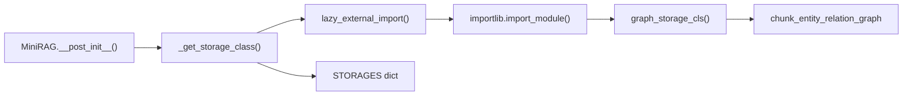
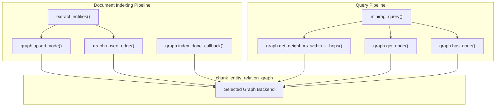

<!-- source: DeepWiki mcp.deepwiki.com · repo HKUDS/MiniRAG · page 5.1 Graph Storage Backends · fetched 2026-11-09 -->

# Graph Storage Backends

<details>
<summary>Relevant source files</summary>

The following files were used as context for generating this wiki page:

- [minirag/kg/networkx_impl.py](minirag/kg/networkx_impl.py)
- [minirag/kg/weaviate_impl.py](minirag/kg/weaviate_impl.py)
- [minirag/minirag.py](minirag/minirag.py)
- [tests/test_weaviate.py](tests/test_weaviate.py)

</details>


Graph Storage Backends in MiniRAG provide pluggable implementations for storing, retrieving, and manipulating knowledge graphs built from document entities and their relationships. MiniRAG supports multiple graph database backends through a unified interface, allowing users to choose the most appropriate storage solution for their deployment requirements.

The framework currently supports eight graph storage backends: NetworkX (in-memory), Neo4j (native graph database), PostgreSQL with AGE extension, TiDB, Oracle, MongoDB, Weaviate, and Gremlin-compatible databases.

Sources: [minirag/base.py:104-148](), [minirag/minirag.py:39-66]()

## Base Graph Storage Interface

The graph storage system in MiniRAG is built on a well-defined abstraction layer that allows for different backend implementations while maintaining a consistent API.



*Class Hierarchy Diagram for MiniRAG Graph Storage Backends*

Sources: [minirag/base.py:48-148](), [minirag/minirag.py:39-66](), [minirag/kg/networkx_impl.py:69-70](), [minirag/kg/weaviate_impl.py:166-167]()

The `BaseGraphStorage` abstract class defines the interface that all graph storage implementations must adhere to:

| Method | Purpose |
|--------|---------|
| `get_types()` | Returns all node types in the graph |
| `has_node(node_id)` | Checks if a node exists in the graph |
| `has_edge(source_id, target_id)` | Checks if an edge exists between two nodes |
| `node_degree(node_id)` | Gets the degree (number of connections) of a node |
| `edge_degree(src_id, tgt_id)` | Gets the combined degree of an edge's nodes |
| `get_node(node_id)` | Retrieves a node's data |
| `get_edge(source_id, target_id)` | Retrieves an edge's data |
| `get_node_edges(source_id)` | Gets all edges connected to a node |
| `upsert_node(node_id, data)` | Inserts or updates a node |
| `upsert_edge(source_id, target_id, data)` | Inserts or updates an edge |
| `delete_node(node_id)` | Removes a node from the graph |
| `embed_nodes(algorithm)` | Embeds nodes using a specified algorithm |

Sources: [minirag/base.py:104-148]()

## NetworkX Storage Implementation

The `NetworkXStorage` implementation provides an in-memory graph storage solution using the NetworkX library. This implementation is ideal for smaller knowledge graphs and development scenarios.



*NetworkX Storage Data Flow Diagram*

Sources: [minirag/kg/networkx_impl.py:69-276]()

Key features of the NetworkX implementation:

1. **Persistent Storage**: Graphs are stored as GraphML files, loaded on initialization, and saved after indexing.
   ```python
   # File path is defined in __post_init__
   self._graphml_xml_file = os.path.join(
       self.global_config["working_dir"], f"graph_{self.namespace}.graphml"
   )
   ```

2. **Graph Stabilization**: Provides methods to ensure graph consistency with `stable_largest_connected_component` and `_stabilize_graph` functions.

3. **Node and Edge Operations**: Implements all required operations for manipulating graph elements:
   ```python
   # Example implementation of node retrieval
   async def get_node(self, node_id: str) -> Union[dict, None]:
       return self._graph.nodes.get(node_id)
   ```

4. **Extended Functionality**: Offers additional functionality like multi-hop neighbors retrieval:
   ```python
   async def get_neighbors_within_k_hops(self, source_node_id: str, k):
       # Implementation to get all neighbors up to k hops away
   ```

Sources: [minirag/kg/networkx_impl.py:132-267]()

## Neo4j Storage Implementation

`Neo4JStorage` provides a native graph database backend using Neo4j. This implementation is suitable for production deployments requiring advanced graph query capabilities and ACID transactions.

**Configuration**: Requires `NEO4J_URI`, `NEO4J_USERNAME`, and `NEO4J_PASSWORD` environment variables.

**Key Features**:
- Native graph database with Cypher query language
- Asynchronous operations using `AsyncDriver` and `AsyncSession`
- Retry mechanisms with exponential backoff for transient errors
- Advanced graph traversal with `get_knowledge_graph()` method
- Node label-based indexing for efficient lookups

**Import Path**: `.kg.neo4j_impl`

Sources: [minirag/minirag.py:44](), [minirag/kg/neo4j_impl.py:30-531]()

## PostgreSQL Storage Implementations

MiniRAG provides two PostgreSQL-based graph storage implementations:

### PGGraphStorage

`PGGraphStorage` implements graph storage using native PostgreSQL tables with foreign key relationships to represent edges.

**Configuration**: Uses PostgreSQL connection pool (`asyncpg.Pool`)

**Key Features**:
- Relational representation of graph data
- Standard PostgreSQL tables for nodes and edges
- Efficient for simple graph queries
- Compatible with existing PostgreSQL infrastructure

**Import Path**: `.kg.postgres_impl`

Sources: [minirag/minirag.py:59]()

### AGEStorage

`AGEStorage` leverages Apache AGE (A Graph Extension) for PostgreSQL, providing native graph capabilities within PostgreSQL.

**Configuration**: Requires PostgreSQL with AGE extension installed

**Key Features**:
- Native graph data type support in PostgreSQL
- Cypher-like query language support
- Graph-optimized storage and indexing
- Combines relational and graph query capabilities

**Import Path**: `.kg.age_impl`

Sources: [minirag/minirag.py:58]()

## TiDB Storage Implementation

`TiDBGraphStorage` provides distributed graph storage using TiDB, a MySQL-compatible distributed database.

**Configuration**: Uses TiDB connection pool (`aiomysql.Pool`)

**Key Features**:
- Horizontally scalable graph storage
- MySQL-compatible interface
- Distributed transaction support
- High availability and fault tolerance
- Suitable for large-scale deployments

**Import Path**: `.kg.tidb_impl`

Sources: [minirag/minirag.py:53-55]()

## Oracle Storage Implementation

`OracleGraphStorage` implements graph storage using Oracle Database's native graph capabilities.

**Configuration**: Requires Oracle Database connection credentials

**Key Features**:
- Enterprise-grade database features
- Native graph data types and queries
- Advanced indexing and optimization
- ACID transaction support
- Integration with Oracle ecosystem

**Import Path**: `.kg.oracle_impl`

Sources: [minirag/minirag.py:45-47]()

## MongoDB Storage Implementation

`MongoGraphStorage` provides document-based graph storage using MongoDB.

**Configuration**: Uses MongoDB connection string and `AsyncIOMotorClient`

**Key Features**:
- Document-oriented graph representation
- Flexible schema for node and edge attributes
- Aggregation pipeline for graph traversal
- Horizontal scalability
- JSON-native data model

**Import Path**: `.kg.mongo_impl`

Sources: [minirag/minirag.py:49-50]()

## Weaviate Storage Implementation

`WeaviateGraphStorage` implements graph storage using Weaviate, a cloud-native vector database.

**Configuration**: Connects to Weaviate instance at `http://localhost:8080` by default

**Key Features**:
- Graph storage with integrated vector search
- Cloud-native architecture
- Schema-based data model with `GraphNode` class
- Reference-based edge representation using `linkedTo` property
- Batch operations for efficient data loading

**Implementation Details**:



*Weaviate Graph Storage Architecture*

The Weaviate implementation uses a schema-based approach where graph nodes are stored as `GraphNode` objects with a `linkedTo` cross-reference property for edges. Node operations use `data_object.create()` and `data_object.delete()`, while edge operations use `data_object.add_reference()`.

**Import Path**: `.kg.weaviate_impl`

Sources: [minirag/minirag.py:62-64](), [minirag/kg/weaviate_impl.py:166-261]()

## Gremlin Storage Implementation

`GremlinStorage` provides compatibility with Gremlin-compatible graph databases (e.g., Amazon Neptune, JanusGraph, Azure Cosmos DB).

**Configuration**: Uses Gremlin `DriverRemoteConnection`

**Key Features**:
- Standard Gremlin query language
- Compatible with multiple graph database backends
- Graph traversal-based operations
- Cloud provider integrations

**Import Path**: `.kg.gremlin_impl`

Sources: [minirag/minirag.py:60]()

## Data Model and Graph Representation

Both implementations represent knowledge graphs using a consistent data model:



*Graph Data Model Diagram*

Sources: [minirag/kg/networkx_impl.py:221-227](), [minirag/kg/neo4j_impl.py:306-379]()

Key aspects of the graph representation:

1. **Nodes**: Represent entities with unique identifiers and attributes:
   - In NetworkX: Nodes are identified by their ID and store properties directly
   - In Neo4j: Nodes use labels as identifiers and store properties internally

2. **Edges**: Represent relationships between entities:
   - In NetworkX: Edges are identified by source and target node IDs
   - In Neo4j: Edges use the `DIRECTED` relationship type with properties

3. **Properties**: Both nodes and edges can have arbitrary properties stored as key-value pairs.

This consistent representation ensures that the underlying storage implementation is transparent to the rest of the system, allowing seamless switching between implementations.

Sources: [minirag/base.py:136-142]()

## Backend Comparison and Selection

| Backend | Storage Type | Scalability | Query Language | Use Case | Setup Complexity |
|---------|-------------|-------------|----------------|----------|------------------|
| **NetworkX** | In-memory + file | Memory-limited | Python API | Development, small graphs | Low |
| **Neo4j** | Native graph DB | Highly scalable | Cypher | Production, complex queries | Medium |
| **PostgreSQL (PGGraphStorage)** | Relational tables | Medium | SQL | Existing PostgreSQL infrastructure | Low-Medium |
| **PostgreSQL (AGEStorage)** | Graph extension | Medium-High | Cypher-like | PostgreSQL with graph needs | Medium |
| **TiDB** | Distributed SQL | Highly scalable | SQL | Large-scale, distributed deployments | Medium-High |
| **Oracle** | Enterprise DB | Highly scalable | SQL + Graph queries | Enterprise environments | High |
| **MongoDB** | Document store | Highly scalable | Aggregation pipeline | Flexible schema, JSON data | Medium |
| **Weaviate** | Vector + Graph | High | GraphQL + Custom | Vector search + graph | Medium |
| **Gremlin** | Varies by backend | Varies | Gremlin | Cloud deployments, portability | Medium-High |

**Selection Criteria**:

1. **Development vs Production**: Use `NetworkXStorage` for development and testing. Use Neo4j, TiDB, or Oracle for production.

2. **Existing Infrastructure**: Choose backends that align with your existing database infrastructure:
   - PostgreSQL → `PGGraphStorage` or `AGEStorage`
   - Oracle ecosystem → `OracleGraphStorage`
   - MongoDB experience → `MongoGraphStorage`

3. **Scale Requirements**:
   - Small graphs (<100K nodes) → `NetworkXStorage`
   - Medium graphs (100K-10M nodes) → Neo4j, PostgreSQL (AGE)
   - Large graphs (>10M nodes) → TiDB, Oracle, distributed solutions

4. **Query Complexity**:
   - Simple lookups → Any backend
   - Complex graph traversal → Neo4j, AGE, Gremlin
   - Hybrid vector + graph queries → Weaviate

5. **Deployment Environment**:
   - Local/single machine → NetworkX, PostgreSQL
   - Cloud environments → Weaviate, Gremlin (Neptune/Cosmos DB), TiDB
   - On-premise clusters → TiDB, Oracle

Sources: [minirag/minirag.py:39-66](), [minirag/kg/networkx_impl.py:69-276](), [minirag/kg/weaviate_impl.py:166-261]()

## Configuration and Initialization

Graph storage backends are configured in the `MiniRAG` class through the `graph_storage` parameter. The storage class is dynamically loaded using the `lazy_external_import` mechanism.

**Configuration Example**:

```python
# In MiniRAG initialization
@dataclass
class MiniRAG:
    graph_storage: str = field(default="NetworkXStorage")
    # ... other fields
```

**Storage Class Resolution**:

The storage class name is resolved through the `STORAGES` dictionary which maps class names to their import paths:

```python
STORAGES = {
    "NetworkXStorage": ".kg.networkx_impl",
    "Neo4JStorage": ".kg.neo4j_impl",
    "PGGraphStorage": ".kg.postgres_impl",
    "AGEStorage": ".kg.age_impl",
    "TiDBGraphStorage": ".kg.tidb_impl",
    "OracleGraphStorage": ".kg.oracle_impl",
    "MongoGraphStorage": ".kg.mongo_impl",
    "WeaviateGraphStorage": ".kg.weaviate_impl",
    "GremlinStorage": ".kg.gremlin_impl",
}
```

**Initialization Process**:



*Graph Storage Initialization Flow*

The initialized graph storage instance is assigned to `chunk_entity_relation_graph` and used throughout the document processing and query pipelines.

Sources: [minirag/minirag.py:213-227](), [minirag/minirag.py:264-268](), [minirag/minirag.py:315-318]()

## Integration with MiniRAG

Graph storage backends integrate with MiniRAG's core pipelines through the `chunk_entity_relation_graph` instance.



*Graph Storage Integration in MiniRAG Pipelines*

**Indexing Phase**: During document insertion, the `extract_entities` function creates nodes and edges in the graph storage using `upsert_node()` and `upsert_edge()`. After indexing completes, `index_done_callback()` is called to persist data (e.g., writing GraphML files for NetworkX, committing transactions for databases).

**Query Phase**: During query processing, graph storage is used for topology-enhanced retrieval through methods like `get_neighbors_within_k_hops()`, `get_node()`, and `has_node()` to traverse the knowledge graph and find related entities.

Sources: [minirag/minirag.py:264-268](), [minirag/minirag.py:379-387](), [minirag/minirag.py:516-531](), [minirag/minirag.py:549-560]()

## Extending Graph Storage

The `BaseGraphStorage` abstract interface enables adding new graph storage backends. 

**Required Methods**:

All graph storage implementations must implement the following methods defined in `BaseGraphStorage`:

| Method | Return Type | Purpose |
|--------|-------------|---------|
| `get_types()` | `tuple[List[str], List[str]]` | Returns node types and edge types |
| `has_node(node_id)` | `bool` | Checks node existence |
| `has_edge(source_id, target_id)` | `bool` | Checks edge existence |
| `node_degree(node_id)` | `int` | Returns node connection count |
| `edge_degree(src_id, tgt_id)` | `int` | Returns combined degree of edge endpoints |
| `get_node(node_id)` | `Union[dict, None]` | Retrieves node data |
| `get_edge(source_id, target_id)` | `Union[dict, None]` | Retrieves edge data |
| `get_node_edges(source_id)` | `Union[List[tuple], None]` | Gets all edges for a node |
| `upsert_node(node_id, node_data)` | `None` | Inserts or updates a node |
| `upsert_edge(source_id, target_id, edge_data)` | `None` | Inserts or updates an edge |
| `delete_node(node_id)` | `None` | Deletes a node |
| `embed_nodes(algorithm)` | `tuple[np.ndarray, list[str]]` | Generates node embeddings |

**Adding a New Backend**:

1. **Create Implementation Class**: Inherit from `BaseGraphStorage` and implement all required methods
2. **Add to STORAGES Dictionary**: Add the class name and import path to the `STORAGES` dictionary in `minirag.py`
3. **Implement Connection Management**: Handle database connections in `__post_init__()` method
4. **Implement Callbacks**: Provide `index_done_callback()` for persistence operations

**Example Structure**:

```python
from minirag.base import BaseGraphStorage

@dataclass
class MyGraphStorage(BaseGraphStorage):
    def __post_init__(self):
        # Initialize database connection
        self._client = MyDatabaseClient(...)
    
    async def has_node(self, node_id: str) -> bool:
        # Implementation
        pass
    
    # ... implement other required methods
```

For detailed guidance on extending storage backends, see page 10.1.

Sources: [minirag/base.py:104-148](), [minirag/minirag.py:315-318]()

## Summary

Graph Storage in MiniRAG provides a flexible and consistent interface for storing and manipulating knowledge graphs. The system offers two concrete implementations:

1. **NetworkXStorage**: An in-memory implementation using the NetworkX library, suitable for development and smaller applications.
2. **Neo4JStorage**: A robust implementation using the Neo4j graph database, suitable for production and larger-scale deployments.

Both implementations adhere to the common interface defined by `BaseGraphStorage`, allowing for transparent switching between backends while maintaining consistent behavior throughout the system. This architecture supports MiniRAG's core capabilities of heterogeneous graph indexing and topology-enhanced retrieval.

Sources: [minirag/base.py:104-148](), [minirag/kg/networkx_impl.py:69-276](), [minirag/kg/neo4j_impl.py:30-531]()

---

