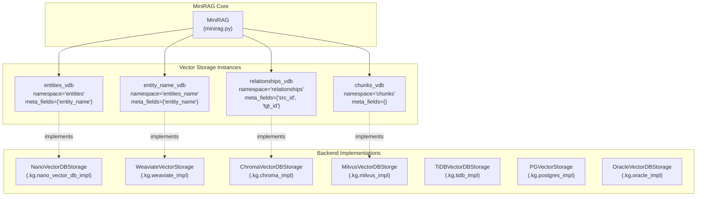
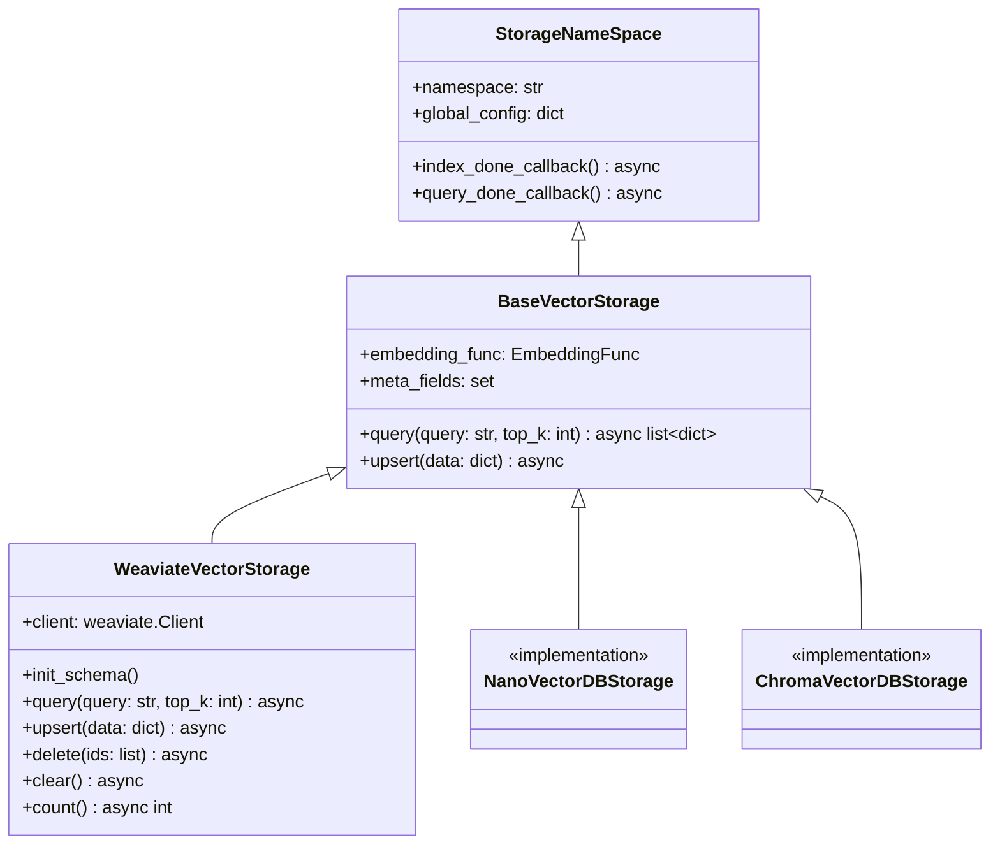
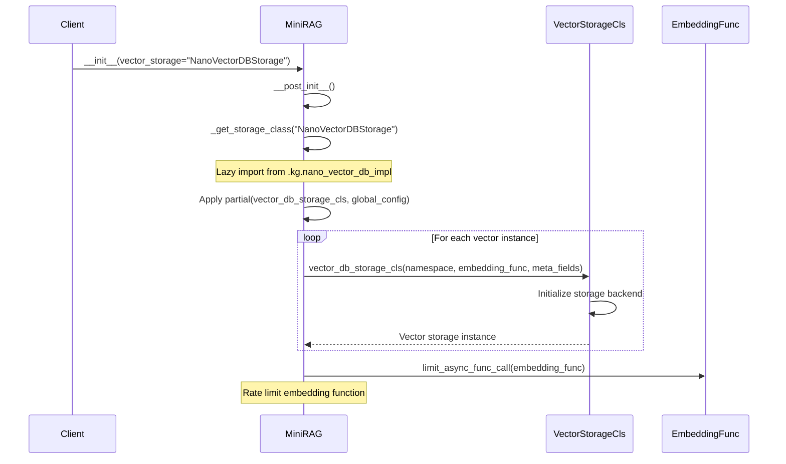
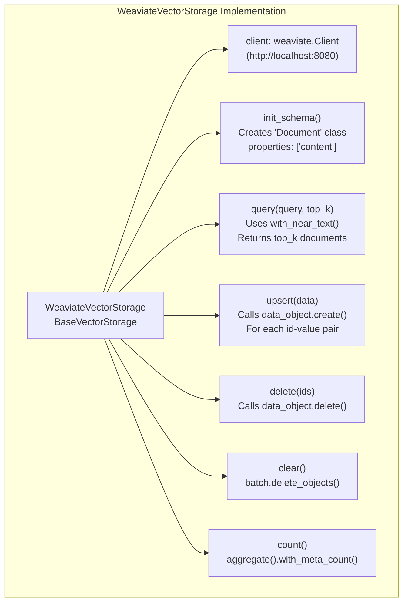
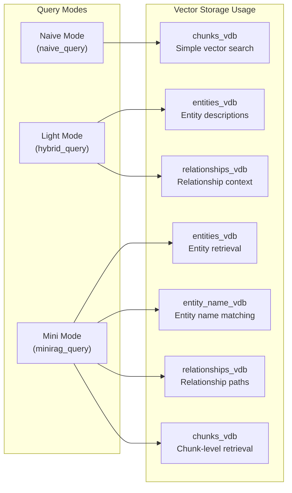
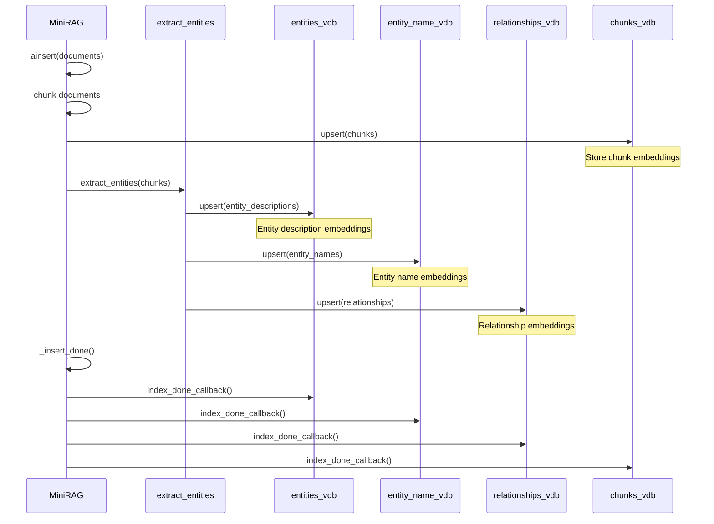
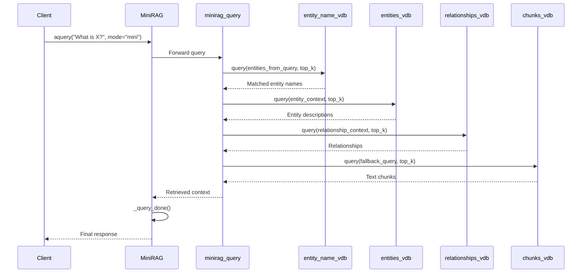
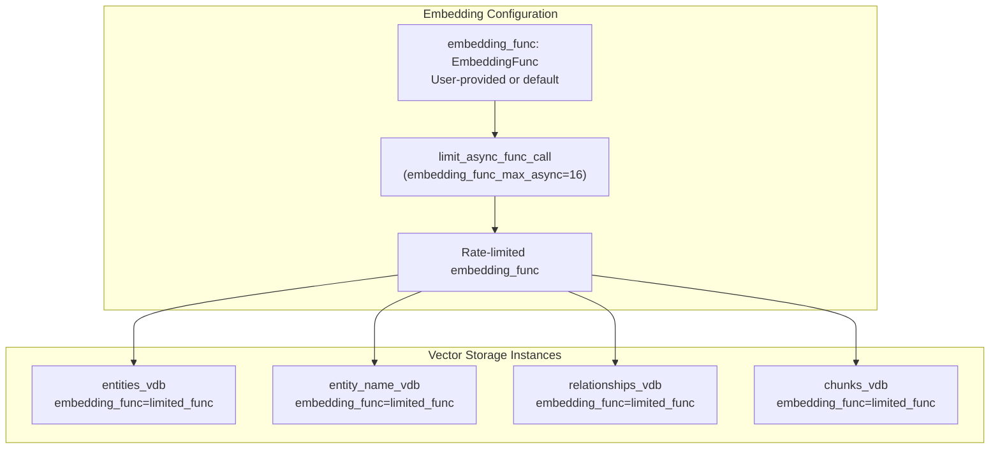

<!-- source: DeepWiki mcp.deepwiki.com · repo HKUDS/MiniRAG · page 5.2 Vector Storage Backends · fetched 2026-11-09 -->

# Vector Storage Backends

<details>
<summary>Relevant source files</summary>

The following files were used as context for generating this wiki page:

- [minirag/__init__.py](minirag/__init__.py)
- [minirag/base.py](minirag/base.py)
- [minirag/kg/weaviate_impl.py](minirag/kg/weaviate_impl.py)
- [minirag/minirag.py](minirag/minirag.py)
- [tests/test_weaviate.py](tests/test_weaviate.py)

</details>


This page documents the vector storage layer in MiniRAG, which enables efficient similarity search for entities, entity names, relationships, and text chunks. Vector storage backends implement semantic search capabilities that are essential for retrieval operations.

For graph-based storage of entity relationships, see [Graph Storage Backends](#5.1). For text chunk key-value storage, see [Key-Value Storage Backends](#5.3).

## Purpose and Scope

Vector storage backends provide embedding-based similarity search for four distinct data types in MiniRAG's heterogeneous graph index. Each vector database instance stores embeddings and supports top-k nearest neighbor queries to retrieve contextually relevant information during query processing.

## Vector Storage Architecture

MiniRAG maintains four separate vector database instances, each serving a specific role in the retrieval pipeline:



**Sources:** [minirag/minirag.py:273-298](), [minirag/minirag.py:39-66]()

### The Four Vector Storage Instances

| Instance | Namespace | Meta Fields | Purpose | Usage |
|----------|-----------|-------------|---------|-------|
| `entities_vdb` | `"entities"` | `{"entity_name"}` | Stores entity descriptions with embeddings | Entity-based retrieval in light/mini modes |
| `entity_name_vdb` | `"entities_name"` | `{"entity_name"}` | Stores entity names with embeddings | Efficient entity name matching in queries |
| `relationships_vdb` | `"relationships"` | `{"src_id", "tgt_id"}` | Stores relationship descriptions between entities | Relationship-based context retrieval |
| `chunks_vdb` | `"chunks"` | `{}` | Stores text chunk embeddings | Naive mode vector search and fallback retrieval |

**Sources:** [minirag/minirag.py:273-298]()

## BaseVectorStorage Interface

All vector storage backends implement the `BaseVectorStorage` abstract class, which defines the contract for similarity search and data insertion operations.



**Sources:** [minirag/base.py:62-75](), [minirag/base.py:48-59]()

### Core Methods

#### `query(query: str, top_k: int) -> list[dict]`

Performs similarity search to retrieve the top-k most relevant items based on the query string.

- **Parameters:**
  - `query`: The search query text
  - `top_k`: Number of results to return
- **Returns:** List of dictionaries containing matched items with their metadata
- **Implementation:** Query text is embedded using `embedding_func`, then nearest neighbor search is performed

**Sources:** [minirag/base.py:67-68]()

#### `upsert(data: dict[str, dict])`

Inserts or updates vector data in the storage backend.

- **Parameters:**
  - `data`: Dictionary mapping IDs to data dictionaries. Each value must contain a `"content"` field for embedding generation, or an `"embedding"` field if embeddings are pre-computed
- **Behavior:** Uses the `embedding_func` to generate embeddings from `"content"` field, then stores the embedding with the provided ID and metadata

**Sources:** [minirag/base.py:70-74]()

## Vector Storage Initialization

Vector storage instances are initialized during `MiniRAG.__post_init__()` with shared configuration and embedding functions:



**Sources:** [minirag/minirag.py:190-314](), [minirag/minirag.py:210-227]()

### Configuration Parameters

Vector storage is configured through the `MiniRAG` dataclass fields:

| Field | Type | Default | Description |
|-------|------|---------|-------------|
| `vector_storage` | `str` | `"NanoVectorDBStorage"` | Class name of vector storage backend |
| `embedding_func` | `EmbeddingFunc` | `None` | Function to generate embeddings from text |
| `embedding_batch_num` | `int` | `32` | Batch size for embedding generation |
| `embedding_func_max_async` | `int` | `16` | Maximum concurrent embedding calls |
| `vector_db_storage_cls_kwargs` | `dict` | `{}` | Additional kwargs for storage initialization |

**Sources:** [minirag/minirag.py:130-173]()

## Concrete Backend Implementations

### NanoVectorDBStorage

Default lightweight vector database implementation, suitable for development and small-scale deployments.

- **Module:** `.kg.nano_vector_db_impl`
- **Features:** In-memory vector storage with simple similarity search
- **Use Case:** Development, testing, small datasets (<100K vectors)

**Sources:** [minirag/minirag.py:42](), [minirag/minirag.py:131]()

### WeaviateVectorStorage

Cloud-native vector database with advanced features and scalability.



**Features:**
- Schema management with class creation
- Near-text semantic search using Weaviate's vectorizer
- Batch operations for bulk delete
- Metadata counting and aggregation

**Configuration:**
```python
rag = MiniRAG(
    vector_storage="WeaviateVectorStorage",
    # Weaviate connects to http://localhost:8080 by default
)
```

**Sources:** [minirag/kg/weaviate_impl.py:16-86](), [minirag/minirag.py:62]()

### ChromaVectorDBStorage

Open-source embedding database optimized for AI applications.

- **Module:** `.kg.chroma_impl`
- **Features:** Persistent storage, multiple distance metrics, filtering
- **Use Case:** Medium-scale deployments, local development

**Sources:** [minirag/minirag.py:52]()

### MilvusVectorDBStorage

High-performance distributed vector database.

- **Module:** `.kg.milvus_impl`
- **Features:** Horizontal scaling, GPU acceleration, hybrid search
- **Use Case:** Large-scale production deployments (>1M vectors)

**Sources:** [minirag/minirag.py:48]()

### PostgreSQL with PGVector

Vector search extension for PostgreSQL.

- **Module:** `.kg.postgres_impl`
- **Implementation:** `PGVectorStorage`
- **Features:** SQL integration, ACID transactions, existing PostgreSQL infrastructure
- **Use Case:** Organizations already using PostgreSQL

**Sources:** [minirag/minirag.py:57]()

### TiDB Vector Storage

Distributed vector storage in TiDB database.

- **Module:** `.kg.tidb_impl`
- **Implementation:** `TiDBVectorDBStorage`
- **Features:** Distributed architecture, horizontal scaling
- **Use Case:** TiDB users needing vector search

**Sources:** [minirag/minirag.py:54]()

### Oracle Vector Storage

Enterprise-grade vector storage in Oracle Database.

- **Module:** `.kg.oracle_impl`
- **Implementation:** `OracleVectorDBStorage`
- **Features:** Enterprise security, high availability, Oracle ecosystem integration
- **Use Case:** Enterprise deployments with Oracle infrastructure

**Sources:** [minirag/minirag.py:47]()

## Vector Storage in Query Modes

Different query modes utilize vector storage instances differently:



**Sources:** [minirag/minirag.py:537-572]()

### Naive Mode

Uses only `chunks_vdb` for simple vector similarity search across all text chunks.

```python
response = await naive_query(
    query,
    self.chunks_vdb,  # Only vector storage used
    self.text_chunks,
    param,
    asdict(self),
)
```

**Sources:** [minirag/minirag.py:561-568]()

### Light Mode

Uses `entities_vdb` and `relationships_vdb` for entity-centric retrieval.

```python
response = await hybrid_query(
    query,
    self.chunk_entity_relation_graph,
    self.entities_vdb,      # Entity description search
    self.relationships_vdb, # Relationship search
    self.text_chunks,
    param,
    asdict(self),
)
```

**Sources:** [minirag/minirag.py:538-547]()

### Mini Mode

Utilizes all four vector storage instances for comprehensive topology-enhanced retrieval.

```python
response = await minirag_query(
    query,
    self.chunk_entity_relation_graph,
    self.entities_vdb,      # Entity descriptions
    self.entity_name_vdb,   # Entity name matching
    self.relationships_vdb, # Relationship context
    self.chunks_vdb,        # Text chunks
    self.text_chunks,
    self.embedding_func,
    param,
    asdict(self),
)
```

**Sources:** [minirag/minirag.py:548-560]()

## Vector Storage Lifecycle

### Insertion Phase

During document insertion, embeddings are generated and stored in vector databases:



**Sources:** [minirag/minirag.py:344-389](), [minirag/minirag.py:516-531]()

### Query Phase

Vector storage is queried to retrieve relevant context:



**Sources:** [minirag/minirag.py:537-580]()

### Index Completion

After insertion or query operations, the `index_done_callback()` method is called to commit changes:

```python
async def _insert_done(self):
    tasks = []
    for storage_inst in [
        self.entities_vdb,
        self.entity_name_vdb,
        self.relationships_vdb,
        self.chunks_vdb,
        # ... other storage instances
    ]:
        if storage_inst is None:
            continue
        tasks.append(cast(StorageNameSpace, storage_inst).index_done_callback())
    await asyncio.gather(*tasks)
```

**Sources:** [minirag/minirag.py:516-531](), [minirag/minirag.py:574-580]()

## Embedding Function Integration

Vector storage instances share a common `embedding_func` that is rate-limited and configured during initialization:



The embedding function is wrapped with `limit_async_func_call()` to prevent overwhelming the embedding service:

```python
self.embedding_func = limit_async_func_call(self.embedding_func_max_async)(
    self.embedding_func
)
```

**Sources:** [minirag/minirag.py:247-249](), [minirag/minirag.py:159-161]()

## Custom Vector Storage Backend

To add a new vector storage backend, implement the `BaseVectorStorage` interface:

```python
from minirag.base import BaseVectorStorage
from dataclasses import dataclass

@dataclass
class CustomVectorStorage(BaseVectorStorage):
    # Add custom fields here
    
    async def query(self, query: str, top_k: int) -> list[dict]:
        # 1. Generate embedding from query using self.embedding_func
        # 2. Perform nearest neighbor search
        # 3. Return top_k results with metadata
        pass
    
    async def upsert(self, data: dict[str, dict]):
        # 1. For each item in data:
        #    - Generate embedding from data[id]["content"] using self.embedding_func
        #    - Store embedding with id and meta_fields
        pass
```

Then register it in the `STORAGES` dictionary in [minirag/minirag.py:39-66]():

```python
STORAGES = {
    # ... existing entries
    "CustomVectorStorage": ".kg.custom_impl",
}
```

**Sources:** [minirag/base.py:62-75](), [minirag/minirag.py:39-66](), [minirag/minirag.py:315-318]()

## Best Practices

### Choosing a Backend

| Scenario | Recommended Backend | Rationale |
|----------|-------------------|-----------|
| Development/Testing | `NanoVectorDBStorage` | Lightweight, no setup required |
| Small datasets (<100K) | `NanoVectorDBStorage` or `ChromaVectorDBStorage` | Simple, efficient for small scale |
| Medium datasets (100K-1M) | `ChromaVectorDBStorage` or `Weaviate` | Good balance of features and performance |
| Large datasets (>1M) | `MilvusVectorDBStorge` or `TiDBVectorDBStorage` | Horizontal scaling, production-ready |
| Enterprise with PostgreSQL | `PGVectorStorage` | Leverage existing infrastructure |
| Enterprise with Oracle | `OracleVectorDBStorage` | Enterprise features, high availability |

### Meta Fields Configuration

Vector storage instances use `meta_fields` to store additional metadata alongside embeddings:

- `entities_vdb`: `meta_fields={"entity_name"}` - Stores entity name for filtering
- `entity_name_vdb`: `meta_fields={"entity_name"}` - Enables entity name lookup
- `relationships_vdb`: `meta_fields={"src_id", "tgt_id"}` - Tracks relationship endpoints
- `chunks_vdb`: `meta_fields={}` - No additional metadata needed

**Sources:** [minirag/minirag.py:273-298]()

### Performance Tuning

Adjust embedding batch size and concurrency limits based on your infrastructure:

```python
rag = MiniRAG(
    embedding_batch_num=64,        # Increase for better throughput
    embedding_func_max_async=32,   # Increase if embedding service can handle it
    vector_db_storage_cls_kwargs={
        # Backend-specific tuning parameters
    }
)
```

**Sources:** [minirag/minirag.py:160-173]()

---

