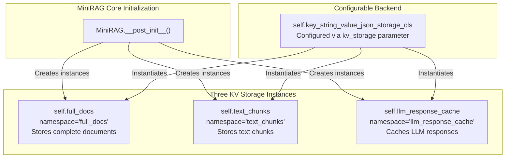
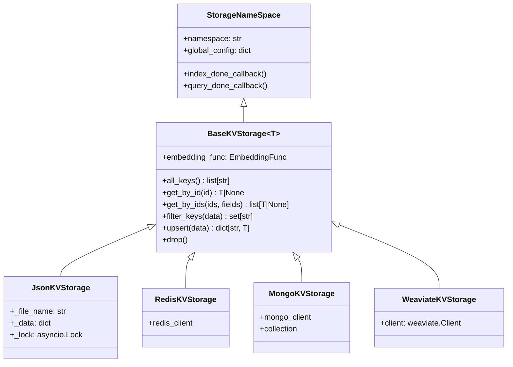
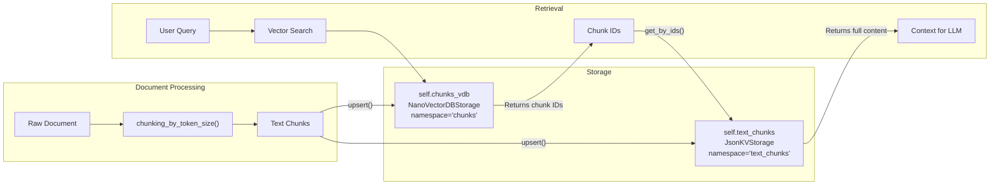
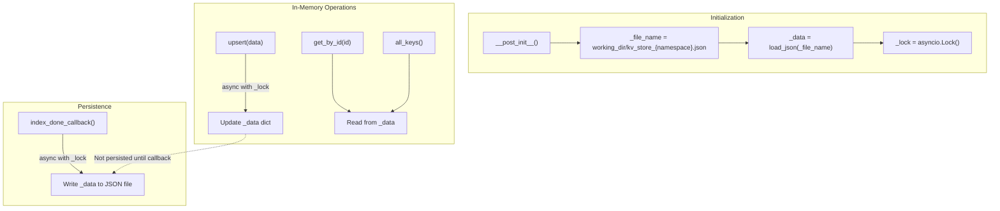
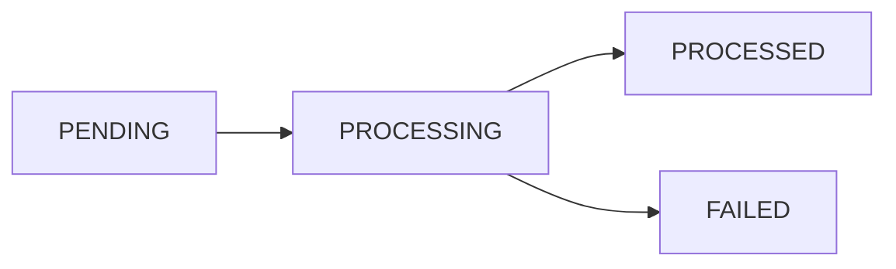

<!-- source: DeepWiki mcp.deepwiki.com · repo HKUDS/MiniRAG · page 5.3 Key-Value Storage Backends · fetched 2026-11-09 -->

# Key-Value Storage Backends

<details>
<summary>Relevant source files</summary>

The following files were used as context for generating this wiki page:

- [minirag/__init__.py](minirag/__init__.py)
- [minirag/base.py](minirag/base.py)
- [minirag/kg/weaviate_impl.py](minirag/kg/weaviate_impl.py)
- [minirag/minirag.py](minirag/minirag.py)
- [tests/test_weaviate.py](tests/test_weaviate.py)

</details>


This document describes the Key-Value (KV) Storage backends in MiniRAG, which provide mechanisms for storing and retrieving data by unique identifiers. MiniRAG uses KV storage for three primary purposes: storing full document content (`full_docs`), storing text chunks (`text_chunks`), and caching LLM responses (`llm_response_cache`). Multiple backend implementations are available, including JSON files, Redis, MongoDB, and others.

For information about Vector Storage which handles embeddings, see page 5.2. For Graph Storage which manages the heterogeneous graph relationships, see page 5.1.

## 1. Role in the System Architecture

Key-Value Storage is one of the core storage components in MiniRAG. The system uses three separate KV storage instances for different purposes:

- **`full_docs`**: Stores complete document content indexed by document ID
- **`text_chunks`**: Stores chunked text segments with metadata (chunk order, token count, parent document reference)
- **`llm_response_cache`**: Caches LLM API responses to reduce redundant calls (when `enable_llm_cache=True`)

KV Storage Instances in MiniRAG Core



Sources: [minirag/minirag.py:254-263](), [minirag/minirag.py:237-245]()

## 2. Available KV Storage Backends

MiniRAG supports multiple KV storage backends, configured via the `kv_storage` parameter:

| Backend | Class Name | Use Case | Storage Location |
|---------|-----------|----------|------------------|
| **JSON Files** | `JsonKVStorage` | Default, local development | Local filesystem |
| **Redis** | `RedisKVStorage` | High-performance caching | Redis server |
| **MongoDB** | `MongoKVStorage` | Document-oriented storage | MongoDB database |
| **Oracle** | `OracleKVStorage` | Enterprise deployments | Oracle Database |
| **PostgreSQL** | `PGKVStorage` | Relational database storage | PostgreSQL |
| **TiDB** | `TiDBKVStorage` | Distributed MySQL-compatible | TiDB cluster |
| **Weaviate** | `WeaviateKVStorage` | Vector database with KV | Weaviate instance |

Sources: [minirag/minirag.py:39-66](), [minirag/minirag.py:130]()

## 3. BaseKVStorage Interface

The `BaseKVStorage` class defined in [minirag/base.py:77-101]() is a generic abstract class that provides the core interface all KV storage backends must implement.

Class Hierarchy



Sources: [minirag/base.py:48-60](), [minirag/base.py:77-101]()

### 3.1 Required Methods

All KV storage backend implementations must provide these methods:

| Method | Signature | Purpose |
|--------|-----------|---------|
| `all_keys()` | `async all_keys() -> list[str]` | Returns all keys in the storage |
| `get_by_id(id)` | `async get_by_id(id: str) -> Union[T, None]` | Retrieves a single value by its ID |
| `get_by_ids(ids, fields)` | `async get_by_ids(ids: list[str], fields: Union[set[str], None]) -> list[Union[T, None]]` | Retrieves multiple values with optional field filtering |
| `filter_keys(data)` | `async filter_keys(data: list[str]) -> set[str]` | Returns keys from input list that don't exist in storage (for deduplication) |
| `upsert(data)` | `async upsert(data: dict[str, T])` | Updates or inserts key-value pairs |
| `drop()` | `async drop()` | Clears the storage |

Sources: [minirag/base.py:77-101]()

### 3.2 Generic Type Parameter

`BaseKVStorage` is generic over type `T`, allowing type-safe storage of different data structures:

- For `full_docs` and `text_chunks`: Stores dictionaries with content and metadata
- For `llm_response_cache`: Stores LLM response strings or objects

Sources: [minirag/base.py:14](), [minirag/base.py:78]()

## 4. Text Chunk Storage

Text chunks are a central concept in MiniRAG's retrieval system. After documents are split into chunks, they are stored in the `text_chunks` KV storage instance.

Text Chunk Data Flow



Sources: [minirag/minirag.py:259-263](), [minirag/minirag.py:484-500]()

### 4.1 TextChunkSchema

Each text chunk stored in KV storage follows the `TextChunkSchema` structure:

| Field | Type | Description |
|-------|------|-------------|
| `content` | `str` | The actual text content of the chunk |
| `tokens` | `int` | Number of tokens in the chunk |
| `full_doc_id` | `str` | Reference to the parent document ID |
| `chunk_order_index` | `int` | Position of this chunk in the original document |

Sources: [minirag/base.py:9-12]()

### 4.2 Chunk ID Generation

Chunk IDs are generated using MD5 hashing of the content with a `"chunk-"` prefix:

```python
compute_mdhash_id(chunk_content, prefix="chunk-")
```

This ensures deterministic IDs and automatic deduplication of identical chunks.

Sources: [minirag/minirag.py:485]()

## 5. JsonKVStorage Implementation

`JsonKVStorage` is the default KV storage backend, storing data in JSON files on the local filesystem.

JsonKVStorage Architecture



Sources: [minirag/kg/json_kv_impl.py:66-135]()

### 5.1 Key Characteristics

- **File-based persistence**: Each namespace gets its own JSON file
- **In-memory operations**: All operations work on an in-memory dictionary
- **Async lock protection**: Uses `asyncio.Lock` for concurrent access safety
- **Explicit persistence**: Data is written to disk only on `index_done_callback()`
- **Lazy loading**: Loads existing data from file during initialization

### 5.2 File Naming Convention

Files are named using the pattern:
```
{working_dir}/kv_store_{namespace}.json
```

For example:
- `kv_store_full_docs.json`
- `kv_store_text_chunks.json`
- `kv_store_llm_response_cache.json`

Sources: [minirag/kg/json_kv_impl.py:66-135]()

## 6. Document Status Storage

The `DocStatusStorage` class extends `BaseKVStorage` to provide specialized functionality for tracking document processing status.

### 6.1 Document Status Tracking

`DocStatusStorage` defines the following additional methods to manage document status:

| Method | Description | Definition |
|--------|-------------|------------|
| `get_status_counts()` | Get counts of documents in each status | [base.py:187-189]() |
| `get_failed_docs()` | Retrieve all failed documents | [base.py:191-193]() |
| `get_pending_docs()` | Retrieve all pending documents | [base.py:195-197]() |

Sources: [minirag/base.py:151-197]()

### 6.2 Document Status Enum

Documents can be in one of the following states:



Sources: [minirag/base.py:151-158]()

## 7. Extending with Custom KV Storage

MiniRAG's modular architecture allows for custom Key-Value Storage implementations. To create a custom implementation:

1. Extend the `BaseKVStorage` class
2. Implement all required methods 
3. Configure MiniRAG to use your implementation

By implementing this interface, you can create KV storage solutions that use different backends, such as Redis, MongoDB, or other databases.

Sources: [minirag/base.py:77-100](), [minirag/kg/json_kv_impl.py:66-135]()

---

