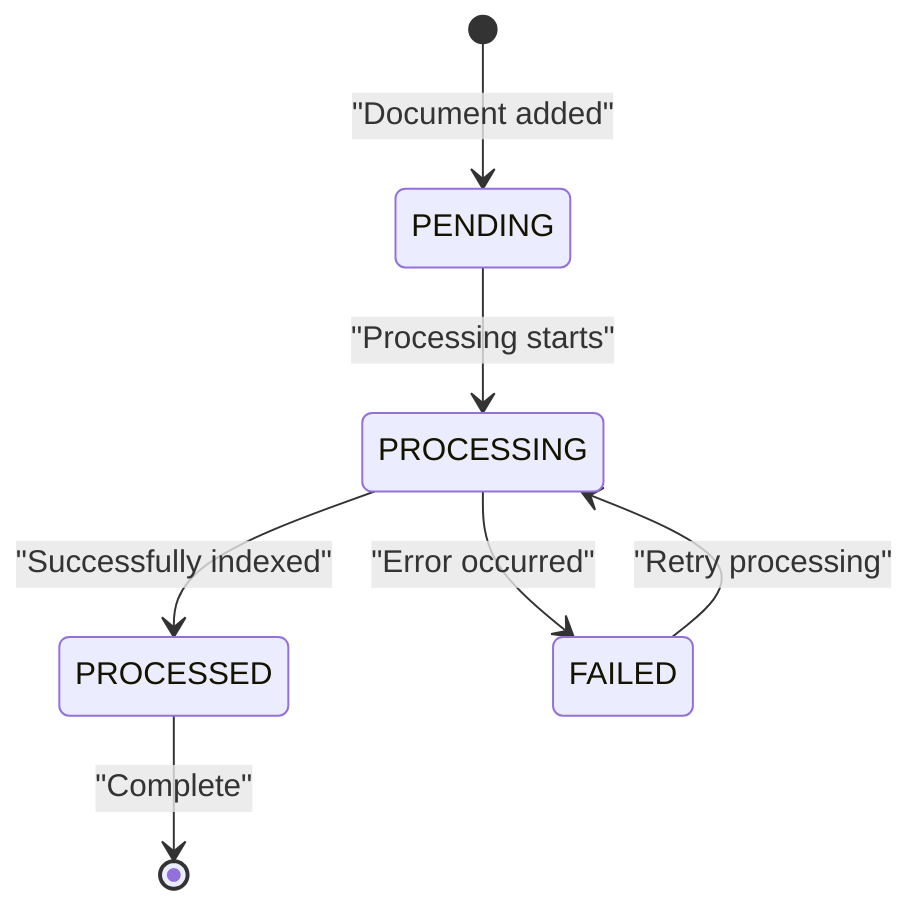
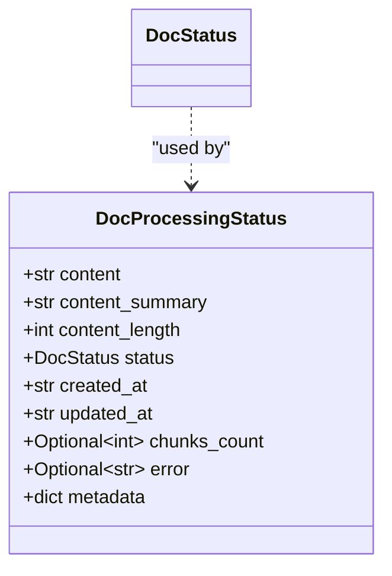
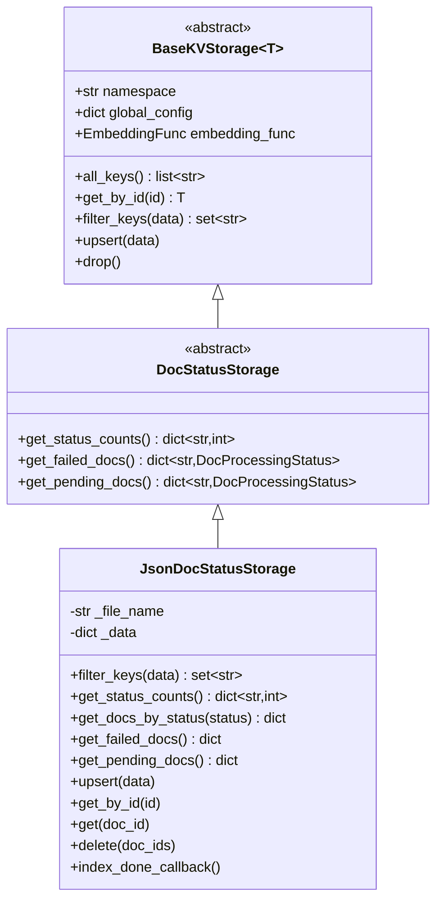
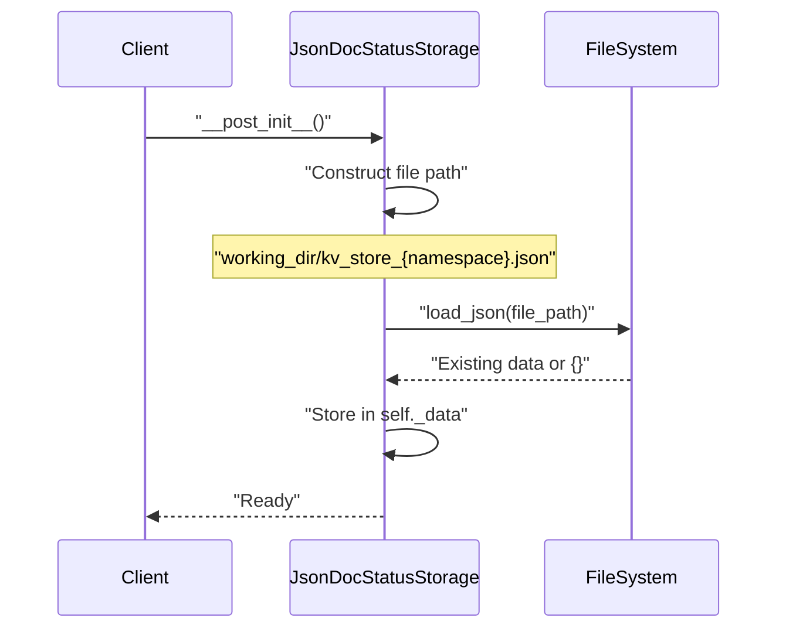
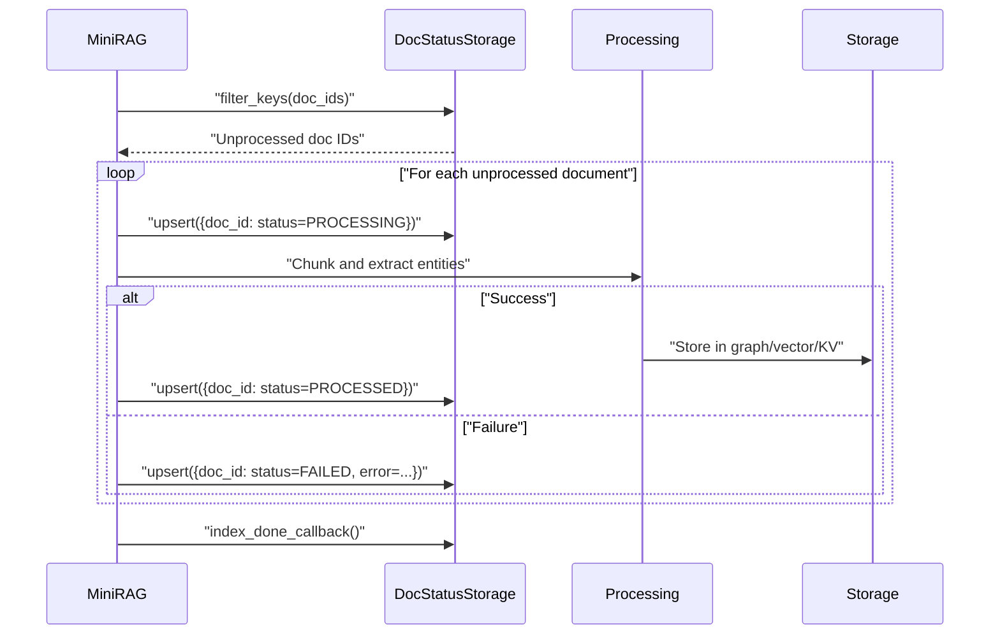

<!-- source: DeepWiki mcp.deepwiki.com · repo HKUDS/MiniRAG · page 5.4 Document Status Tracking · fetched 2026-11-09 -->

# Document Status Tracking

<details>
<summary>Relevant source files</summary>

The following files were used as context for generating this wiki page:

- [minirag/__init__.py](minirag/__init__.py)
- [minirag/base.py](minirag/base.py)
- [minirag/kg/jsondocstatus_impl.py](minirag/kg/jsondocstatus_impl.py)

</details>


## Purpose and Scope

Document Status Tracking is a system within MiniRAG that manages the lifecycle of documents as they are ingested, processed, and indexed into the knowledge graph. This system tracks which documents have been successfully processed, which are pending, which are currently being processed, and which have failed, enabling incremental updates, error recovery, and processing resumption.

This page documents the `DocStatus` enum, `DocProcessingStatus` dataclass, and the `DocStatusStorage` interface and implementations. For information about how documents are actually processed and indexed, see [Data Processing Pipeline](#3.3). For other storage backends, see [Key-Value Storage Backends](#5.3).

**Sources:** [minirag/base.py:151-197](), [minirag/kg/jsondocstatus_impl.py:1-148]()

---

## Document Lifecycle Overview

MiniRAG tracks documents through four distinct states during their processing lifecycle. Understanding these states is essential for managing document ingestion and handling processing failures.

### Document Status State Machine



### Status Definitions

| Status | Value | Description | Next States |
|--------|-------|-------------|-------------|
| `PENDING` | `"pending"` | Document is queued for processing but not yet started | `PROCESSING` |
| `PROCESSING` | `"processing"` | Document is currently being chunked and entities are being extracted | `PROCESSED`, `FAILED` |
| `PROCESSED` | `"processed"` | Document has been successfully indexed into all storage backends | Terminal state |
| `FAILED` | `"failed"` | Document processing encountered an error | `PROCESSING` (on retry) |

**Sources:** [minirag/base.py:151-157]()

---

## Core Data Structures

### DocStatus Enum

The `DocStatus` enum defines the four possible states a document can be in during processing.

```python
class DocStatus(str, Enum):
    PENDING = "pending"
    PROCESSING = "processing"
    PROCESSED = "processed"
    FAILED = "failed"
```

This enum extends both `str` and `Enum`, allowing status values to be used as strings while maintaining type safety.

**Sources:** [minirag/base.py:151-157]()

### DocProcessingStatus Dataclass

The `DocProcessingStatus` dataclass captures comprehensive metadata about a document's processing state.



#### Field Descriptions

| Field | Type | Required | Description |
|-------|------|----------|-------------|
| `content` | `str` | Yes | Full original content of the document |
| `content_summary` | `str` | Yes | First 100 characters for preview purposes |
| `content_length` | `int` | Yes | Total character count of the document |
| `status` | `DocStatus` | Yes | Current processing status |
| `created_at` | `str` | Yes | ISO 8601 timestamp when document was first added |
| `updated_at` | `str` | Yes | ISO 8601 timestamp of last status change |
| `chunks_count` | `Optional[int]` | No | Number of chunks created during splitting |
| `error` | `Optional[str]` | No | Error message if `status` is `FAILED` |
| `metadata` | `dict[str, Any]` | No | Additional custom metadata |

**Sources:** [minirag/base.py:160-181]()

---

## Storage Interface

### DocStatusStorage Base Class

The `DocStatusStorage` abstract class extends `BaseKVStorage` and defines the interface for storing and querying document status information.



### Core Methods

#### Status Querying Methods

| Method | Return Type | Description |
|--------|-------------|-------------|
| `get_status_counts()` | `dict[str, int]` | Returns count of documents in each status state |
| `get_failed_docs()` | `dict[str, DocProcessingStatus]` | Retrieves all documents with `FAILED` status |
| `get_pending_docs()` | `dict[str, DocProcessingStatus]` | Retrieves all documents with `PENDING` status |

These methods are defined in the base class but must be implemented by concrete storage backends.

**Sources:** [minirag/base.py:184-197]()

---

## JSON Implementation: JsonDocStatusStorage

The `JsonDocStatusStorage` class provides a file-based implementation of document status tracking using JSON serialization.

### Initialization and File Structure



The storage file is located at `{working_dir}/kv_store_{namespace}.json` where:
- `working_dir` is from `global_config["working_dir"]`
- `namespace` is the storage namespace identifier

**Sources:** [minirag/kg/jsondocstatus_impl.py:72-76]()

### Key Methods

#### filter_keys(data: list[str]) -> set[str]

Returns the set of document IDs that need processing. A document needs processing if:
1. It doesn't exist in storage, OR
2. Its status is not `PROCESSED`

```python
async def filter_keys(self, data: list[str]) -> set[str]:
    return set([
        k for k in data
        if k not in self._data or self._data[k]["status"] != DocStatus.PROCESSED
    ])
```

This method is critical for incremental indexing, allowing MiniRAG to skip already-processed documents.

**Sources:** [minirag/kg/jsondocstatus_impl.py:78-86]()

#### get_status_counts() -> Dict[str, int]

Aggregates counts of documents in each status state.

**Sources:** [minirag/kg/jsondocstatus_impl.py:88-93]()

#### get_docs_by_status(status: DocStatus) -> dict[str, DocProcessingStatus]

Retrieves all documents matching a specific status. Handles a special case where `content` field might be missing but `content_summary` is present:

```python
if "content" not in data and "content_summary" in data:
    data["content"] = data["content_summary"]
```

This fallback ensures backward compatibility if the storage schema evolves.

**Sources:** [minirag/kg/jsondocstatus_impl.py:95-112]()

#### upsert(data: dict[str, dict])

Updates or inserts document status records. After updating the in-memory `_data` dictionary, it immediately persists to disk by calling `index_done_callback()`.

**Sources:** [minirag/kg/jsondocstatus_impl.py:126-134]()

#### index_done_callback()

Persists the in-memory `_data` dictionary to the JSON file. This method is called after indexing operations complete to ensure durability.

**Sources:** [minirag/kg/jsondocstatus_impl.py:122-124]()

#### delete(doc_ids: list[str])

Removes document status records by their IDs and persists changes to disk.

**Sources:** [minirag/kg/jsondocstatus_impl.py:143-147]()

### Data Structure Example

The JSON file stores a dictionary mapping document IDs to status objects:

```json
{
  "doc_123": {
    "content": "Full document text...",
    "content_summary": "Full document text...",
    "content_length": 1500,
    "status": "processed",
    "created_at": "2024-01-15T10:30:00Z",
    "updated_at": "2024-01-15T10:35:00Z",
    "chunks_count": 3,
    "metadata": {}
  },
  "doc_456": {
    "content": "Another document...",
    "content_summary": "Another document...",
    "content_length": 800,
    "status": "failed",
    "created_at": "2024-01-15T11:00:00Z",
    "updated_at": "2024-01-15T11:02:00Z",
    "error": "Entity extraction timeout",
    "metadata": {}
  }
}
```

**Sources:** [minirag/kg/jsondocstatus_impl.py:68-148]()

---

## Integration with MiniRAG Core

### Document Status Tracking in the Indexing Pipeline



### Usage Pattern: Incremental Updates

When documents are added to MiniRAG, the system:

1. **Checks existing status** via `filter_keys()` to determine which documents need processing
2. **Marks as processing** by setting status to `PROCESSING`
3. **Processes the document** through chunking and entity extraction
4. **Updates final status** to either `PROCESSED` or `FAILED`
5. **Persists state** via `index_done_callback()`

This design enables:
- **Crash recovery**: Resume processing after interruption
- **Incremental indexing**: Skip already-processed documents
- **Error tracking**: Identify and retry failed documents
- **Progress monitoring**: Query status counts to track processing progress

**Sources:** [minirag/kg/jsondocstatus_impl.py:78-86](), [minirag/base.py:184-197]()

---

## Extensibility

### Implementing Custom Status Storage

To implement a custom document status storage backend (e.g., using Redis, MongoDB, or a SQL database), create a class that extends `DocStatusStorage`:

```python
from minirag.base import DocStatusStorage, DocStatus, DocProcessingStatus
from dataclasses import dataclass

@dataclass
class CustomDocStatusStorage(DocStatusStorage):
    def __post_init__(self):
        # Initialize connection to your storage backend
        pass
    
    async def filter_keys(self, data: list[str]) -> set[str]:
        # Query backend for unprocessed documents
        pass
    
    async def get_status_counts(self) -> dict[str, int]:
        # Aggregate counts from backend
        pass
    
    async def get_docs_by_status(self, status: DocStatus) -> dict:
        # Query documents by status
        pass
    
    async def upsert(self, data: dict[str, dict]):
        # Update/insert records in backend
        pass
```

The key requirement is implementing `filter_keys()` correctly to enable incremental processing.

**Sources:** [minirag/base.py:184-197]()

---

## Summary

The Document Status Tracking system provides robust lifecycle management for documents in MiniRAG through:

| Component | Purpose |
|-----------|---------|
| `DocStatus` enum | Defines four processing states (pending, processing, processed, failed) |
| `DocProcessingStatus` dataclass | Captures comprehensive document metadata including content, timestamps, and errors |
| `DocStatusStorage` interface | Abstract base class defining status querying and management operations |
| `JsonDocStatusStorage` implementation | File-based JSON storage for document status, suitable for local deployments |

This system enables incremental indexing, crash recovery, error tracking, and processing resumption, making MiniRAG robust for production deployments where document ingestion may be interrupted or fail.

**Sources:** [minirag/base.py:151-197](), [minirag/kg/jsondocstatus_impl.py:1-148]()

---

