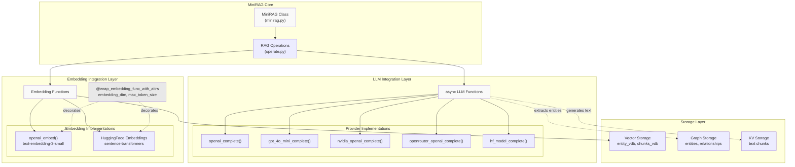
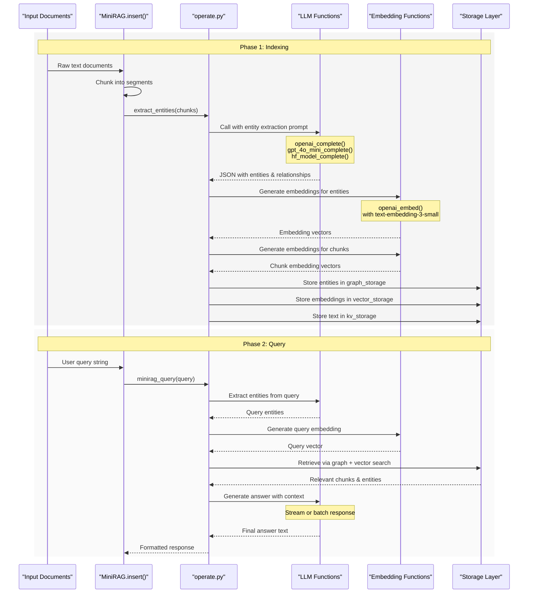
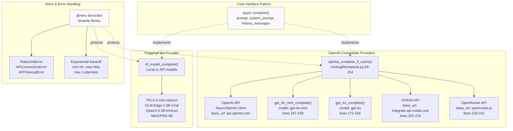
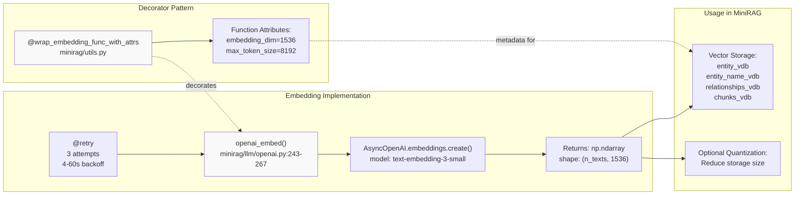
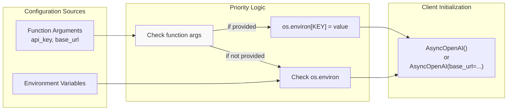
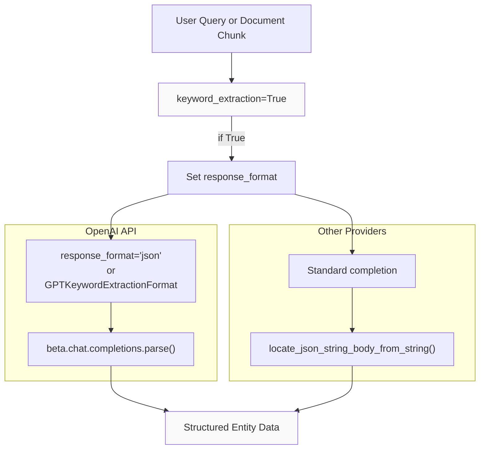

<!-- source: DeepWiki mcp.deepwiki.com · repo HKUDS/MiniRAG · page 6 LLM and Embedding Integration · fetched 2026-11-09 -->

# LLM and Embedding Integration

<details>
<summary>Relevant source files</summary>

The following files were used as context for generating this wiki page:

- [README.md](README.md)
- [minirag/llm/openai.py](minirag/llm/openai.py)

</details>


This document describes how MiniRAG integrates with Large Language Models (LLMs) and embedding models to power both the indexing and query phases of the RAG pipeline. It covers the abstraction interfaces, provider implementations, and integration points within the system architecture.

For detailed information about specific aspects of LLM integration:
- LLM interface implementations and provider-specific functions: see [LLM Interface](#6.1)
- Embedding function wrappers and generation: see [Embedding Functions](#6.2)  
- Supported model list and performance characteristics: see [Supported Models](#6.3)

## Purpose and Scope

MiniRAG's LLM and embedding integration layer provides:

1. **Unified async interfaces** for multiple LLM providers (OpenAI, HuggingFace, NVIDIA, OpenRouter)
2. **Embedding function abstraction** with dimension and token size metadata
3. **Retry and error handling** logic for robust API interactions
4. **Streaming and batch support** for different usage patterns

This layer decouples the core RAG logic from specific LLM implementations, enabling flexible model selection based on deployment constraints (cloud APIs, on-device models, or hybrid approaches).

---

## System Integration Architecture

The following diagram shows how LLM and embedding components integrate with the broader MiniRAG system:

**Diagram 1: LLM and Embedding Integration in MiniRAG Architecture**



Sources: [minirag/llm/openai.py:1-267](), [README.md:36-42]()

---

## Two-Phase LLM Usage Pattern

MiniRAG uses LLMs and embeddings in distinct ways during the indexing and query phases:

**Diagram 2: LLM Calls in Indexing and Query Phases**



Sources: [minirag/llm/openai.py:93-169](), [README.md:36-42]()

---

## LLM Interface Design Pattern

All LLM integrations follow a consistent async interface pattern that provides:

| Feature | Implementation | Purpose |
|---------|---------------|---------|
| **Async Execution** | `async def` functions | Non-blocking I/O for API calls |
| **Retry Logic** | `@retry` decorator with exponential backoff | Handle rate limits and transient failures |
| **Streaming Support** | `AsyncIterator[str]` return type | Enable real-time response generation |
| **Message History** | `history_messages` parameter | Support conversational context |
| **System Prompts** | `system_prompt` parameter | Configure model behavior |
| **Provider Abstraction** | Unified function signature | Swap providers without code changes |

**Function Signature Pattern:**

```python
async def {provider}_complete(
    prompt: str,
    system_prompt: str = None,
    history_messages: List[Dict] = [],
    keyword_extraction: bool = False,
    **kwargs
) -> Union[str, AsyncIterator[str]]
```

Sources: [minirag/llm/openai.py:156-169](), [minirag/llm/openai.py:93-154]()

---

## LLM Provider Implementations

**Diagram 3: LLM Provider Architecture**



Sources: [minirag/llm/openai.py:81-241](), [README.md:74-89]()

---

## Embedding Function Architecture

The embedding integration uses a decorator pattern to attach metadata to embedding functions:

**Diagram 4: Embedding Function Wrapper Pattern**



Sources: [minirag/llm/openai.py:243-267](), [minirag/llm/openai.py:69-74]()

---

## Configuration and API Keys

LLM and embedding functions access credentials through environment variables:

| Environment Variable | Purpose | Used By |
|---------------------|---------|---------|
| `OPENAI_API_KEY` | OpenAI authentication | `openai_complete()`, `openai_embed()` |
| `OPENAI_API_BASE` | Custom OpenAI endpoint | `openai_complete_if_cache()` |
| `OPENROUTER_API_KEY` | OpenRouter authentication | `openrouter_openai_complete()` |

**Configuration Flow:**



Sources: [minirag/llm/openai.py:102-108](), [minirag/llm/openai.py:226-227](), [minirag/llm/openai.py:257-258]()

---

## Streaming Response Support

LLM functions can return either complete strings or async iterators for streaming:

**Return Type Handling:**

```python
# From minirag/llm/openai.py:131-153
if hasattr(response, "__aiter__"):
    # Streaming response
    async def inner():
        async for chunk in response:
            content = chunk.choices[0].delta.content
            if content is None:
                continue
            if r"\u" in content:
                content = safe_unicode_decode(content.encode("utf-8"))
            yield content
    return inner()  # Returns AsyncIterator[str]
else:
    # Complete response
    content = response.choices[0].message.content
    if r"\u" in content:
        content = safe_unicode_decode(content.encode("utf-8"))
    return content  # Returns str
```

This dual-mode support enables:
- **Batch processing** during indexing for efficiency
- **Real-time streaming** during query for user experience
- **Flexible integration** with different downstream consumers

Sources: [minirag/llm/openai.py:131-153]()

---

## Error Handling and Resilience

The LLM integration layer implements comprehensive error handling:

**Error Handling Strategy:**

| Error Type | Handling | Configuration |
|------------|----------|---------------|
| `RateLimitError` | Exponential backoff retry | Wait 4-60s, max 3 attempts |
| `APIConnectionError` | Automatic retry | Same backoff strategy |
| `APITimeoutError` | Automatic retry | Same backoff strategy |
| Empty response | Logged warning + empty string | No retry (data issue) |
| Unicode errors | `safe_unicode_decode()` | Automatic correction |

The retry decorator is applied at two levels:

1. **Function level**: [minirag/llm/openai.py:81-87]() for `openai_complete_if_cache()`
2. **Embedding level**: [minirag/llm/openai.py:244-250]() for `openai_embed()`

Sources: [minirag/llm/openai.py:81-87](), [minirag/llm/openai.py:144-150](), [minirag/llm/openai.py:244-250]()

---

## Keyword Extraction Mode

LLM functions support a special `keyword_extraction` mode for structured entity extraction:

**Extraction Flow:**



The `GPTKeywordExtractionFormat` schema:

```python
class GPTKeywordExtractionFormat(BaseModel):
    high_level_keywords: List[str]
    low_level_keywords: List[str]
```

Sources: [minirag/llm/openai.py:89-92](), [minirag/llm/openai.py:157-161](), [minirag/llm/openai.py:214-216]()

---

## Integration with MiniRAG Core

The LLM and embedding functions are accessed through the `QueryParam` configuration:

**Configuration Structure:**

| Parameter | Purpose | Example Values |
|-----------|---------|----------------|
| `llm_model_func` | LLM function reference | `openai_complete`, `gpt_4o_mini_complete` |
| `llm_model_name` | Model identifier | `"gpt-4o-mini"`, `"Phi-3.5-mini-instruct"` |
| `embedding_func` | Embedding function | `openai_embed` with decorator attributes |
| `embedding_dim` | Inferred from function | `1536` (from decorator) |
| `max_token_size` | Inferred from function | `8192` (from decorator) |

The core MiniRAG class passes these through the `hashing_kv` global config:

```python
# Pattern used in minirag/llm/openai.py:162-163
model_name = kwargs["hashing_kv"].global_config["llm_model_name"]
return await openai_complete_if_cache(model_name, prompt, ...)
```

Sources: [minirag/llm/openai.py:162-169](), [minirag/llm/openai.py:243]()

---

## Performance Characteristics

Different LLM and embedding combinations affect MiniRAG performance:

**Model Performance on LiHua-World Dataset:**

| Model | Type | Parameters | Accuracy | Error Rate | Use Case |
|-------|------|-----------|----------|------------|----------|
| Phi-3.5-mini-instruct | SLM | ~3.8B | 53.29% | 23.35% | On-device |
| GLM-Edge-1.5B-Chat | SLM | 1.5B | 52.51% | 25.71% | Resource-constrained |
| Qwen2.5-3B-Instruct | SLM | 3B | 48.75% | 26.02% | Edge deployment |
| MiniCPM3-4B | SLM | 4B | 51.25% | 21.79% | Balanced |
| gpt-4o-mini | LLM | Unknown | 54.08% | 19.44% | Cloud API |

**Embedding Model:**
- Default: `text-embedding-3-small` with 1536 dimensions
- Storage optimization: 25% reduction vs. traditional RAG through quantization

Sources: [README.md:74-89](), [minirag/llm/openai.py:243]()

---

## Summary

The LLM and embedding integration layer in MiniRAG provides:

1. **Unified async interface** across multiple providers (OpenAI, HuggingFace, NVIDIA, OpenRouter)
2. **Robust error handling** with automatic retry and exponential backoff
3. **Flexible response modes** supporting both streaming and batch operations
4. **Metadata-enriched embeddings** via decorator pattern for storage optimization
5. **Structured extraction support** for entity and keyword identification
6. **Provider-agnostic design** enabling easy model swapping and A/B testing

This architecture enables MiniRAG to support both Small Language Models for on-device deployment and Large Language Models for cloud-based scenarios, with consistent interfaces throughout the codebase.

For implementation details:
- LLM function implementations: [LLM Interface](#6.1)
- Embedding generation and quantization: [Embedding Functions](#6.2)
- Complete model list and benchmarks: [Supported Models](#6.3)

Sources: [minirag/llm/openai.py:1-267](), [README.md:1-174]()

---

