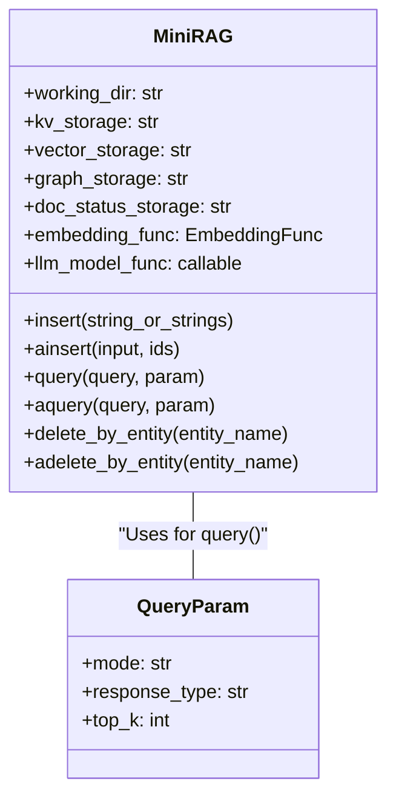
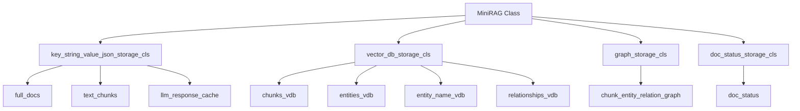
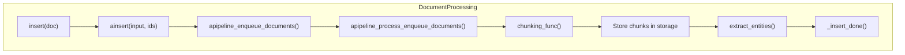
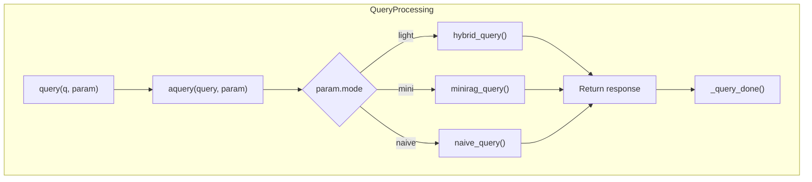

<!-- source: DeepWiki mcp.deepwiki.com · repo HKUDS/MiniRAG · page 6.1 LLM Interface · fetched 2026-11-09 -->

# Python API

<details>
<summary>Relevant source files</summary>

The following files were used as context for generating this wiki page:

- [main.py](main.py)
- [minirag/llm/openai.py](minirag/llm/openai.py)
- [minirag/prompt.py](minirag/prompt.py)

</details>


This page documents the Python API for MiniRAG, which provides programmatic access to MiniRAG's core functionality. The API allows users to index documents, query the indexed knowledge base, and manage entities within the system. For information about the REST API, see [REST API](#6.2).

## Core API Overview

MiniRAG's Python API is centered around the `MiniRAG` class, which serves as the primary entry point for interacting with the system. This class encapsulates all the functionality needed to initialize the system, configure storage backends, index documents, and perform queries.

### MiniRAG Class Overview



Sources: [minirag/minirag.py:118-600]()

## Installation and Initialization

To use the MiniRAG Python API, you first need to import the MiniRAG class and create an instance:

```python
from minirag import MiniRAG, QueryParam
from minirag.utils import EmbeddingFunc

# Create a MiniRAG instance
rag = MiniRAG(
    working_dir="./my_minirag_cache",
    embedding_func=your_embedding_function,
    llm_model_func=your_llm_function
)
```

The `MiniRAG` class constructor accepts numerous parameters to configure various aspects of the system:

| Parameter | Type | Description | Default |
|-----------|------|-------------|---------|
| `working_dir` | str | Directory for storing cache files | `"./minirag_cache_{timestamp}"` |
| `kv_storage` | str | Key-value storage backend | `"JsonKVStorage"` |
| `vector_storage` | str | Vector storage backend | `"NanoVectorDBStorage"` |
| `graph_storage` | str | Graph storage backend | `"NetworkXStorage"` |
| `doc_status_storage` | str | Document status storage backend | `"JsonDocStatusStorage"` |
| `embedding_func` | EmbeddingFunc | Function for creating embeddings | None |
| `llm_model_func` | callable | Function for LLM inference | None |
| `chunk_token_size` | int | Token size for text chunks | 1200 |
| `chunk_overlap_token_size` | int | Overlap size between chunks | 100 |

Sources: [minirag/minirag.py:118-183]()

### Storage Components

During initialization, MiniRAG creates various storage components based on the configured backends:



Sources: [minirag/minirag.py:185-309]()

## Core Methods

The MiniRAG class provides several core methods for document indexing, querying, and entity management:

### Document Indexing

```python
# Synchronous indexing
rag.insert("My document text")
rag.insert(["Document 1", "Document 2", "Document 3"])

# Asynchronous indexing
await rag.ainsert("My document text")
await rag.ainsert(["Document 1", "Document 2", "Document 3"])

# With custom IDs
rag.insert("My document text", ids="doc-1")
rag.insert(["Document 1", "Document 2"], ids=["doc-1", "doc-2"])
```

Sources: [minirag/minirag.py:336-385]()

The document indexing pipeline consists of several steps:



Sources: [minirag/minirag.py:386-511]()

### Querying

```python
# Synchronous querying with different modes
result = rag.query("What is MiniRAG?", param=QueryParam(mode="light"))
result = rag.query("What is MiniRAG?", param=QueryParam(mode="mini"))
result = rag.query("What is MiniRAG?", param=QueryParam(mode="naive"))

# Asynchronous querying
result = await rag.aquery("What is MiniRAG?", param=QueryParam(mode="mini"))

# With custom parameters
result = rag.query("What is MiniRAG?", param=QueryParam(
    mode="mini",
    top_k=5,
    response_type="brief"
))
```

Sources: [minirag/minirag.py:529-568]()

The query processing workflow:



Sources: [minirag/minirag.py:529-576]()

### Entity Management

```python
# Delete an entity and its relationships
rag.delete_by_entity("Entity Name")

# Asynchronous deletion
await rag.adelete_by_entity("Entity Name")
```

Sources: [minirag/minirag.py:578-607]()

## Query Parameters

The `QueryParam` class provides configuration options for queries:

```python
from minirag import QueryParam

param = QueryParam(
    mode="mini",       # Query mode: "light", "mini", or "naive"
    top_k=5,           # Number of results to retrieve
    response_type="brief"  # Response format
)
```

## Complete Usage Example

Here's a complete example of using the MiniRAG Python API:

```python
from minirag import MiniRAG, QueryParam
from minirag.llm.hf import hf_model_complete, hf_embed
from minirag.utils import EmbeddingFunc
from transformers import AutoModel, AutoTokenizer

# Initialize embedding function
EMBEDDING_MODEL = "sentence-transformers/all-MiniLM-L6-v2"
embedding_func = EmbeddingFunc(
    embedding_dim=384,
    max_token_size=1000,
    func=lambda texts: hf_embed(
        texts,
        tokenizer=AutoTokenizer.from_pretrained(EMBEDDING_MODEL),
        embed_model=AutoModel.from_pretrained(EMBEDDING_MODEL),
    ),
)

# Initialize MiniRAG
rag = MiniRAG(
    working_dir="./minirag_cache",
    llm_model_func=hf_model_complete,
    llm_model_name="meta-llama/Llama-3.2-1B-Instruct",
    embedding_func=embedding_func,
)

# Index documents
with open("document.txt") as f:
    rag.insert(f.read())

# Query the indexed documents
query = "What is MiniRAG?"
answer = rag.query(query, param=QueryParam(mode="mini"))
print(answer)
```

Sources: [main.py:1-97]()

## Storage Backends

MiniRAG supports multiple storage backends for different components:

| Component | Available Backends |
|-----------|-------------------|
| Vector Storage | NanoVectorDBStorage, OracleVectorDBStorage, MilvusVectorDBStorge, ChromaVectorDBStorage, TiDBVectorDBStorage, PGVectorStorage |
| Key-Value Storage | JsonKVStorage, OracleKVStorage, MongoKVStorage, RedisKVStorage, TiDBKVStorage, PGKVStorage |
| Graph Storage | NetworkXStorage, Neo4JStorage, OracleGraphStorage, MongoGraphStorage, TiDBGraphStorage, PGGraphStorage, AGEStorage, GremlinStorage |
| Document Status Storage | JsonDocStatusStorage, PGDocStatusStorage |

Sources: [minirag/minirag.py:39-62]()

## Asynchronous API

MiniRAG provides both synchronous and asynchronous versions of its core methods:

| Synchronous | Asynchronous | Description |
|-------------|--------------|-------------|
| `insert()` | `ainsert()` | Insert documents into the system |
| `query()` | `aquery()` | Query the indexed knowledge base |
| `delete_by_entity()` | `adelete_by_entity()` | Delete an entity and its relationships |

The synchronous methods are implemented as wrappers around the asynchronous ones, running them in the current event loop until completion:

```python
def insert(self, string_or_strings):
    loop = always_get_an_event_loop()
    return loop.run_until_complete(self.ainsert(string_or_strings))
```

Sources: [minirag/minirag.py:336-339](), [minirag/minirag.py:529-532](), [minirag/minirag.py:578-580]()

## Event Loop Management

MiniRAG includes a utility function `always_get_an_event_loop()` to ensure there is always an event loop available for asynchronous operations. This function tries to get the current event loop, and if not available or closed, creates a new one:

```python
def always_get_an_event_loop() -> asyncio.AbstractEventLoop:
    try:
        current_loop = asyncio.get_event_loop()
        if current_loop.is_closed():
            raise RuntimeError("Event loop is closed.")
        return current_loop
    except RuntimeError:
        logger.info("Creating a new event loop in main thread.")
        new_loop = asyncio.new_event_loop()
        asyncio.set_event_loop(new_loop)
        return new_loop
```

Sources: [minirag/minirag.py:93-115]()

## Advanced Usage: Custom Storage Backends

MiniRAG allows lazy loading of storage classes through the `_get_storage_class` method:

```python
def _get_storage_class(self, storage_name: str) -> dict:
    import_path = STORAGES[storage_name]
    storage_class = lazy_external_import(import_path, storage_name)
    return storage_class
```

Sources: [minirag/minirag.py:311-314]()

This enables you to use any of the supported storage backends or implement your own by extending the base storage classes.

---

