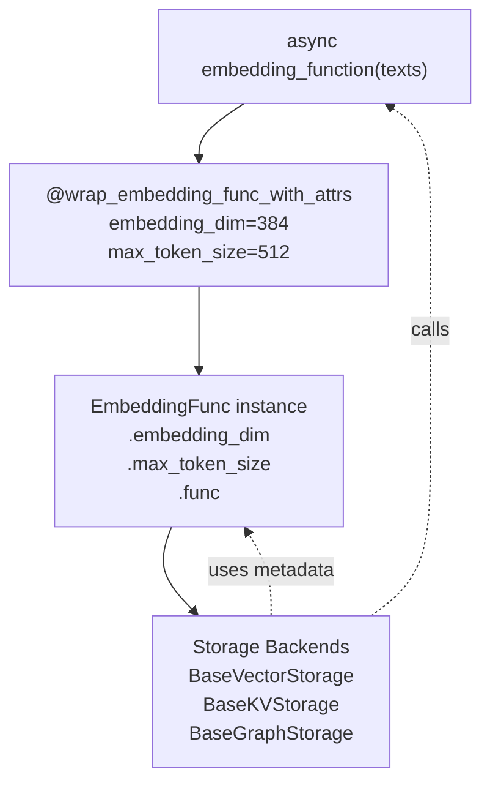
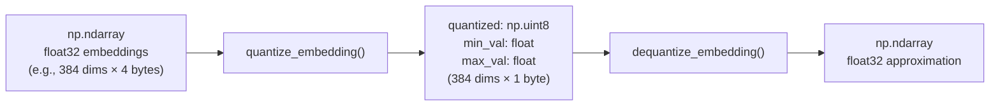
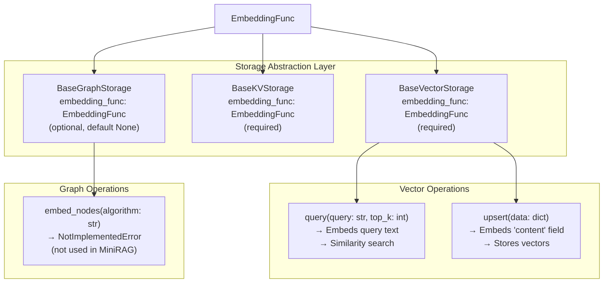
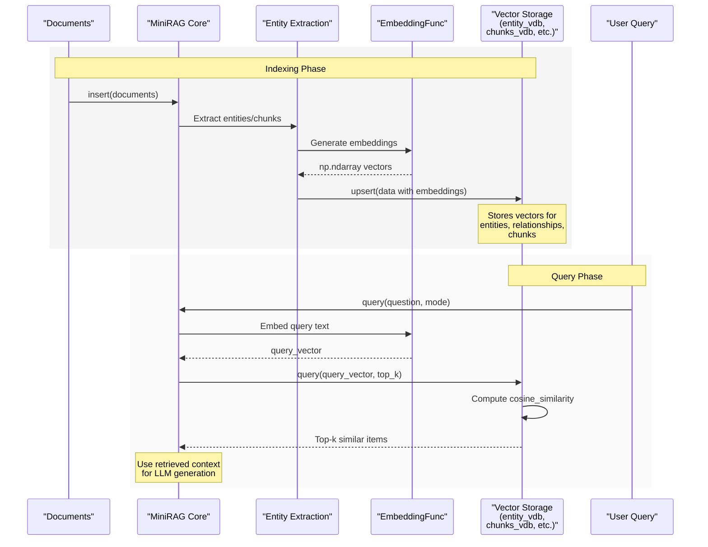

<!-- source: DeepWiki mcp.deepwiki.com · repo HKUDS/MiniRAG · page 6.2 Embedding Functions · fetched 2026-11-09 -->

# Embedding Functions

<details>
<summary>Relevant source files</summary>

The following files were used as context for generating this wiki page:

- [minirag/__init__.py](minirag/__init__.py)
- [minirag/base.py](minirag/base.py)
- [minirag/utils.py](minirag/utils.py)

</details>


## Purpose and Scope

Embedding functions in MiniRAG convert text into dense vector representations that enable semantic similarity search across entities, relationships, and document chunks. This page documents the `EmbeddingFunc` dataclass, quantization mechanisms, and integration patterns with storage backends.

For information about LLM models and API interfaces, see [LLM Interface](#6.1). For supported embedding model implementations, see [Supported Models](#6.3). For vector storage backends that consume embeddings, see [Vector Storage Backends](#5.2).

---

## EmbeddingFunc Dataclass

The `EmbeddingFunc` dataclass wraps embedding generation functions with metadata about dimensionality and token limits. It provides a standardized interface for all embedding operations across the MiniRAG system.

**Structure:**

```
EmbeddingFunc
├── embedding_dim: int          # Dimensionality of output vectors
├── max_token_size: int         # Maximum input tokens the model handles
└── func: callable              # Async function that generates embeddings
```

### Core Implementation

The dataclass is defined in [minirag/utils.py:45-52]() and implements the async callable protocol:

```python
@dataclass
class EmbeddingFunc:
    embedding_dim: int
    max_token_size: int
    func: callable

    async def __call__(self, *args, **kwargs) -> np.ndarray:
        return await self.func(*args, **kwargs)
```

| Field | Type | Purpose |
|-------|------|---------|
| `embedding_dim` | `int` | Dimension of embedding vectors (e.g., 384, 768, 1536) |
| `max_token_size` | `int` | Maximum tokens the embedding model can process |
| `func` | `callable` | Async function that performs the actual embedding generation |

The async callable pattern allows `EmbeddingFunc` instances to be invoked directly: `embeddings = await embedding_func(texts)`.

**Sources:** [minirag/utils.py:45-52]()

---

## Creating Embedding Functions

Embedding functions are created using the `wrap_embedding_func_with_attrs` decorator, which converts a standard async function into an `EmbeddingFunc` instance with the required metadata.

### Decorator Pattern

The decorator is implemented in [minirag/utils.py:119-126]():

```python
def wrap_embedding_func_with_attrs(**kwargs):
    """Wrap a function with attributes"""
    def final_decro(func) -> EmbeddingFunc:
        new_func = EmbeddingFunc(**kwargs, func=func)
        return new_func
    return final_decro
```

### Usage Example

```python
@wrap_embedding_func_with_attrs(
    embedding_dim=384,
    max_token_size=512
)
async def my_embedding_function(texts: list[str]) -> np.ndarray:
    # Implementation that returns shape (len(texts), 384)
    ...
```

This pattern ensures all embedding functions provide consistent metadata to storage backends that need to configure vector dimensions and handle token limits.



**Sources:** [minirag/utils.py:119-126]()

---

## Embedding Quantization

MiniRAG supports 8-bit quantization of embedding vectors to reduce storage requirements by approximately 75% (from 32-bit float to 8-bit uint). This is particularly important for on-device deployment scenarios.

### Quantization Functions



### Quantization Implementation

Defined in [minirag/utils.py:450-463]():

| Function | Input | Output | Purpose |
|----------|-------|--------|---------|
| `quantize_embedding()` | `embedding: np.ndarray`, `bits: int = 8` | `(quantized, min_val, max_val)` | Convert float embeddings to 8-bit integers with metadata |
| `dequantize_embedding()` | `quantized: np.ndarray`, `min_val`, `max_val`, `bits=8` | `np.ndarray` (float32) | Restore quantized embeddings to approximate float values |

### Quantization Algorithm

The quantization process uses min-max normalization:

1. **Find range:** `min_val = embedding.min()`, `max_val = embedding.max()`
2. **Calculate scale:** `scale = (2^bits - 1) / (max_val - min_val)`
3. **Quantize:** `quantized = round((embedding - min_val) * scale)` as uint8

Dequantization reverses the process:

1. **Calculate scale:** `scale = (max_val - min_val) / (2^bits - 1)`
2. **Dequantize:** `restored = quantized * scale + min_val` as float32

The metadata (`min_val`, `max_val`) must be stored alongside quantized vectors to enable reconstruction.

**Sources:** [minirag/utils.py:450-463]()

---

## Integration with Storage Backends

All three storage abstraction layers accept an `embedding_func` parameter, though they use it differently based on their role in the system.

### Storage Layer Embedding Requirements



### BaseVectorStorage

Declared in [minirag/base.py:63-74]():

```python
@dataclass
class BaseVectorStorage(StorageNameSpace):
    embedding_func: EmbeddingFunc
    meta_fields: set = field(default_factory=set)

    async def query(self, query: str, top_k: int) -> list[dict]:
        # Uses embedding_func to convert query to vector
        
    async def upsert(self, data: dict[str, dict]):
        # Uses embedding_func to convert 'content' field to vectors
```

**Usage:** The `embedding_func` is invoked during both `query()` (to embed the query string) and `upsert()` (to embed the `'content'` field from each document). If the data already contains an `'embedding'` field, it may be used directly instead.

### BaseKVStorage

Declared in [minirag/base.py:78-100]():

```python
@dataclass
class BaseKVStorage(Generic[T], StorageNameSpace):
    embedding_func: EmbeddingFunc
    # ... methods for key-value operations
```

**Usage:** While `BaseKVStorage` receives an `embedding_func`, it's primarily provided for consistency across storage types. Key-value stores typically don't perform similarity searches themselves but may use embeddings for related operations.

### BaseGraphStorage

Declared in [minirag/base.py:104-148]():

```python
@dataclass
class BaseGraphStorage(StorageNameSpace):
    embedding_func: EmbeddingFunc = None
    
    async def embed_nodes(self, algorithm: str) -> tuple[np.ndarray, list[str]]:
        raise NotImplementedError("Node embedding is not used in minirag.")
```

**Usage:** The `embedding_func` is optional for graph storage. The `embed_nodes()` method explicitly raises `NotImplementedError` at [minirag/base.py:148](), confirming that MiniRAG does not use graph node embeddings for its topology-enhanced retrieval approach.

**Sources:** [minirag/base.py:63-148]()

---

## Similarity Computation

Once embeddings are generated, they are used for similarity search operations. MiniRAG provides cosine similarity calculation as the primary similarity metric.

### Cosine Similarity

Implemented in [minirag/utils.py:443-447]():

```python
def cosine_similarity(v1, v2):
    dot_product = np.dot(v1, v2)
    norm1 = np.linalg.norm(v1)
    norm2 = np.linalg.norm(v2)
    return dot_product / (norm1 * norm2)
```

This function computes the cosine of the angle between two vectors, producing values in [-1, 1] where 1 indicates identical direction (maximum similarity) and -1 indicates opposite direction.

### Usage in Vector Databases

Vector storage implementations use this similarity function (or hardware-accelerated equivalents) to rank results during `query()` operations:

1. **Query embedding:** Convert query string to vector using `embedding_func`
2. **Similarity search:** Compute cosine similarity with stored vectors
3. **Ranking:** Return top-k results sorted by similarity score

**Sources:** [minirag/utils.py:443-447]()

---

## Embedding Flow in MiniRAG Pipeline

The following diagram shows how embedding functions are used throughout the indexing and query phases:



### Indexing Phase Embedding Points

During document indexing, embeddings are generated for:

1. **Named entities:** Entity names and descriptions are embedded and stored in `entity_vdb` and `entity_name_vdb`
2. **Relationships:** Relationship descriptions are embedded and stored in `relationships_vdb`
3. **Text chunks:** Document chunks are embedded and stored in `chunks_vdb`

### Query Phase Embedding Points

During query processing, embeddings are generated for:

1. **Query text:** The user's question is embedded to find semantically similar entities
2. **Entity extraction:** Extracted query entities may be embedded for matching
3. **Context ranking:** Retrieved contexts are compared using embedding similarity

**Sources:** [minirag/base.py:63-74](), [minirag/utils.py:45-52]()

---

## Summary

The `EmbeddingFunc` abstraction provides a clean separation between embedding generation logic and storage operations. Key design principles:

| Aspect | Design Choice | Benefit |
|--------|---------------|---------|
| **Dataclass structure** | Wraps callable with metadata | Storage backends can configure dimensions and token limits |
| **Async protocol** | `__call__` returns coroutine | Integrates with async storage operations |
| **Decorator pattern** | `wrap_embedding_func_with_attrs` | Clean syntax for creating instances |
| **Quantization support** | 8-bit compression functions | 75% storage reduction for on-device scenarios |
| **Storage integration** | Required for vector/KV, optional for graph | Flexible usage based on storage type needs |

The embedding system enables MiniRAG's semantic search capabilities while maintaining flexibility for different embedding models and storage backends. The quantization support is particularly important for the system's goal of efficient on-device deployment with Small Language Models.

**Sources:** [minirag/base.py:7](), [minirag/base.py:63-148](), [minirag/utils.py:45-52](), [minirag/utils.py:119-126](), [minirag/utils.py:443-463]()

---

