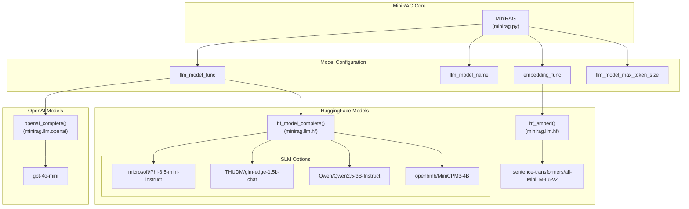
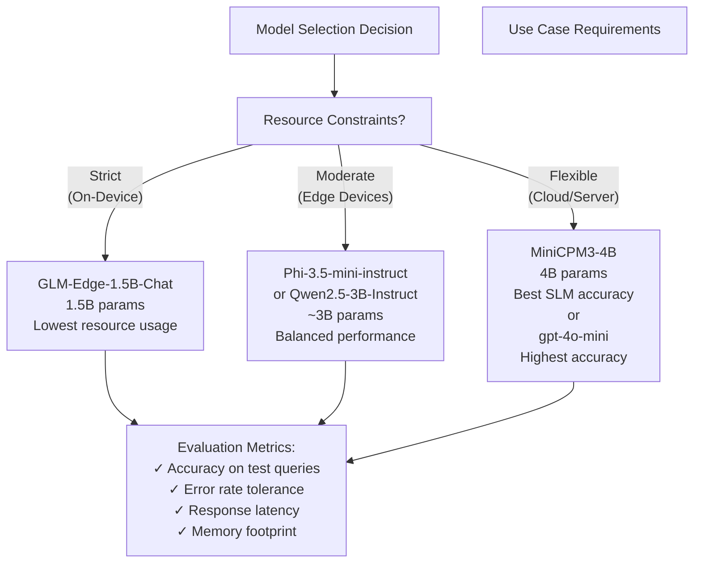
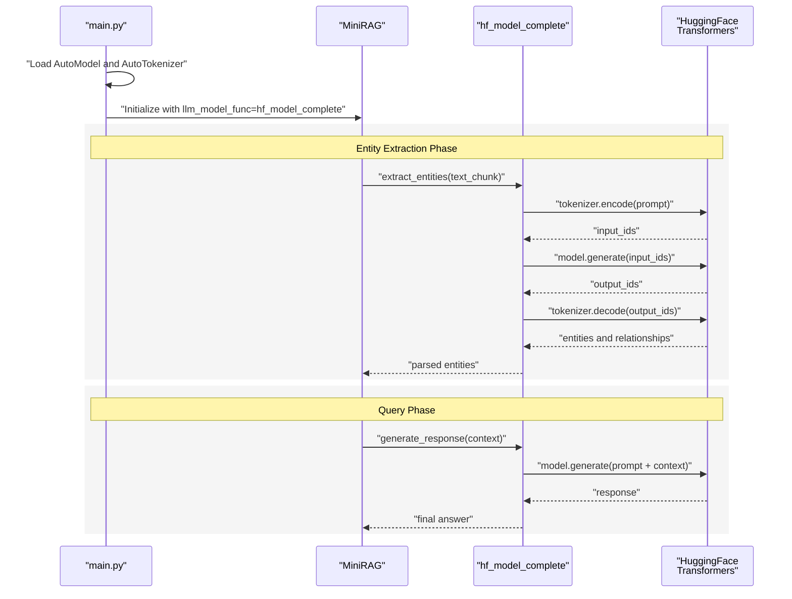
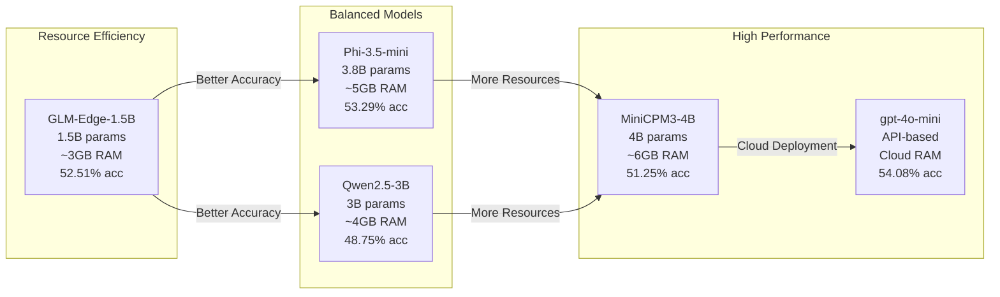

<!-- source: DeepWiki mcp.deepwiki.com · repo HKUDS/MiniRAG · page 6.3 Supported Models · fetched 2026-11-09 -->

# Supported Models

<details>
<summary>Relevant source files</summary>

The following files were used as context for generating this wiki page:

- [README.md](README.md)
- [main.py](main.py)
- [minirag/prompt.py](minirag/prompt.py)

</details>


This page documents the language models and embedding models supported by MiniRAG, including Small Language Models (SLMs) optimized for on-device RAG scenarios and larger LLMs for comparison purposes. For information about the LLM interface and API integration, see [LLM Interface](#6.1). For details on embedding generation, see [Embedding Functions](#6.2).

## Overview

MiniRAG is designed to enable effective RAG performance with Small Language Models (1.5B-4B parameters) through its heterogeneous graph indexing and topology-enhanced retrieval innovations. The framework supports both open-source models via HuggingFace and commercial models via OpenAI-compatible APIs.

**Sources:** [README.md:30-34](), [README.md:74-88]()

---

## Small Language Models (SLMs)

MiniRAG's core innovation targets Small Language Models, which are suitable for resource-constrained and on-device deployment scenarios. The following SLMs have been validated with MiniRAG:

### Phi-3.5-mini-instruct

| Property | Value |
|----------|-------|
| **Model ID** | `microsoft/Phi-3.5-mini-instruct` |
| **Parameters** | ~3.8B |
| **Provider** | Microsoft |
| **LiHua-World Accuracy** | 53.29% |
| **Error Rate** | 23.35% |

Microsoft's Phi-3.5-mini-instruct is a compact instruction-tuned model that demonstrates strong performance with MiniRAG's topology-enhanced retrieval, achieving 53.29% accuracy compared to 41.22% with NaiveRAG.

### GLM-Edge-1.5B-Chat

| Property | Value |
|----------|-------|
| **Model ID** | `THUDM/glm-edge-1.5b-chat` |
| **Parameters** | 1.5B |
| **Provider** | Tsinghua University (THUDM) |
| **LiHua-World Accuracy** | 52.51% |
| **Error Rate** | 25.71% |

GLM-Edge is the smallest model tested, demonstrating that MiniRAG can achieve strong RAG performance even with ultra-compact models. It shows a 52.51% accuracy with MiniRAG versus 42.79% with NaiveRAG.

### Qwen2.5-3B-Instruct

| Property | Value |
|----------|-------|
| **Model ID** | `Qwen/Qwen2.5-3B-Instruct` |
| **Parameters** | 3B |
| **Provider** | Alibaba Cloud |
| **LiHua-World Accuracy** | 48.75% |
| **Error Rate** | 26.02% |

Qwen2.5-3B-Instruct is part of Alibaba's Qwen model family, showing consistent improvement with MiniRAG's graph-based retrieval (48.75%) over the baseline NaiveRAG approach (43.73%).

### MiniCPM3-4B

| Property | Value |
|----------|-------|
| **Model ID** | `openbmb/MiniCPM3-4B` |
| **Parameters** | 4B |
| **Provider** | OpenBMB |
| **LiHua-World Accuracy** | 51.25% |
| **Error Rate** | 21.79% |

MiniCPM3-4B is the largest SLM in the test set, achieving 51.25% accuracy with MiniRAG and demonstrating the lowest error rate (21.79%) among small models.

**Sources:** [README.md:78-82](), [main.py:35-45]()

---

## Large Language Models (LLMs)

### gpt-4o-mini

| Property | Value |
|----------|-------|
| **Model ID** | `gpt-4o-mini` |
| **Provider** | OpenAI |
| **API** | OpenAI API |
| **LiHua-World Accuracy** | 54.08% (MiniRAG), 56.90% (LightRAG) |
| **Error Rate** | 19.44% (MiniRAG) |

OpenAI's gpt-4o-mini serves as the LLM baseline, demonstrating that MiniRAG's SLM performance approaches LLM-level results. The model achieves 54.08% accuracy with MiniRAG on the LiHua-World dataset.

**Sources:** [README.md:82]()

---

## Embedding Models

MiniRAG uses embedding models for vector-based similarity search in its heterogeneous graph structure. The default configuration uses:

### sentence-transformers/all-MiniLM-L6-v2

| Property | Value |
|----------|-------|
| **Model ID** | `sentence-transformers/all-MiniLM-L6-v2` |
| **Embedding Dimension** | 384 |
| **Max Token Size** | 1000 |
| **Provider** | Sentence Transformers |

This lightweight embedding model provides efficient semantic embeddings for text chunks and entity representations in MiniRAG's vector storage backends.

**Sources:** [main.py:14](), [main.py:63-71]()

---

## Model Integration Architecture

The following diagram shows how different model types integrate into MiniRAG's architecture:



**Diagram: Model Integration in MiniRAG Architecture**

**Sources:** [main.py:58-72]()

---

## Model Configuration

### HuggingFace Model Configuration

The following example shows how to configure a HuggingFace model in MiniRAG:

```python
from minirag import MiniRAG, QueryParam
from minirag.llm.hf import hf_model_complete, hf_embed
from minirag.utils import EmbeddingFunc
from transformers import AutoModel, AutoTokenizer

# Configure LLM
LLM_MODEL = "microsoft/Phi-3.5-mini-instruct"
EMBEDDING_MODEL = "sentence-transformers/all-MiniLM-L6-v2"

# Initialize MiniRAG
rag = MiniRAG(
    working_dir="./working_dir",
    llm_model_func=hf_model_complete,
    llm_model_max_token_size=200,
    llm_model_name=LLM_MODEL,
    embedding_func=EmbeddingFunc(
        embedding_dim=384,
        max_token_size=1000,
        func=lambda texts: hf_embed(
            texts,
            tokenizer=AutoTokenizer.from_pretrained(EMBEDDING_MODEL),
            embed_model=AutoModel.from_pretrained(EMBEDDING_MODEL),
        ),
    ),
)
```

This code can be found at [main.py:58-72]().

### Model Selection via Command Line

The main.py script provides a convenient command-line interface for model selection:

```bash
# Use Phi-3.5-mini-instruct
python main.py --model PHI

# Use GLM-Edge-1.5B-Chat
python main.py --model GLM

# Use MiniCPM3-4B
python main.py --model MiniCPM

# Use Qwen2.5-3B-Instruct
python main.py --model qwen
```

The model mapping logic is implemented at [main.py:35-45]().

**Sources:** [main.py:35-72]()

---

## Performance Comparison

### LiHua-World Dataset Results

The following table compares model performance across different RAG approaches on the LiHua-World benchmark:

| Model | NaiveRAG | GraphRAG | LightRAG | **MiniRAG** |
|-------|----------|----------|----------|-------------|
|       | acc↑ / err↓ | acc↑ / err↓ | acc↑ / err↓ | acc↑ / err↓ |
| **Phi-3.5-mini-instruct** | 41.22% / 23.20% | / | 39.81% / 25.39% | **53.29% / 23.35%** |
| **GLM-Edge-1.5B-Chat** | 42.79% / 24.76% | / | 35.74% / 25.86% | **52.51% / 25.71%** |
| **Qwen2.5-3B-Instruct** | 43.73% / 24.14% | / | 39.18% / 28.68% | **48.75% / 26.02%** |
| **MiniCPM3-4B** | 43.42% / 17.08% | / | 35.42% / 21.94% | **51.25% / 21.79%** |
| **gpt-4o-mini** | 46.55% / 19.12% | 35.27% / 37.77% | 56.90% / 20.85% | **54.08% / 19.44%** |

**Key Observations:**
- All SLMs show 8-13% absolute accuracy improvement with MiniRAG over NaiveRAG
- MiniRAG enables SLMs to achieve performance comparable to LLM-based methods
- Error rates remain competitive across all models with MiniRAG

### MultiHop-RAG Dataset Results

| Model | NaiveRAG | GraphRAG | LightRAG | **MiniRAG** |
|-------|----------|----------|----------|-------------|
|       | acc↑ / err↓ | acc↑ / err↓ | acc↑ / err↓ | acc↑ / err↓ |
| **Phi-3.5-mini-instruct** | 42.72% / 31.34% | / | 27.03% / 11.78% | **49.96% / 28.44%** |
| **GLM-Edge-1.5B-Chat** | 44.44% / 24.26% | / | / | **51.41% / 23.44%** |
| **Qwen2.5-3B-Instruct** | 39.48% / 31.69% | / | 21.91% / 13.73% | **48.55% / 33.10%** |
| **MiniCPM3-4B** | 39.24% / 31.42% | / | 19.48% / 10.41% | **47.77% / 26.88%** |
| **gpt-4o-mini** | 53.60% / 27.19% | 60.92% / 16.86% | 64.91% / 19.37% | **68.43% / 19.41%** |

**Note:** "/" indicates the method struggles to generate effective responses.

**Sources:** [README.md:73-91]()

---

## Model Selection Guidelines



**Diagram: Model Selection Decision Tree**

### Selection Criteria

**For Ultra-Compact Deployment (< 2GB Memory):**
- **Model:** GLM-Edge-1.5B-Chat
- **Use Case:** Mobile devices, IoT, severely constrained environments
- **Trade-off:** Lowest resource usage, 52.51% accuracy

**For Balanced Performance (2-4GB Memory):**
- **Model:** Phi-3.5-mini-instruct or Qwen2.5-3B-Instruct
- **Use Case:** Edge devices, embedded systems, standard on-device scenarios
- **Trade-off:** Good balance of accuracy (48-53%) and resource usage

**For Maximum SLM Performance (4-8GB Memory):**
- **Model:** MiniCPM3-4B
- **Use Case:** High-performance edge computing, workstations
- **Trade-off:** Best SLM accuracy (51.25%), lowest error rate among SLMs

**For Cloud/API Deployment:**
- **Model:** gpt-4o-mini
- **Use Case:** Cloud services, unlimited resources
- **Trade-off:** Highest accuracy (54-68%), requires API access

**Sources:** [README.md:74-91]()

---

## Model-Specific Integration Details

### HuggingFace Model Loading



**Diagram: HuggingFace Model Integration Sequence**

**Sources:** [main.py:7-10](), [main.py:58-72]()

---

## Embedding Model Configuration

The `EmbeddingFunc` dataclass wraps the embedding generation process:

```python
EmbeddingFunc(
    embedding_dim=384,        # Output dimension for all-MiniLM-L6-v2
    max_token_size=1000,      # Maximum tokens per text chunk
    func=lambda texts: hf_embed(
        texts,
        tokenizer=AutoTokenizer.from_pretrained(EMBEDDING_MODEL),
        embed_model=AutoModel.from_pretrained(EMBEDDING_MODEL),
    ),
)
```

This configuration at [main.py:63-71]() provides:
- **embedding_dim:** 384-dimensional vectors for efficient similarity search
- **max_token_size:** 1000 tokens to handle substantial text chunks
- **func:** Custom embedding function using HuggingFace's sentence transformers

**Sources:** [main.py:63-71]()

---

## Performance vs. Resource Trade-offs



**Diagram: Model Performance vs. Resource Requirements**

The diagram illustrates the progression from ultra-compact models suitable for mobile devices to high-performance models for cloud deployment, showing the trade-off between resource requirements and accuracy.

**Sources:** [README.md:74-91]()

---

This page provides comprehensive documentation of all models supported by MiniRAG, their performance characteristics, and guidelines for selecting the appropriate model for specific deployment scenarios.

---

