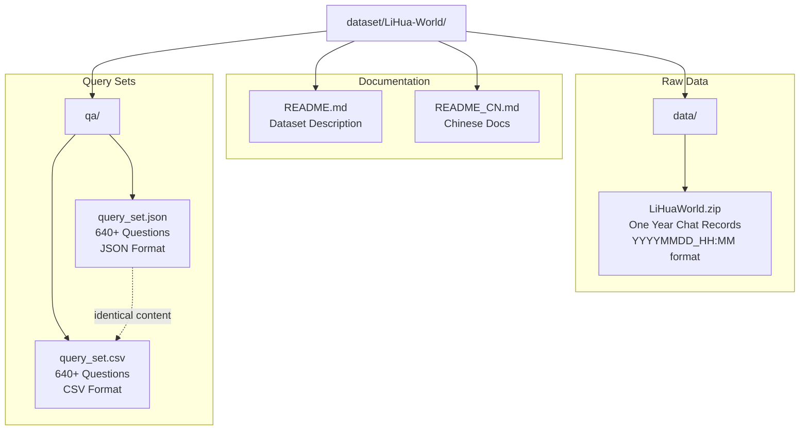
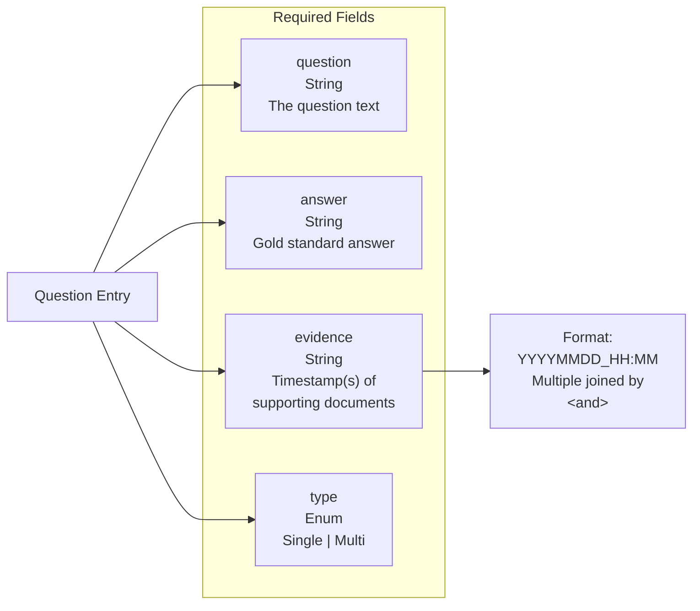
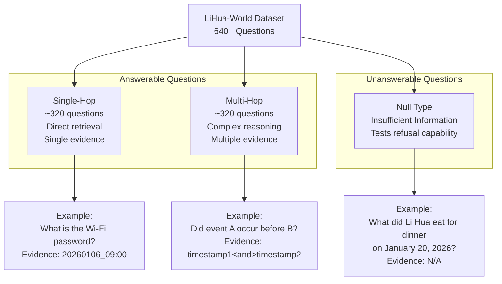
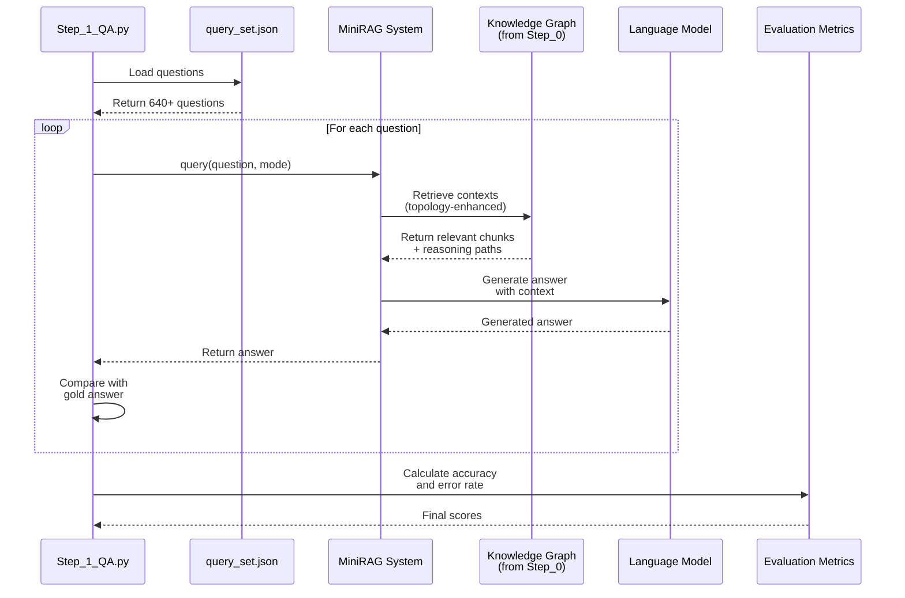
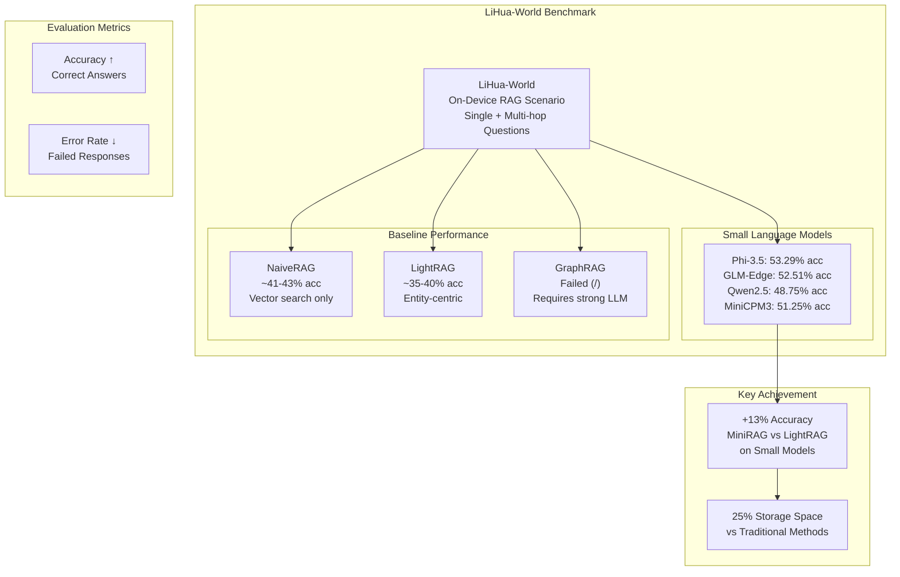

<!-- source: DeepWiki mcp.deepwiki.com · repo HKUDS/MiniRAG · page 7 LiHua-World Benchmark · fetched 2026-11-09 -->

# LiHua-World Benchmark

<details>
<summary>Relevant source files</summary>

The following files were used as context for generating this wiki page:

- [README.md](README.md)
- [dataset/LiHua-World/qa/query_set.csv](dataset/LiHua-World/qa/query_set.csv)
- [dataset/LiHua-World/qa/query_set.json](dataset/LiHua-World/qa/query_set.json)

</details>


## Purpose and Scope

This document describes the **LiHua-World Benchmark**, a comprehensive evaluation dataset specifically designed for assessing on-device Retrieval-Augmented Generation (RAG) systems in realistic scenarios. LiHua-World provides a year-long chat record from a virtual user named LiHua, annotated with questions requiring single-hop and multi-hop reasoning, along with gold standard answers and supporting evidence.

For information about using this dataset in MiniRAG experiments, see [Usage Examples](#8). For details on the reproduction scripts that use this benchmark, see [Quick Start Guide](#2.2).

**Sources:** [README.md:133-137](), [dataset/LiHua-World/qa/query_set.json:1-100]()

---

## Dataset Structure

### File Organization

LiHua-World is organized within the repository as follows:

```
dataset/LiHua-World/
├── README.md                    # Dataset documentation
├── README_CN.md                 # Chinese documentation
├── data/
│   └── LiHuaWorld.zip          # One year of chat records
└── qa/
    ├── query_set.json          # Questions in JSON format
    └── query_set.csv           # Questions in CSV format
```

**Dataset Location:** [dataset/LiHua-World/data/LiHuaWorld.zip]()

**Query Sets:** [dataset/LiHua-World/qa/query_set.json](), [dataset/LiHua-World/qa/query_set.csv]()

### Evidence Timestamp Format

The dataset uses a specific timestamp format to reference supporting documents within LiHua's chat history:

**Format:** `YYYYMMDD_HH:MM`

**Example:** `20260121_10:00` refers to a conversation on January 21, 2026 at 10:00 AM

Multiple evidence timestamps are concatenated using `<and>` separators:

```
20260121_10:00<and>20260701_10:00<and>20260812_11:00
```

This format allows evaluators to precisely identify which conversations contain the information needed to answer each question.

### Data Format Schema

Both JSON and CSV formats contain identical information. The JSON structure for each question is:

```json
{
  "0": {
    "question": "Question text here",
    "answer": "Answer text or Yes/No",
    "evidence": "timestamp1<and>timestamp2<and>...",
    "type": "Single|Multi"
  }
}
```

#### Dataset File Organization Diagram



**Sources:** [README.md:96-131](), [dataset/LiHua-World/qa/query_set.json:1-50](), [dataset/LiHua-World/qa/query_set.csv:1-50]()

---

## Question Types and Schema

### Question Type Taxonomy

LiHua-World contains two primary question types, each designed to test different aspects of RAG system capabilities:

| Question Type | Description | Example Count | Complexity |
|--------------|-------------|---------------|------------|
| **Single-hop** | Questions answerable from a single conversation or direct fact | ~320 questions | Low |
| **Multi-hop** | Questions requiring reasoning across multiple conversations or entities | ~320 questions | High |

### Single-Hop Questions

Single-hop questions test basic retrieval and extraction capabilities. They can be answered from information found in one conversation or document.

**Example from Dataset:**

```json
{
  "62": {
    "question": "What time does Li Hua check in with Adam about moving in?",
    "answer": "5:30 PM",
    "evidence": "20260105_14:00",
    "type": "Single"
  }
}
```

**Characteristics:**
- Single evidence timestamp
- Direct factual answers
- Tests basic retrieval accuracy
- Minimal reasoning required

**Additional Examples:**
- [dataset/LiHua-World/qa/query_set.json:377-450]() (Questions 62-72)

### Multi-Hop Questions

Multi-hop questions require the RAG system to:
1. Retrieve information from multiple conversations
2. Connect entities and relationships across documents
3. Perform temporal or logical reasoning
4. Synthesize information from diverse sources

**Example from Dataset:**

```json
{
  "0": {
    "question": "Did Adam Smith send a message to Li Hua about the upcoming building maintenance schedule before the administrators announced a temporary change in the construction schedule due to weather conditions?",
    "answer": "Yes",
    "evidence": "20260121_10:00<and>20260701_10:00",
    "type": "Multi"
  }
}
```

**Characteristics:**
- Multiple evidence timestamps (typically 2-8)
- Temporal reasoning (before/after relationships)
- Entity tracking across conversations
- Complex boolean or comparative answers

**Additional Examples:**
- [dataset/LiHua-World/qa/query_set.json:1-300]() (Questions 0-50)

### Schema Field Definitions

#### Question Schema Structure



| Field | Type | Description | Example |
|-------|------|-------------|---------|
| `question` | String | The evaluation question | "What is the Wi-Fi password at Li Hua's house?" |
| `answer` | String | Human-annotated gold answer | "Family123" |
| `evidence` | String | Timestamp(s) of supporting conversations | "20260106_09:00" or "20260121_10:00<and>20260701_10:00" |
| `type` | String | Question category: "Single" or "Multi" | "Single" |

### Question Distribution Examples

Examining the first 100 questions from the dataset:

| Type | Count (first 100) | Percentage |
|------|-------------------|------------|
| Multi-hop | 62 | 62% |
| Single-hop | 38 | 38% |

**Note:** The dataset also includes a special "Null" type for questions marked as having insufficient information, which are used to test the system's ability to recognize unanswerable queries [dataset/LiHua-World/qa/query_set.csv:574-639]().

#### Question Type Distribution Diagram



**Sources:** [dataset/LiHua-World/qa/query_set.json:1-100](), [dataset/LiHua-World/qa/query_set.csv:1-100](), [dataset/LiHua-World/qa/query_set.csv:574-639]()

---

## Evaluation Methodology

### Evaluation Metrics

LiHua-World uses two primary metrics to assess RAG system performance:

| Metric | Symbol | Description | Calculation |
|--------|--------|-------------|-------------|
| **Accuracy** | acc↑ | Percentage of correct answers | (Correct Answers / Total Questions) × 100% |
| **Error Rate** | err↓ | Percentage of failed responses | (Failed/Error Responses / Total Questions) × 100% |

**Note:** Higher accuracy (↑) is better, while lower error rate (↓) is better.

### Evaluation Pipeline

The evaluation process uses two reproduction scripts located in [reproduce/]():

#### Step 0: Indexing

**Script:** [reproduce/Step_0_index.py]()

1. Loads chat records from `LiHuaWorld.zip`
2. Extracts entities and relationships using MiniRAG
3. Builds the knowledge graph index
4. Stores in specified working directory

```bash
python ./reproduce/Step_0_index.py
```

#### Step 1: Question Answering

**Script:** [reproduce/Step_1_QA.py]()

1. Loads questions from `query_set.json` or `query_set.csv`
2. For each question:
   - Queries the indexed knowledge graph
   - Retrieves relevant contexts
   - Generates answer using LLM
3. Compares generated answers against gold answers
4. Calculates accuracy and error rate metrics

```bash
python ./reproduce/Step_1_QA.py
```

#### Evaluation Workflow Diagram



**Sources:** [README.md:64-68](), [README.md:93-94]()

### Baseline Comparison Systems

LiHua-World evaluation compares MiniRAG against three baseline RAG systems:

| System | Approach | Key Features |
|--------|----------|--------------|
| **NaiveRAG** | Simple vector search | Retrieves chunks based on embedding similarity only |
| **GraphRAG** | Graph-based RAG | Requires strong LLMs; often fails with small models |
| **LightRAG** | Lightweight graph RAG | Foundation for MiniRAG; entity-centric retrieval |
| **MiniRAG** | Heterogeneous graph + topology | Optimized for small language models (SLMs) |

**Note:** GraphRAG is marked with "/" (slash) in results tables when it struggles to generate effective responses with small language models [README.md:74-88]().

### Tested Models

Evaluation spans both Small Language Models (SLMs) and Large Language Models (LLMs):

#### Small Language Models (1.5B-4B parameters)
- `Phi-3.5-mini-instruct` (Microsoft)
- `GLM-Edge-1.5B-Chat` (Zhipu AI)
- `Qwen2.5-3B-Instruct` (Alibaba)
- `MiniCPM3-4B` (OpenBMB)

#### Large Language Model (comparison)
- `gpt-4o-mini` (OpenAI)

### Performance Results

#### LiHua-World Benchmark Results

| Model | NaiveRAG | | GraphRAG | | LightRAG | | **MiniRAG** | |
|-------|----------|---|----------|---|----------|---|-------------|---|
| | acc↑ | err↓ | acc↑ | err↓ | acc↑ | err↓ | acc↑ | err↓ |
| Phi-3.5-mini-instruct | 41.22% | 23.20% | / | / | 39.81% | 25.39% | **53.29%** | 23.35% |
| GLM-Edge-1.5B-Chat | 42.79% | 24.76% | / | / | 35.74% | 25.86% | **52.51%** | 25.71% |
| Qwen2.5-3B-Instruct | 43.73% | 24.14% | / | / | 39.18% | 28.68% | **48.75%** | 26.02% |
| MiniCPM3-4B | 43.42% | 17.08% | / | / | 35.42% | 21.94% | **51.25%** | 21.79% |
| gpt-4o-mini | 46.55% | 19.12% | 35.27% | 37.77% | **56.90%** | 20.85% | 54.08% | 19.44% |

**Key Findings:**
- MiniRAG achieves **~13% absolute improvement** over LightRAG baseline with SLMs
- MiniRAG enables SLMs to reach **comparable performance** to LLM-based methods
- GraphRAG fails to generate effective responses with SLMs (marked with "/")
- Error rates remain relatively stable across systems (~20-25%)

#### MultiHop-RAG Benchmark Results

| Model | NaiveRAG | | GraphRAG | | LightRAG | | **MiniRAG** | |
|-------|----------|---|----------|---|----------|---|-------------|---|
| | acc↑ | err↓ | acc↑ | err↓ | acc↑ | err↓ | acc↑ | err↓ |
| Phi-3.5-mini-instruct | 42.72% | 31.34% | / | / | 27.03% | 11.78% | **49.96%** | 28.44% |
| GLM-Edge-1.5B-Chat | 44.44% | 24.26% | / | / | / | / | **51.41%** | 23.44% |
| Qwen2.5-3B-Instruct | 39.48% | 31.69% | / | / | 21.91% | 13.73% | **48.55%** | 33.10% |
| MiniCPM3-4B | 39.24% | 31.42% | / | / | 19.48% | 10.41% | **47.77%** | 26.88% |
| gpt-4o-mini | 53.60% | 27.19% | 60.92% | 16.86% | 64.91% | 19.37% | **68.43%** | 19.41% |

**Key Findings:**
- MiniRAG shows even stronger improvements on multi-hop reasoning tasks
- Some baseline systems completely fail (marked with "/") on certain SLMs
- MiniRAG maintains consistent performance across all tested models

#### Performance Comparison Diagram



### Why MiniRAG Outperforms on LiHua-World

The performance gains on LiHua-World specifically validate MiniRAG's two core innovations:

1. **Heterogeneous Graph Indexing**: Reduces semantic understanding requirements by unifying text chunks and named entities [README.md:31-34]()

2. **Topology-Enhanced Retrieval**: Leverages graph structure for lightweight knowledge discovery without requiring advanced language capabilities [README.md:31-34]()

These innovations are particularly effective on LiHua-World's multi-hop questions, which require reasoning across multiple conversations and entities—precisely the scenario where small language models traditionally struggle.

**Sources:** [README.md:73-88](), [README.md:30-34]()

---

## Summary

LiHua-World provides a rigorous benchmark for evaluating on-device RAG systems with realistic, multi-hop reasoning requirements. The dataset's design—one year of chat records with precisely timestamped evidence—enables fine-grained assessment of how well systems can handle the complex information retrieval and reasoning tasks that occur in real-world on-device scenarios.

**Key Specifications:**
- **Size:** 640+ questions across one year of chat data
- **Question Types:** Single-hop (direct retrieval) and Multi-hop (reasoning)
- **Evaluation:** Accuracy and error rate metrics
- **Benchmark Results:** MiniRAG achieves 53.29% accuracy with small models vs 39.81% baseline

For practical usage of this benchmark in your own experiments, see [Document Indexing](#8.1) and [Question Answering](#8.2).

**Sources:** [README.md:133-137](), [README.md:73-88](), [dataset/LiHua-World/qa/query_set.json:1-3000]()

---

