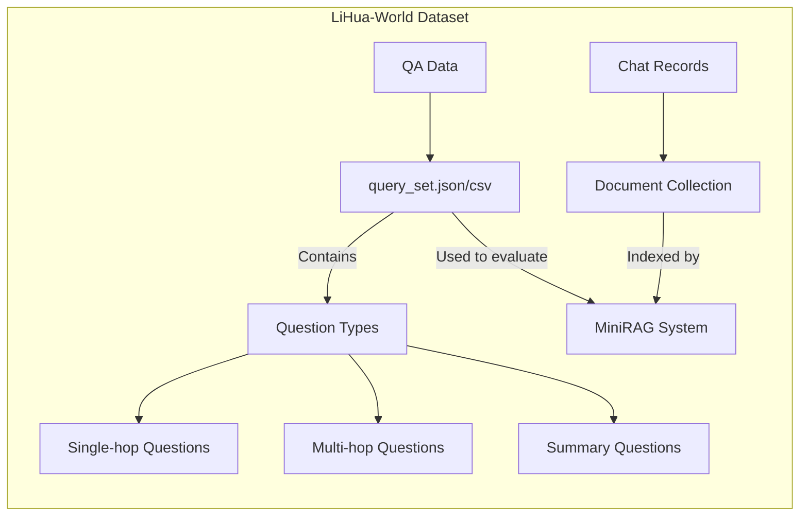
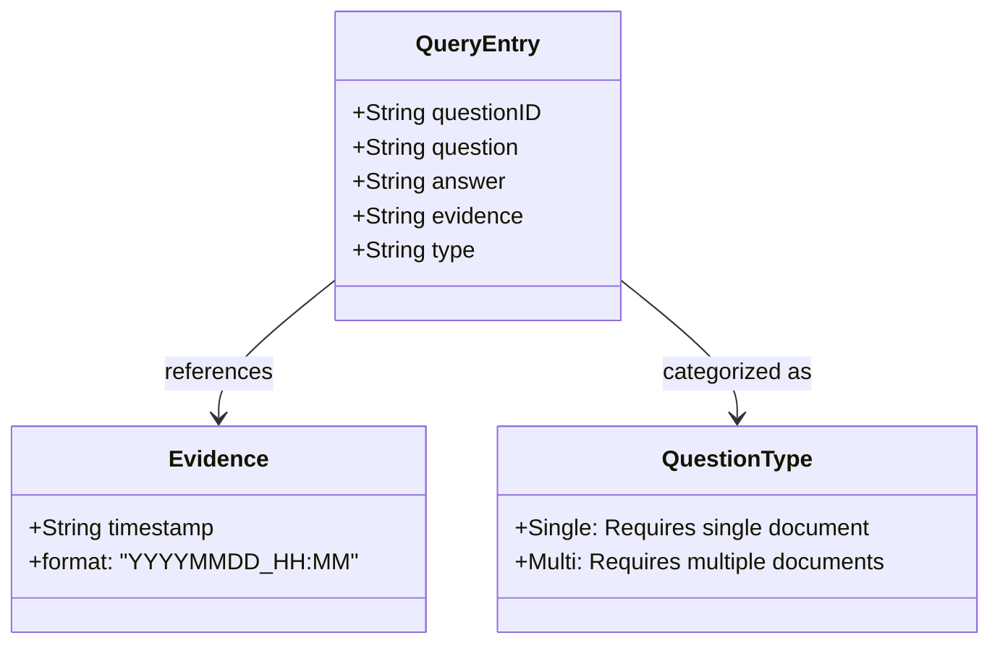
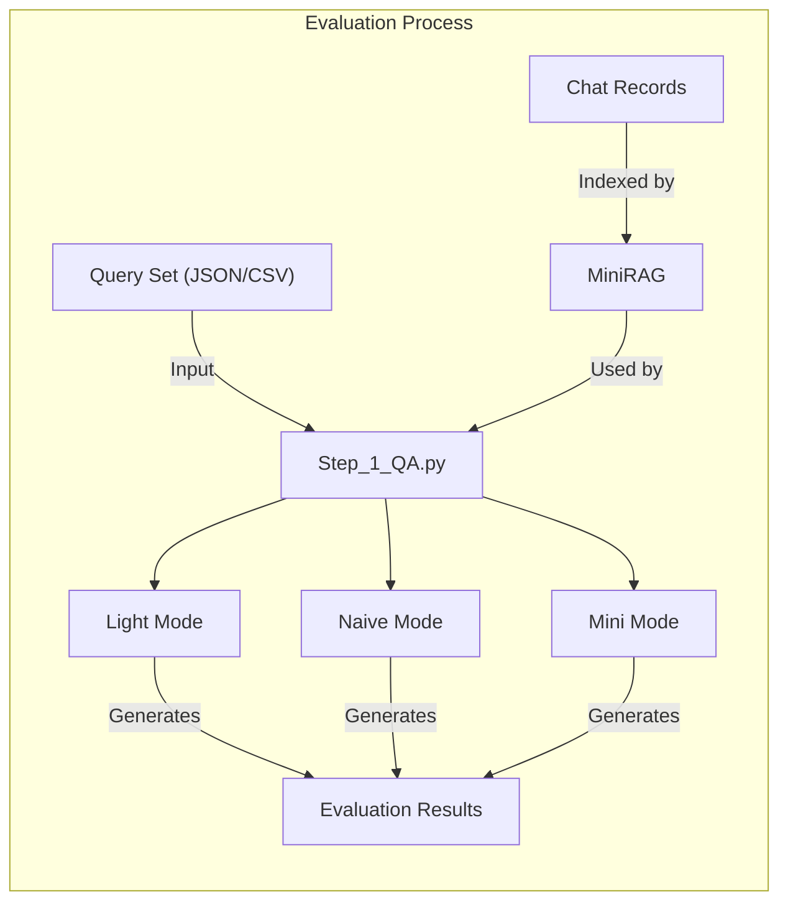
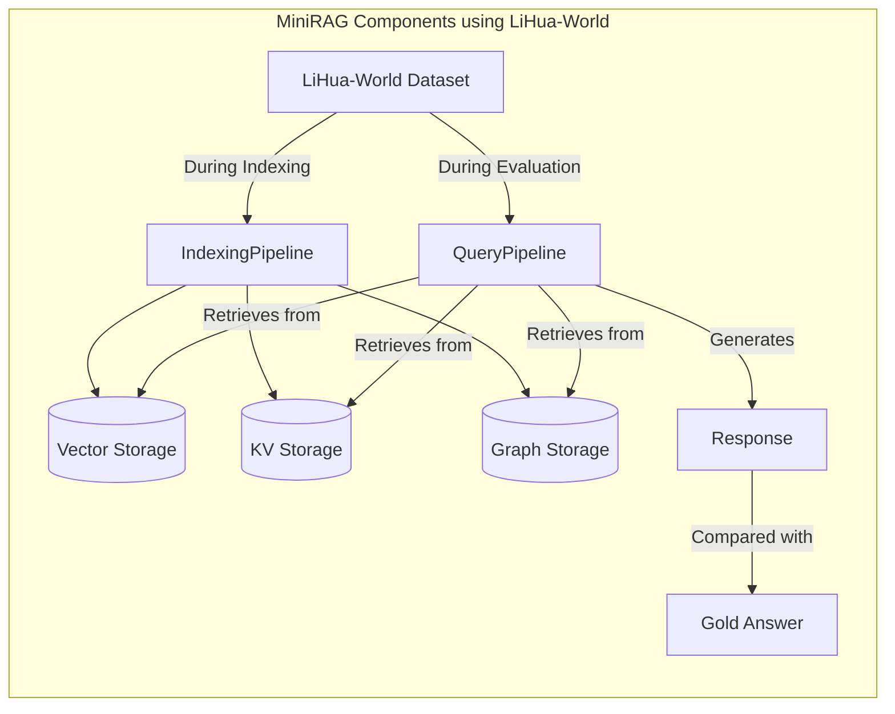

<!-- source: DeepWiki mcp.deepwiki.com · repo HKUDS/MiniRAG · page 7.1 Dataset Structure · fetched 2026-11-09 -->

# Dataset Structure

<details>
<summary>Relevant source files</summary>

The following files were used as context for generating this wiki page:

- [README_CN.md](README_CN.md)
- [dataset/LiHua-World/qa/query_set.csv](dataset/LiHua-World/qa/query_set.csv)
- [dataset/LiHua-World/qa/query_set.json](dataset/LiHua-World/qa/query_set.json)

</details>


This page explains the structure and organization of the LiHua-World dataset used for evaluating MiniRAG's retrieval and question-answering capabilities. The dataset provides a standardized way to measure performance across different retrieval modes. For information about using the dataset for evaluation, see [Evaluation Methodology](#7.3).

## Overview of LiHua-World Dataset

The LiHua-World dataset is a specialized collection of text-based data designed to test retrieval-augmented generation systems. It consists of two primary components:

1. **Chat Records**: A collection of time-stamped conversations between Li Hua and various characters
2. **Question-Answer Pairs**: A structured set of queries with gold-standard answers and evidence references



Sources: [dataset/LiHua-World/qa/query_set.json](dataset/LiHua-World/qa/query_set.json), [dataset/LiHua-World/qa/query_set.csv](dataset/LiHua-World/qa/query_set.csv)

## Data Components

### Chat Records

The chat records represent a series of conversations formatted as text files with timestamps. Each record follows a naming convention that uses a date and time format: `YYYYMMDD_HH:MM`. These documents form the corpus that MiniRAG indexes and later retrieves from during evaluation.

### Query Set Format

The query set is provided in two formats (JSON and CSV) with identical content. Each query entry contains:

| Field | Description |
|-------|-------------|
| ID | Numeric identifier for the query |
| Question | Natural language question about the chat records |
| Answer | Gold-standard reference answer |
| Evidence | References to specific chat records (in timestamp format) |
| Type | Question type: "Single" or "Multi" |



Sources: [dataset/LiHua-World/qa/query_set.json](dataset/LiHua-World/qa/query_set.json), [dataset/LiHua-World/qa/query_set.csv](dataset/LiHua-World/qa/query_set.csv)

## Question Types

The dataset contains different types of questions, each designed to test different aspects of retrieval and reasoning:

### Single-hop Questions

These questions can be answered by retrieving information from a single document/chat record. They test basic retrieval capabilities.

Example:
```
"What time does Li Hua check in with Adam about moving in?"
Answer: "5:30 PM"
Evidence: "20260105_14:00"
```

### Multi-hop Questions

These questions require the system to retrieve and connect information across multiple documents. They test the system's ability to integrate information from different sources.

Example:
```
"Did Li Hua ask Jennifer for advice on how to prevent muscle soreness after an intense workout session before he told her that he feels soreness in his arm muscles after the workout this week?"
Answer: "Yes"
Evidence: "20260206_16:00<and>20260811_11:00<and>20261008_14:00<and>20261211_11:00"
```

The `<and>` delimiter in the evidence field indicates that multiple documents need to be referenced to answer the question correctly.

Sources: [dataset/LiHua-World/qa/query_set.json](dataset/LiHua-World/qa/query_set.json), [dataset/LiHua-World/qa/query_set.csv](dataset/LiHua-World/qa/query_set.csv)

## Evidence Format

The evidence field uses a specific format to indicate which documents contain information relevant to answering a question:

1. Single document reference: `YYYYMMDD_HH:MM`
2. Multiple document references: `YYYYMMDD_HH:MM<and>YYYYMMDD_HH:MM<and>...`

This structured approach allows for precise evaluation of the system's retrieval capabilities by comparing the documents it retrieves with the gold-standard evidence list.

## Dataset Usage in Evaluation

The dataset integrates with MiniRAG's evaluation pipeline as follows:



The query set is processed by the evaluation script, which tests how well MiniRAG can retrieve relevant documents and answer questions across different retrieval modes.

Sources: [dataset/LiHua-World/qa/query_set.json](dataset/LiHua-World/qa/query_set.json), [dataset/LiHua-World/qa/query_set.csv](dataset/LiHua-World/qa/query_set.csv)

## Data Statistics

The LiHua-World dataset contains:

- 639 total questions in the query set
- Multiple question types:
  - Single-hop questions
  - Multi-hop questions
- "Sufficient Information" and "Insufficient Information" questions (the latter marked as "Null" type)
- Temporal questions that test reasoning about event sequences
- Factual questions that test retrieval of specific details

This variety ensures comprehensive evaluation of different aspects of MiniRAG's retrieval and reasoning capabilities.

## Relationship to MiniRAG Architecture

The dataset is designed to work with MiniRAG's storage and retrieval components:



The timestamped document IDs in the dataset correspond to keys in the storage systems. During evaluation, the query pipeline retrieves documents based on these IDs to generate answers.

Sources: [dataset/LiHua-World/qa/query_set.json](dataset/LiHua-World/qa/query_set.json), [dataset/LiHua-World/qa/query_set.csv](dataset/LiHua-World/qa/query_set.csv)

## Extending the Dataset

The LiHua-World dataset structure allows for straightforward extension through:

1. Adding new chat records with the same timestamp format
2. Extending the query set with new question-answer pairs
3. Creating new question types to test additional reasoning capabilities

This flexibility makes it a valuable resource for ongoing development and evaluation of retrieval-augmented generation systems like MiniRAG.

---

