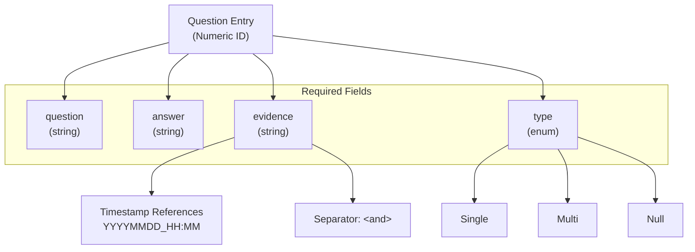
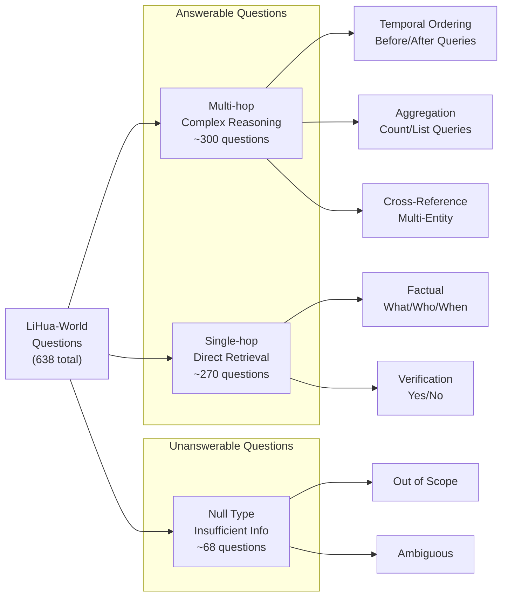
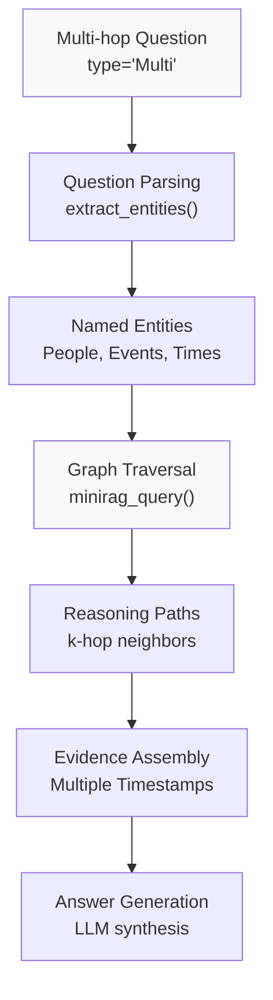
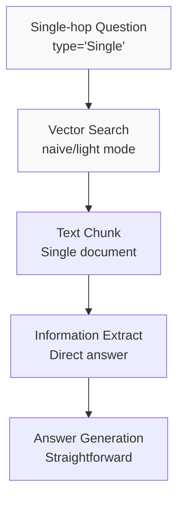
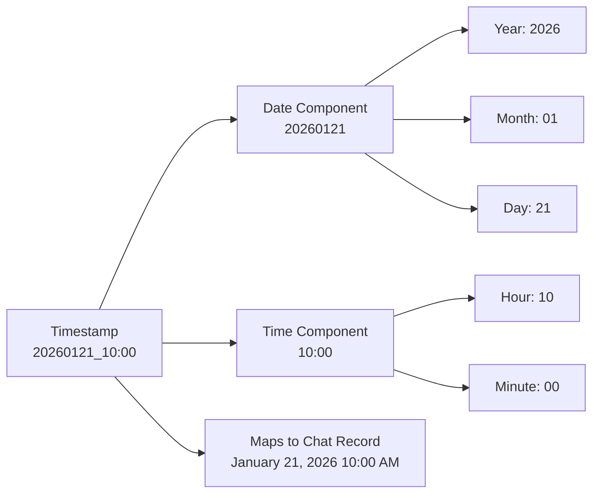
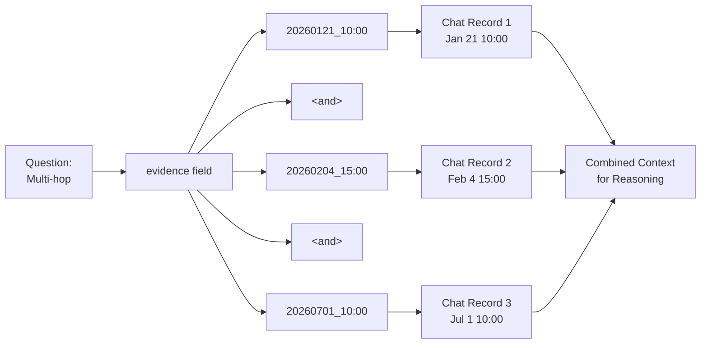
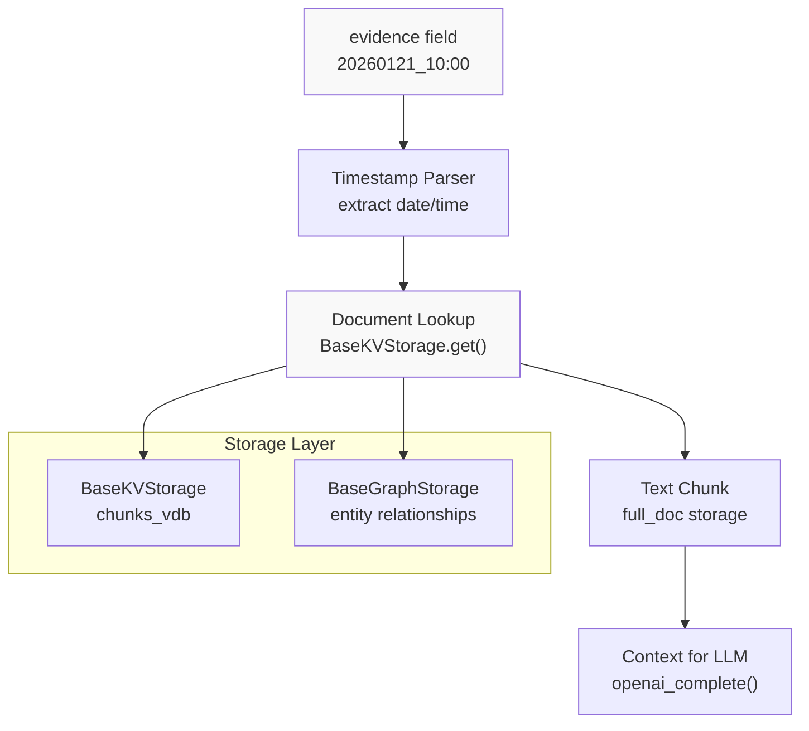
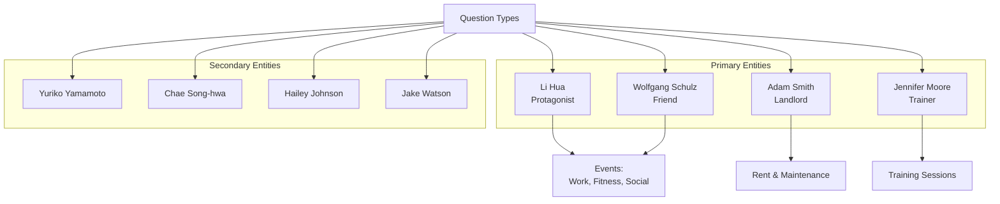
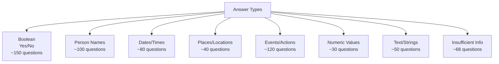
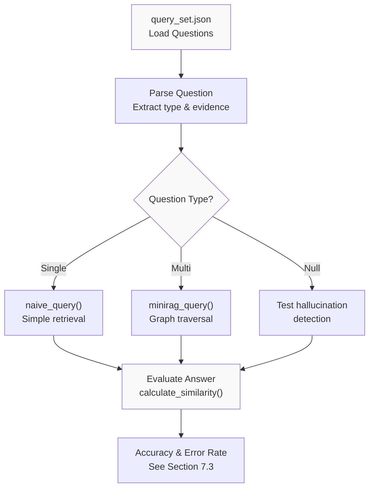

<!-- source: DeepWiki mcp.deepwiki.com · repo HKUDS/MiniRAG · page 7.2 Question Types and Schema · fetched 2026-11-09 -->

# Question Types and Schema

<details>
<summary>Relevant source files</summary>

The following files were used as context for generating this wiki page:

- [dataset/LiHua-World/qa/query_set.csv](dataset/LiHua-World/qa/query_set.csv)
- [dataset/LiHua-World/qa/query_set.json](dataset/LiHua-World/qa/query_set.json)

</details>


This document details the structure and taxonomy of questions in the LiHua-World benchmark dataset. It covers the JSON schema format, the three primary question types (Single-hop, Multi-hop, and Null), and the evidence referencing system used to link questions to supporting documents.

For information about the overall dataset structure and organization, see [Dataset Structure](#7.1). For evaluation methodology and metrics, see [Evaluation Methodology](#7.3).

## Purpose and Scope

The LiHua-World benchmark includes 638 questions designed to test RAG systems across different reasoning complexity levels. Each question follows a standardized schema with explicit type annotations and evidence pointers to support reproducible evaluation. This page documents the question schema, type taxonomy, and the evidence format used to reference source documents.

## Schema Structure

### Core Fields

Each question in the dataset follows a consistent JSON schema with four primary fields:



**Schema Field Definitions:**

| Field | Type | Description | Example |
|-------|------|-------------|---------|
| `question` | string | Natural language question text | "Did Adam Smith send a message to Li Hua..." |
| `answer` | string | Gold standard answer | "Yes" / "No" / Specific value |
| `evidence` | string | Timestamp references to supporting documents | "20260121_10:00&lt;and&gt;20260701_10:00" |
| `type` | enum | Question type classification | "Multi" / "Single" / "Null" |

**Sources:** [dataset/LiHua-World/qa/query_set.json:1-10]()

### JSON Structure Example

```json
{
    "0": {
        "question": "Did Adam Smith send a message to Li Hua about the upcoming building maintenance schedule before the administrators announced a temporary change in the construction schedule due to weather conditions?",
        "answer": "Yes",
        "evidence": "20260121_10:00<and>20260701_10:00",
        "type": "Multi"
    },
    "62": {
        "question": "What time does Li Hua check in with Adam about moving in?",
        "answer": "5:30 PM",
        "evidence": "20260105_14:00",
        "type": "Single"
    },
    "574": {
        "question": "What time will Li Hua and Wolfgang meet for breakfast on the morning of the 9th?",
        "answer": "Insufficient information",
        "evidence": "N/A",
        "type": "Null"
    }
}
```

**Sources:** [dataset/LiHua-World/qa/query_set.json:1-7](), [dataset/LiHua-World/qa/query_set.json:375-379](), [dataset/LiHua-World/qa/query_set.json:2296-2301]()

## Question Type Taxonomy

### Type Distribution



**Sources:** [dataset/LiHua-World/qa/query_set.json:1-2700]()

### Multi-Hop Questions

Multi-hop questions require reasoning across multiple pieces of evidence. They test the system's ability to traverse the knowledge graph and synthesize information from different temporal contexts.

**Characteristics:**
- Require 2+ evidence timestamps
- Involve temporal reasoning ("before", "after")
- Test relationship tracking across events
- May involve counting or aggregation

**Example Patterns:**

| Pattern | Question Example | Evidence Count |
|---------|-----------------|----------------|
| **Temporal Ordering** | "Did Adam Smith send a message... before the administrators announced..." | 2 |
| **Event Sequence** | "Did Wolfgang arrive in Hong Kong after he informed Li Hua..." | 2 |
| **Aggregation** | "Who wished Li Hua a happy Lunar New Year?" | 3 |
| **Complex Timeline** | "What special offerings did Hailey have... in May?" | 4 |

**Code Mapping:**



**Sources:** [dataset/LiHua-World/qa/query_set.json:1-7](), [dataset/LiHua-World/qa/query_set.json:26-31](), [dataset/LiHua-World/qa/query_set.json:188-193]()

### Single-Hop Questions

Single-hop questions can be answered from a single piece of evidence. They test direct retrieval capabilities without complex reasoning.

**Characteristics:**
- Require exactly 1 evidence timestamp
- Direct factual queries
- No temporal reasoning required
- Test precision of retrieval

**Example Patterns:**

| Pattern | Question Example | Answer Type |
|---------|-----------------|-------------|
| **Time Query** | "What time does Li Hua check in with Adam about moving in?" | Time value |
| **Location Query** | "What is the name of the café..." | Place name |
| **Person Query** | "Who suggested Li Hua keep a clear log..." | Person name |
| **Object Query** | "What is the Wi-Fi password at Li Hua's house?" | String value |
| **Yes/No** | "Can Li Hua hang his artworks on the wall?" | Boolean |

**Code Mapping:**



**Sources:** [dataset/LiHua-World/qa/query_set.json:375-379](), [dataset/LiHua-World/qa/query_set.json:391-395](), [dataset/LiHua-World/qa/query_set.json:519-523]()

### Null Type Questions

Null type questions are designed to be unanswerable based on the available dataset. They test the system's ability to recognize information gaps.

**Characteristics:**
- Answer: "Insufficient information"
- Evidence: "N/A"
- No supporting documents exist
- Test system's ability to avoid hallucination

**Example Patterns:**

| Pattern | Question Example | Why Unanswerable |
|---------|-----------------|------------------|
| **Missing Detail** | "What time will Li Hua and Wolfgang meet for breakfast on the morning of the 9th?" | Specific detail not recorded |
| **Undefined Context** | "What type of equipment does Wolfgang use at the gym?" | Information never mentioned |
| **Out of Scope** | "What payment method did Li Hua use to purchase groceries..." | Transaction details not tracked |
| **Ambiguous Reference** | "What specific suggestions did Li Hua have regarding the construction schedule..." | Vague reference |

**Sources:** [dataset/LiHua-World/qa/query_set.json:2296-2301](), [dataset/LiHua-World/qa/query_set.json:2302-2307](), [dataset/LiHua-World/qa/query_set.csv:575-640]()

## Evidence Format and Referencing

### Timestamp Format

Evidence references use a standardized timestamp format that maps directly to chat record files in the LiHua-World dataset.

**Format:** `YYYYMMDD_HH:MM`



**Components:**

| Component | Format | Example | Description |
|-----------|--------|---------|-------------|
| Year | YYYY | 2026 | Four-digit year |
| Month | MM | 01 | Two-digit month (01-12) |
| Day | DD | 21 | Two-digit day (01-31) |
| Hour | HH | 10 | Two-digit hour (00-23) |
| Minute | MM | 00 | Two-digit minute (00-59) |

**Sources:** [dataset/LiHua-World/qa/query_set.json:5]()

### Multiple Evidence References

Multi-hop questions link multiple evidence timestamps using the `<and>` separator.

**Syntax:** `timestamp1<and>timestamp2<and>timestamp3`



**Examples:**

| Evidence String | Document Count | Question Type |
|----------------|----------------|---------------|
| `20260105_14:00` | 1 | Single-hop |
| `20260121_10:00<and>20260701_10:00` | 2 | Multi-hop |
| `20260119_11:30<and>20260119_14:30<and>20260119_09:30` | 3 | Multi-hop aggregation |
| `20260206_16:00<and>20260811_11:00<and>20261008_14:00<and>20261211_11:00` | 4 | Complex multi-hop |

**Sources:** [dataset/LiHua-World/qa/query_set.json:5](), [dataset/LiHua-World/qa/query_set.json:22-24](), [dataset/LiHua-World/qa/query_set.json:191]()

### Evidence-to-Code Mapping



**Sources:** [dataset/LiHua-World/qa/query_set.json:5]()

## Question Characteristics

### Temporal Reasoning Patterns

Multi-hop questions often involve explicit temporal reasoning keywords:

| Keyword | Count | Example |
|---------|-------|---------|
| "before" | ~40 | "Did X happen before Y?" |
| "after" | ~30 | "Did X occur after Y?" |
| "between" | ~15 | "Time interval between X and Y" |
| "during" | ~10 | "Who did X during period Y?" |

**Sources:** [dataset/LiHua-World/qa/query_set.json:1-200]()

### Entity-Centric Questions

Questions focus on core entities in the LiHua-World narrative:



**Entity Frequency in Questions:**

| Entity | Mention Count | Primary Role |
|--------|--------------|--------------|
| Li Hua | ~500 | Main protagonist |
| Wolfgang Schulz | ~120 | Friend, coworker |
| Jennifer Moore | ~80 | Fitness trainer |
| Adam Smith | ~60 | Landlord |
| Yuriko Yamamoto | ~40 | Client, musician |

**Sources:** [dataset/LiHua-World/qa/query_set.json:1-2700]()

### Answer Type Distribution



**Sources:** [dataset/LiHua-World/qa/query_set.json:1-2700]()

## CSV Format

The dataset is also available in CSV format with identical information:

**Column Schema:**

| Column | Description | JSON Equivalent |
|--------|-------------|-----------------|
| Question | Natural language question | `question` field |
| Gold Answer | Correct answer | `answer` field |
| Evidence | Timestamp references | `evidence` field |
| Type | Question type | `type` field |

**Sources:** [dataset/LiHua-World/qa/query_set.csv:1-2]()

## Usage in Evaluation

### Question Processing Pipeline



**Sources:** [dataset/LiHua-World/qa/query_set.json:1-10]()

### Type-Specific Evaluation

Different question types are evaluated separately to measure performance across reasoning complexity levels:

| Type | Evaluation Focus | Key Metric |
|------|-----------------|------------|
| Single | Retrieval precision | Exact match accuracy |
| Multi | Reasoning capability | Multi-hop accuracy |
| Null | Hallucination detection | False positive rate |

**Sources:** [dataset/LiHua-World/qa/query_set.json:1-2700]()

---

