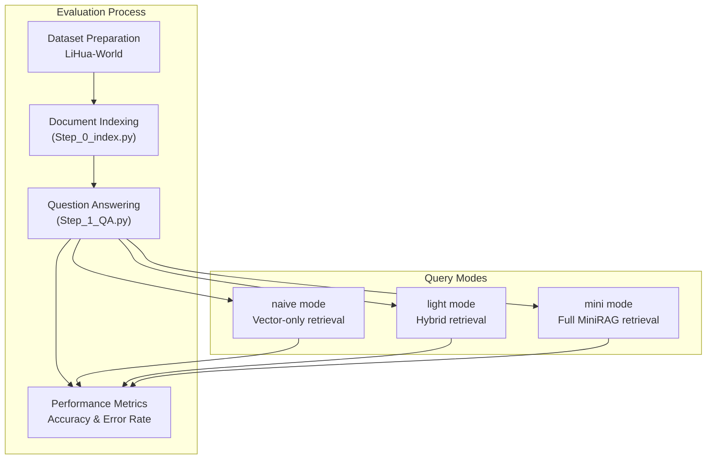
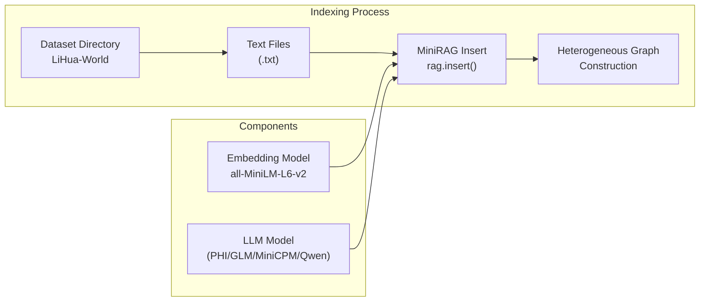
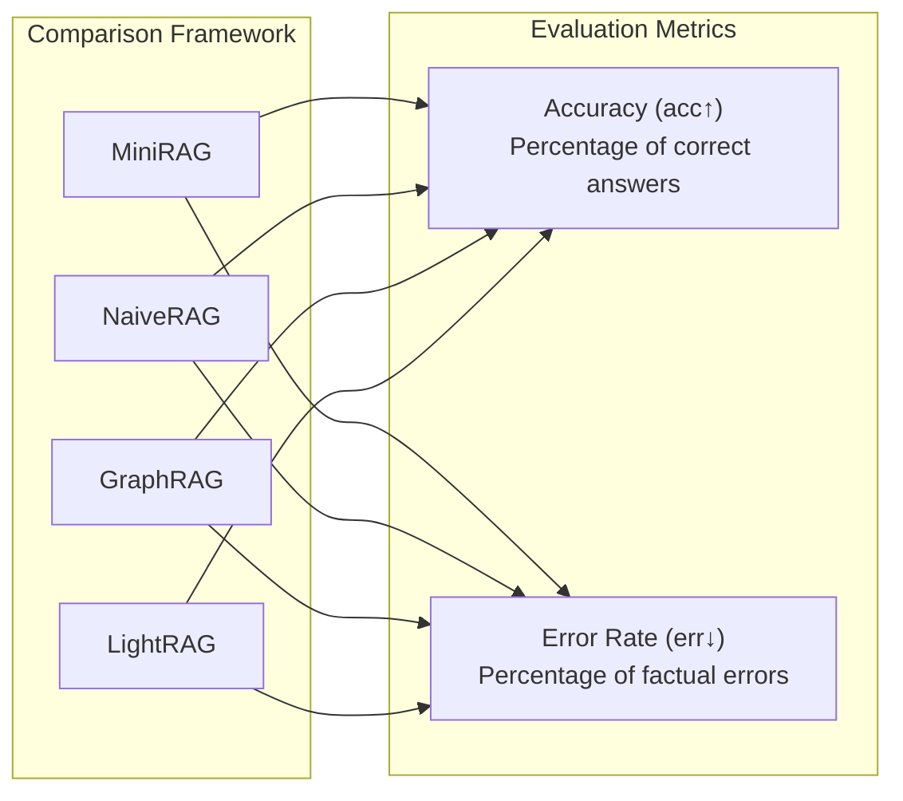
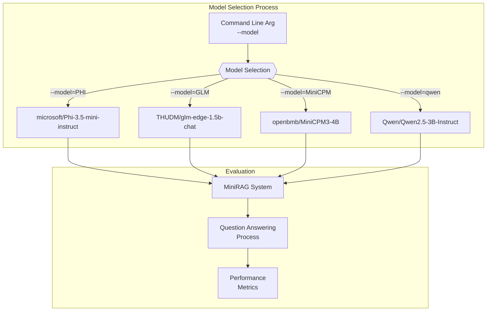

<!-- source: DeepWiki mcp.deepwiki.com · repo HKUDS/MiniRAG · page 7.3 Evaluation Methodology · fetched 2026-11-09 -->

# Evaluation Methodology

Relevant source files

The following files were used as context for generating this wiki page:

- [README.md](README.md)
- [reproduce/Step_0_index.py](reproduce/Step_0_index.py)
- [reproduce/Step_1_QA.py](reproduce/Step_1_QA.py)

This page describes the methodology used to evaluate MiniRAG's performance, covering the benchmarking process, evaluation metrics, and comparison protocols. For information about the dataset structure used in evaluation, see [Dataset Structure](#7.1), and for details about the different question types used in testing, see [Question Types](#7.2).

## Overview of Evaluation Approach

MiniRAG's evaluation methodology is designed to assess how effectively small language models (SLMs) can perform retrieval-augmented generation tasks when equipped with MiniRAG's heterogeneous graph indexing and topology-enhanced retrieval capabilities. The evaluation process consists of two main phases: document indexing and question answering, followed by performance measurement against gold standard answers.

Sources: [README.md:34-36](), [reproduce/Step_0_index.py](), [reproduce/Step_1_QA.py]()

## Evaluation Dataset

MiniRAG is evaluated using the LiHua-World dataset, which contains one year of chat records from a virtual user named LiHua. This dataset is specifically designed for on-device RAG scenarios and includes three question types:

1. **Single-hop questions**: Require retrieving information from a single document
2. **Multi-hop questions**: Require synthesizing information from multiple documents
3. **Summary questions**: Require summarizing information across multiple documents

The dataset provides manually annotated gold standard answers for each question to enable objective evaluation.

Sources: [README.md:130-134]()

## Evaluation Process

### Document Indexing Phase

The first step in the evaluation process is document indexing, which is handled by the `Step_0_index.py` script. This script:

1. Initializes a MiniRAG instance with the specified language model and embedding model
2. Recursively finds all text files in the dataset directory
3. Inserts each document into the MiniRAG system, which builds the heterogeneous graph index

Sources: [reproduce/Step_0_index.py:80-97]()

### Question Answering Phase

After indexing, the `Step_1_QA.py` script performs the question answering evaluation:

1. Reads questions and gold answers from the query CSV file
2. For each question, queries the MiniRAG system using the "mini" mode
3. Records the MiniRAG answer alongside the question and gold answer in an output CSV file

The script processes questions sequentially and handles any errors that may occur during the querying process.

Sources: [reproduce/Step_1_QA.py:92-134]()

## Evaluation Metrics

MiniRAG's performance is evaluated using two primary metrics:

1. **Accuracy (acc↑)**: The percentage of questions for which the system provides a correct answer. Higher is better.
2. **Error Rate (err↓)**: The percentage of answers containing factual errors or hallucinations. Lower is better.

These metrics allow for comprehensive assessment of both the system's ability to retrieve relevant information and its accuracy in generating answers.

Sources: [README.md:70-85]()

## Query Modes and Comparison

MiniRAG supports three query modes, each corresponding to a different retrieval approach:

1. **Naive mode**: Uses only vector-based retrieval
2. **Light mode**: Uses hybrid retrieval combining vector search with entity-based retrieval
3. **Mini mode**: Uses full MiniRAG topology-enhanced retrieval

The evaluation framework compares these modes against other RAG systems:

| System | Retrieval Method | Description |
|--------|------------------|-------------|
| NaiveRAG | Vector-only | Traditional RAG using only vector embeddings |
| GraphRAG | Graph-based | Uses knowledge graphs but with more complex query mechanisms |
| LightRAG | Hybrid | Lightweight RAG with simplified hybrid retrieval |
| MiniRAG | Topology-enhanced | Uses heterogeneous graph indexing with topology-enhanced retrieval |

Sources: [README.md:70-85](), [reproduce/Step_1_QA.py:119]()

## Language Models Evaluation

The evaluation methodology tests MiniRAG with various small language models to demonstrate its effectiveness across different model sizes and architectures:

1. **Phi-3.5-mini-instruct**: Microsoft's small instruction-tuned model
2. **GLM-Edge-1.5B-Chat**: THUDM's edge-optimized chat model
3. **Qwen2.5-3B-Instruct**: Qwen's instruction-tuned model
4. **MiniCPM3-4B**: OpenBMB's compact model
5. **gpt-4o-mini**: OpenAI's smaller version of GPT-4o

This diverse set of models allows for comprehensive evaluation across different model capabilities and sizes.

Sources: [reproduce/Step_0_index.py:40-50](), [reproduce/Step_1_QA.py:42-52]()

## Running Evaluations

The evaluation can be reproduced using the following steps:

1. **Setup**: Ensure the LiHua-World dataset is placed in the `./dataset/LiHua-World/data/` directory
2. **Indexing**: Run `python ./reproduce/Step_0_index.py` with appropriate arguments
3. **Question Answering**: Run `python ./reproduce/Step_1_QA.py` with matching arguments

### Command Line Arguments

Both scripts accept the following arguments:

| Argument | Description | Default Value |
|----------|-------------|---------------|
| `--model` | LLM model to use (PHI, GLM, MiniCPM, qwen) | PHI |
| `--outputpath` | Path for the output CSV file | ./logs/Default_output.csv |
| `--workingdir` | Working directory for MiniRAG | ./LiHua-World |
| `--datapath` | Path to the dataset files | ./dataset/LiHua-World/data/ |
| `--querypath` | Path to the query set file | ./dataset/LiHua-World/qa/query_set.csv |

This standardized approach ensures consistent and reproducible evaluation across different models and configurations.

Sources: [reproduce/Step_0_index.py:23-35](), [reproduce/Step_1_QA.py:26-37]()

## Performance Comparison

The evaluation methodology enables fair comparison between MiniRAG and other RAG systems across different language models. The results demonstrate MiniRAG's effectiveness, particularly when used with small language models.

For the LiHua-World dataset, MiniRAG achieves significantly higher accuracy compared to other RAG approaches when using small models like Phi-3.5-mini-instruct (53.29% vs. 41.22% for NaiveRAG), while maintaining comparable error rates.

For the MultiHop-RAG dataset, which contains more complex multi-hop questions, MiniRAG shows even more pronounced improvements, with accuracy gains of up to 28.29 percentage points over competing approaches when using small language models.

Sources: [README.md:70-85]()

---

