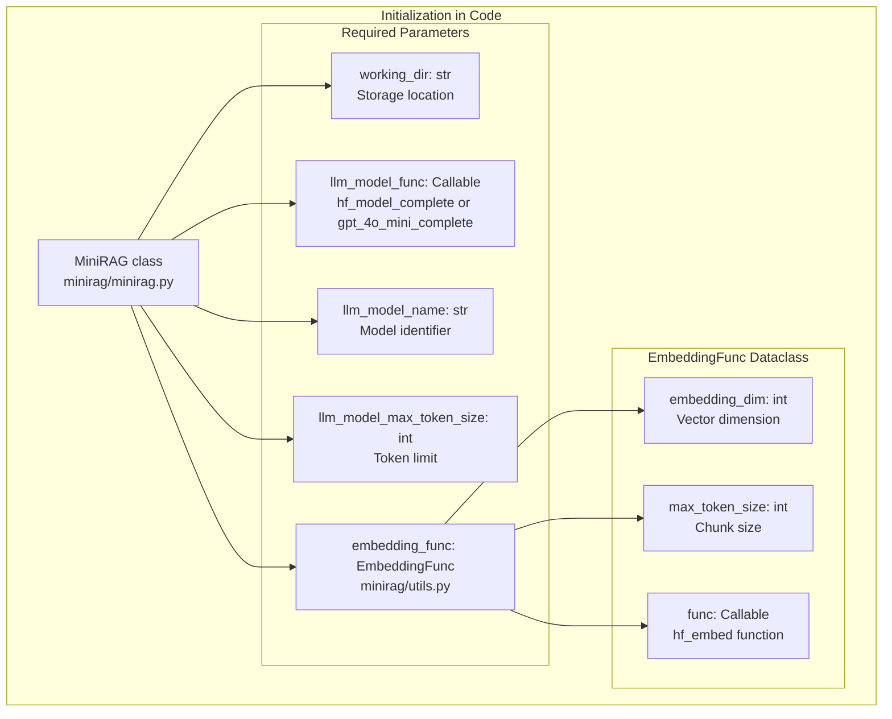
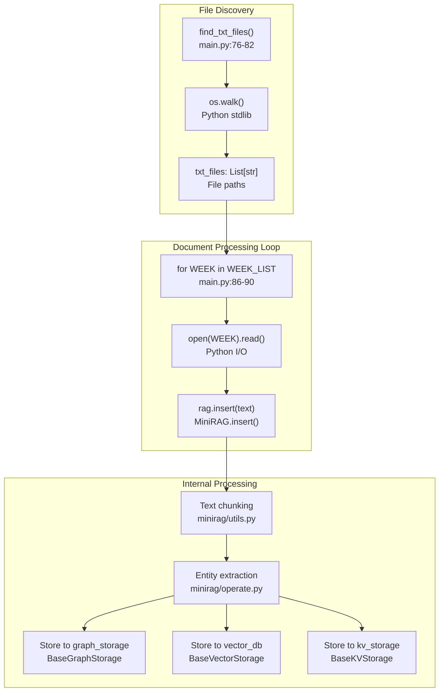
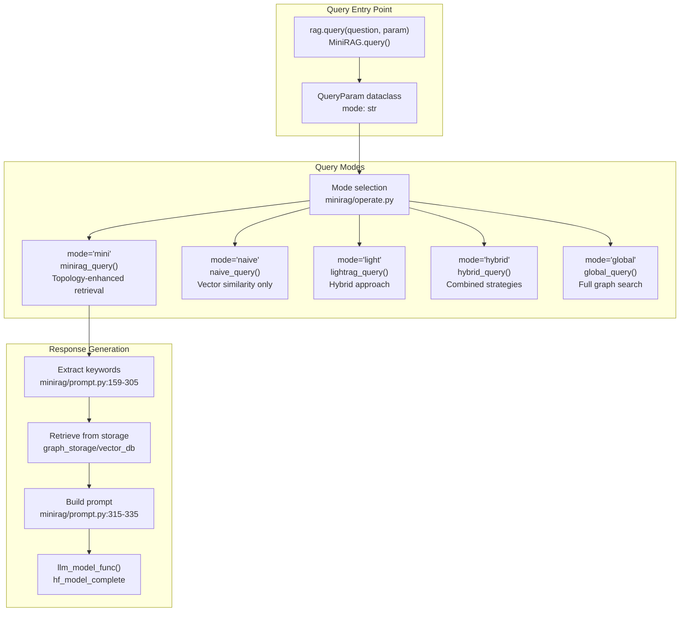
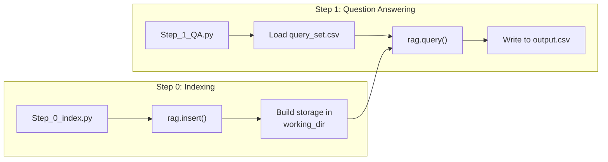

<!-- source: DeepWiki mcp.deepwiki.com · repo HKUDS/MiniRAG · page 8 Usage Examples · fetched 2026-11-09 -->

# Usage Examples

<details>
<summary>Relevant source files</summary>

The following files were used as context for generating this wiki page:

- [main.py](main.py)
- [minirag/prompt.py](minirag/prompt.py)
- [reproduce/Step_0_index.py](reproduce/Step_0_index.py)
- [reproduce/Step_1_QA.py](reproduce/Step_1_QA.py)

</details>


This page provides practical examples of common MiniRAG operations. MiniRAG follows a two-phase workflow: document indexing (Phase 1) and question answering (Phase 2). The examples demonstrate how to use both the reproduction scripts and the programmatic API.

## Overview

MiniRAG provides two usage patterns:

| Usage Pattern | Description | Best For |
|--------------|-------------|----------|
| **Reproduction Scripts** | `Step_0_index.py` and `Step_1_QA.py` in the `reproduce/` directory | Benchmarking on LiHua-World dataset |
| **Programmatic API** | Direct use of `MiniRAG` class with `insert()` and `query()` methods | Custom applications and integration |

This page is organized into three sections:
- **Document Indexing (Page 8.1)**: Using `insert()` to build the knowledge graph
- **Question Answering (Page 8.2)**: Using `query()` with different `QueryParam` modes
- **Custom Workflows (Page 8.3)**: Advanced usage patterns and error handling

For system architecture details, see Page 3. For installation, see Page 2.

## MiniRAG Initialization Pattern

### Code Entity Mapping: Initialization Components

The following diagram maps the initialization process to specific code constructs:



Sources: [main.py:58-72](), [reproduce/Step_0_index.py:63-78](), [reproduce/Step_1_QA.py:65-80]()

### Standard Initialization Example

All examples follow this initialization pattern defined in [main.py:58-72](), [reproduce/Step_0_index.py:63-78](), and [reproduce/Step_1_QA.py:65-80](). Key components:

- **`MiniRAG` constructor**: Orchestrates the entire system
- **`working_dir`**: Persistent directory for graph, vector, and KV storage
- **`llm_model_func`**: Function pointer to `hf_model_complete` or `gpt_4o_mini_complete`
- **`llm_model_name`**: Model identifier (e.g., `"microsoft/Phi-3.5-mini-instruct"`)
- **`embedding_func`**: `EmbeddingFunc` dataclass wrapping `hf_embed` with tokenizer and model

### Supported LLM Models

MiniRAG supports multiple Small Language Models defined in [main.py:35-45](), [reproduce/Step_0_index.py:40-50](), [reproduce/Step_1_QA.py:42-52]():

| Model Argument | Model Path | Parameters |
|----------------|-----------|-----------|
| `PHI` | `microsoft/Phi-3.5-mini-instruct` | ~3.8B |
| `GLM` | `THUDM/glm-edge-1.5b-chat` | 1.5B |
| `MiniCPM` | `openbmb/MiniCPM3-4B` | 4B |
| `qwen` | `Qwen/Qwen2.5-3B-Instruct` | 3B |

Sources: [main.py:35-51](), [reproduce/Step_0_index.py:40-51](), [reproduce/Step_1_QA.py:42-52]()

## Document Indexing Workflow

### Code Entity Mapping: Indexing Pipeline

The document indexing process uses the following code constructs:



Sources: [main.py:76-90](), [reproduce/Step_0_index.py:82-96]()

### Implementation Details

The indexing implementation follows this pattern:

1. **File Discovery**: `find_txt_files()` utility at [main.py:76-82]() and [reproduce/Step_0_index.py:82-88]() uses `os.walk()` to locate all `.txt` files recursively

2. **Iteration**: Loop at [main.py:86-90]() and [reproduce/Step_0_index.py:91-96]() processes each file sequentially

3. **Insertion**: `rag.insert(text)` method accepts raw text strings and handles:
   - Text chunking into manageable segments
   - Entity extraction using prompts from [minirag/prompt.py:13-118]()
   - Storage in graph, vector, and key-value backends

### LiHua-World Dataset Structure

The reproduction scripts use the LiHua-World benchmark dataset organized as:

```
dataset/LiHua-World/
├── data/              # Text files (chat records)
│   ├── week_01.txt
│   ├── week_02.txt
│   └── ...
└── qa/                # Question sets
    ├── query_set.csv
    └── query_set.json
```

The `DATA_PATH` variable at [main.py:48](), [reproduce/Step_0_index.py:53](), and [reproduce/Step_1_QA.py:55]() points to `./dataset/LiHua-World/data/`.

For detailed indexing examples, see Page 8.1.

Sources: [main.py:24-90](), [reproduce/Step_0_index.py:29-96]()

## Question Answering Workflow

### Code Entity Mapping: Query Pipeline

The query process maps to these code constructs:



Sources: [main.py:93-96](), [reproduce/Step_1_QA.py:118-122](), [minirag/prompt.py:159-335]()

### Single Query Example

Basic query invocation at [main.py:93-96]():

- **Query string**: User question as `str`
- **`QueryParam`**: Configuration object with `mode` field
- **Return value**: Generated answer as `str`

Example query: `'What does LiHua predict will happen in "The Rings of Power"?'`

The query is processed with `QueryParam(mode="mini")` to use topology-enhanced retrieval.

### Batch Processing Pattern

The batch processing implementation at [reproduce/Step_1_QA.py:85-128]() demonstrates:

| Component | Implementation | Location |
|-----------|---------------|----------|
| **CSV Loading** | `csv.DictReader` | [reproduce/Step_1_QA.py:85-89]() |
| **Progress Tracking** | `tqdm.trange` | [reproduce/Step_1_QA.py:110]() |
| **Error Handling** | `try-except` block | [reproduce/Step_1_QA.py:117-125]() |
| **Result Logging** | `csv.writer.writerow` | [reproduce/Step_1_QA.py:127]() |

The script loads questions from `QUERY_PATH` variable defined at [reproduce/Step_1_QA.py:56](), which defaults to `./dataset/LiHua-World/qa/query_set.csv`.

### QueryParam Modes

The five query modes are defined in the `operate.py` module:

1. **`mode="mini"`**: MiniRAG's core topology-enhanced retrieval using graph structure
2. **`mode="naive"`**: Simple vector similarity search without graph
3. **`mode="light"`**: LightRAG-style entity-centric retrieval
4. **`mode="hybrid"`**: Combines multiple retrieval strategies
5. **`mode="global"`**: Full knowledge graph search

For detailed query examples and mode comparisons, see Page 8.2.

Sources: [reproduce/Step_1_QA.py:82-128](), [main.py:93-97]()

## Experiment Execution Pattern

### Reproduction Scripts Workflow

The reproduction scripts implement a complete benchmarking pipeline:



Sources: [reproduce/Step_0_index.py:1-97](), [reproduce/Step_1_QA.py:1-135]()

### Command-Line Arguments

Both scripts accept the same argument structure defined using `argparse.ArgumentParser`:

| Argument | Default | Description |
|----------|---------|-------------|
| `--model` | `"PHI"` | LLM model selection (PHI/GLM/MiniCPM/qwen) |
| `--workingdir` | `"./LiHua-World"` | Persistent storage directory |
| `--datapath` | `"./dataset/LiHua-World/data/"` | Input documents (Step_0 only) |
| `--querypath` | `"./dataset/LiHua-World/qa/query_set.csv"` | Question set (Step_1 only) |
| `--outputpath` | `"./logs/Default_output.csv"` | Results log (Step_1 only) |

Argument parsing is implemented at [reproduce/Step_0_index.py:24-36]() and [reproduce/Step_1_QA.py:26-36]().

### Experiment Function Structure

The `run_experiment()` function at [reproduce/Step_1_QA.py:92-129]() implements:

1. **Resume Capability**: Checks existing output file at [reproduce/Step_1_QA.py:96-100]() to skip already-processed questions
2. **Incremental Logging**: Appends results using `mode="a"` at [reproduce/Step_1_QA.py:105]()
3. **Error Handling**: Catches exceptions at [reproduce/Step_1_QA.py:117-125]() and logs `"Error"` string
4. **Progress Display**: Uses `trange()` at [reproduce/Step_1_QA.py:110]() for visual progress bar

The output CSV contains three columns defined in the `headers` list at [reproduce/Step_1_QA.py:93]():
- `"Question"`: Input query
- `"Gold Answer"`: Reference answer from dataset
- `"minirag"`: Generated answer from MiniRAG

Sources: [reproduce/Step_1_QA.py:92-134]()

## Script Execution Examples

### Running Step_0_index.py

Index the LiHua-World dataset with Phi-3.5 model:

```bash
python reproduce/Step_0_index.py \
    --model PHI \
    --workingdir ./LiHua-World \
    --datapath ./dataset/LiHua-World/data/
```

This script:
1. Discovers all `.txt` files in `--datapath` using [reproduce/Step_0_index.py:82-88]()
2. Initializes MiniRAG with specified model at [reproduce/Step_0_index.py:63-78]()
3. Calls `rag.insert()` for each file at [reproduce/Step_0_index.py:91-96]()
4. Stores graph/vector/KV data in `--workingdir`

### Running Step_1_QA.py

Execute question answering on indexed data:

```bash
python reproduce/Step_1_QA.py \
    --model PHI \
    --workingdir ./LiHua-World \
    --querypath ./dataset/LiHua-World/qa/query_set.csv \
    --outputpath ./logs/phi_results.csv
```

This script:
1. Loads MiniRAG from existing `--workingdir` at [reproduce/Step_1_QA.py:65-80]()
2. Reads questions from `--querypath` at [reproduce/Step_1_QA.py:85-89]()
3. Queries with `mode="mini"` at [reproduce/Step_1_QA.py:118-122]()
4. Logs results to `--outputpath` at [reproduce/Step_1_QA.py:127]()

Sources: [reproduce/Step_0_index.py:1-97](), [reproduce/Step_1_QA.py:1-135]()

## Best Practices

When using MiniRAG, consider the following best practices:

1. **Working directory setup**: Choose a persistent directory for the `working_dir` parameter to maintain your index between sessions.
2. **Model selection**: Choose LLM and embedding models appropriate for your task. Smaller models may be faster but less accurate.
3. **Query mode selection**:
   - Use `mode="mini"` for complex questions requiring comprehension of relationships
   - Use `mode="naive"` for simple factual questions
   - Use `mode="light"` for a balance between speed and accuracy
4. **Error handling**: Always wrap query calls in try-except blocks to handle potential errors.

## Summary

This page has demonstrated the basic usage patterns of MiniRAG:

1. **Setup and configuration**: Initializing MiniRAG with appropriate models
2. **Document indexing**: Adding documents to build the knowledge graph
3. **Question answering**: Querying the system with different modes
4. **Running experiments**: Processing multiple questions and logging results

For more advanced usage, including custom storage backends, embedding models, and LLM integration, see [Extending MiniRAG](#9).

---

