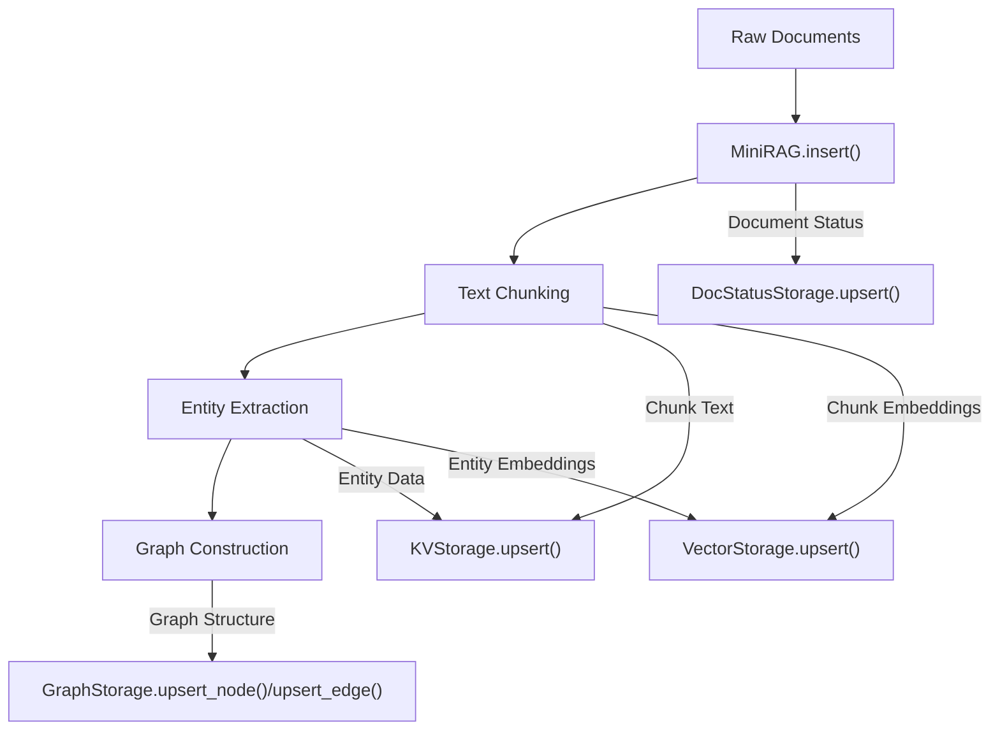
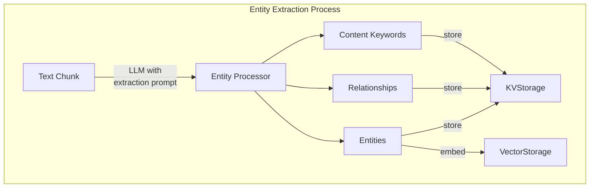
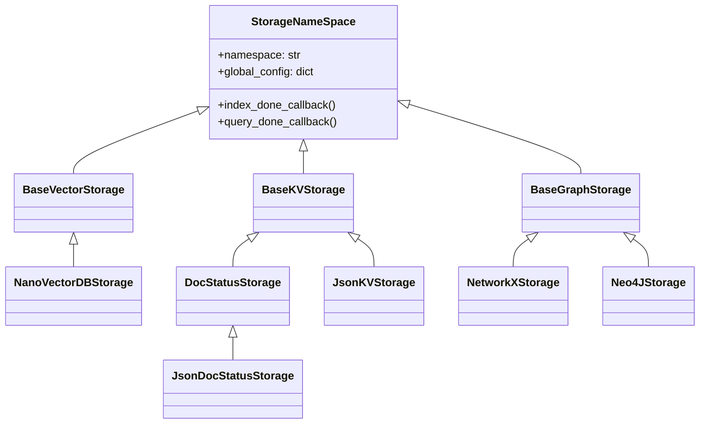

<!-- source: DeepWiki mcp.deepwiki.com · repo HKUDS/MiniRAG · page 8.1 Document Indexing · fetched 2026-11-09 -->

# Document Indexing

<details>
<summary>Relevant source files</summary>

The following files were used as context for generating this wiki page:

- [minirag/kg/weaviate_impl.py](minirag/kg/weaviate_impl.py)
- [minirag/minirag.py](minirag/minirag.py)
- [reproduce/Step_0_index.py](reproduce/Step_0_index.py)
- [reproduce/Step_1_QA.py](reproduce/Step_1_QA.py)
- [tests/test_weaviate.py](tests/test_weaviate.py)

</details>


Document Indexing in MiniRAG is the process of ingesting raw documents, extracting valuable information from them, and storing this information in various storage systems for efficient retrieval. This page explains how to index documents using MiniRAG and details the underlying indexing architecture.

For information on how to query the indexed documents, see [Question Answering](#8.2).

## Indexing Process Overview

The document indexing pipeline in MiniRAG transforms raw text documents into a structured knowledge base that supports advanced retrieval capabilities.



Sources: [main.py:76-90](), [minirag/prompt.py:13-118]()

## Using the API to Index Documents

The primary way to index documents is using the `insert` method of the `MiniRAG` class:

```python
# Initialize MiniRAG
rag = MiniRAG(
    working_dir="./working_dir",
    llm_model_func=hf_model_complete,
    llm_model_max_token_size=200,
    llm_model_name="microsoft/Phi-3.5-mini-instruct",
    embedding_func=EmbeddingFunc(...),
)

# Index a document
with open("document.txt") as f:
    rag.insert(f.read())
```

Sources: [main.py:58-71](), [main.py:85-90]()

## Indexing Process Details

### Document Reading

The first step in the indexing process is reading documents from their source. MiniRAG supports reading plain text files (`.txt`). In the provided example, a utility function `find_txt_files()` is used to locate text files in a directory structure.

```python
def find_txt_files(root_path):
    txt_files = []
    for root, dirs, files in os.walk(root_path):
        for file in files:
            if file.endswith(".txt"):
                txt_files.append(os.path.join(root, file))
    return txt_files
```

Sources: [main.py:76-82]()

### Text Chunking

During indexing, MiniRAG splits documents into smaller chunks to:
1. Fit within token limits of LLMs
2. Create more granular units for retrieval
3. Enable more precise context generation

Each chunk is assigned a unique identifier, and the text is stored in KV storage while its embedding is stored in Vector storage.

### Entity Extraction

MiniRAG uses a Language Model with a specialized prompt to extract structured information from text chunks:

1. **Entities**: Named objects with types (person, organization, location, event)
2. **Relationships**: Connections between entities
3. **Content Keywords**: High-level themes and concepts



The entity extraction prompt template is defined in `prompt.py` and includes detailed instructions for identifying entities with their names, types, and descriptions.

Sources: [minirag/prompt.py:13-118]()

### Graph Construction

After extracting entities and relationships, MiniRAG constructs a heterogeneous graph that represents the knowledge in the documents. This graph includes:

- Nodes for text chunks
- Nodes for entities
- Edges between chunks and entities they mention
- Edges between related entities

This graph structure is stored in Graph storage and is essential for MiniRAG's topology-enhanced retrieval capabilities. For more information on the theoretical basis of this approach, see [Heterogeneous Graph Indexing](#4.1).

## Storage Systems

MiniRAG uses four types of storage systems during indexing:

| Storage Type | Purpose | Implementation Options | Key Methods |
|--------------|---------|------------------------|-------------|
| Vector Storage | Stores embeddings for similarity search | NanoVectorDBStorage | `upsert()`, `query()` |
| KV Storage | Stores text and metadata | JsonKVStorage | `upsert()`, `get_by_id()` |
| Graph Storage | Stores entity-relation graph | NetworkXStorage, Neo4JStorage | `upsert_node()`, `upsert_edge()` |
| Document Status Storage | Tracks document processing status | JsonDocStatusStorage | `upsert()`, `get_status_counts()` |

Each storage system inherits from the `StorageNameSpace` base class, providing a consistent interface and namespace management.



For more details on storage implementations, see [Storage Implementations](#5).

Sources: [main.py:58-71]()

## Example: Indexing a Document Collection

The following example shows how to index all text files in a directory, which is useful for processing collections like the LiHua-World dataset:

```python
# Configuration
EMBEDDING_MODEL = "sentence-transformers/all-MiniLM-L6-v2"
LLM_MODEL = "microsoft/Phi-3.5-mini-instruct"
WORKING_DIR = "./working_dir"
DATA_PATH = "./dataset/LiHua-World/data/"

# Initialize MiniRAG
rag = MiniRAG(
    working_dir=WORKING_DIR,
    llm_model_func=hf_model_complete,
    llm_model_max_token_size=200,
    llm_model_name=LLM_MODEL,
    embedding_func=EmbeddingFunc(...),
)

# Find and index all text files
WEEK_LIST = find_txt_files(DATA_PATH)
for WEEK in WEEK_LIST:
    id = WEEK_LIST.index(WEEK)
    print(f"{id}/{len(WEEK_LIST)}")
    with open(WEEK) as f:
        rag.insert(f.read())
```

This example shows:
1. How to configure MiniRAG with appropriate model settings
2. How to locate text files in a directory structure
3. How to index each file and track progress

Sources: [main.py:84-90]()

## Best Practices for Document Indexing

When indexing documents with MiniRAG, consider the following best practices:

1. **Model Selection**: Choose appropriate embedding models and LLMs that balance quality and speed
2. **Working Directory**: Use a dedicated working directory for each project to isolate storage
3. **Document Preprocessing**: Clean and normalize text before indexing if needed
4. **Batch Processing**: For large collections, index in batches to manage memory usage
5. **Status Monitoring**: Check document status storage to identify and fix failed indexing operations

By following these practices, you can build a robust knowledge base that supports effective question answering and information retrieval.

---

