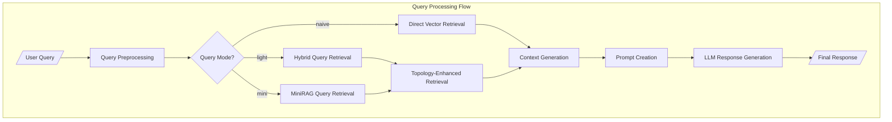
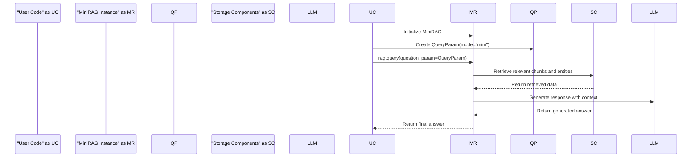
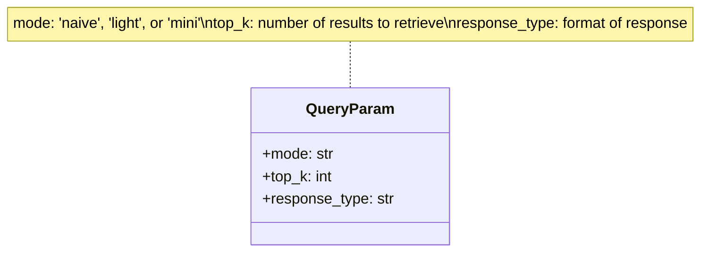
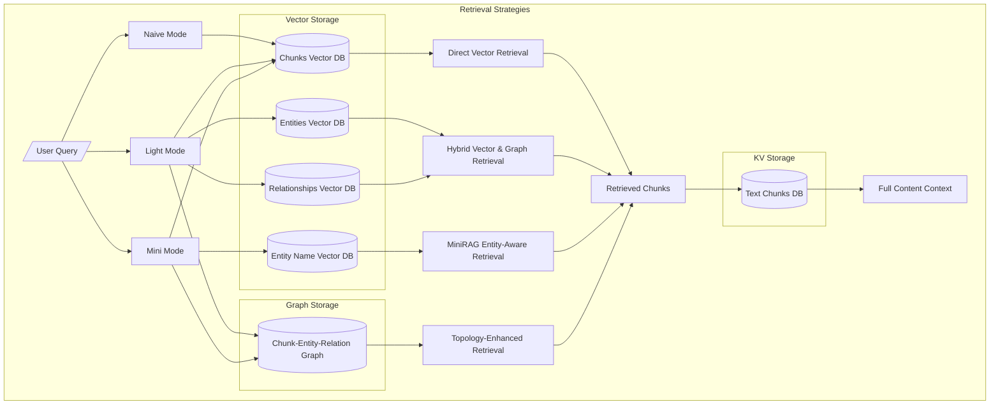
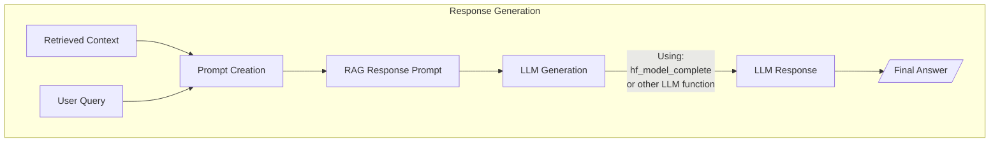
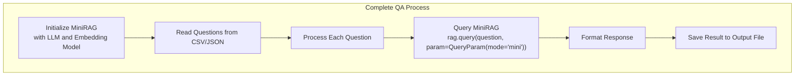

<!-- source: DeepWiki mcp.deepwiki.com · repo HKUDS/MiniRAG · page 8.2 Question Answering · fetched 2026-11-09 -->

# Question Answering

<details>
<summary>Relevant source files</summary>

The following files were used as context for generating this wiki page:

- [minirag/api/requirements.txt](minirag/api/requirements.txt)
- [minirag/operate.py](minirag/operate.py)
- [reproduce/Step_0_index.py](reproduce/Step_0_index.py)
- [reproduce/Step_1_QA.py](reproduce/Step_1_QA.py)

</details>


This page documents how to use MiniRAG's question answering capabilities to retrieve and generate accurate responses based on indexed documents. It explains the query processing flow, different query modes, and how to execute queries against your knowledge base. For information about indexing documents before querying, see [Document Indexing](#8.1).

## Query Processing Flow

MiniRAG supports three different query modes that determine how your query is processed and how information is retrieved from the knowledge base.



Sources: [reproduce/Step_1_QA.py:117-123](), [minirag/prompt.py:313-413]()

### Query Modes

MiniRAG provides three distinct query modes, each with different retrieval strategies:

| Mode | Description | Retrieval Strategy | Best Use Cases |
|------|-------------|-------------------|----------------|
| `naive` | Basic vector similarity search | Direct vector retrieval without topology | Simple factual queries where direct matching is sufficient |
| `light` | Hybrid vector and graph search | Topology-enhanced retrieval with lightweight graph traversal | Most general-purpose queries requiring some connections |
| `mini` | Full heterogeneous graph-based retrieval | Advanced topology-enhanced retrieval with full graph features | Complex questions requiring multi-hop reasoning and entity relationships |

Sources: [reproduce/Step_1_QA.py:119]()

## Using Question Answering

### Basic Usage

The simplest way to query your indexed data is to use the `query()` method of your MiniRAG instance:



Sources: [reproduce/Step_1_QA.py:117-123](), [main.py:94-96]()

### Code Example

Here's a minimal example of how to perform question answering with MiniRAG:

```python
from minirag import MiniRAG, QueryParam

# Initialize MiniRAG (configuration omitted for brevity)
rag = MiniRAG(...)

# Ask a question
question = 'What does LiHua predict will happen in "The Rings of Power"?'
answer = rag.query(question, param=QueryParam(mode="mini"))
print(answer)
```

Sources: [main.py:94-96](), [reproduce/Step_1_QA.py:117-123]()

## Query Processing Components

### Query Parameter Configuration

The `QueryParam` class allows you to customize how your query is processed:



Sources: [reproduce/Step_1_QA.py:119](), [main.py:95]()

### Retrieval Strategies

The retrieval strategy differs based on the query mode:



Sources: [reproduce/Step_1_QA.py:117-123](), [main.py:94-96]()

## Response Generation

After retrieving relevant information, MiniRAG uses an LLM to generate a response based on the retrieved context:



Sources: [minirag/prompt.py:313-337](), [minirag/prompt.py:393-413](), [reproduce/Step_1_QA.py:67-70]()

### Prompt Templates

MiniRAG uses specific prompt templates for generating responses:

1. For standard RAG responses: `rag_response` template
2. For naive mode: `naive_rag_response` template

These templates include placeholders for:
- Response type
- Context data from retrieved documents
- The user's query

Sources: [minirag/prompt.py:313-337](), [minirag/prompt.py:393-413]()

## Practical Example: Running a Query

Here's a complete example of how to run a question answering task with MiniRAG using the LiHua-World dataset:



Sources: [reproduce/Step_1_QA.py:65-127]()

## Integration with Language Models

MiniRAG supports integration with various language models:

| Model | Identifier | Description |
|-------|------------|-------------|
| Phi-3.5-mini | `microsoft/Phi-3.5-mini-instruct` | Small but capable model from Microsoft |
| GLM Edge | `THUDM/glm-edge-1.5b-chat` | Efficient edge model from THUDM |
| MiniCPM | `openbmb/MiniCPM3-4B` | Small Chinese-English bilingual model |
| Qwen | `Qwen/Qwen2.5-3B-Instruct` | Small model from Alibaba |

To use these models, specify the model name when initializing MiniRAG or set it via the command line in provided scripts.

Sources: [reproduce/Step_1_QA.py:42-52](), [main.py:35-45]()

## Performance Considerations

When using question answering with MiniRAG, consider:

1. **Query Mode Selection**: Choose the appropriate mode based on your query complexity
   - `naive`: Fastest but least sophisticated
   - `light`: Good balance of speed and accuracy
   - `mini`: Most accurate but potentially slower

2. **Model Selection**: Smaller models are faster but may have lower accuracy

3. **Embedding Model**: The default embedding model `sentence-transformers/all-MiniLM-L6-v2` provides a good balance of performance and accuracy

4. **Top-k Parameter**: Adjust this to control how many documents are retrieved and sent to the LLM

Sources: [reproduce/Step_1_QA.py:21-79](), [main.py:14-72]()

---

