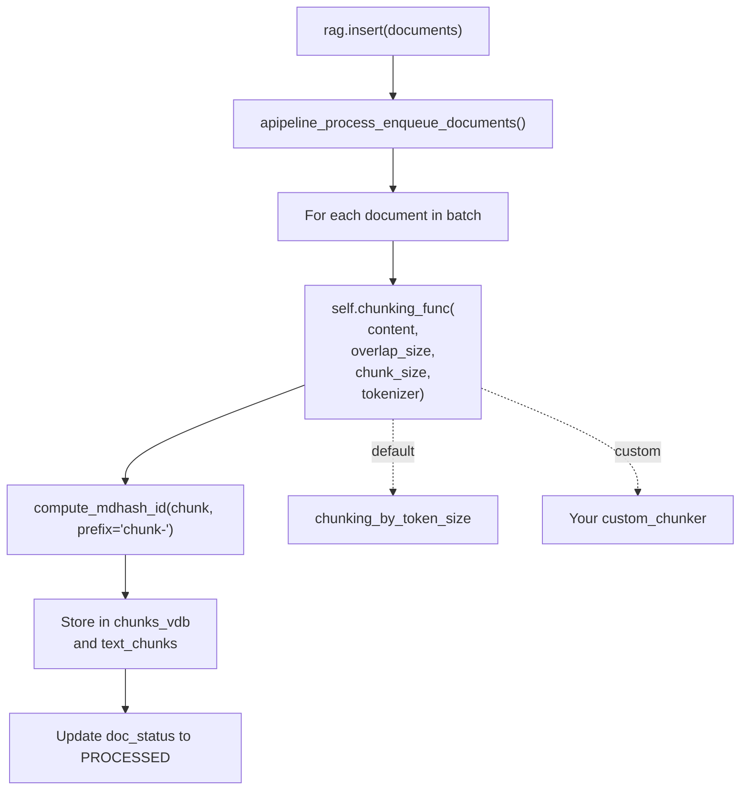
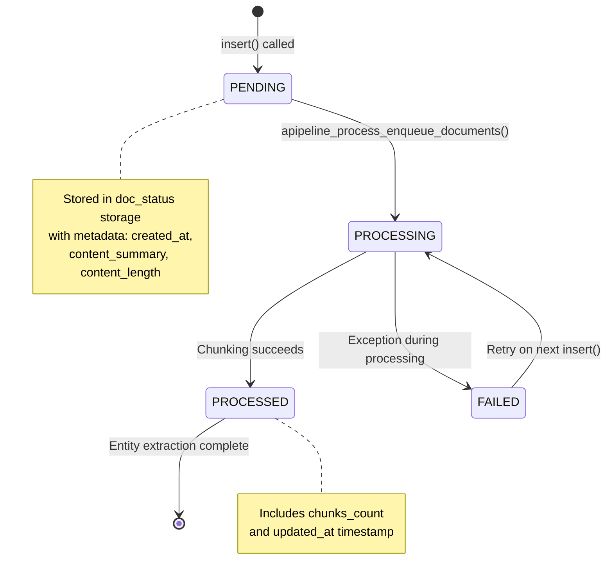
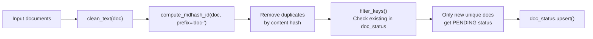
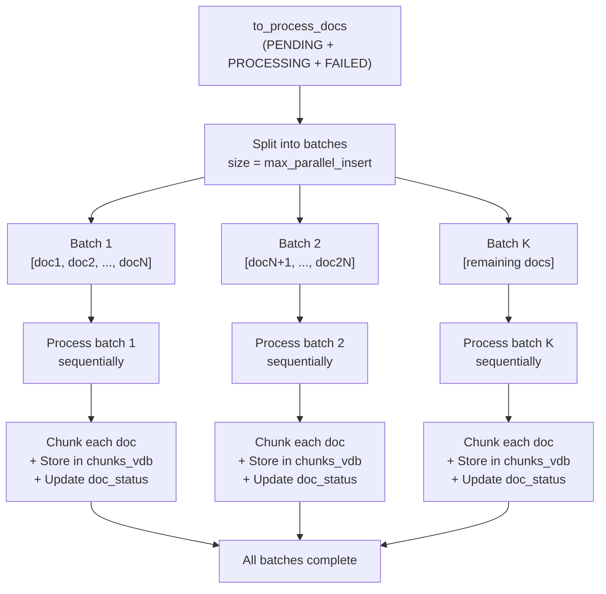
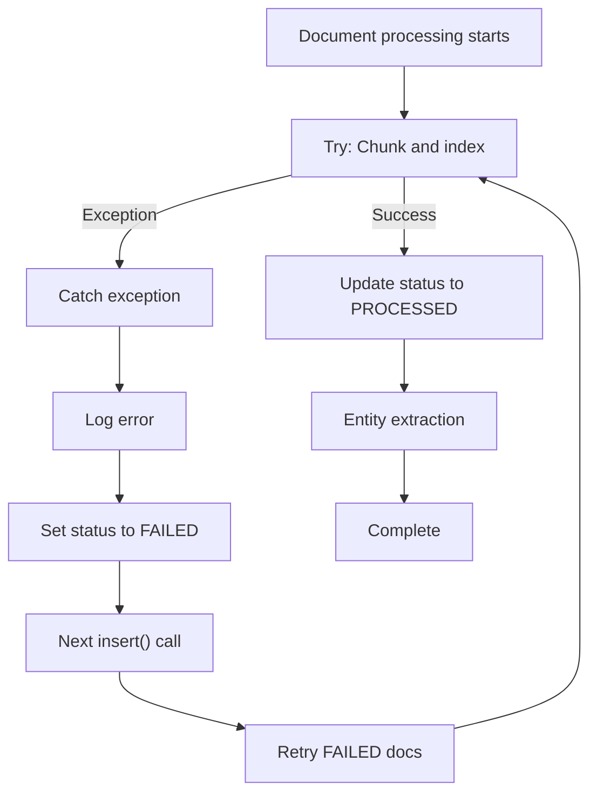
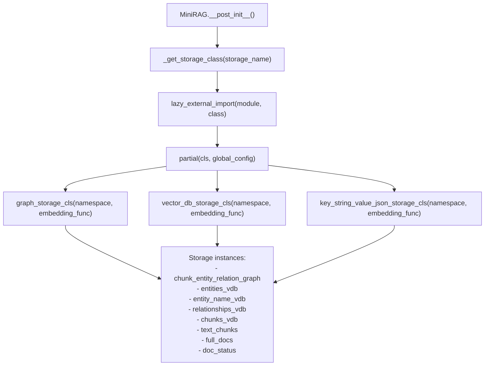
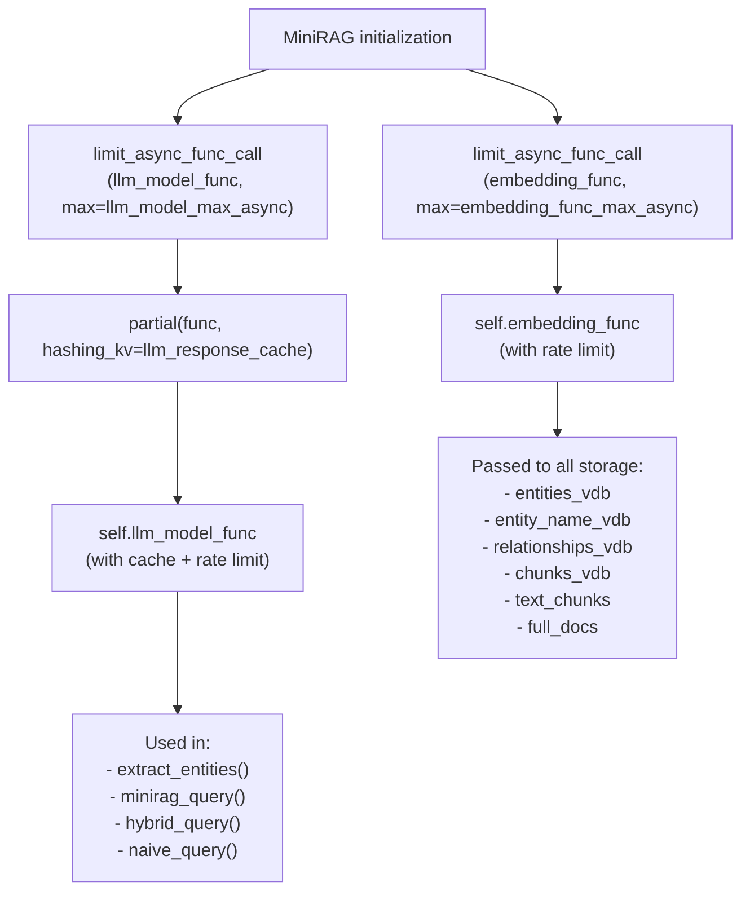

<!-- source: DeepWiki mcp.deepwiki.com · repo HKUDS/MiniRAG · page 8.3 Custom Workflows · fetched 2026-11-09 -->

# Custom Workflows

<details>
<summary>Relevant source files</summary>

The following files were used as context for generating this wiki page:

- [main.py](main.py)
- [minirag/kg/weaviate_impl.py](minirag/kg/weaviate_impl.py)
- [minirag/minirag.py](minirag/minirag.py)
- [minirag/prompt.py](minirag/prompt.py)
- [tests/test_weaviate.py](tests/test_weaviate.py)

</details>


## Purpose and Scope

This document covers advanced usage patterns for MiniRAG beyond basic document indexing and querying. Topics include custom text chunking strategies, incremental document updates, batch processing configurations, error handling mechanisms, custom storage backend selection, and custom LLM/embedding integration.

For basic document insertion, see [Document Indexing](#8.1). For standard query operations, see [Question Answering](#8.2). For implementing new storage backends from scratch, see [Adding Storage Backends](#10.1).

---

## Custom Chunking Functions

MiniRAG allows you to replace the default token-based chunking algorithm with custom implementations. The `chunking_func` parameter in the `MiniRAG` class accepts any callable that follows the chunking interface.

### Default Chunking Behavior

By default, MiniRAG uses token-based chunking from `operate.py`:

```python
chunking_func: callable = chunking_by_token_size
```

The default function takes the following parameters and returns a list of chunk dictionaries with `content` and `tokens` fields. Configuration is controlled via:

| Parameter | Default | Purpose |
|-----------|---------|---------|
| `chunk_token_size` | 1200 | Maximum tokens per chunk |
| `chunk_overlap_token_size` | 100 | Overlap between chunks |
| `tiktoken_model_name` | "gpt-4o-mini" | Tokenizer model |

Sources: [minirag/minirag.py:138-140](), [minirag/minirag.py:185-186]()

### Implementing Custom Chunking

Custom chunking functions must accept `(content, overlap_size, chunk_size, tokenizer_model)` parameters and return a list of dictionaries with at minimum a `content` field:

```python
def custom_semantic_chunker(content, overlap_size, chunk_size, tokenizer_model):
    """Custom chunker that splits by semantic boundaries"""
    chunks = []
    # Your custom logic here
    # Split by paragraphs, sentences, or semantic similarity
    for i, chunk_text in enumerate(split_semantic(content)):
        chunks.append({
            "content": chunk_text,
            "tokens": len(chunk_text.split()),
            "chunk_index": i
        })
    return chunks

# Initialize with custom chunker
rag = MiniRAG(
    working_dir="./my_rag",
    chunking_func=custom_semantic_chunker,
    chunking_func_kwargs={}  # Additional kwargs passed to your function
)
```

The custom chunking function is invoked during document processing in the pipeline:

Sources: [minirag/minirag.py:484-495]()

### Chunking Function Call Pattern



Sources: [minirag/minirag.py:484-495](), [minirag/minirag.py:370-376]()

---

## Document Lifecycle Management

MiniRAG tracks document processing status through a state machine, enabling incremental updates and robust error handling.

### Document Status States

The `DocStatus` enum defines the document lifecycle:

| Status | Description | Transition |
|--------|-------------|------------|
| `PENDING` | Newly enqueued, not yet processed | Initial state |
| `PROCESSING` | Currently being chunked/indexed | From PENDING or FAILED |
| `PROCESSED` | Successfully completed | Terminal success state |
| `FAILED` | Processing encountered error | Can retry to PROCESSING |

Sources: [minirag/base.py]()

### Document Status Tracking Diagram



Sources: [minirag/minirag.py:424-449](), [minirag/minirag.py:501-513]()

### Incremental Update Pattern

Documents are deduplicated by content hash. If a document with the same content already exists, it is not reprocessed:

```python
# Enqueue multiple documents - duplicates filtered automatically
documents = [
    "Document content 1",
    "Document content 2",
    "Document content 1",  # Duplicate - will be filtered
]

rag.insert(documents)  # Only 2 documents processed

# Check document status
all_docs = await rag.doc_status.get_docs_by_status(DocStatus.PROCESSED)
print(f"Processed {len(all_docs)} unique documents")
```

The deduplication logic uses MD5 hashing:



Sources: [minirag/minirag.py:391-449](), [minirag/minirag.py:415-423]()

### Querying Document Status

Access document status programmatically:

```python
# Get all documents by status
pending = await rag.doc_status.get_docs_by_status(DocStatus.PENDING)
processing = await rag.doc_status.get_docs_by_status(DocStatus.PROCESSING)
failed = await rag.doc_status.get_docs_by_status(DocStatus.FAILED)
processed = await rag.doc_status.get_docs_by_status(DocStatus.PROCESSED)

# Manually retry failed documents
if failed:
    # Failed docs are automatically retried on next insert()
    await rag.apipeline_process_enqueue_documents()
```

Failed and processing documents are automatically included in the next processing batch:

Sources: [minirag/minirag.py:461-474]()

---

## Batch Processing and Parallelization

### Batch Size Configuration

Control parallel document processing with the `max_parallel_insert` parameter:

```python
import os

# Set via environment variable
os.environ["MAX_PARALLEL_INSERT"] = "5"

# Or via constructor
rag = MiniRAG(
    working_dir="./rag_data",
    max_parallel_insert=5  # Process 5 documents in parallel
)
```

Default value is 2 if not specified. This controls how many documents are processed concurrently in each batch during the pipeline execution.

Sources: [minirag/minirag.py:188]()

### Batch Processing Flow



Sources: [minirag/minirag.py:476-514]()

### Async Concurrency Limits

LLM and embedding calls have separate async concurrency controls:

| Parameter | Default | Purpose |
|-----------|---------|---------|
| `llm_model_max_async` | 16 | Max concurrent LLM calls |
| `embedding_func_max_async` | 16 | Max concurrent embedding calls |

These are applied using the `limit_async_func_call` decorator:

```python
rag = MiniRAG(
    llm_model_max_async=8,      # Limit to 8 concurrent LLM calls
    embedding_func_max_async=32  # Allow 32 concurrent embeddings
)
```

The limits are enforced via semaphore-based throttling:

Sources: [minirag/minirag.py:161](), [minirag/minirag.py:169](), [minirag/minirag.py:247-249](), [minirag/minirag.py:300-306]()

---

## Error Handling and Recovery

### Automatic Retry for Failed Documents

Documents that fail during processing are marked as `FAILED` and automatically retried on the next `insert()` call. The system aggregates all documents needing processing:

```python
# First attempt - some docs may fail
rag.insert(["doc1", "doc2", "doc3"])

# Later insert - failed docs from previous run are retried
rag.insert(["doc4"])  # Also retries any FAILED docs from before
```

The retry logic combines `PROCESSING`, `FAILED`, and `PENDING` documents:

Sources: [minirag/minirag.py:461-474]()

### Storage-Level Error Handling

Storage operations should handle exceptions gracefully. Example from Weaviate implementation:

```python
async def upsert(self, data: Dict[str, Dict]):
    for _id, value in data.items():
        try:
            obj = {"content": value.get("content")}
            await run_sync(
                self.client.data_object.create, obj, "Document", _id
            )
        except WeaviateQueryException as e:
            print(f"Error upserting id {_id} to weaviate: {e}")
            # Continue processing other documents
```

Custom storage implementations should follow this pattern of catching exceptions and allowing partial success.

Sources: [minirag/kg/weaviate_impl.py:50-62]()

### Error Handling Pattern



Sources: [minirag/minirag.py:496-513]()

---

## Custom Storage Backend Selection

MiniRAG supports pluggable storage backends for graph, vector, and key-value stores. Select storage implementations via constructor parameters.

### Storage Backend Configuration

```python
rag = MiniRAG(
    working_dir="./data",
    graph_storage="NetworkXStorage",      # In-memory graph
    vector_storage="NanoVectorDBStorage", # Lightweight vector DB
    kv_storage="JsonKVStorage",           # JSON file storage
    doc_status_storage="JsonDocStatusStorage"
)
```

### Available Storage Backends

| Storage Type | Implementations | Use Case |
|-------------|-----------------|----------|
| Graph Storage | `NetworkXStorage`, `Neo4JStorage`, `AGEStorage`, `PGGraphStorage`, `TiDBGraphStorage`, `MongoGraphStorage`, `OracleGraphStorage`, `WeaviateGraphStorage`, `GremlinStorage` | Entity relationships |
| Vector Storage | `NanoVectorDBStorage`, `MilvusVectorDBStorge`, `ChromaVectorDBStorage`, `TiDBVectorDBStorage`, `PGVectorStorage`, `OracleVectorDBStorage`, `WeaviateVectorStorage` | Semantic search |
| KV Storage | `JsonKVStorage`, `MongoKVStorage`, `RedisKVStorage`, `TiDBKVStorage`, `PGKVStorage`, `OracleKVStorage`, `WeaviateKVStorage` | Text chunk storage |

Sources: [minirag/minirag.py:39-66](), [minirag/minirag.py:130-133](), [minirag/minirag.py:182]()

### Storage Initialization Flow



Sources: [minirag/minirag.py:207-227](), [minirag/minirag.py:264-314](), [minirag/minirag.py:315-318]()

### Using Cloud/Distributed Backends

Example with TiDB for distributed storage:

```python
rag = MiniRAG(
    working_dir="./tidb_rag",
    graph_storage="TiDBGraphStorage",
    vector_storage="TiDBVectorDBStorage",
    kv_storage="TiDBKVStorage",
    vector_db_storage_cls_kwargs={
        "host": "gateway01.us-west-2.prod.aws.tidbcloud.com",
        "port": 4000,
        "user": "your_user",
        "password": "your_password",
        "database": "minirag_db"
    }
)
```

Storage-specific configuration is passed via `vector_db_storage_cls_kwargs`:

Sources: [minirag/minirag.py:173]()

---

## Custom LLM and Embedding Integration

### Custom LLM Functions

Replace the default LLM with custom implementations by providing a callable to `llm_model_func`:

```python
from minirag.llm.hf import hf_model_complete
from transformers import AutoModelForCausalLM, AutoTokenizer

# Custom LLM wrapper
def my_custom_llm(prompt, **kwargs):
    # Your custom logic here
    model = AutoModelForCausalLM.from_pretrained("my-model")
    tokenizer = AutoTokenizer.from_pretrained("my-model")
    # ... generation logic
    return response_text

rag = MiniRAG(
    llm_model_func=my_custom_llm,
    llm_model_name="custom-model-name",
    llm_model_max_token_size=4096,
    llm_model_kwargs={
        "temperature": 0.7,
        "top_p": 0.9
    }
)
```

The LLM function is wrapped with async limiting and caching:

Sources: [minirag/minirag.py:164-170](), [minirag/minirag.py:300-306]()

### Custom Embedding Functions

Provide custom embedding functions via `EmbeddingFunc`:

```python
from minirag.utils import EmbeddingFunc
from transformers import AutoModel, AutoTokenizer

EMBEDDING_MODEL = "sentence-transformers/all-MiniLM-L6-v2"

def custom_embed(texts):
    tokenizer = AutoTokenizer.from_pretrained(EMBEDDING_MODEL)
    model = AutoModel.from_pretrained(EMBEDDING_MODEL)
    # Your embedding logic
    return embeddings

rag = MiniRAG(
    embedding_func=EmbeddingFunc(
        embedding_dim=384,
        max_token_size=512,
        func=lambda texts: custom_embed(texts)
    )
)
```

The `EmbeddingFunc` dataclass wraps your function and provides metadata:

- `embedding_dim`: Dimension of output vectors
- `max_token_size`: Maximum tokens to process
- `func`: Callable that takes list of texts and returns embeddings

Sources: [main.py:63-71](), [minirag/minirag.py:159](), [minirag/minirag.py:247-249]()

### LLM/Embedding Integration Architecture



Sources: [minirag/minirag.py:247-249](), [minirag/minirag.py:300-306](), [minirag/minirag.py:254-298]()

---

## Advanced Workflow Patterns

### Pattern 1: Progressive Document Loading

Load and process documents incrementally with status monitoring:

```python
import os
from minirag import MiniRAG, QueryParam
from minirag.base import DocStatus

rag = MiniRAG(working_dir="./progressive_rag")

# Load documents in batches from a directory
def load_documents_progressively(data_path):
    txt_files = []
    for root, dirs, files in os.walk(data_path):
        for file in files:
            if file.endswith(".txt"):
                txt_files.append(os.path.join(root, file))
    
    # Process in batches of 10
    batch_size = 10
    for i in range(0, len(txt_files), batch_size):
        batch = txt_files[i:i+batch_size]
        batch_content = []
        
        for file_path in batch:
            with open(file_path) as f:
                content = f.read()
                batch_content.append(content)
        
        # Insert batch
        rag.insert(batch_content)
        
        # Check status
        processed = await rag.doc_status.get_docs_by_status(DocStatus.PROCESSED)
        print(f"Processed {len(processed)} documents total")
```

Sources: [main.py:76-90]()

### Pattern 2: Custom Document IDs

Provide explicit document IDs to maintain stable references:

```python
# Using custom IDs
document_ids = ["doc-001", "doc-002", "doc-003"]
documents = ["Content 1", "Content 2", "Content 3"]

rag.insert(documents, ids=document_ids)

# Later updates with same IDs are deduplicated
rag.insert(["Content 1"], ids=["doc-001"])  # Skipped - already exists
```

Custom IDs bypass the MD5 hash generation and allow explicit control over document identity:

Sources: [minirag/minirag.py:344-359](), [minirag/minirag.py:408-416]()

### Pattern 3: Multi-Stage Processing with Custom Handlers

Combine custom chunking, preprocessing, and post-processing:

```python
from minirag import MiniRAG

# Preprocessing function
def preprocess_document(text):
    # Clean, normalize, extract metadata
    cleaned = text.strip().lower()
    return cleaned

# Custom chunker with metadata
def chunk_with_metadata(content, overlap, size, tokenizer):
    chunks = []
    # Your chunking logic
    for i, chunk in enumerate(split_content(content, size)):
        chunks.append({
            "content": chunk,
            "chunk_index": i,
            "metadata": extract_metadata(chunk)
        })
    return chunks

# Initialize
rag = MiniRAG(
    chunking_func=chunk_with_metadata,
    max_parallel_insert=4
)

# Process with preprocessing
documents = load_raw_documents()
preprocessed = [preprocess_document(doc) for doc in documents]
rag.insert(preprocessed)
```

### Pattern 4: Monitoring and Observability

Track processing metrics during bulk operations:

```python
import asyncio
from minirag import MiniRAG
from minirag.base import DocStatus

async def monitor_processing(rag, check_interval=5):
    """Monitor document processing status"""
    while True:
        pending = await rag.doc_status.get_docs_by_status(DocStatus.PENDING)
        processing = await rag.doc_status.get_docs_by_status(DocStatus.PROCESSING)
        processed = await rag.doc_status.get_docs_by_status(DocStatus.PROCESSED)
        failed = await rag.doc_status.get_docs_by_status(DocStatus.FAILED)
        
        print(f"""
        Status:
        - Pending: {len(pending)}
        - Processing: {len(processing)}
        - Processed: {len(processed)}
        - Failed: {len(failed)}
        """)
        
        if not pending and not processing:
            break
            
        await asyncio.sleep(check_interval)

# Usage
rag = MiniRAG(working_dir="./monitored_rag")
rag.insert(large_document_list)
await monitor_processing(rag)
```

Sources: [minirag/minirag.py:461-474]()

### Pattern 5: Batch Query with Different Modes

Execute multiple queries with varying retrieval strategies:

```python
from minirag import MiniRAG, QueryParam

rag = MiniRAG(working_dir="./multi_mode_rag")
rag.insert(documents)

queries = [
    "What is the main topic?",
    "List all persons mentioned",
    "Summarize the key events"
]

# Run same queries with different modes
results = {}
for mode in ["naive", "light", "mini"]:
    results[mode] = []
    for query in queries:
        answer = rag.query(query, param=QueryParam(mode=mode))
        results[mode].append(answer)

# Compare results
for query, naive_ans, light_ans, mini_ans in zip(
    queries, results["naive"], results["light"], results["mini"]
):
    print(f"Query: {query}")
    print(f"Naive: {naive_ans[:100]}...")
    print(f"Light: {light_ans[:100]}...")
    print(f"Mini: {mini_ans[:100]}...")
    print()
```

Sources: [minirag/minirag.py:537-572](), [main.py:93-97]()

---

## Summary

Custom workflows in MiniRAG enable:

1. **Flexible chunking** via `chunking_func` parameter with custom implementations
2. **Incremental updates** through automatic document deduplication and status tracking  
3. **Scalable batch processing** controlled by `max_parallel_insert` and async concurrency limits
4. **Robust error handling** with automatic retry for failed documents
5. **Storage flexibility** through pluggable backend selection for graph, vector, and KV stores
6. **Custom model integration** via `llm_model_func` and `embedding_func` parameters

These capabilities allow MiniRAG to adapt to diverse deployment scenarios, from single-machine prototypes to distributed production systems with custom data processing requirements.

Sources: [minirag/minirag.py:122-314](), [minirag/minirag.py:340-581](), [main.py:1-98]()

---

