<!-- source: DeepWiki mcp.deepwiki.com · repo HKUDS/MiniRAG · page 9 Utilities and Helpers · fetched 2026-11-09 -->

# Utilities and Helpers

<details>
<summary>Relevant source files</summary>

The following files were used as context for generating this wiki page:

- [minirag/utils.py](minirag/utils.py)

</details>


The `minirag/utils.py` module provides a comprehensive set of utility functions that support MiniRAG's core operations. These utilities handle text processing, similarity calculations, graph algorithms, data serialization, and async control mechanisms used throughout the codebase. This page documents the helper functions that enable MiniRAG's data processing pipeline, storage operations, and query execution.

For information about the main RAG operations that use these utilities, see [RAG Operations and Query Processing](#3.3). For embedding model integration details, see [Embedding Functions](#6.2).

**Sources:** [minirag/utils.py:1-517]()

---

## Utility Function Categories

The utilities module is organized into several functional categories that support different aspects of the MiniRAG system:

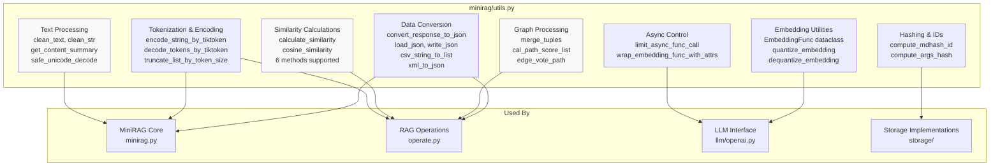

**Diagram: Utility Function Categories and Their Consumers**

**Sources:** [minirag/utils.py:1-517]()

---

## Logger Configuration

The module provides a global logger instance for MiniRAG operations:

```python
logger = logging.getLogger("minirag")
```

The `set_logger` function configures file-based logging with DEBUG level output:

| Function | Purpose | Parameters |
|----------|---------|------------|
| `set_logger` | Configure file logging for MiniRAG | `log_file: str` - Path to log file |

The logger uses a standard format including timestamp, logger name, level, and message. It ensures only one file handler is attached to prevent duplicate log entries.

**Sources:** [minirag/utils.py:27-42]()

---

## 9.1 Text Processing

Text processing utilities handle cleaning, normalization, tokenization, and encoding operations required for document ingestion and query processing.

### Text Cleaning and Normalization

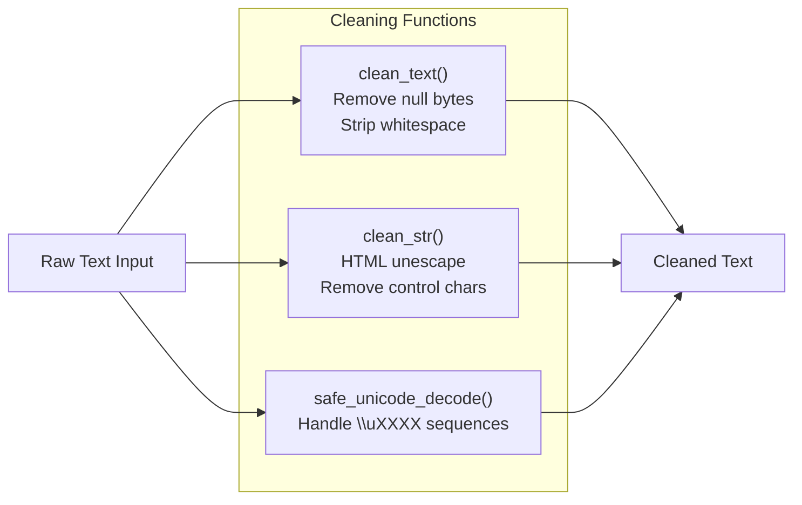

**Diagram: Text Cleaning Pipeline**

| Function | Purpose | Implementation Details |
|----------|---------|----------------------|
| `clean_text` | Remove null bytes and whitespace | Strips text and replaces `\x00` characters |
| `clean_str` | Comprehensive cleaning for entity extraction | HTML unescape, removes control characters `[\x00-\x1f\x7f-\x9f]` |
| `safe_unicode_decode` | Decode Unicode escape sequences | Converts `\uXXXX` patterns to actual characters |
| `get_content_summary` | Truncate content for logging/display | Returns first `max_length` characters with ellipsis |

**Sources:** [minirag/utils.py:66-74](), [minirag/utils.py:174-182](), [minirag/utils.py:293-307]()

### Tokenization and Token Management

MiniRAG uses `tiktoken` for token-based text operations, essential for managing LLM context windows:

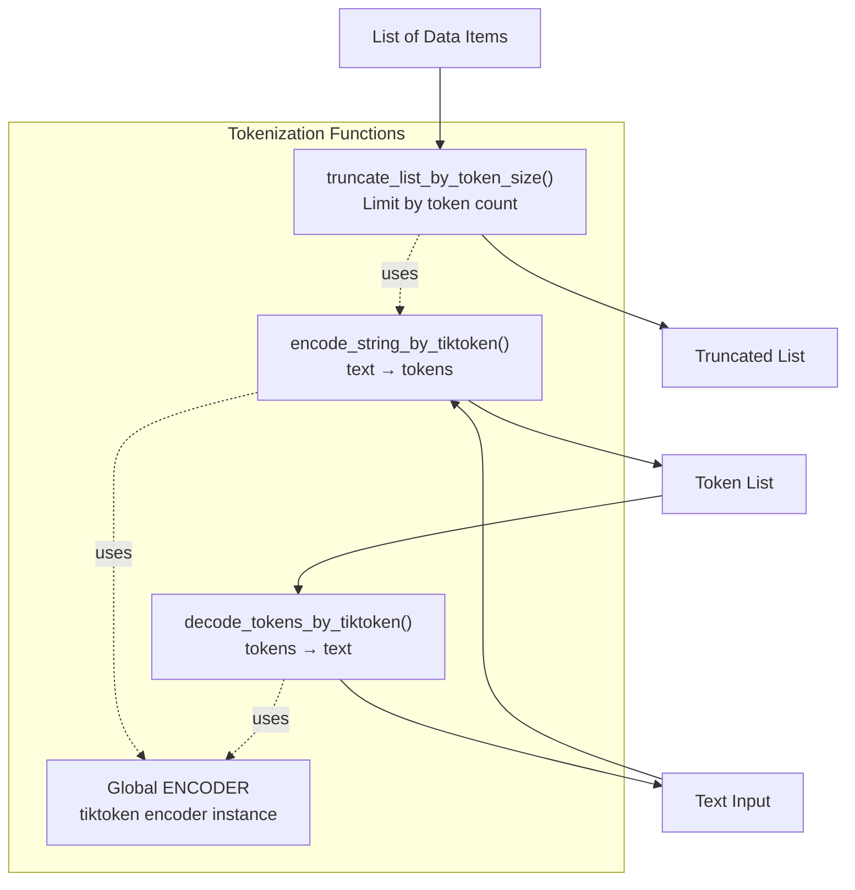

**Diagram: Tokenization Functions and Token Management**

| Function | Signature | Purpose |
|----------|-----------|---------|
| `encode_string_by_tiktoken` | `(content: str, model_name: str = "gpt-4o") -> list[int]` | Encode text to tokens |
| `decode_tokens_by_tiktoken` | `(tokens: list[int], model_name: str = "gpt-4o") -> str` | Decode tokens to text |
| `truncate_list_by_token_size` | `(list_data: list, key: callable, max_token_size: int) -> list` | Truncate list to fit token budget |

The `ENCODER` global variable [line 25] caches the tiktoken encoder to avoid repeated initialization overhead.

**Sources:** [minirag/utils.py:25](), [minirag/utils.py:141-154](), [minirag/utils.py:189-198]()

### String Manipulation Utilities

Additional string processing functions support specialized operations:

| Function | Purpose | Example Use Case |
|----------|---------|------------------|
| `split_string_by_multi_markers` | Split text by multiple delimiters | Parse structured LLM outputs |
| `pack_user_ass_to_openai_messages` | Format conversation as OpenAI messages | Prepare chat history for API calls |

**Sources:** [minirag/utils.py:157-169]()

---

## 9.2 Similarity Calculations

The similarity calculation system provides multiple algorithms for comparing text and embeddings, critical for retrieval and ranking operations.

### Multi-Method Similarity Framework

The `calculate_similarity` function [lines 466-516] supports six different similarity methods:

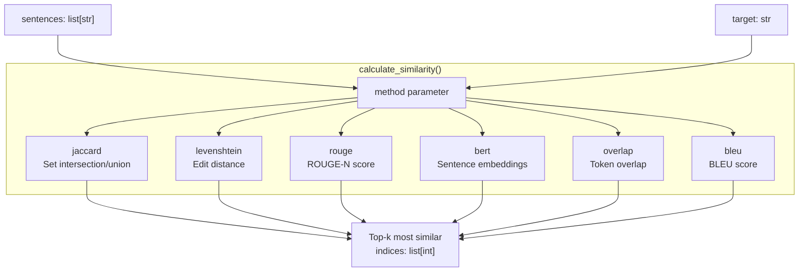

**Diagram: Similarity Calculation Methods in calculate_similarity()**

#### Similarity Method Details

| Method | Algorithm | Use Case | Dependencies |
|--------|-----------|----------|--------------|
| `jaccard` | Jaccard index of token sets | Fast lexical similarity | None (built-in) |
| `levenshtein` | Edit distance between token sequences | Spelling/structural similarity | `nltk.metrics.edit_distance` |
| `rouge` | ROUGE-N recall/precision/F1 | Summary evaluation | `rouge` library |
| `bert` | Cosine similarity of sentence embeddings | Semantic similarity | `sentence-transformers` |
| `overlap` | Token set overlap ratio | Entity matching | None (built-in) |
| `bleu` | BLEU score with smoothing | Translation/generation quality | `nltk.translate.bleu_score` |

**Function Signature:**
```python
calculate_similarity(
    sentences: list[str], 
    target: str, 
    method: str = "levenshtein", 
    n: int = 1,  # ROUGE-n parameter
    k: int = 1   # Number of top results to return
) -> list[int]  # Indices of top-k similar sentences
```

**Sources:** [minirag/utils.py:466-516]()

### Vector Similarity and Quantization

For embedding-based operations:

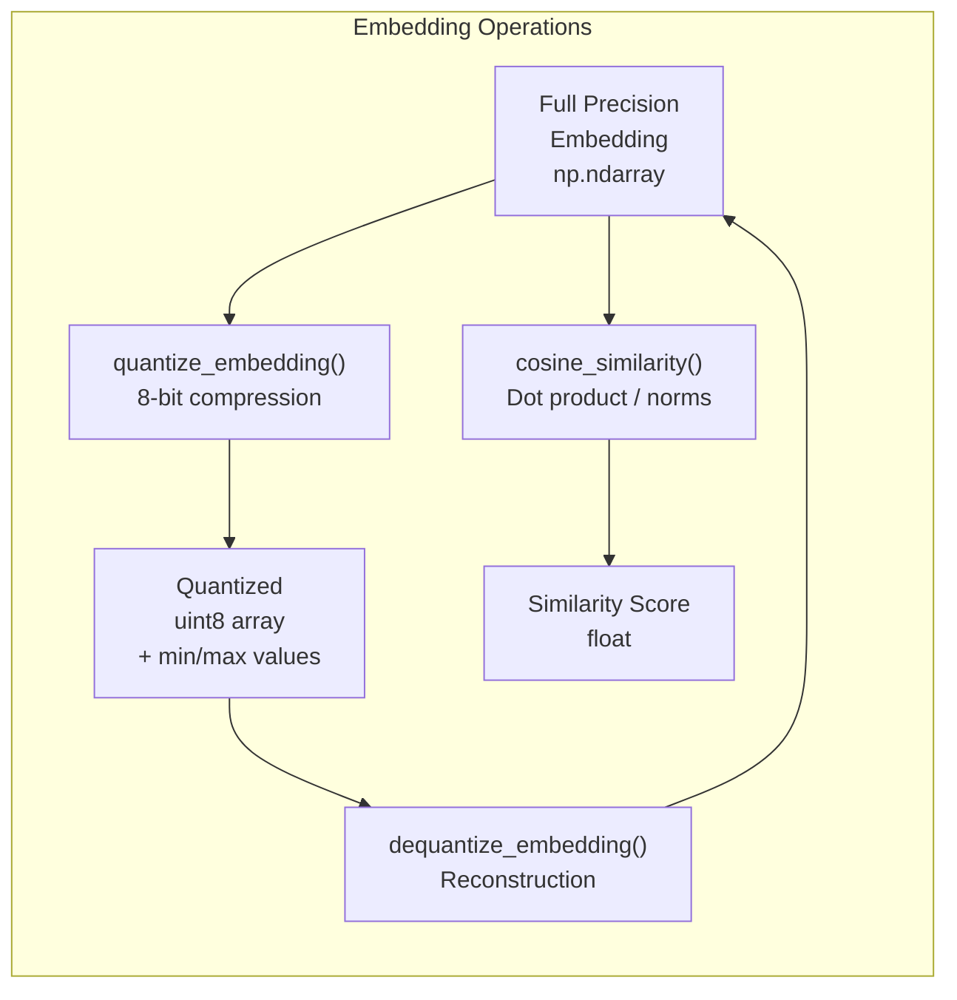

**Diagram: Embedding Quantization and Similarity**

| Function | Purpose | Parameters | Returns |
|----------|---------|------------|---------|
| `cosine_similarity` | Calculate cosine similarity | `v1, v2: np.ndarray` | `float` similarity score |
| `quantize_embedding` | Compress to 8-bit integers | `embedding, bits=8` | `(quantized, min_val, max_val)` |
| `dequantize_embedding` | Restore full precision | `quantized, min_val, max_val, bits=8` | `np.ndarray` |

Quantization reduces storage by ~75% (32-bit → 8-bit) while maintaining similarity ranking quality.

**Sources:** [minirag/utils.py:443-463]()

---

## 9.3 Graph Processing Utilities

Graph processing utilities implement algorithms for path merging, scoring, and edge voting used in topology-enhanced retrieval (see [Topology-Enhanced Retrieval](#4.2)).

### Path Merging and Tuple Operations

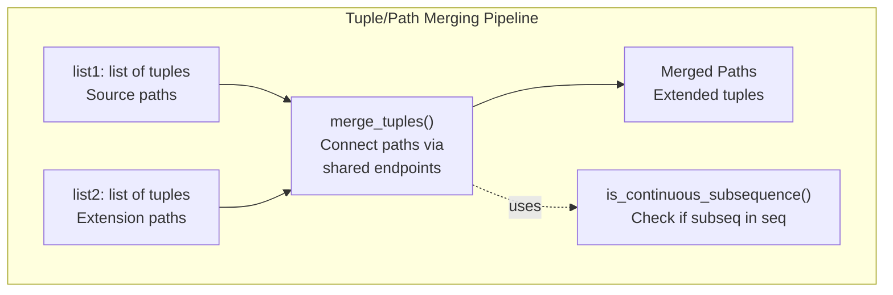

**Diagram: Path Merging Process**

| Function | Purpose | Algorithm |
|----------|---------|-----------|
| `is_continuous_subsequence` | Check if 2-element tuple appears consecutively in sequence | Finds all occurrences of first element, checks if next matches second |
| `merge_tuples` | Extend paths by connecting via shared endpoints | For each tuple, find matching tuples starting with last element, concatenate if not redundant |
| `count_elements_in_tuple` | Count matching elements between tuple and list | Sorted intersection counting |

**Example:**
- `list1 = [("A", "B", "C")]`
- `list2 = [("C", "D"), ("C", "E")]`
- Result: `[("A", "B", "C", "D"), ("A", "B", "C", "E")]`

**Sources:** [minirag/utils.py:341-401]()

### Path Scoring and Edge Voting

The scoring system ranks reasoning paths based on entity matches and edge support:

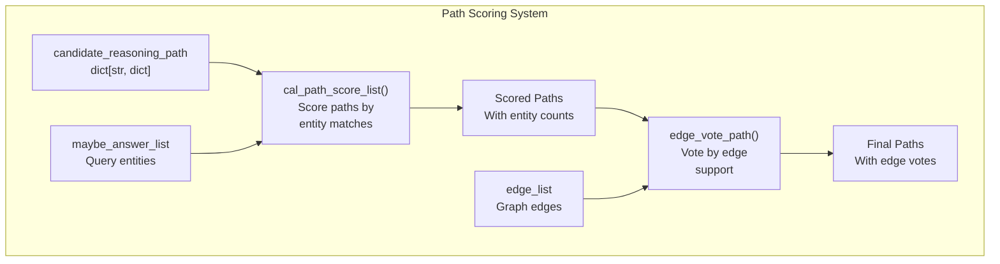

**Diagram: Path Scoring and Edge Voting Pipeline**

| Function | Purpose | Implementation |
|----------|---------|----------------|
| `cal_path_score_list` | Score paths by entity overlap | Counts how many query entities appear in each path |
| `edge_vote_path` | Vote for paths based on edge support | Counts how many graph edges support path connections |

**Data Structures:**
- Input: `candidate_reasoning_path: dict[str, {"Score": float, "Path": list[tuple]}]`
- Output: `dict[str, {"Score": float, "Path": dict[tuple, list[int]]}]` where list contains `[entity_count, edge_vote]`

These functions implement the topology-enhanced retrieval scoring mechanism that ranks reasoning paths without requiring advanced language understanding.

**Sources:** [minirag/utils.py:404-437]()

---

## Data Conversion and Serialization

### JSON Operations

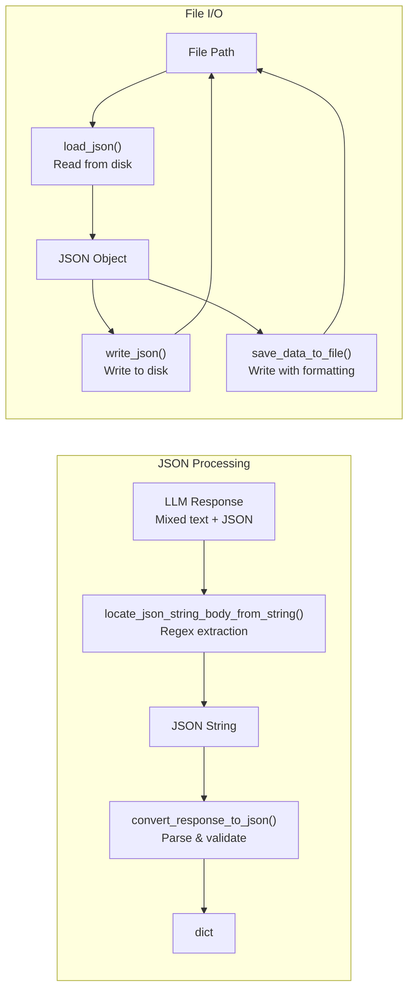

**Diagram: JSON Conversion and File I/O Functions**

| Function | Purpose | Notes |
|----------|---------|-------|
| `locate_json_string_body_from_string` | Extract JSON from mixed text | Uses regex `r"{.*}"` with DOTALL flag |
| `convert_response_to_json` | Parse LLM response to dict | Combines locate + parse, raises on error |
| `load_json` | Load JSON from file | Returns `None` if file doesn't exist |
| `write_json` | Save dict to JSON file | Uses `indent=2, ensure_ascii=False` |
| `save_data_to_file` | Alias with consistent formatting | Uses `indent=4` |

**Sources:** [minirag/utils.py:77-94](), [minirag/utils.py:129-138](), [minirag/utils.py:214-216]()

### CSV Operations

| Function | Purpose | Signature |
|----------|---------|-----------|
| `list_of_list_to_csv` | Convert 2D list to CSV string | `(data: List[List[str]]) -> str` |
| `csv_string_to_list` | Parse CSV string to 2D list | `(csv_string: str) -> List[List[str]]` |
| `process_combine_contexts` | Merge high/low level contexts | Used in context combination for queries |

The `process_combine_contexts` function [lines 310-338] is specifically designed for MiniRAG's multi-level context retrieval, merging entity-level and chunk-level contexts into a unified CSV format.

**Sources:** [minirag/utils.py:201-211](), [minirag/utils.py:310-338]()

### XML to JSON Conversion

The `xml_to_json` function [lines 219-290] supports importing graph data from GraphML format:

**Supported Schema:**
- **Nodes:** `id`, `entity_type` (d0), `description` (d1), `source_id` (d2)
- **Edges:** `source`, `target`, `weight` (d3), `description` (d4), `keywords` (d5), `source_id` (d6)

Returns: `{"nodes": [...], "edges": [...]}`

**Sources:** [minirag/utils.py:219-290]()

---

## Async Control and Decorators

### Concurrency Limiting

The `limit_async_func_call` decorator [lines 97-116] throttles async function execution:

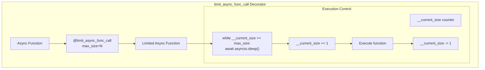

**Diagram: Async Function Concurrency Limiting**

**Parameters:**
- `max_size: int` - Maximum concurrent executions
- `waitting_time: float = 0.0001` - Sleep interval when waiting

**Usage Pattern:**
```python
@limit_async_func_call(max_size=10)
async def call_llm(prompt):
    return await llm_api(prompt)
```

This prevents overwhelming LLM APIs with too many simultaneous requests.

**Sources:** [minirag/utils.py:97-116]()

### Embedding Function Wrapper

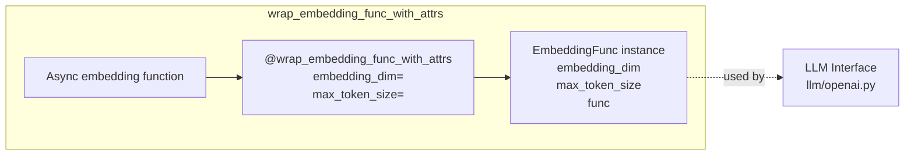

**Diagram: EmbeddingFunc Wrapper Creation**

The `EmbeddingFunc` dataclass [lines 45-52] wraps embedding functions with metadata:

| Attribute | Type | Purpose |
|-----------|------|---------|
| `embedding_dim` | `int` | Dimensionality of embeddings |
| `max_token_size` | `int` | Maximum input token length |
| `func` | `callable` | Async embedding function |

The `wrap_embedding_func_with_attrs` decorator [lines 119-126] creates these instances, enabling uniform handling of different embedding models throughout MiniRAG.

**Sources:** [minirag/utils.py:45-52](), [minirag/utils.py:119-126]()

---

## Hashing and ID Generation

### MD5-Based Identifiers

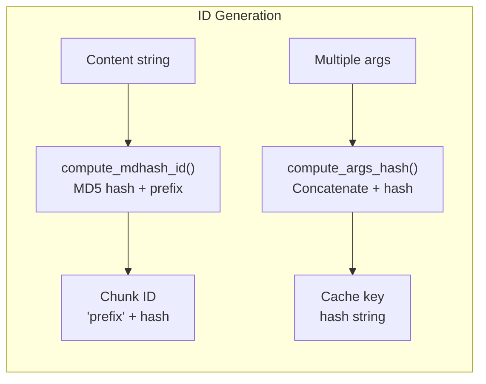

**Diagram: Hash-Based ID Generation**

| Function | Signature | Purpose |
|----------|-----------|---------|
| `compute_mdhash_id` | `(content: str, prefix: str = "") -> str` | Generate unique chunk/entity IDs |
| `compute_args_hash` | `(*args, cache_type: str \| None = None) -> str` | Generate cache keys from arguments |

Both use MD5 hashing to create deterministic, collision-resistant identifiers for content-based deduplication and caching.

**Sources:** [minirag/utils.py:55-63]()

---

## Validation Utilities

| Function | Purpose | Implementation |
|----------|---------|----------------|
| `is_float_regex` | Check if string represents a float | Regex: `^[-+]?[0-9]*\.?[0-9]+$` |

**Sources:** [minirag/utils.py:185-186]()

---

## Summary Table: Key Utility Functions by Use Case

| Use Case | Functions | Purpose |
|----------|-----------|---------|
| **Document Chunking** | `encode_string_by_tiktoken`, `truncate_list_by_token_size` | Manage token budgets |
| **Entity Extraction** | `clean_str`, `convert_response_to_json` | Clean and parse LLM outputs |
| **Similarity Search** | `calculate_similarity`, `cosine_similarity` | Rank retrieved chunks/entities |
| **Path Retrieval** | `merge_tuples`, `cal_path_score_list`, `edge_vote_path` | Score reasoning paths |
| **Context Assembly** | `process_combine_contexts`, `csv_string_to_list` | Merge multi-level contexts |
| **Deduplication** | `compute_mdhash_id` | Generate content-based IDs |
| **API Rate Limiting** | `limit_async_func_call` | Prevent API throttling |
| **Embedding Management** | `EmbeddingFunc`, `quantize_embedding` | Wrap and compress embeddings |

**Sources:** [minirag/utils.py:1-517]()

---

