<!-- source: DeepWiki mcp.deepwiki.com · repo HKUDS/MiniRAG · page 9.1 Text Processing · fetched 2026-11-09 -->

# Text Processing

<details>
<summary>Relevant source files</summary>

The following files were used as context for generating this wiki page:

- [minirag/utils.py](minirag/utils.py)

</details>


## Purpose and Scope

This document covers the text processing utilities provided by MiniRAG in [minirag/utils.py](). These utilities handle fundamental text operations required throughout the RAG pipeline, including text cleaning, tokenization, truncation, Unicode handling, and string manipulation. These functions are used extensively during document indexing and query processing phases.

For text similarity calculations, see [Similarity Calculations](#9.2). For graph-specific data processing, see [Graph Processing Utilities](#9.3).

## Overview

The text processing utilities in MiniRAG are organized into six functional categories that support the document ingestion and query pipeline:

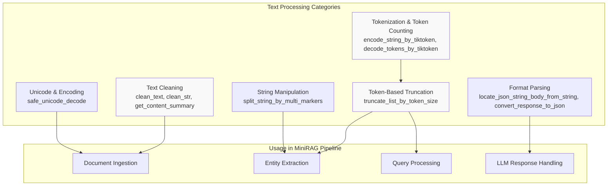

**Sources:** [minirag/utils.py:1-517]()

## Text Cleaning Functions

MiniRAG provides two levels of text cleaning to handle various input quality issues:

### Basic Cleaning: `clean_text()`

The `clean_text()` function provides lightweight cleaning for standard text inputs.

| Function | Purpose | Operations | Location |
|----------|---------|------------|----------|
| `clean_text()` | Basic text sanitization | Removes null bytes (`\x00`), strips whitespace | [minirag/utils.py:66-68]() |

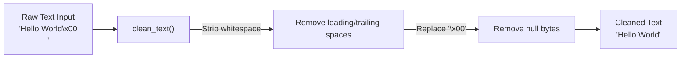

**Sources:** [minirag/utils.py:66-68]()

### Advanced Cleaning: `clean_str()`

The `clean_str()` function, adapted from Microsoft's GraphRAG implementation, provides comprehensive text sanitization:

| Feature | Implementation | Purpose |
|---------|---------------|---------|
| HTML Unescaping | `html.unescape()` | Converts HTML entities like `&amp;` to `&` |
| Control Character Removal | Regex `[\x00-\x1f\x7f-\x9f]` | Removes ASCII control characters |
| Type Safety | Returns non-strings unchanged | Handles mixed input types |

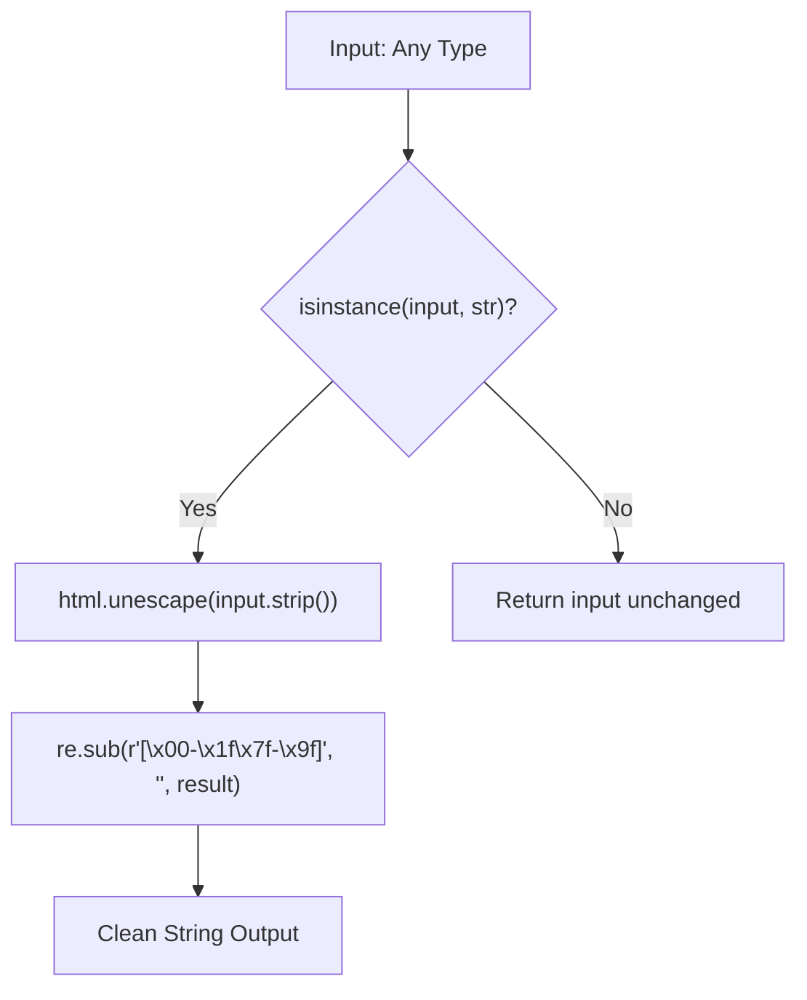

**Sources:** [minirag/utils.py:174-182]()

### Content Summarization: `get_content_summary()`

The `get_content_summary()` function truncates long text for logging and display purposes:

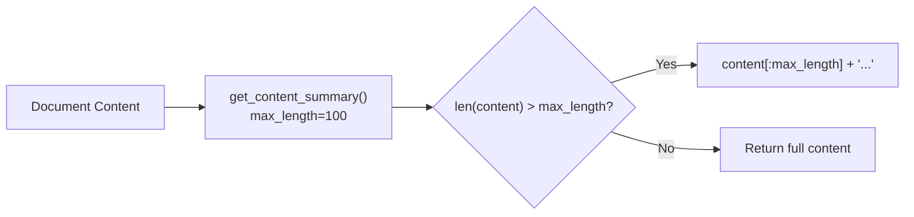

**Sources:** [minirag/utils.py:71-74]()

## Tokenization and Token Counting

MiniRAG uses the `tiktoken` library for tokenization, which is essential for managing context windows and truncating content to fit LLM token limits.

### Global Encoder Instance

The tokenization system maintains a global encoder to avoid repeated initialization overhead:

| Variable | Type | Purpose | Location |
|----------|------|---------|----------|
| `ENCODER` | `tiktoken.Encoding` | Global tokenizer instance | [minirag/utils.py:25]() |

### Tokenization Functions

```mermaid
graph TB
    subgraph "Tokenization Flow"
        Input["Text String"]
        encode_string_by_tiktoken["encode_string_by_tiktoken()<br/>default: 'gpt-4o'"]
        GlobalEncoder{"ENCODER is None?"}
        InitEncoder["ENCODER = tiktoken.encoding_for_model()"]
        Encode["tokens = ENCODER.encode(content)"]
        TokensOutput["List[int] tokens"]
        
        Input --> encode_string_by_tiktoken
        encode_string_by_tiktoken --> GlobalEncoder
        GlobalEncoder -->|"Yes"| InitEncoder
        GlobalEncoder -->|"No"| Encode
        InitEncoder --> Encode
        Encode --> TokensOutput
    end
    
    subgraph "Detokenization Flow"
        TokensInput["List[int] tokens"]
        decode_tokens_by_tiktoken["decode_tokens_by_tiktoken()<br/>default: 'gpt-4o'"]
        Decode["content = ENCODER.decode(tokens)"]
        StringOutput["Text String"]
        
        TokensInput --> decode_tokens_by_tiktoken
        decode_tokens_by_tiktoken --> Decode
        Decode --> StringOutput
    end
```

**Sources:** [minirag/utils.py:25](), [minirag/utils.py:141-154]()

### Token-Based Truncation

The `truncate_list_by_token_size()` function is critical for managing context window limits:

```python
# Function signature
def truncate_list_by_token_size(
    list_data: list, 
    key: callable, 
    max_token_size: int
) -> list
```

**Algorithm:**

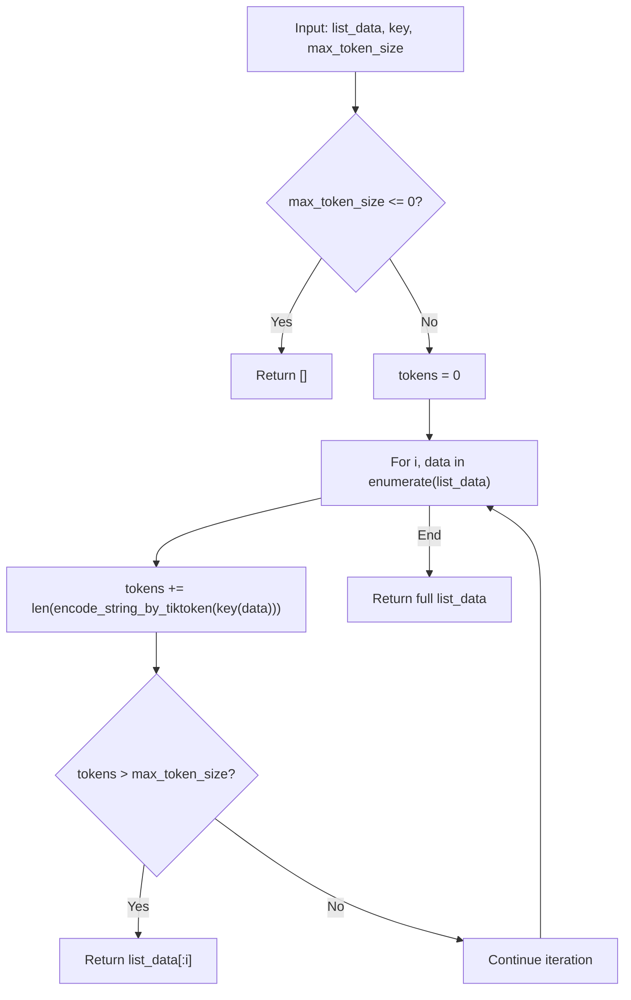

**Usage Example:** This function is commonly used to truncate retrieved context before sending to LLMs:

| Parameter | Type | Purpose |
|-----------|------|---------|
| `list_data` | `list` | List of items to truncate (e.g., text chunks) |
| `key` | `callable` | Function to extract text from each item |
| `max_token_size` | `int` | Maximum total tokens allowed |

**Sources:** [minirag/utils.py:189-198]()

## Unicode and Encoding Handling

### Unicode Escape Sequence Decoding

The `safe_unicode_decode()` function handles Unicode escape sequences commonly found in JSON or encoded text:

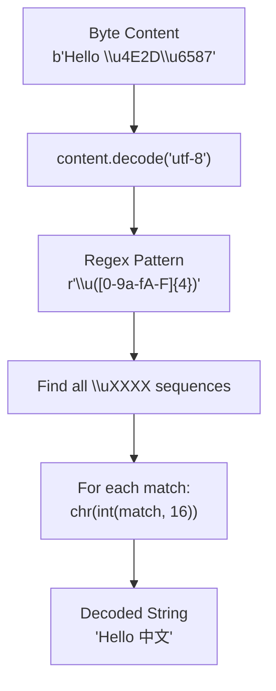

**Implementation Details:**

| Component | Implementation | Purpose |
|-----------|---------------|---------|
| Pattern | `r'\\u([0-9a-fA-F]{4})'` | Matches Unicode escape sequences |
| Replacement | `chr(int(match.group(1), 16))` | Converts hex to Unicode character |
| Input | `bytes` | Handles byte content directly |

**Sources:** [minirag/utils.py:293-307]()

## String Manipulation

### Multi-Marker String Splitting

The `split_string_by_multi_markers()` function splits text using multiple delimiters simultaneously:

```python
# Function signature
def split_string_by_multi_markers(
    content: str, 
    markers: list[str]
) -> list[str]
```

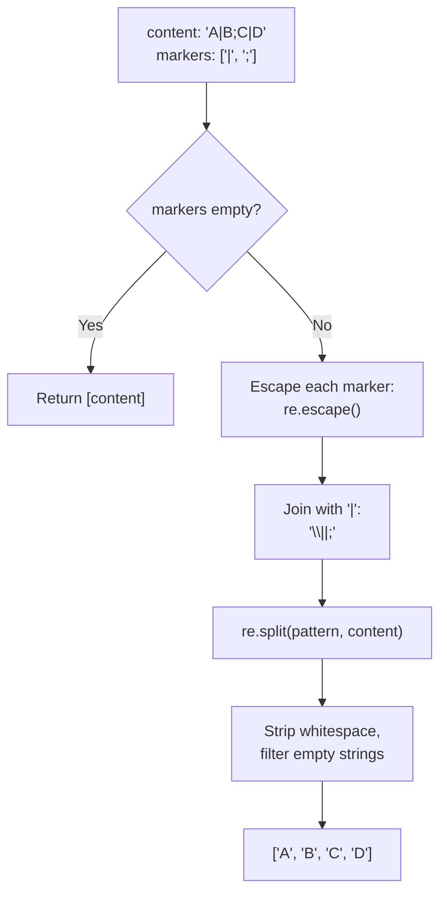

**Key Features:**
- **Regex Escaping:** Properly escapes special regex characters in markers
- **Whitespace Handling:** Strips leading/trailing whitespace from results
- **Empty Filtering:** Removes empty strings from output

**Sources:** [minirag/utils.py:164-169]()

## Format Parsing and Conversion

### JSON Extraction from Text

MiniRAG provides utilities to extract and parse JSON from LLM responses:

```mermaid
graph TB
    subgraph "JSON Extraction Pipeline"
        Response["LLM Response Text<br/>'Here is the data: {...}'"]
        locate_json_string_body_from_string["locate_json_string_body_from_string()"]
        RegexSearch["re.search(r'{.*}', content, re.DOTALL)"]
        CheckMatch{"Match found?"}
        ExtractGroup["maybe_json_str.group(0)"]
        ReturnNone["Return None"]
        JSONStr["JSON String: '{...}'"]
        
        Response --> locate_json_string_body_from_string
        locate_json_string_body_from_string --> RegexSearch
        RegexSearch --> CheckMatch
        CheckMatch -->|"Yes"| ExtractGroup
        CheckMatch -->|"No"| ReturnNone
        ExtractGroup --> JSONStr
    end
    
    subgraph "JSON Parsing"
        JSONInput["JSON String or Text"]
        convert_response_to_json["convert_response_to_json()"]
        Extract["locate_json_string_body_from_string()"]
        Assert{"JSON found?"}
        Parse["json.loads(json_str)"]
        ErrorHandle["Log error, raise JSONDecodeError"]
        DictOutput["dict"]
        
        JSONInput --> convert_response_to_json
        convert_response_to_json --> Extract
        Extract --> Assert
        Assert -->|"Yes"| Parse
        Assert -->|"No"| ErrorHandle
        Parse -->|"Success"| DictOutput
        Parse -->|"Failure"| ErrorHandle
    end
```

| Function | Returns | Error Handling | Location |
|----------|---------|----------------|----------|
| `locate_json_string_body_from_string()` | `str \| None` | Returns `None` if no JSON found | [minirag/utils.py:77-83]() |
| `convert_response_to_json()` | `dict` | Raises assertion/JSONDecodeError with logging | [minirag/utils.py:86-94]() |

**Sources:** [minirag/utils.py:77-94]()

### CSV Format Conversion

MiniRAG uses CSV format for serializing structured context data:

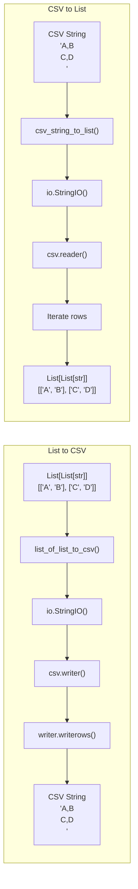

**Usage in MiniRAG:** These functions are used to serialize context data for LLM prompts and deserialize structured responses.

**Sources:** [minirag/utils.py:201-211]()

## Hash Functions for Content Identification

### MD5 Hash Generation

MiniRAG uses MD5 hashing for generating unique identifiers:

```mermaid
graph TB
    subgraph "Content Hashing: compute_mdhash_id()"
        Content["content: str"]
        Prefix["prefix: str = ''"]
        Encode["content.encode()"]
        MD5["md5(encoded)"]
        Hexdigest["hexdigest()"]
        Concat["prefix + hash"]
        Output["Hash ID: 'prefix_abc123...'"]
        
        Content --> Encode
        Prefix --> Concat
        Encode --> MD5
        MD5 --> Hexdigest
        Hexdigest --> Concat
        Concat --> Output
    end
    
    subgraph "Argument Hashing: compute_args_hash()"
        Args["*args"]
        CacheType["cache_type: str | None"]
        JoinArgs["''.join([str(arg) for arg in args])"]
        CheckType{"cache_type provided?"}
        AddType["f'{cache_type}:{args_str}'"]
        NoType["args_str"]
        EncodeMD5["md5(args_str.encode())"]
        HashOutput["Hash: 'def456...'"]
        
        Args --> JoinArgs
        CacheType --> CheckType
        JoinArgs --> CheckType
        CheckType -->|"Yes"| AddType
        CheckType -->|"No"| NoType
        AddType --> EncodeMD5
        NoType --> EncodeMD5
        EncodeMD5 --> HashOutput
    end
```

| Function | Parameters | Purpose | Usage |
|----------|-----------|---------|-------|
| `compute_mdhash_id()` | `content: str, prefix: str` | Generate prefixed content hash | Document IDs, chunk IDs |
| `compute_args_hash()` | `*args, cache_type: str \| None` | Generate hash from multiple arguments | Cache keys, deduplication |

**Sources:** [minirag/utils.py:55-63]()

## Integration with MiniRAG Pipeline

The text processing utilities integrate throughout the MiniRAG system:

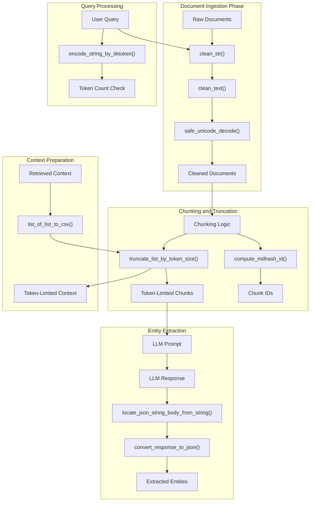

**Sources:** [minirag/utils.py:1-517]()

## Summary Table of Text Processing Functions

| Category | Function | Input | Output | Primary Use Case |
|----------|----------|-------|--------|------------------|
| **Cleaning** | `clean_text()` | `str` | `str` | Remove null bytes and whitespace |
| | `clean_str()` | `Any` | `str` | Remove HTML entities and control chars |
| | `get_content_summary()` | `str, int` | `str` | Truncate for display |
| **Tokenization** | `encode_string_by_tiktoken()` | `str, str` | `list[int]` | Count tokens, encode text |
| | `decode_tokens_by_tiktoken()` | `list[int], str` | `str` | Decode tokens to text |
| **Truncation** | `truncate_list_by_token_size()` | `list, callable, int` | `list` | Limit context by token count |
| **Unicode** | `safe_unicode_decode()` | `bytes` | `str` | Decode Unicode escapes |
| **String Ops** | `split_string_by_multi_markers()` | `str, list[str]` | `list[str]` | Split by multiple delimiters |
| **Parsing** | `locate_json_string_body_from_string()` | `str` | `str \| None` | Extract JSON from text |
| | `convert_response_to_json()` | `str` | `dict` | Parse JSON from LLM response |
| **CSV** | `list_of_list_to_csv()` | `List[List[str]]` | `str` | Serialize to CSV format |
| | `csv_string_to_list()` | `str` | `List[List[str]]` | Parse CSV to list |
| **Hashing** | `compute_mdhash_id()` | `str, str` | `str` | Generate content hash ID |
| | `compute_args_hash()` | `*args, str \| None` | `str` | Generate argument hash |

**Sources:** [minirag/utils.py:1-517]()

---

