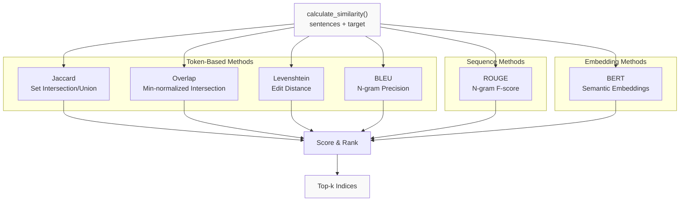
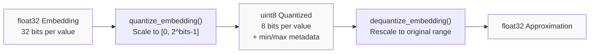
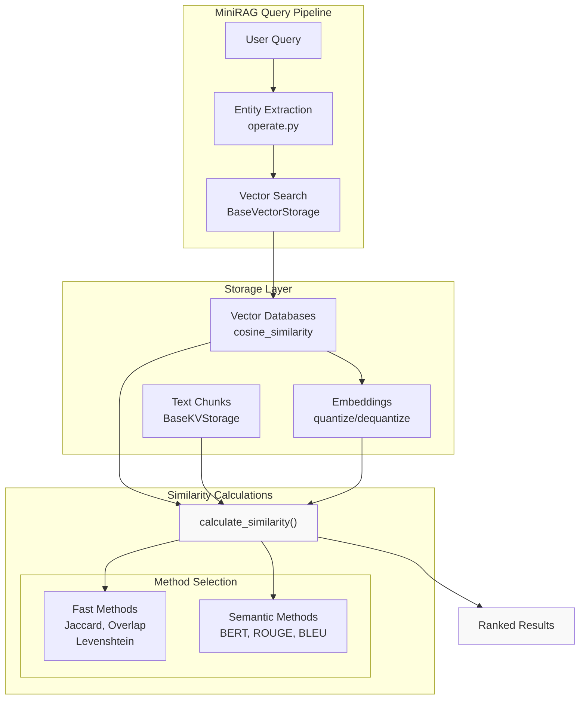
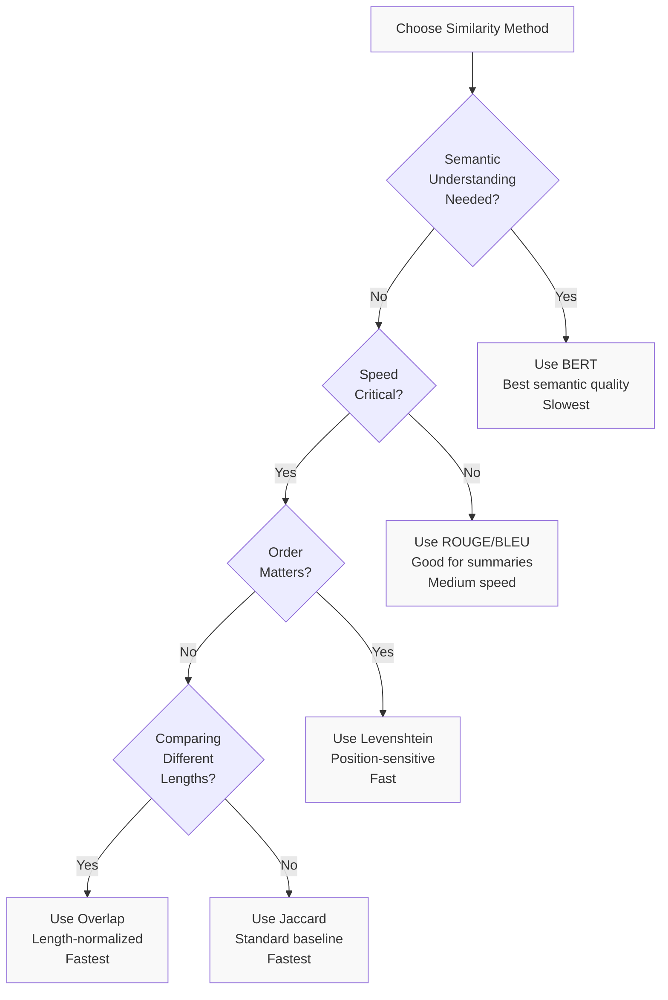

<!-- source: DeepWiki mcp.deepwiki.com · repo HKUDS/MiniRAG · page 9.2 Similarity Calculations · fetched 2026-11-09 -->

# Similarity Calculations

<details>
<summary>Relevant source files</summary>

The following files were used as context for generating this wiki page:

- [minirag/utils.py](minirag/utils.py)

</details>


This page documents the text similarity calculation utilities provided in [minirag/utils.py:466-517](). These functions enable MiniRAG to compare and rank text passages based on various similarity metrics. The primary use case is selecting the most relevant sentences or chunks when processing queries or performing entity matching.

For information about graph-specific path scoring and ranking utilities, see [Graph Processing Utilities](#9.3). For text preprocessing operations before similarity calculation, see [Text Processing](#9.1).

## Overview

The similarity calculation module provides six distinct similarity measurement methods, each with different characteristics and computational requirements. The main entry point is the `calculate_similarity` function, which returns the indices of the top-k most similar sentences to a target text.

**Sources:** [minirag/utils.py:466-517]()

## Function Signature and Parameters

```python
calculate_similarity(sentences, target, method="levenshtein", n=1, k=1)
```

| Parameter | Type | Default | Description |
|-----------|------|---------|-------------|
| `sentences` | List[str] | Required | List of candidate sentences to compare against target |
| `target` | str | Required | Reference text to measure similarity against |
| `method` | str | `"levenshtein"` | Similarity algorithm: `"jaccard"`, `"levenshtein"`, `"rouge"`, `"bert"`, `"overlap"`, or `"bleu"` |
| `n` | int | 1 | ROUGE-n gram size (only used when method=`"rouge"`) |
| `k` | int | 1 | Number of top-k most similar sentence indices to return |

**Returns:** `List[int]` - Indices of the k most similar sentences, sorted by similarity score (highest first)

**Sources:** [minirag/utils.py:466-467]()

## Similarity Methods

### Method Comparison Flow



**Sources:** [minirag/utils.py:469-514]()

### Jaccard Similarity

Measures overlap between token sets using the Jaccard coefficient: |A ∩ B| / |A ∪ B|

**Implementation:** [minirag/utils.py:469-475]()

```python
# Tokenizes to lowercase words
sentence_tokens = sentence.lower().split()
target_tokens = target.lower().split()
# Computes set intersection and union
intersection = set(sentence_tokens).intersection(set(target_tokens))
union = set(sentence_tokens).union(set(target_tokens))
jaccard_score = len(intersection) / len(union) if union else 0
```

**Characteristics:**
- Fast computation (O(n) where n is number of tokens)
- Order-independent
- Good for keyword matching
- Range: [0, 1]

**Sources:** [minirag/utils.py:469-475]()

### Levenshtein Distance

Computes normalized edit distance between token sequences. Measures the minimum number of single-token edits (insertions, deletions, substitutions) required to transform one sequence into another.

**Implementation:** [minirag/utils.py:476-481]()

```python
# Uses nltk.metrics.edit_distance
distance = edit_distance(target_tokens, sentence.lower().split())
# Normalizes by maximum sequence length
similarity = 1 - (distance / max(len(target_tokens), len(sentence.split())))
```

**Characteristics:**
- Order-sensitive
- Accounts for token position differences
- Normalized to [0, 1] range
- Moderate computational cost (O(mn) dynamic programming)

**Dependencies:** `nltk.metrics.edit_distance` [minirag/utils.py:17]()

**Sources:** [minirag/utils.py:476-481]()

### ROUGE Score

Uses ROUGE (Recall-Oriented Understudy for Gisting Evaluation) to measure n-gram overlap with F-score weighting.

**Implementation:** [minirag/utils.py:482-487]()

```python
from rouge import Rouge
rouge = Rouge()
scores = rouge.get_scores(sentence, target)
rouge_score = scores[0].get(f"rouge-{n}", {}).get("f", 0)
```

**Characteristics:**
- Designed for summarization evaluation
- Balances precision and recall via F-score
- Configurable n-gram size (typically n=1 or n=2)
- Range: [0, 1]

**Dependencies:** `rouge.Rouge` [minirag/utils.py:18]()

**Sources:** [minirag/utils.py:482-487]()

### BERT Embeddings

Computes semantic similarity using pre-trained sentence embeddings from the `sentence-transformers` library.

**Implementation:** [minirag/utils.py:489-495]()

```python
from sentence_transformers import SentenceTransformer
model = SentenceTransformer('all-MiniLM-L6-v2')
# Encode all sentences plus target
embeddings = model.encode(sentences + [target])
target_vec = embeddings[-1]
# Compute cosine similarity
similarity = np.dot(embeddings[i], target_vec) / 
             (np.linalg.norm(embeddings[i]) * np.linalg.norm(target_vec))
```

**Characteristics:**
- Captures semantic meaning beyond lexical overlap
- Best for paraphrase detection
- Highest computational cost (neural network inference)
- Model: `all-MiniLM-L6-v2` (produces 384-dimensional embeddings)
- Range: [-1, 1], typically [0, 1] for similar sentences

**Dependencies:** `sentence_transformers.SentenceTransformer` [minirag/utils.py:20]()

**Sources:** [minirag/utils.py:489-495]()

### Overlap Coefficient

Measures the ratio of common tokens to the size of the smaller set. This is particularly useful when comparing texts of significantly different lengths.

**Implementation:** [minirag/utils.py:497-502]()

```python
sentence_tokens = set(sentence.lower().split())
overlap = sentence_tokens.intersection(set(target_tokens))
score = len(overlap) / min(len(sentence_tokens), len(target_tokens))
```

**Characteristics:**
- Normalizes by smaller set (more lenient than Jaccard)
- Good for subset matching
- Fast computation (O(n))
- Range: [0, 1]

**Sources:** [minirag/utils.py:497-502]()

### BLEU Score

Uses BLEU (Bilingual Evaluation Understudy) to measure n-gram precision with length penalty. Originally designed for machine translation evaluation.

**Implementation:** [minirag/utils.py:504-510]()

```python
from nltk.translate.bleu_score import sentence_bleu, SmoothingFunction
smooth_fn = SmoothingFunction().method1
target_tokens_bleu = word_tokenize(target.lower())
sentence_tokens_bleu = word_tokenize(sentence.lower())
score = sentence_bleu([target_tokens_bleu], sentence_tokens_bleu, 
                      smoothing_function=smooth_fn)
```

**Characteristics:**
- Precision-oriented (rewards matching n-grams)
- Uses smoothing to handle zero counts
- Considers multiple n-gram sizes (1-4 grams by default)
- Range: [0, 1]

**Dependencies:** `nltk.translate.bleu_score`, `nltk.tokenize.word_tokenize` [minirag/utils.py:19,22]()

**Sources:** [minirag/utils.py:504-510]()

## Vector Similarity Utilities

The module also provides lower-level vector operations used by embedding-based methods and throughout MiniRAG's vector storage operations.

### cosine_similarity Function

Computes the cosine similarity between two numpy arrays, representing the cosine of the angle between vectors in n-dimensional space.

**Implementation:** [minirag/utils.py:443-447]()

```python
def cosine_similarity(v1, v2):
    dot_product = np.dot(v1, v2)
    norm1 = np.linalg.norm(v1)
    norm2 = np.linalg.norm(v2)
    return dot_product / (norm1 * norm2)
```

**Formula:** `cos(θ) = (v1 · v2) / (||v1|| × ||v2||)`

**Range:** [-1, 1] where:
- 1 = identical direction
- 0 = orthogonal (no similarity)
- -1 = opposite direction

**Sources:** [minirag/utils.py:443-447]()

### Embedding Quantization

Reduces memory footprint of embeddings by converting float32 values to lower-bit representations.



**Sources:** [minirag/utils.py:450-463]()

#### quantize_embedding

**Implementation:** [minirag/utils.py:450-456]()

```python
def quantize_embedding(embedding: np.ndarray | list[float], bits: int = 8):
    embedding = np.array(embedding)
    min_val = embedding.min()
    max_val = embedding.max()
    scale = (2**bits - 1) / (max_val - min_val)
    quantized = np.round((embedding - min_val) * scale).astype(np.uint8)
    return quantized, min_val, max_val
```

**Parameters:**
- `embedding`: Original float embedding vector
- `bits`: Quantization bit depth (default: 8)

**Returns:** `(quantized, min_val, max_val)` tuple

**Storage Reduction:** 75% reduction (32 bits → 8 bits per dimension)

**Sources:** [minirag/utils.py:450-456]()

#### dequantize_embedding

**Implementation:** [minirag/utils.py:459-463]()

```python
def dequantize_embedding(quantized: np.ndarray, min_val: float, 
                        max_val: float, bits=8) -> np.ndarray:
    scale = (max_val - min_val) / (2**bits - 1)
    return (quantized * scale + min_val).astype(np.float32)
```

**Parameters:**
- `quantized`: Quantized uint8 array
- `min_val`: Original minimum value
- `max_val`: Original maximum value
- `bits`: Quantization bit depth

**Returns:** `np.ndarray` - Reconstructed float32 embedding

**Sources:** [minirag/utils.py:459-463]()

## Integration with MiniRAG System



**Sources:** [minirag/utils.py:443-517](), [minirag/operate.py](), [minirag/storage/base.py]()

### Usage Contexts

| Context | Typical Method | Rationale |
|---------|---------------|-----------|
| Entity name matching | `overlap` or `jaccard` | Fast, handles partial matches |
| Chunk retrieval ranking | `levenshtein` | Balances speed and accuracy |
| Semantic query expansion | `bert` | Captures meaning beyond keywords |
| Answer evaluation | `rouge` or `bleu` | Standard metrics for generation quality |
| Duplicate detection | `jaccard` | Fast, order-independent |

**Sources:** [minirag/utils.py:466-517]()

## Method Selection Guidelines



**Sources:** [minirag/utils.py:466-517]()

## Example Usage

### Basic Similarity Calculation

```python
from minirag.utils import calculate_similarity

sentences = [
    "The cat sat on the mat",
    "A feline rested on the rug",
    "Dogs are great pets",
    "The mat had a cat on it"
]

target = "cat sitting on mat"

# Get top 2 most similar using Levenshtein
indices = calculate_similarity(sentences, target, method="levenshtein", k=2)
# Returns: [0, 3] - indices of most similar sentences

# Use BERT for semantic similarity
semantic_indices = calculate_similarity(sentences, target, method="bert", k=2)
# Returns: [1, 0] - "feline" and "rug" semantically similar

# Fast keyword matching
keyword_indices = calculate_similarity(sentences, target, method="jaccard", k=2)
# Returns: [0, 3] - exact word overlap
```

**Sources:** [minirag/utils.py:466-517]()

### Vector Operations

```python
from minirag.utils import cosine_similarity, quantize_embedding, dequantize_embedding
import numpy as np

# Compute cosine similarity
v1 = np.array([1.0, 2.0, 3.0])
v2 = np.array([2.0, 4.0, 6.0])
similarity = cosine_similarity(v1, v2)  # Returns: 1.0 (parallel vectors)

# Quantize embeddings for storage
embedding = np.random.randn(384)  # Typical BERT embedding
quantized, min_val, max_val = quantize_embedding(embedding, bits=8)
# quantized is uint8, 75% smaller

# Restore for computation
restored = dequantize_embedding(quantized, min_val, max_val, bits=8)
# Small approximation error, significant space savings
```

**Sources:** [minirag/utils.py:443-463]()

## Performance Characteristics

| Method | Time Complexity | Space | Semantic Quality | Best Use Case |
|--------|----------------|-------|------------------|---------------|
| Jaccard | O(n) | O(n) | Low | Keyword matching |
| Overlap | O(n) | O(n) | Low | Subset detection |
| Levenshtein | O(mn) | O(mn) | Medium | Sequence comparison |
| ROUGE | O(n) | O(n) | Medium | Summary evaluation |
| BLEU | O(n) | O(n) | Medium | Translation quality |
| BERT | O(batch×d²) | O(d) | High | Semantic similarity |

**Legend:**
- n, m = sequence lengths
- d = embedding dimension (typically 384)
- batch = number of sentences

**Sources:** [minirag/utils.py:466-517]()

## Error Handling

The `calculate_similarity` function raises a `ValueError` if an unsupported method is specified:

```python
try:
    indices = calculate_similarity(sentences, target, method="unknown")
except ValueError as e:
    # "Unsupported method. Choose from 'jaccard', 'levenshtein', 
    # 'rouge', 'bert', 'overlap', or 'bleu'."
    print(e)
```

**Sources:** [minirag/utils.py:514]()

## Dependencies

The following external libraries are required for full functionality:

| Library | Purpose | Required For |
|---------|---------|--------------|
| `nltk` | Edit distance, BLEU, tokenization | Levenshtein, BLEU methods |
| `rouge` | ROUGE score computation | ROUGE method |
| `sentence-transformers` | Pre-trained BERT models | BERT method |
| `scikit-learn` | TF-IDF vectorization (imported but unused) | - |
| `numpy` | Vector operations | All embedding operations |

**Sources:** [minirag/utils.py:16-23]()

---

